2026年最新考据发现：清代古籍《石头记》卷首语明确写出了曹雪芹的真名由林和金构成！算是新的重大考据发现吗？（40个铁证汇总。2026年5月22日补充黛玉李纨等 4幅人物绣像）

__前言：本文持续深挖中国国宝级大艺术家八大山人朱统quan（写为上林下金、朱元璋十世孙）与《红楼梦》的关联线索，期待与各位高人同好共同揭开《红楼梦》真正作者之谜。__

__2026年5月8日更新：补贴一张让我泪目的《镇楼图》__（详解作为第40个铁证在本楼最后）。

__索隐派宝宝们请看清代古籍《石头记》里宝玉胸前佩戴的通灵宝玉到底什么？！↓__

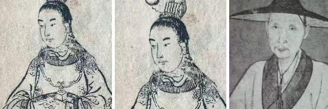

送给所有索隐派宝宝们的镇楼图

__【考据证据之一：清代竹纸古籍里直接写了《红楼梦》作者名字上下由林和金构成】__

最近无意中在朋友家看到一册清代竹纸石印古籍《增评补图石头记》，用蝇头小楷写的。征得朋友同意，他同意我贴出来与大家分享。

卷首“明斋主人总评”里有一行字，竟然明明白白地告诉了读者《石头记》作者的本名：__公子之名的上下两部分是由“林”和“金”构成的。__——这个字岂不就是【quan（上林下金）】字？（上林下金是生僻字，发音为quan、四声）

从明末到清朝结束的近300年间，除了朱元璋十世孙八大山人朱统quan（上林下金），试问还有哪位文人的名字的上下两部分是由“林”和“金”构成的？！

清代竹纸古籍《石头记》的原文如下：

__“公子之名，上一字与薛家同。下一字与与林家同。自己日趣于下。父母必欲其向上。泊呼飘然远去。则又不上不下。”__↓

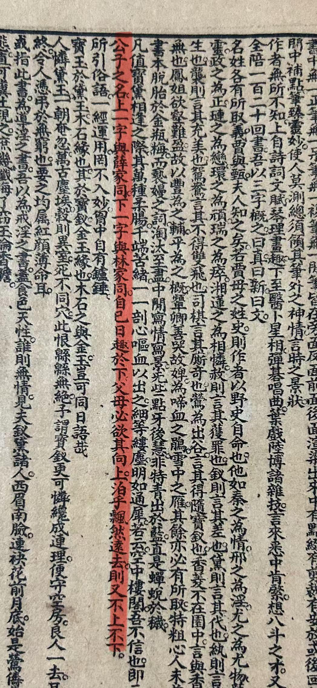

清代竹纸古籍《石头记》明确写了曹雪芹的本名上下由“金”字和“林”字构成

__“公子之名，上一字与薛家同。下一字与与林家同。自己日趣于下。父母必欲其向上。泊呼飘然远去。则又不上不下。”__

__翻译其意思就是：__

__公子（就是经历了一番梦幻，把自己的经历记录下来的公子贾宝玉，即作者）的名字，上面是金字（与薛家同），下面是林字（与林家同）。__

__公子（作者）每日以“林”为趣、怡然自得，沉浸在怀念明王朝的金陵美梦中。__

__父母当初为儿子取名含“金”字，是希望儿子将来能金榜题名：明亡前八大山人曾主动放弃世袭爵位\(奉国中尉 \)参加科举中了秀才。同时，这个“金偏旁来自父母之意”还有另一层意思：这是太祖皇帝朱元璋定下的取名法则，不可违背。__

公子（作者自己）喜欢林而厌恶金，这个说法和给大观园里的怡红院命名时提到的“怡红快绿”保持一致。

__现在大明亡了、曾对自己寄予厚望的父母也离世了、一切都飘然远去了，唯留下自己一个人成了“既非林、亦非金”的“情不情公子“——身在清、怀念明的亦僧亦道、非僧非道之人。__

注意：作者（批书人）可能故意把林和金上下颠倒来写，否则太明显了，别忘了这是文字狱时代。也有可能原稿是上林下金，是后世 出版商为了避免过于明显而自己上下颠倒为上金下林。

《红楼梦》一个字都不能改、一个字都非闲笔。批书人明斋主人（作者自己）专门写了这段话说明公子贾宝玉的真名，会是闲笔么？根本不会是闲笔！作者是借机“夹带私货”，期待能解作者辛酸泪的聪明读者能“巨眼”解谜。

__需补充说明：__

这套带绘图和用另一个角度进行点评的《石头记》，虽然是后世道光年间（之后光绪年间和民国也有出版）被人冠以他人名字出版的，但仔细阅读和研究后能发现：和脂砚斋、畸笏叟、栖霞客、松斋等批书人一样，这套带图增评的《石头记》版本（绣像和绘图均是大画家八大山人自己所画），其中的批书人“蛟川大某山民”、“东洞庭护花主人”、“明斋主人”、“太平闲人”也都是作者曹雪芹八大山人本人的马甲小号。

我们可忽略道光年间顶着这些批书人名头的王希廉、姚燮、张新之等名，这是后世文人为了在皇家官方允许范围内（代表皇家的书商高鹗程伟元说了“曹雪芹是谁无法确认”）出版“悼红轩原本”的带图增评版本后做出的符合逻辑常识的冒名顶替，换做是我，我也会做出同样选择。

蛟川大某山民：“大某山民”明显是由“八大山人”之名演化，指向和暗示强烈。蛟川——青云圃道院（大观园）的传说里就有河里杀蛟的传说。

东洞庭护花主人：江西在洞庭湖的东边，“护花主人”好理解，作者贾宝玉不是护花主人谁是？

太平闲人：贾宝玉在书中被调侃为富贵闲人，依此类推。现在是太平盛世么？就像求生欲满满的作者一再强调如今是太平之年，可是真的是么？不是“假语村言”么？

明斋主人：就不用解释了吧。

明朝遗民的文人圈子一直秘密保存着八大山人的“悼红轩原本”的原稿，道光年间的文人为了出版，就冠以其他人批书人的名字出版了。之后还有各种版本（插图的区别比较大，仿图版本占绝大多数）。王希廉、姚燮、张新之这些批书人，不一定是出版商沽名钓誉故意假冒，我的理解是曹雪芹的真爱粉铁杆拥趸为了出版的生存策略。

而且为了能出版，《增评补图石头记》等带绘图的三家评本（各时期和不同出版商书名各有不同），是以120回程高本为基础来评的。所以聪明的读者一定要有“巨眼”，要甄别哪些批语是作者本人（大某山民、护花主人、太平闲人、明斋主人）原汁原味的，哪些批语是为了契合120回本不得已由后人模仿作者口吻添加的。

清代竹纸古籍《曾评补图石头记》明确写了曹雪芹的本名上下由“金”字和“林”字构成↓

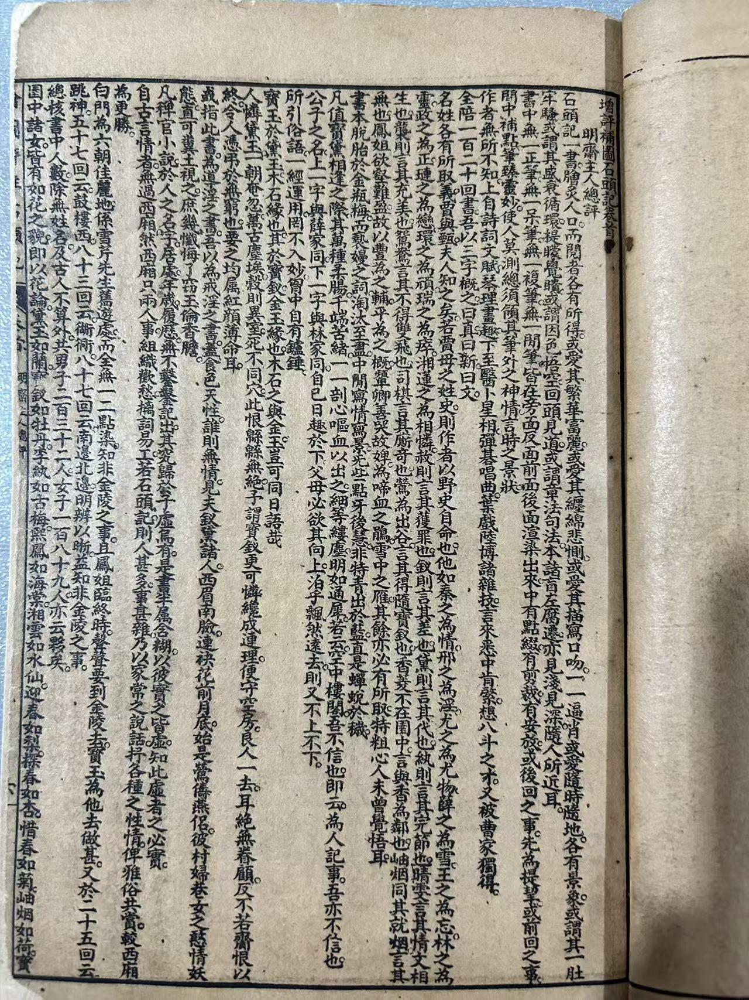

清代竹纸古籍《曾评补图石头记》卷首

==========

明太祖朱元璋给儿子们封王的同时，颁赐了谱系字辈名录。宗室子孙谱名由两个字构成，朱元璋为王子各支拟定了世系二十个字，取名时依次用作谱名的第一个字。普名的第二个字，选用五行“木、火、土、金、水”旁的字，由礼部择字命名，五世一轮换。

八大山人的真名朱统quan（上林下金）遵循了这个原则：普名第一个字是统字辈，第二字轮到五行的金偏旁。八大山人的祖父朱多炡是火偏旁，父亲朱谋x是土偏旁，也是生僻字，我看过几种不同写法，土偏旁才对。

祖父开始的子孙三代是“火土金”，轮到八大山人是金偏旁。因为是远宗，现成的字轮不到他，所以他的“quan（上林下金）”是新造的生僻字（目前电脑手机用拼音输入法打不出来）。

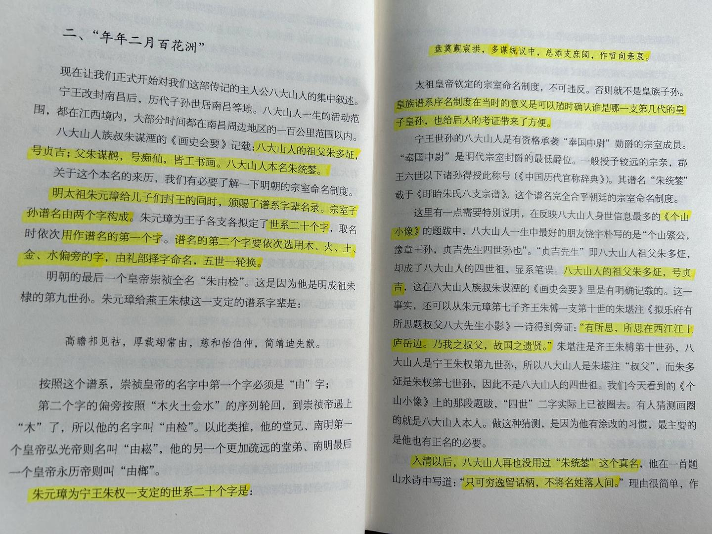

照片选自陈世旭著《孤独的绝唱ー八大山人传》

==========

针对评论区一些观点，统一在正文里回复：

__1、“公子之名”并非指“宝玉”__

理由：薛家并不代表“宝”；林家也不代表“玉”。

__2、“公子之名”并非指“雪芹”__

理由：

薛家=雪、金、清、水、虫。如果要取“雪”字，解释不了下一句：“父母必欲其向上”。作者父母对他的期冀是“雪”？啥意思呢？解释不了。

另外，林家是木、是林，不是草字头。《红楼梦》里贾蓉、贾蔷这些反面人物都是草字头；描写薛宝钗的蘅芜苑时详细写了没有树木，只有一些藤藤蔓蔓的异草，而且批书人直接批薛宝钗是奸险之人。可见，公子自己“趣之”的“林家”是林、绝对不可能是草字头，那自然不是“芹”。

最后，借鉴一位乎友的解释：“爱新觉罗”是根据满语音译，翻译成汉语是“金族”的意思。

====================

强烈推荐大家看知乎这篇介绍宁王朱权的文章，读完后就能明白到底是什么样的世代簪缨、琴棋书画和戏曲音律传家、并有著书立说家风的的王府贵族子孙在遭逢国破家亡的人生巨变后能写出《红楼梦》这样囊括了百科全书的作品。

曹雪芹的先祖宁王朱权能解释何为“集百科全书和儒释道为一身”。特别是：从大戏剧家朱权身上能理解为何曹雪芹能创作戏剧戏曲。

[宁王朱权：半生幽愤半生藏｜历史人物](https://zhuanlan.zhihu.com/p/1910973050570146131?share_code=1gN4fcHoBk041&utm_psn=2025198339667314358)

__<关于清代古籍上对“公子之名”的考据发现分析到此结束。下文会陆续补充一些我的其他考据发现，持续更新中。不愿意阅读长文的网友可以忽略之后的内容。>__

__===================__

__关于“八大山人=曹雪芹“，我已经找到大约三十个庞大的证据线索。__

因本文阅读者较多，我将我数月来利用业余时间考据出来的成果一并贴出，与各位高人雅士共享。篇幅有限，本文仅罗列几个重要的考据发现（持续更新中）。也欢迎大家提供各自的研究发现。

__【20260407更新 考据证据之二：使用“合文”书写法在画作上直接签署“曹雪芹”三个字】__

__八大山人用中国固有的“合文“书写方法造字，把“曹雪芹”三个字合写成一个字，签署在晚年的很多画作之上。__

__我们看到八大山人在画作上将“曹雪芹”三个字写成一个字，不是“脑洞大开”和“过度解读”，这也是一个我们现代人不知道的“知识点”：所谓“合文”是把两个或两个以上的字写成一个字的形状。这种办法，远在甲骨文里就已经存在。__

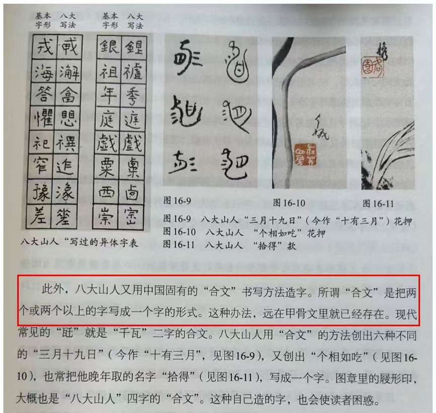

八大山人擅长“合文”书写法并经常使用

有的网友可能会说我解读出的“曹雪芹三个字写成一个字”的这个字是“冩”（写）字，但可以大量对比大八大山人签署“冩”字的其他画作，两个字明显不同，显然八大山人就是在用“合文”书写法留线索。（篇幅有限，本文里不展示明显看出是“冩”字的对比画作）

出现在八大山人晚年某些画作上的“曹雪芹”这个“合文字”，或许脱胎于“冩”字，但它一定就是__“善于设谜、又留下线索、期待读者能解”__的八大山人最精通、最常用的“合文”书写法。

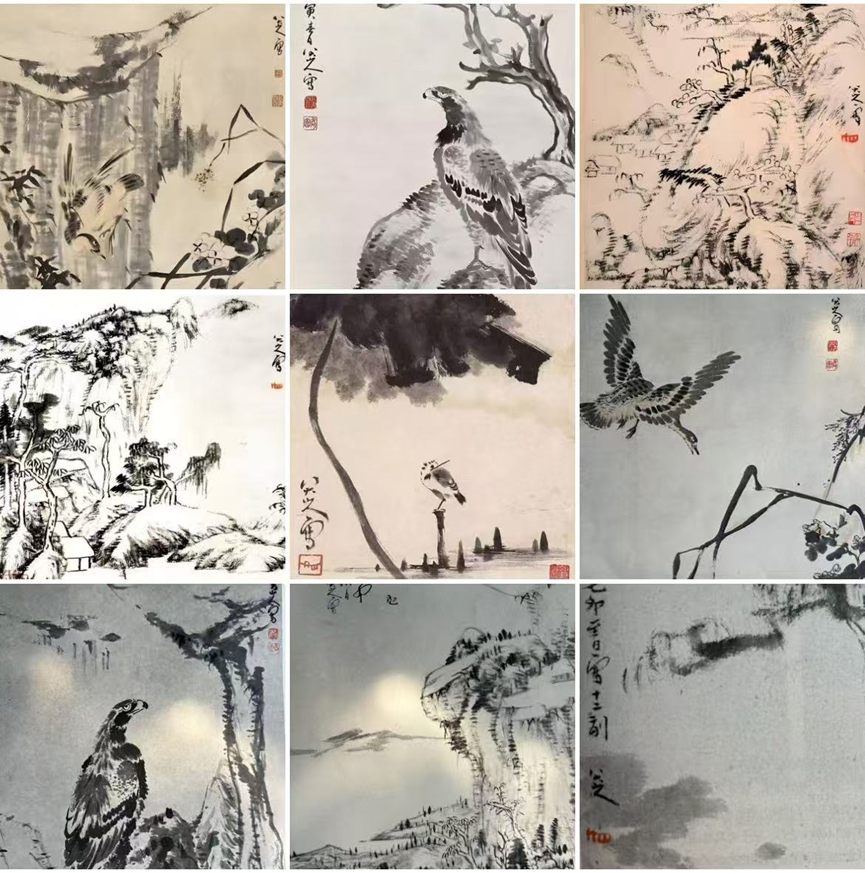

八大山人用“合文”书写法直接在画作上将“曹雪芹”三个字写成一个字

补充一个值得深思的问题：

__阅读《红楼梦》，所有人都能感知到：曹雪芹一定擅长绘画。__

我在大量阅读与曹雪芹（胡适说的那个曹家包衣）有关的资料时，看到某本书写到：__有一位民国人（祖上是清朝高官贵胄）说自己家里曾藏有大量曹雪芹的画作，后来这些画作被带去日本了。__

__请大家思考：现在可曾在哪里听说有曹雪芹（包衣曹）的画作？与此同时，为什么有大量的八大山人的真迹画作被收藏保存在日本和美国？__

__我的答案是：以前某些清朝高官贵胄的后人们说的“自己家中曾藏有大量曹雪芹画作、后来被带去日本了”，就是八大山人用合文书写法把“曹雪芹”三个字签署在画作上的画。__

===================

__【20260418更新 考据证据之三：弋阳荣王府的“阆园”与《红楼梦》“阆苑仙葩”的巧合】__

八大山人家祖上是宁藩__宁王府__、__弋阳荣庄王府__：巧了，正好对应《红楼梦》里宁、荣二府的设定。

八大山人家弋阳荣庄王府里曾有园子叫__“阆园”__：__“阆园”即“阆苑”__，正好与《红楼梦》第五回的红楼梦十二曲《枉凝眉》唱词中的“一个是__阆苑__仙葩”巧合般的一致。

此处还有第二个巧合般的雷同：八大山人家原先的府邸阆园后来被一个叫__李明睿__的人获得，而《红楼梦》里最终继承了贾宝玉（作者）的家贾府的人也是__姓李之人__李纨和贾兰。

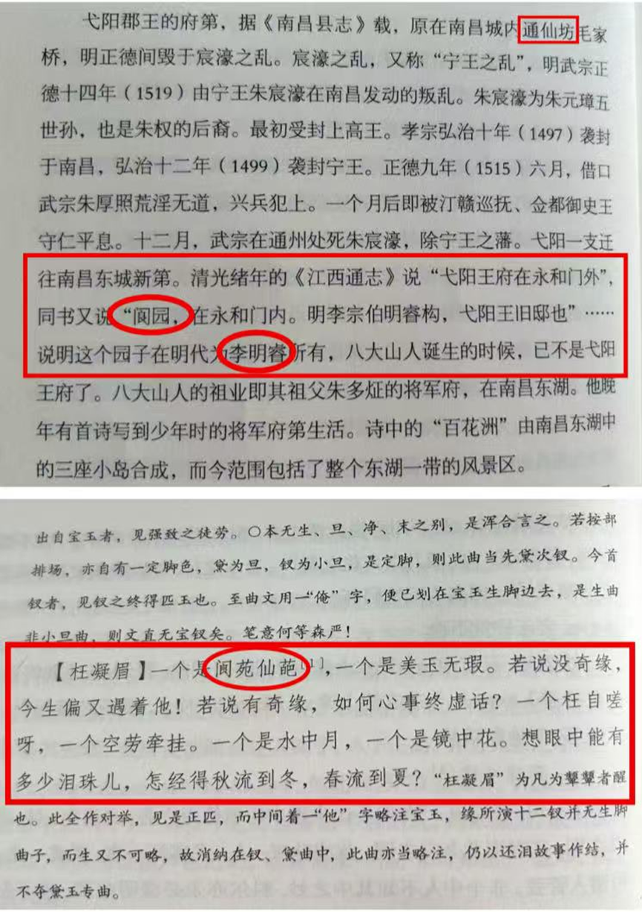

八大山人家荣王府的“阆园”与《红楼梦》枉凝眉唱曲“阆苑仙葩”巧合般一致

===================

__【20260418更新 考据证据之四：八大山人画了《红楼梦》专属密码“耗子精偷香芋”】__

__中国上下五千年的画坛仅此一幅。巧合的是，这幅画是《红楼梦》的专属密码：__

__“耗子精偷香芋”、__

__“花儿（华）谢了结了一个大倭瓜、然后耗子精来了”__

__此画寓意金钱鼠尾的耗子精窃了华夏，而画面感又很像“金钱鼠尾”。__

另外，落款“黄竹园”就是二敦兄弟《寄怀曹雪芹》诗稿中的“黄叶村”；印章“可得神仙”可不就是《好了歌》中唱的“世人都说神仙好”么？

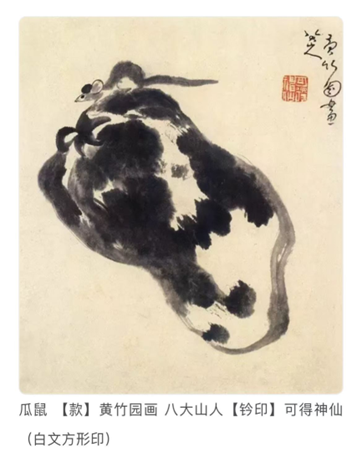

八大山人画了《红楼梦》专属密码“耗子精偷香芋”

五行里明属火、清属水，“子”在五行中属水，而十二生肖里“子”是鼠，牡丹别名鼠姑，《红楼梦》里薛宝钗是牡丹。

《红楼梦》中贾宝玉给林黛玉讲耗子精偷香芋的笑话时，话刚说完薛宝钗（鼠）就进来了；薛宝钗帮贾宝玉改诗，被贾宝玉称为一字师的章节，薛宝钗建议用“蠟”（蜡）字，古文中蠟字右边就是鼠字。

综上：薛宝钗就是代表鼠、水、清、（后）金。

而《红楼梦》整部书就是讲述代表清的薛宝钗（皇太极、孝庄）和代表明的林黛玉（崇祯）争夺贾宝玉（传国玉玺）。

===================

__【20260418更新 考据证据之五：《红楼梦》全书出现近千处南昌方言】__

__我在网上搜索关于曹雪芹的资料时，看到一篇网文作者提出：“《红楼梦》有近千处都昌方言”。网络解释“都昌方言”指“广义南昌话”。__

该研究者受胡适提出的“曹雪芹乃曹寅之孙”所误导，虽然研究出了“《红楼梦》有近千处都昌方言”，但该作者将之归结为“曹雪芹祖上是江西都昌人，方言是平时家人口口相传”。

该文作者写了查证家谱可知，江西的该曹氏家族有一支一子二孙在明代永乐年间去了东北铁岭和河北丰润。—— 请大家用自己身边的亲身经历和逻辑常识想想：300多年前永乐年间的祖先是江西都昌人，之后200多年一直生活在东北，然后清初随清军入关到了北京，再然后去南京赴任，那么300年后的乾隆年间出生在南京的子孙会说南昌方言吗？并且会在小说里对南昌方言大量运用自如么？

贴小条造假指鹿为马的胡适贻害百年，除了那些或为了私心私欲、或无脑无判断力只会人云亦云的所谓红学家之外，胡适还坑害了无数喜爱《红楼梦》并且愿意认真研究和认真思考的读者。

我很尊敬研究出“《红楼梦》有近千处都昌方言（南昌方言）”的这位《红楼梦》爱好者，我认为他（她）的研究成果应该受到高度重视，并且将之作为考证《红楼梦》作者的出生和生活地区的重要佐证证据。

希望之前猜测分析《红楼梦》作者是吴梅村、朱慈炤、严绳孙、方以智、张岱等人的索引派们阅读到__“《红楼梦》有近千处都昌方言”__这一重要考据证据时，也能秉着“尊重事实证据和逻辑常识”的原则，用新发现的考据证据（或者是借鉴别人提出的考据证据）交叉验证自己之前的分析判断。

__索隐派悼明派如果想推动将来某一天（或许还比较遥远）在所谓官方层面彻底否定曹家沟红学，必须举证出《红楼梦》如假包换的真正作者才有可能实现。__

__而有庞大证据链支撑的生活在江西南昌的八大山人，正是能打败所有《红楼梦》假作者的唯一的真作者。__

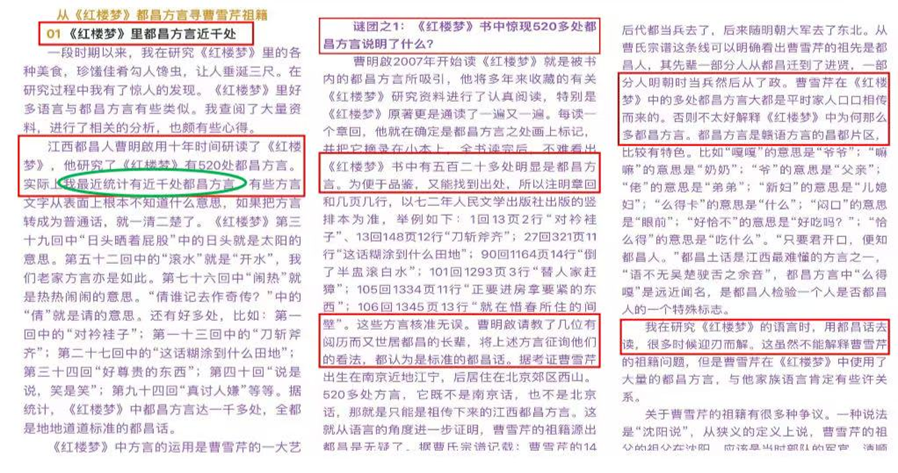

《红楼梦》全书出现近千处都昌（南昌）方言可佐证作者曹雪芹生活在江西

===================

__【20260418更新 考据证据之六：八大山人1704年的题壁诗与惜春的判曲《虚花悟》相同】__

__虽然我早已破解了《红楼梦》作者曹雪芹八大山人在贾宝玉、惜春、跛足道人、癞头和尚四个书中人物身上投射了自己的人生经历和儒释道的哲学思想，__

__但是在阅读八大山人的传记时，看到八大山人1704年（时年79岁）在一个罗汉洞里题壁写的一首偈语诗与惜春的判曲《虚花悟》的内容（内核）完全相同时，仍然非常惊喜：又发现一个证据！ __

__这两首诗的内核都是：先谈论佛家的空即色、色即空，最后结语归结到道家的长生果/长生不老翁。__

唯有亦僧亦道、佛道同修的八大山人才会有这样随时随地自然圆融的融合吧。

书中善绘画最后出家的惜春本身就是八大山人自己的人格之一，八大山人在79岁的高龄题壁写的偈语诗，也是对自己人生的总结，所以内核当然与昭示惜春人生的谶语判曲完全一样！不一样反而才奇怪。

而其，或许，一直在为后人留各种线索的八大山人特意题壁写下与惜春《虚花悟》内核一样的题壁诗，也是特意为之，八大山人是想让有“巨眼”的后世读者能品出这首诗与《虚花悟》竟然一样，从而破解曹雪芹就是他。

（※特别说明：下面截图的传记作者写1704甲申年是八大山人去世前一年，该卒年有误。正确的应是八大山人卒于1707丁亥年）

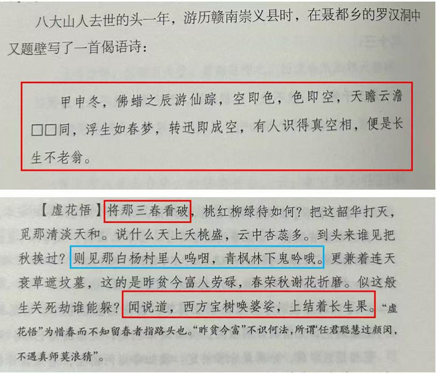

八大山人79岁时写的题壁诗内容与惜春谶语判曲《虚花悟》内核完全相同

另外，《红楼梦》第五回惜春的谶语判曲__《虚花悟》里出现的“白杨村”（癸酉本里亦出现）__，为了反向映证我数月前就找到的作者八大山人到底是不是真正的作者曹雪芹，我曾搜索“江西有白杨村吗？”

答案是江西有很多地方都有白杨村。在明亡前宁藩八支将近十代人历时200多年一直生活在江西各地，宁藩各支的祖坟所在地应该都叫白杨村吧。

__===================__

__【20260419更新 考据证据之七：癸酉本第102回惜春的诗就是八大山人本人真实写照】__

记得以前看过曾有网友说自己看了癸酉本贾惜春的诗就知道《红楼梦》作者是八大山人。

癸酉本\[第102回 冷惜春甘伴青灯佛 洁妙玉泥馅瓜州渡\] 惜春的诗如下：

__莫罕我装聋作哑，莫怪我白眼瞪他。__

__休问我乡居出身，细思量泪洒杈桠。__

__画一幅怪鸟残萼，不稀你惑解图画。__

__心却似虬根秃枝，情唏嘘分付梅花。__

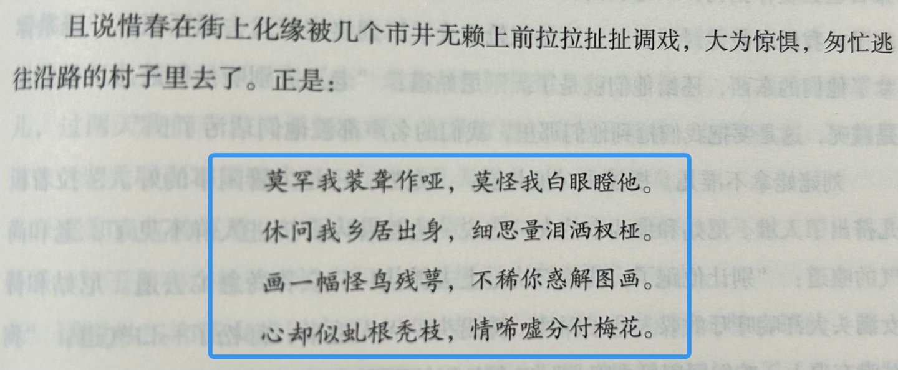

癸酉本第102回惜春的诗就是作者八大山人本人的真实写照

若要问中国上下五千年画怪鸟残荷和白眼瞪人的鸟兽的画家是谁，我想书画界人士所有人都会回答：八大山人。不会有第二个名字。__↓__

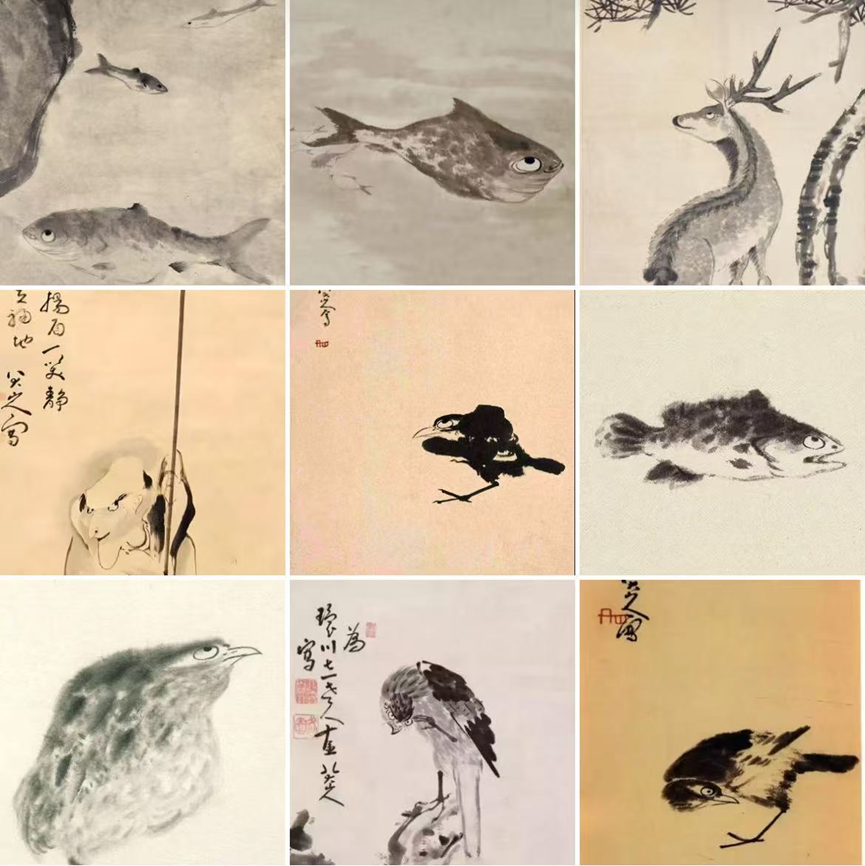

八大山人画作的标志性标签——白眼瞪他

※惜春诗句最后一句“情唏嘘吩咐梅花”与有些网友说的吴梅村没有任何关系。八大山人那幅梅花图，有三个题跋，其中一句“分付梅花吴道人”与吴梅村无关。那三个题跋的意思，以后另外解析。

除了怪鸟残荷白眼瞪人的画作之外，惜春的诗还写了八大山人另一个个人标签：“装聋作哑”。

明亡后，八大山人一生中曾多次扮哑。八大山人同样才华横溢的父亲是天生有哑疾，但是八大山人的哑默是装的，是故意为之。↓

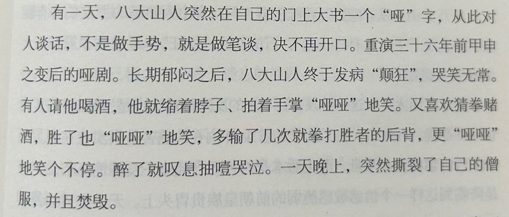

明亡后对这个世界无语的八大山人常用装聋作哑来无声抵抗、猜拳的样子非常史湘云

有一次是在受邀参加临川诗会时，扮哑十多天，然后某天夜里与人下棋，到了决定胜负的关键一步时，八大山人突然开口说话，使得主人胡亦堂十分高兴，还专门写诗记录此事。由此也可见八大山人因人品学识才德颇受重视和受尊重。__↓__

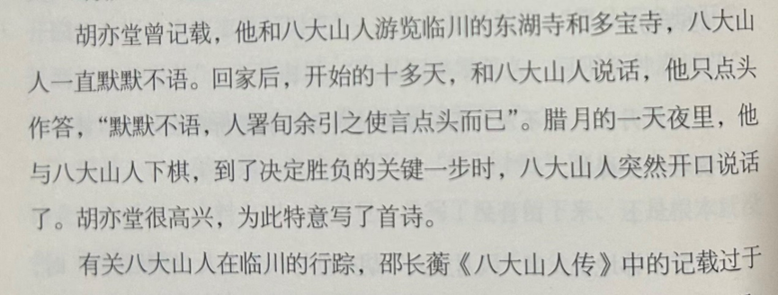

八大山人扮哑时因为下棋太投入突然开口说话

陈世旭老师写的《孤独的绝唱——八大山人传》里，对八大山人的故意“哑默”有详细分析。其中提到八大山人的祖父朱多炡（《牡丹亭》作者汤显祖的好友）的一些怪异特质，感觉从家风影响和DNA遗传学来说，也能从旁佐证为什么八大山人会想到写《石头记》、为什么书中贯穿主线的是疯疯癫癫高声唱歌的道士。

__据可信的资料记载，八大山人的祖父朱多炡，才华超群，但行为却异乎常人，常常当众歌唱、哭泣，令在场的人觉得莫名其妙，喜欢游览名山大川，常常独来独往，应景写诗刻在石头上，说要让后世知道曾有过他这个人。__

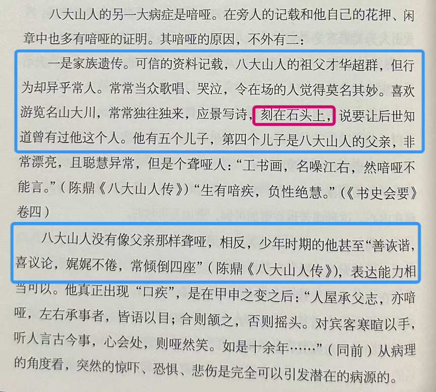

八大山人的装聋作哑和刻书在石头上的想法应该也有来自祖父朱多炡的家风影响

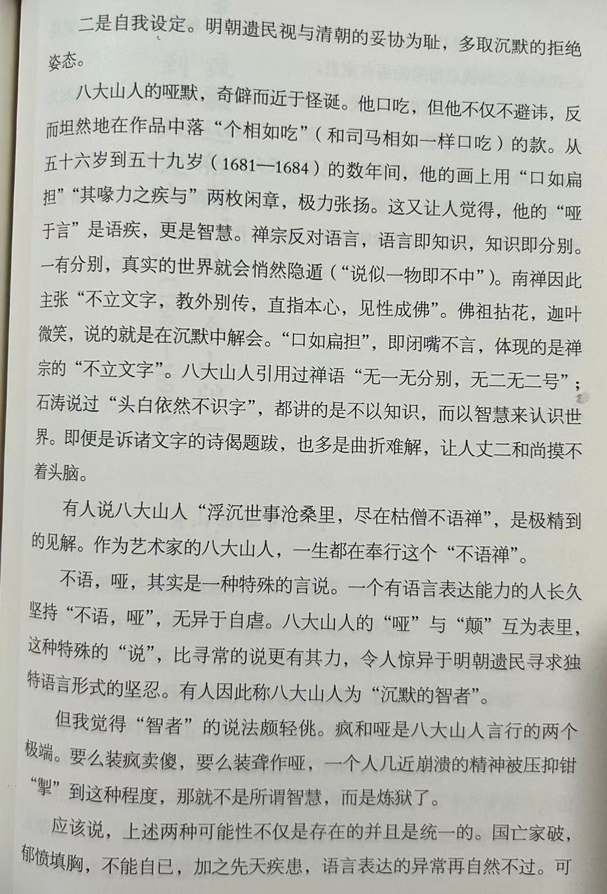

八大山人的装聋作哑亦是作为明遗民在表达对清廷的坚忍拒绝态度

__===================__

__【20260420更新 考据证据之八：全书总结唱词“上下六十年、笑啼应两置”与八大山人完全吻合】__

在蛟川大某山民（亦是八大山人的批书人马甲小号）等人点评的清代出版的增评带图石头记的各种版本里，最后有一段批书人（作者自己）的总结唱词：

__他说荒唐言，我宣真实义。__

__上下六十年，始泄其中密。__

__何乐亦何悲、笑啼应两置。__

__仁者谓之仁，智者谓之智。__↓

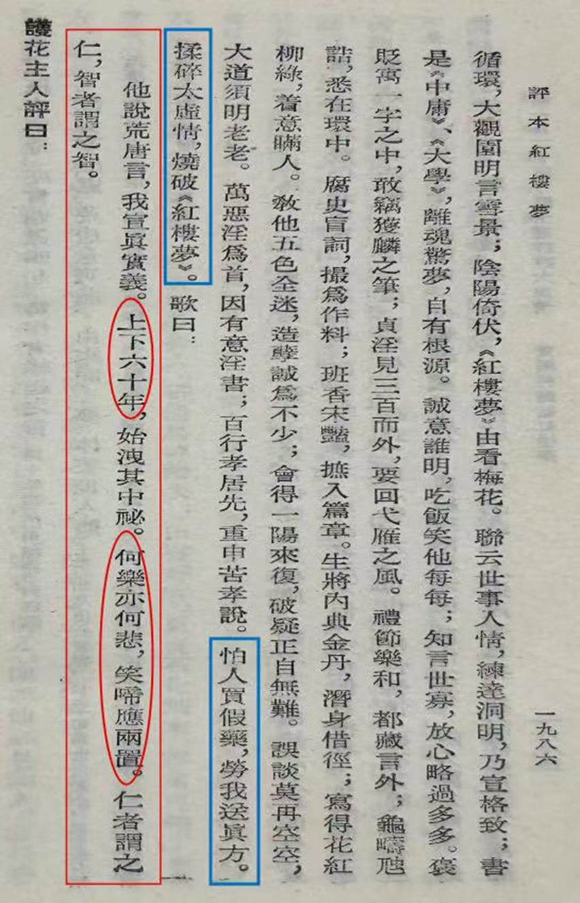

《增评补图石头记》系列版本最后总结唱词“上下六十年”与八大山人完全吻合

这段全书总结唱词也同样与八大山人完全吻合：1626年出生，明亡时19岁，1707年丁亥年卒，享年82岁（古人一般说虚岁）。明亡后以明遗民身份生活了62年，所以在晚年加评的《增评补图石头记》版本里批书人（作者自己）说__“上下六十年”。__

唱词的后两句__“何乐亦何悲、笑啼应两置”__也完全对应八大山人画作上最标志性的签名符号：__“哭之笑之”__

另外，这段总结唱词之前的四句话也挺有意思，值得分析探究：

__怕人买假药，劳我送真方。__

__揉碎太虚情，烧破《红楼梦》。__

这四句话该怎么理解？请各位同好们仁者见仁智者见智。

我之前阐述过我的观点：护花主人、大某山民、明斋主人、太平闲人这个带图批评系统的批书人也都是作者八大山人的马甲小号，但这个增评带图系统的版本面世时间在1792年官方程高本出版之后的道光年间，为了被允许出版只能以官方认可的程高本120回本来评，所以批语里真真假假，只有一部分是八大山人原汁原味的。一部分肯定是后人（道光年间出版人王希廉、姚燮、张新之等人）模仿大某山民、护花主人、明斋主人等作者的马甲小号的口吻和思路增加或修改的评语。

__<可能性之一>__

我觉得上述四句话，可能性之一是后人添加的，因为他们看到程高本面世并且自己也不得不采用程高本120回本作为底稿来评来出版，所以提醒大家：

__1、程高本是假药__，__不要被120回程高本骗了__。（程高本删除了所有脂批；将全书后三分之一改写为与谶语判词不符的内容；还大肆删除添加修改前80回的字句）

__2、我们这些点评才是真方。__（增评补图系列版本的点评非常直白，例如直接说薛姨妈薛宝钗奸险、说不知道薛宝钗是何许人也、说袭人是狐狸精、直接说了空空道人孔梅溪老明公山子野是同一个人）

__3、批书人直接说高鹗程伟元烧破了《红楼梦》__。没有说烧毁而说烧破，大家可以脑补“烧破”的画面，就是一部份还在、一部分烧没了。很符合120回程高本。

__<可能性之二>__

__上述四句话是曹公八大山人生前自己写的。__

八大山人晚年在世时就看到《石头记》全本在传抄传播时世人大多“惧前畏后”，估计大部分人也只敢传抄收藏前80回。对此曹公老人家有些不满也很无奈，请看批书人栖霞客（也是八大山人的马甲小号）的这段点评（点评写于1702壬午年让曹雪芹提前销号之后）：

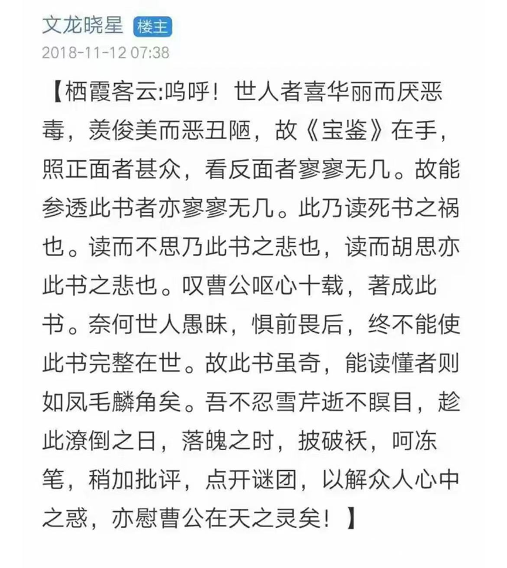

八大山人的批书人马甲之一栖霞客无奈感叹世人惧前畏后不敢传抄完整版《石头记》

曹公八大山人生前就看到《石头记》的传抄不是“完整在世”，他自己最清楚《石头记》如果没有原汁原味的后28回，就不是“真方”是“假药”，就像是《红楼梦》被烧破了不完整。

__所以，结论是：这四句话也可能是曹公八大山人生前自己写的。__

__==========__

__【20260420更新 考据证据之九：八大山人一幅画上的怪石与清代出版的林黛玉画像背景里的怪石长得一样；这幅画的构图和元素又和清代出版的关于青埂峰顽石和绛珠草的绘图一样】__

__请大家记住八大山人这幅画：松树\+怪石\+不知名的植物（可视之为绛珠仙草）__

这幅画签名是他标志性的八大山人四个字连写成既像“哭之”又像“笑之”；印章是“可得神仙”。__↓__

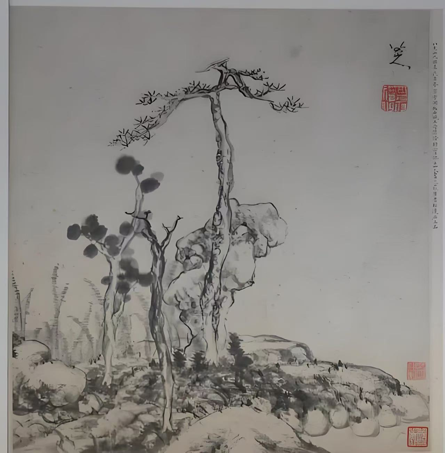

八大山人这幅画的怪石和林黛玉画像背景图里的怪石长得一样；同时此画（松树\+怪石\+不知名植物）与清代出版古籍里的青埂峰顽石和绛珠草的插画绘图一样

我研究【八大山人=曹雪芹】的方法之一就是大量地看八大山人的画、书法、印章。

__某一天突然发现有很多当代出版的《红楼梦》封面里林黛玉身后的怪石和八大山人这幅画的怪石长得可以说是几乎一模一样，两幅怪石就是看的人站的方向正好相反。站到对面看两幅怪石就是几乎长得一样。仅仅又是巧合吗？__

__孤证不立，当众多巧合都指向八大山人那它就不是巧合。__

我搜索这些当代出版的《红楼梦》的封面黛玉图的来源。得知这幅图来自在嘉庆年间出版的《红楼梦图咏》画册，据说画者叫改琦（1773 年—1828 年）。改琦的事先不详谈（另一个复杂的话题）。↓

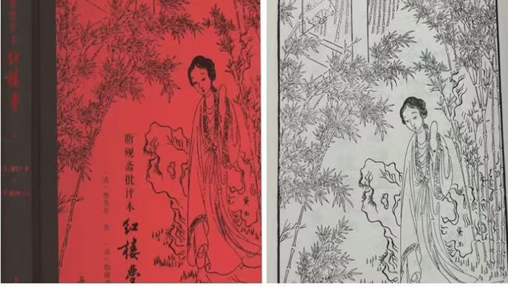

当代出版的很多《红楼梦》封面黛玉图采用了嘉庆年间改琦“画”的林黛玉绣像

看这幅林黛玉绣像（属于文人工笔画）背景里的怪石，再对比八大山人的工笔画自画像《个山小像》，我怀疑（可以说是肯定）改琦那套《红楼梦图咏》的人物画像有真迹作为参照，而改琦参照临摹使用的母本，就是大画家八大山人自己亲自画的一系列《石头记》绣像和插画。

八大山人亲自画的林黛玉画像真迹，背景肯定就是改琦画里这块石头，全画也就是这个造型构图。否则林黛玉背景图里的石头不可能长得和八大山人的画中石几乎一模一样。

这应该也是八大山人故意留的密码之一。他希望有“巨眼”的读者能看出来：“两块石头方向扭转就长得一样”！还是那句话：试问，哪有这么多巧合的线索全都指向八大山人？！↓

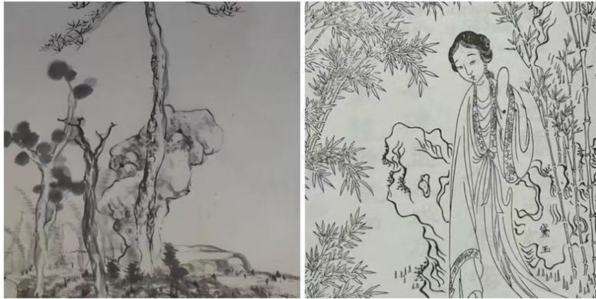

八大山人的画上的怪石与清代嘉庆年间出版的林黛玉绣像背景怪石长得几乎完全一样

__还有第二个巧合：除了与林黛玉绣像里的背景怪石长得一样，八大山人这幅画的构图和元素还和清代出版的带图《石头记》各种版本里所有关于青埂峰顽石和绛珠草的插画一样，都是“松树\+石头\+仙草”。难道仅仅又是一次巧合？__↓

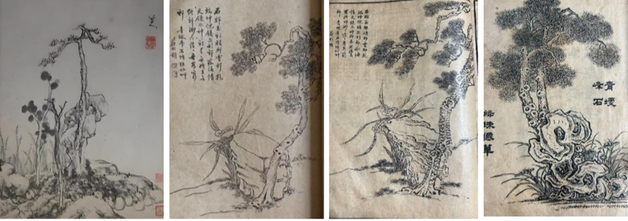

清代出版的各种带图版本的《石头记》插画里的青埂峰石和绛珠仙草的插图，构图和元素都和八大山人这幅画一样：松树\+石头\+仙草。

__这些带图《石头记》插画里的绛珠仙草都画成了灵芝，那么八大山人的画作里有画灵芝的吗？答案是有的。__↓

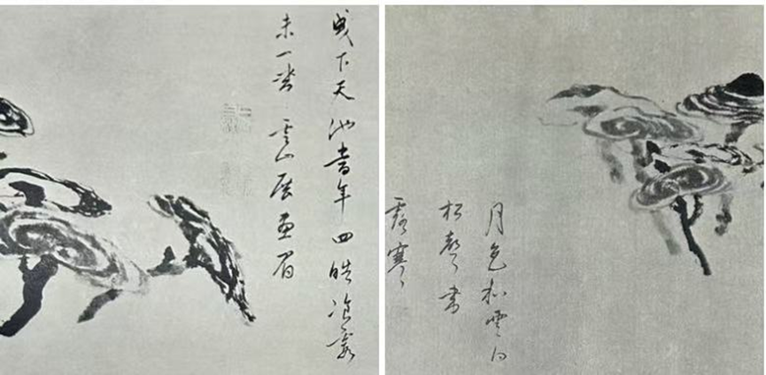

八大山人的画作里曾画过灵芝

__我的结论是是：__

__大画家曹公曹雪芹为自己的《石头记》画了几百幅人物绣像和插图流传后世__（网上说清代出版的《石头记》绣像加插画一共有几百幅）__。上图贴出的各种版本的“青埂峰石和绛珠仙草”的插图，应该都是参照了来自“悼红轩原本”的曹公自己画的顽石仙草插画真迹。__

__我已经破解了八大山人用诗画印章为《石头记》留密码的三种方式：__

__（1）以曹雪芹“悼红轩原本”之名画了大量的人物绣像和章回情节插画。在这些《石头记》人物插画里留下独属于“八大山人”的个人烙印。（我已经找到数个个人独属烙印）__

↑本小节上文论述的八大山人的“松树\+怪石\+不知名植物”画就是属于此类型。怪石与林黛玉绣像背景怪石长得一样；而整幅画与青埂峰顽石和绛珠仙草插画一样。

__（2）用署名“八大山人”的画、诗、书法、印章为《石头记》留下大量关联密码。这就是书画界这么多年解不开八大山人书画上晦涩难懂的题诗印章的原因。__

↑我已经找到海量密码线索。例如：感兴趣的读者可以用网络图片自己去解析《安晚册》（原作现藏于日本），《安晚册》每幅画都关联《石头记》。

__（3）到了晚年，在“八大山人”的画作上用合文书写法直接签署“曹雪芹”三个字，让“八大山人”和“曹雪芹”同时出现。__

↑这也是前文所述我曾思考的：为什么以前某些清朝高官贵胄的后人会说“自己家中曾藏有大量曹雪芹画作、后来被带去日本了”。

这些《石头记》的绣像和情节插画从嘉庆、道光年间开始陆续以各种方式出版，有的是真迹、有的是或高明或低劣的修改过的仿作（现在市面上和网上能看大的插图大部分是仿画）。最初出版的《增评补图石头记》是印着“悼红轩原本”出版的。

我坚信大观园就是八大山人居住的青云圃道院（鼎盛时300间屋舍），“悼红轩”就是身为住持的他居住的居所“黍居”（“黍居”之名可参考大某山民点评平儿时说的“一粒粟可现大观也”），61岁让出住持之位后隐居在其中的某间屋舍；晚年隐居居住的屋舍被他命名为“黄竹园”、“窹（wu、醒着的意思）歌草”。

“窹歌草堂”——亦可从《石头记》中看到关联：三家评版本里大某山民在开篇第一回就点评：__“历过梦幻之后，则是书为既醒之书可知”。__↓

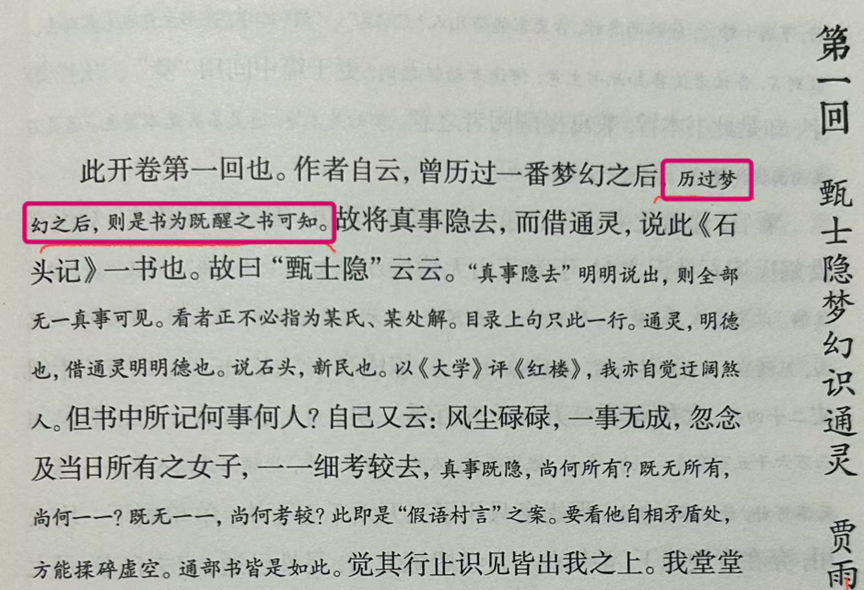

八大山人晚年居所叫“窹歌草”、《石头记》第一回批书人点评“是书为既醒之书”

__惜春就是八大山人自己的人格之一，《红楼梦》里描写惜春画了大观园图，我坚信大画家八大山人亲自画了《大观园图》。而我的想法在《红楼梦》第45回的脂砚斋点评里得到了映证，脂砚斋明确说了《大观园图》就是宝玉画的（后文再详述）。__

网上能搜到各种大观园图，真真假假，或精美或粗劣，不过多多少少能够窥得端倪。__能明显看出《大观园图》里有几处非常独特和典型的建筑景致和八大山人纪念馆的建筑景致一摸一样__

我自认为自己已经一脚踏进了八大山人构筑的大型迷宫般的艺术世界的大门，我坚信八大山人在他自己修建的大观园（青云圃道院）居住了将近40年就是为了《石头记》能传世而在奋笔疾书和泼墨挥毫。

当然还有篆刻！__别忘了被清朝皇家贵族们鸠占鹊巢的曹雪芹的诗稿和各种谈论艺术的文稿《废艺斋集稿》里第一卷《弊芾馆鉴印章金石集》就是金石篆刻大家曹雪芹谈论金石篆刻艺术篇。__

加上遗失的和被当成他人篆刻的印章，八大山人的印章应该超过100枚，目前八大山人能确凿确认的印章就多达89枚，中国古代民间画家里还有谁的别名字号和印章数量能超过八大山人的么？八大山人真是既令人无比钦佩又令人倍感心酸忍不住潸然泪下的大天才！

被当成他人篆刻的印章：例如周汝昌先生说在隆福寺庙会淘到的疑似曹雪芹的印章“怡红快绿”，周先生认为是（曹包衣家的）曹雪芹的真印章。那枚印章如果是真品，毫无疑问肯定是金石篆刻大家八大山人为自己的《石头记》刻的。

__插播一句：《废艺斋集稿》里曹雪芹谈论各种艺术的文章，都说是“某人见过、某人摘抄过一部分、但是原稿都遗失了、原稿再也看不到了”，然后就被出版了，然后被官方红学家们称之为：“这些能证明曹雪芹又黑又胖、生活在北京西山、是数位清朝贵族公子的好友”。何其滑稽可笑！何其双标！__

把以上逻辑放在何丽丽的癸酉本里标准为啥就不同了呢？为啥非要眼见为实的原稿？那你们官方红学家为啥就凭某人见过和抄录的几句话就能盖章出版并作为证据呢？！

当然我有自己的答案：署名曹雪芹的诗稿和各种文稿作者真身都是大艺术家八大山人。八大山人去世后这些遗稿和《石头记》手稿一样慢慢都落入了有钱有势的清朝贵族手里（或者购得或者拍马屁之人奉送），要是都展示出从第一页到最后一页的原稿，不是就像破风箱一样到处漏风到处都是破绽么？！善于藏谜又大量留专属密码的八大山人写的东西，可不都是到处都能看出曹雪芹真身是八大山人么？！

__八大山人拥有超乎常人的智商和非凡智慧，我希望我们这些华夏后人能努力研究，努力找出八大山人留下的千头万绪的庞大线索，一点点去接近《红楼梦》的真相并最终抵达真相的终点。__

__==========__

__【20260421更新 铁证之十：八大山人修建的青云圃道院就是现实中大观园原型、八大山人纪念馆的石牌坊与清代“悼红轩原本”《大观园图》里的省亲别墅石牌坊一摸一样】__

从我数月前探寻到八大山人在康熙年间修建的青云圃道院（今天的江西南昌八大山人纪念馆）就是现实中大观园原型开始，我就坚信八大山人是真正的曹雪芹，并且__我认为这个证据可以成为证明八大山人是曹雪芹的【铁证】。__

八大山人（以良月道人朱道朗的身份）当年在修建青云圃道院时特意留下了__“石刻始建全图”__，新中国政府于1959年在青云圃的原址上修葺重建八大山人纪念馆时就参考了该石刻始建全图。

__建一座园子竟然要留下“石刻始建全图”，这是一个非常重要的信息线索。探轶工作需要敏锐的直觉，我自认为我还算具备。__

之前我对青云圃（八大山人纪念馆）做了很多研究（条件不具备，暂时只是纸面资料和照片图片研究），对于__【青云圃=大观园原型】__这一结论深信不疑。

关于良月道人是不是八大山人的问题，历来分为两派观点，我支持赞同派并且无比坚定，我自己也从史料故纸堆里找到了一些有力佐证。本文不详谈。

而且，以前的赞同派还不知道八大山人就是曹雪芹（或许内心知道但因为zz因素等原因无法得到公开承认），现在要证明修建青云圃的良月道人就是八大山人，证据更有力了！__【八大山人、曹雪芹、大观园、青云圃】四大要素形成了一个能互相映证的无敌宇宙。__

可以这么理解：《石头记》就是刻在石头上的历史和墓志铭。青云圃的“石刻始建全图”也可以理解为就是对应惜春画的《大观园图》的石刻版。

之前我写过两篇介绍分析“青云圃道院=大观园”的文章，遗憾的是关注的人不多。即便分为了两篇文章，每篇也都很长（把枯燥长文写得有趣吸引人的能力还有待加强，可能读之不易。文章写的不好，阅者请见谅），感兴趣的网友可以阅读参考。

__我只是迫切地想和大家分享我的研究结果，想让大家相信：青云圃真的是大观园啊！__

之前写的关于【青云圃=大观园】的分析文章链接如下：

[现实中的红楼梦大观园是江西南昌八大山人纪念馆吗？](https://zhuanlan.zhihu.com/p/1992754570674324405)

[破案了！现实中的红楼梦大观园找到了！](https://zhuanlan.zhihu.com/p/1988081001033925704)

__本文里新增加两张对比图。当初我看到清代出版的各种古籍里的《大观园图》的很多建筑和景致，居然和八大山人纪念馆的建筑和景致相同，觉得这个巧合也太巧了！！__

__最典型的是两处：__

__第一处：石牌坊后面紧连着一栋两层建筑（此处最独特，第一眼就奇怪为啥会有这种设计）__↓

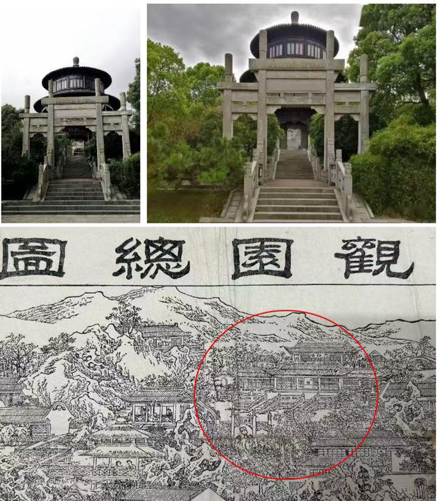

八大山人纪念馆的某处景致与《红楼梦》省亲别墅设计布局相同

↑__上图照片中八大山人纪念馆的某处景致（抱歉我暂时不知道该处叫什么）与《红楼梦》省亲别墅一带的设计布局相同。条件有限照片图片模糊看不清，石牌坊上写着“省亲别墅”，后面两层建筑匾额上写着“大观楼”。__

__下面三张局部放大图中，（左图）八大山人纪念馆里的石牌坊与（中图）清代出版的“悼红轩原本”的“省亲别墅”石牌坊长得【一摸一样】！—— 看到这两座石牌坊，还会有人说青云圃不是大观园么？！真会这么说的人不是眼瞎就是心坏。__右图是用来参照对比的其他版本出版物的仿图。[↓](https://zhuanlan.zhihu.com/p/2023062470688798552/edit)

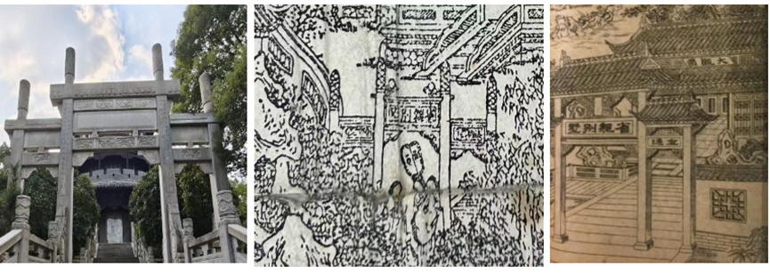

（左图）八大山人纪念馆里的石牌坊与（中图）清代出版的“悼红轩原本”里的《大观园总图》“省亲别墅”的造型和细部特征均长得【一摸一样】

__第二处典型雷同景致：“Z字型”廊桥通向湖心亭__↓

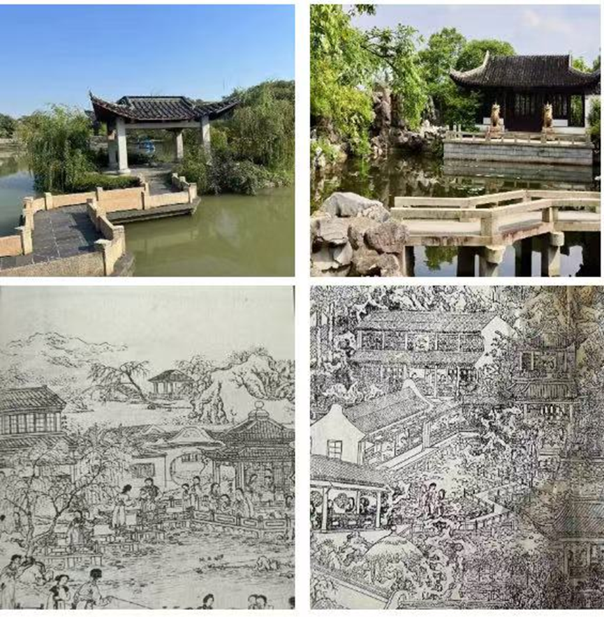

《大观园图》里的“Z字型”廊桥通向湖心亭的景致也能在八大山人纪念馆里找到同款

↑__《大观园图》里的“Z字型”廊桥通向湖心亭的景致也能在八大山人纪念馆里找到同款。另外，我个人猜测八大山人当年修建的湖心亭一定比现在建的简易亭子漂亮。__

__结论：青云圃（八大山人纪念馆）就是大观园的现实中原型！修建青云圃的八大山人（良月道人朱道朗）正是如假包换的《红楼梦》作者曹雪芹！__

__==========__

__【20260424更新 考据证据之十一：八大山人的《个山小像》自题诗“莫是悲他世上人，到头不识来时路”揭示了创作《石头记》的目的】__

1675年，同时亦僧亦道的八大山人49岁（名义上身份为耕香院住持，实际以良月道人身份在青云圃任住持并秘密创作《石头记》），开始谋划脱下僧袍彻底还俗作道士。

于是假托“好友黄安平”的名义画了自画像《个山小像》，至1678年，历时4年分几次与友人一起在《个山小像》上作了9个题跋，其中6跋是八大自题，其余3跋是好友饶宇朴、彭文亮、蔡受所题。

在《个山小像》中，八大山人才华恣肆，分别使用了篆书、董体行草、行书、楷书、行楷、隶书六种字体。这些文字如谶语、如天书，呈现出一段艰苦的心路历程。成为研究八大山人生平最重要的信物。

完整讲述《个山小像》九个题跋需要很长篇幅，此处不展开。只想先介绍这首自题诗：

__没毛驴，初生兔。剺破面门，手足无措。__

__莫是悲他世上人，到头不识来时路。__

__今朝且喜当行，穿过葛藤露布。咄！__

__【莫是悲他世上人，到头不识来时路】——正是曹雪芹创作《红楼梦》的目的。__↓

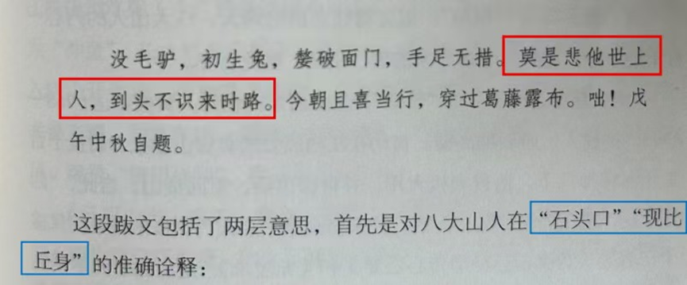

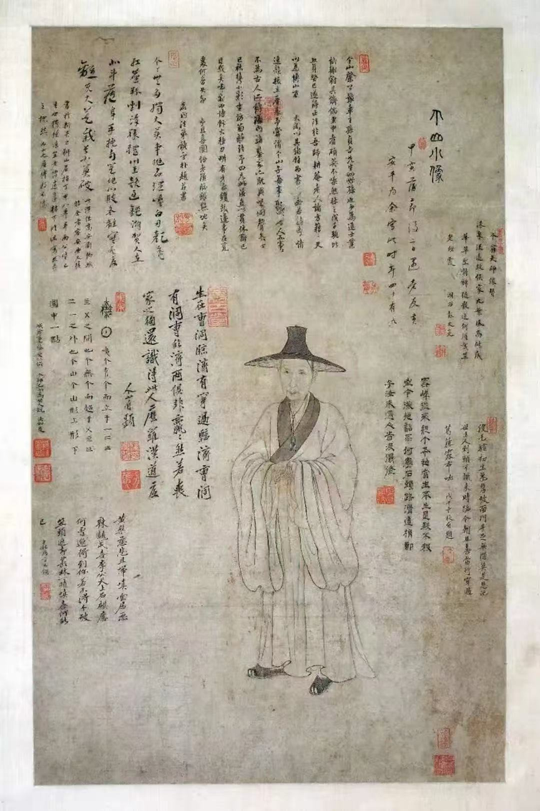

《个山小像》自题诗“莫是悲他世上人，到头不识来时路”揭示了八大山人创作《红楼梦》的目的

__从2025年开始，越来越多的“香菱”们找到了“来时路”。曹公八大山人在天之灵，亦当感到欣慰了吧。 __

《个山小像》的九个题跋都值得好好分析，以后单独开贴细说。我把第一个题跋也顺便贴出来。当初读到__“当生不生、是杀不杀”__这两句时，我联想到了情榜对贾宝玉的定义：__“情不情”。__↓

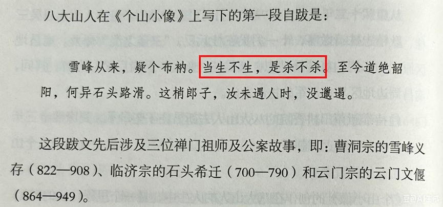

“当生不生、是杀不杀”这两句自跋让我联想到情榜对贾宝玉的定义：“情不情”

借着《个人小像》多写几句：

__“身上充满未解谜团”__是八大山人的特质，关于在__《个山小像》上使用六种不同字体写题跋__，我也曾思考过什么。

后来看到清代出版的各种版本的《红楼梦》人物绣像和插图（真真假假，仿图占多数），我第一眼就注意到：

__每幅绣像上配的人物赞和人物咏的诗谶，竟然【刻意用了不同字体】！很容易让我联想到《个山小像》上特意用了六种字体写题跋。__

另外，感谢在知乎学到的“明制汉服主体是交领右衽”这个知识点，也能帮助我判断哪些才有可能是真正出自“悼红轩原本”的明遗民大画家明八大山人本人画的。

__==========__

__【20260424更新 考据证据之十二：庚辰本第45回脂砚斋点明 宝玉=惜春】__

__有的《红楼梦》读者对于“八大山人=惜春”是认可的。__

__但对于“八大山人=惜春=宝玉=作者曹雪芹”可能还是将信将疑。__

请大家看庚辰本第45回，惜春在画《大观园图》，原文写道：

__宝玉每日便在惜春这里帮忙。\[庚双：自忙不暇，又加上一帮字，可笑可笑，所谓春秋笔法。\]__

__解析脂批：惜春在画《大观园图》，宝玉每日在惜春这里“帮忙”的“帮”字是春秋笔法加上去的一个字，那么其实真实情形就该去掉“帮”字。__

__所以是：宝玉每日在惜春这里忙着画《大观园图》，宝玉不是“帮”，是自己在忙。__

__所以答案就是：《大观园图》是宝玉画的、宝玉=惜春=八大山人。__

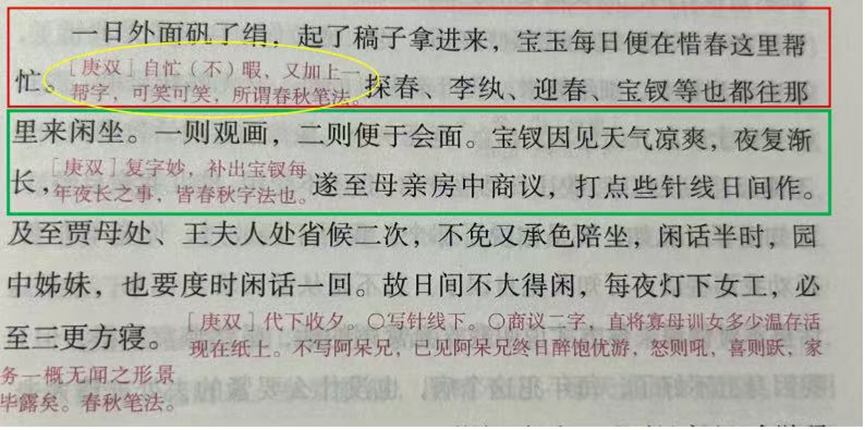

庚辰本第45回脂砚斋点明宝玉=惜春

插播：发现上面截图还有一句话有深意：__宝钗因见天气凉爽，夜复渐长\[庚双：复字妙，补出宝钗每年夜长之事，皆春秋字法也。\]__

宝钗自然【每年夜长】，很多人都能心领神会。如果没有宝钗的“夜长”，也就没有那啥了\.\.\.\.\.下面一段还专门提醒：__“阿呆兄__（大家知道阿呆兄指谁）__终日醉饱优游，家务一概无闻”__=阿呆兄对宝钗夜长之事无所觉察。所以阿呆兄傻乎乎地卖力帮着\.\.\.\.\.\.阿呆兄应该是误会了什么。——曹公的史笔绝妙至此！

回到__【宝玉=惜春=画大观园图的作者】__的分析：

做出妥协（不得不使用官方允许的程高120回本为批评底本）、在夹缝中出版的三家评本，在第42回最后批书人（批书人都是作者自己）有一段点评，直白地说了大观园图就是作者曹雪芹画的：

__【议论画大观园图一段文字，乃作者自言其惨淡经营也。……】__↓

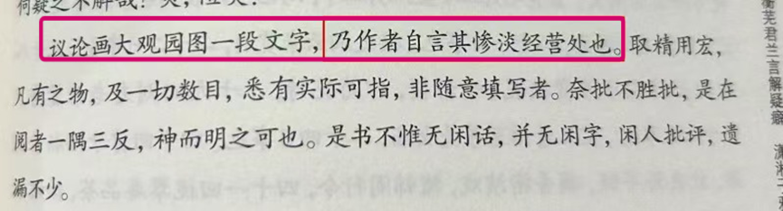

三家评本第42回批书人直接点明《大观园图》是作者曹雪芹画的

==========

__【20260430更新 考据证据之十三：癸酉本中出现的嶽（yue）神庙对应八大山人家弋阳荣王府附近的东嶽庙（借用乎友泛山的结论）】__

当初围绕癸酉本有关于__“嶽（yue）神庙”__还是__“獄（yu）神庙”__的争论。

查询资料可知：__“东嶽庙”主祀东岳大帝泰山神、岳飞作为配祀也供奉在东嶽庙__；而民间又有__专门祭祀岳飞的“岳神庙__”。

由此可知：写成“嶽（yue、岳的繁体字）”才是正确的。作为明遗民的《红楼梦》作者，当然写的是祭祀岳飞的“东嶽庙→嶽神庙”。另外，监獄肯定是没有“神”的。

__八大山人家弋阳荣王府附近正好有两座东嶽（yue）庙。__

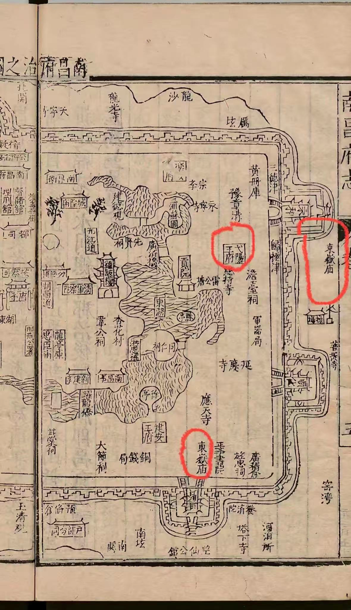

弋阳荣王府附近有两座东嶽（yue）庙（配祀岳飞）对应癸酉本嶽神庙

__==========__

__【20260430更新 考据证据之十四：利玛窦赠送宁藩诸王的礼物证明宁藩王府拥有自鸣钟和玻璃镜（借用乎友泛山的结论）】__

以下引用__乎友泛山__的考据结论：

史载，利玛窦与江西宁藩诸王府来往密切，宁藩诸王是他在南昌三年传教期间重要的支持者，其中建安王和乐安王尤为热情，讨教西学并互赠礼物；除了建安王乐安王支持他传教，__八大山人的祖父弋阳王朱多炡和利玛窦还直接是好友。__

__利玛窦赠送宁藩诸王府的礼物有：自鸣钟，西式钟表、三棱镜、玻璃镜子、地图、地球仪，天星图，西式版画。利玛窦教堂目前在南昌保存完好。__

这里又扯出另一场公案，就是现在网络上说他带来的世界地图有中国原创成份，这是有可能的，因为南昌是航海家汪大渊的故乡，汪大渊坐着阿拉伯人的船跑了半个地球，可能地图知识在这里糅合进去了。汪大渊老家就在青云圃（八大山人纪念馆）隔壁。此处按下不表。

__利玛窦去南昌传教距离八大山人出生只有三十年，相信镜子这些东西都保存完好无损。__

另外，除了利玛窦送的礼物会保存好之外，我个人认为利玛窦在江西传教和赠送西方礼物给宁藩王府后直到大明覆灭历经50年，科技和能工巧匠排当时世界第一的明朝肯定自己也能仿造钟表和玻璃镜。明代王公贵族家有自鸣钟和穿衣镜不稀奇。

__乎友泛山提供的考据证据有力驳斥了曹学家们说的清代王府贵族才可能见过自鸣钟和穿衣镜。__

__==========__

__【20260430更新 考据证据之十五：《红楼梦》中掌管天下符禄的张道士原型就是江西宁藩龙虎山张天师（借用乎友泛山的结论）】__

以下引用__乎友泛山__的考据结论：

__《红楼梦》中掌管天下符禄的张道士，和贾府交往密切，不卑不亢，还能随意出入内室，而且道观就在都中附近。符合这些条件的也只有南昌宁王系和附近的龙虎山张天师，两家亦师亦友贯穿整个明朝。__这些重点不难发现，只是有人故意回避而已。

__==========__

__【20260503更新 考据证据之十六～二十三 《红楼梦》出现的诸多地名与江西及宁藩的关联（借用①乎友泛山、②乎友Rycrtc 林的结论）】__

以下引用__乎友Rycrtc 林__的考据结论：

__证据之十六 ：空空道人出场时候，书中说“相逢若问家何处，却在蓬莱弱水西“。 __

这首诗选自宋代熊克的《葛仙山》里面那句__“蓬莱何曾弱水隔，兜率有天才咫尺“__。

__葛仙山就在江西__，指向八大山人是没问题的。

※葛仙山：道教圣地，江西省上饶市铅山县葛仙山镇，号称中华灵宝第一山。

以下全部引用__乎友泛山__的考据结论：

__证据之十七：钟鸣鼎食之家__和__槛外人\(槛外长江空自流\)__：都是《滕王阁序》写南昌的诗句。

__证据之十八：昌明隆盛之地__：南昌宋代叫__隆兴__。

__证据之十九__：千年__铁门槛（限）__：即对应宁王家庙__南昌铁柱万寿宫__（妙玉喜欢的原诗句写为“从有千年铁门限，终须一个 土馒头“）

__证据之二十：都中水路三日到镇江，__符合水路南昌到镇江的实际。

__证据之二十一：“恐先生闻西字落泪”的由来：__

__大观园的灵感应该是南昌东湖，后来在青云圃得到了完善__。八大山人的弋阳王府在东湖的东北角绝佳位置，__在弋阳王府西边原来有个花园__，__后来清军入侵后王府和花园全毁，只留下了一个老地名叫花园角。【这也是《红楼梦》里，恐先生闻西字落泪的由来，这个西字指的就是西园】__

我看网上很多专家对这个西字落泪有各种解释，其实全都不对。八大山人中年返回南昌城后，没有办法再回到王府故居，但他经常在东湖附近流连会友，只能遥望故居，所以他的诗里也发出了__【西园易故居】__的感慨。当时的他有动力在城郊青云圃再建一个儿时的园林，《红楼梦》里的大观园其实是西园，东湖以及青云圃的混合映射。

__证据之二十二：南昌的百花洲、杏花楼：__

__林黛玉在大观园里写的唐多令，粉堕百花洲，香残燕子楼，写的就是东湖百花洲和附近的杏花楼\(娄妃住所\)。粉堕百花洲指的是柳絮之景，香残燕子楼指的是娄妃为宁王朱宸豪殉情一事。__

这里不敢直写杏花楼，而是拿徐州燕子楼典故打了马虎眼，亦让人误以为百花洲是林黛玉老家苏州百花洲。八大山人真是费劲心思隐藏地点！东湖百花洲和杏花楼现还在，明末百花洲附近还有杏花村，即后来蒋介石行营所在地，现在改为江西画院。

八大山人在百花洲有诗云:

__人打球来马打球，年年二月百花洲。__

__百花二月春风暮，谁共美人楼上头。__

八大山人和林黛玉一样，在百花洲结社做诗，史称东湖书画社，【__题材之一就是咏柳絮】__，有几首重要的诗在此写成，如:

1\. 题山水（常题于罗牧山水册后）

__西塞长云尽，南湖片月斜。__

__漾舟人不见，卧入武陵花。 __

2\. 题画

__墨点无多泪点多，山河仍是旧山河。__

__横流乱世杈椰树，留得文林细揣摩。 __

3\. 题自画水仙

__此花此叶此芳辰，不与人间桃李春。__

__寄语东湖诸旧友，莫将清艳染风尘。__

社友也有诗，如:

1\. 朱容重（同社）题罗牧画

__笔底烟霞自一家，东湖风月属君夸。__

__相逢尽是忘机客，醉写青山当落花。 __

2\. 涂岫（同社）东湖即事

__春风吹絮满东湖，社里诗人半酒徒。__

__莫笑山僧同放浪，乾坤留得此江湖。__

话说回东湖杏花楼上的娄妃，她的老师唐伯虎给她写了悼亡诗:

__花落花开总属春，开时休羡落休嗔。__

__好知青草骷髅冢，就是红楼掩面人。__

__证据之二十三：沁芳闸一带：__

明代南昌地图上，__东湖的水闸关和东北角的水渠__和《红楼梦》中一致。

=========

__【20260503更新 考据证据之二十四：八大山人的\[何园\]印章解析：①字形很像“畸笏叟”的“畸”字——含义来自八大山人最喜欢的庄子；②关联跛足道人的诗】__

金石篆刻大家八大山人一生拥有近百枚印章，大部分印章都关联《红楼梦》。如下图这两枚__“何园”，是从晚年1699己卯年（《石头记》有己卯本）开始启用，直到去世。__

__我第一眼在画上注意到这枚印章时认为它是个“畸”字，很容易联想到“畸笏叟”的“畸”。进一步查证这枚印章所刻之字是“何园”两个字，而《红楼梦》里跛足道人的诗句写到：“若问家何处”，“何处”即“何园”。__

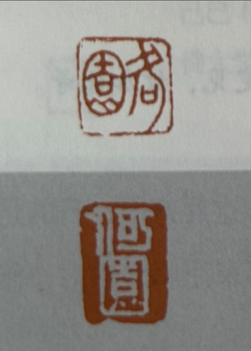

八大山人1699己卯年开始启用的两枚“何园”印章

八大山人的诗画书法印章和《红楼梦》一样，也是一声两歌，可以同时解析出好几层他特意留下的密码。

一、__“何园”的第一层密码：__

__“何园”的字形用“合文法”写为形似“畸笏叟”的“畸”字。__

古典文学知识水平不高的我最初以为“畸笏”是变形的笏板。查询资料后摈弃了自己最初的浅薄解读。__“畸”应该来自八大山人最喜爱的庄子。__

__畸人：最早见于战国时期《庄子·内篇·大宗师》，指特立独行、超脱世俗或具仙人特质的人物 。__庄子借子桑户葬礼中友人的行为，阐释其“侔于天”的生死观，强调其精神游离于礼法之外，与自然相融的特质。

该词经后世文人拓展为文学意象：唐代司空图《二十四诗品》以“畸人乘真”__喻艺术至高境界__，宋代陆游以“__无俗情__”突显其出世品格，清代孙枝蔚则以“__不肯仕__”延续其超然形象 。其内涵承载__道家齐物返朴思想__，__既指异于世俗的异士，亦隐含通晓自然规律的哲学维度__。古代文学中，__“畸人”渐成独立人格与超越性精神的典型符号__。

__看到古典文化中对于“畸人”的解释，真正理解《红楼梦》的读者很容易理解男主贾宝玉（作者自己）就是作者八大山人按照“畸人”来描写的。__

__《红楼梦》所有批书人的马甲小号都是以“畸人”自比的作者八大山人自己，那么其中一个马甲小号叫“畸笏叟”很自然很正常。__

__那么再来分析“笏”字何解呢？__

除了大家熟知的官员上朝用的“笏板”，__“笏”字还有另一层意思是指点戏用的 “戏笏”（点戏牌）。多为竹制或硬木，狭长板状，写戏目名；堂会、戏班日常用。__

八大山人的祖上宁王朱权是大戏曲家，宁藩是明代藩府刻书最多质量最好的四大名藩之一，而宁藩的藩刻最多最出名的就是诗集类和戏曲类。

《石头记》又名《红楼梦》，第五回写到“红楼十二曲”（加上引子和收尾，一共十四支曲子，一般称“红楼十二曲”）。

大戏曲家宁王朱权与门下乐者一起编写了中国戏曲史上第一部系统全面的理论著作《太和正音谱》。该书分为戏曲理论和北曲曲谱两个部分，诸如“乐府体式”﹑“古今英贤乐府格式”﹑“杂剧十二科”﹑“群英所编杂剧”﹑“善歌之士”等八个类目。概述187名元曲家，16名明曲家的作曲风格及贡献，收录568本杂剧剧目和355支北曲曲牌。

朱权编纂的 “杂剧十二科”部分将“神仙道化”排为第一，儒道相通的“隐居乐道”为第二，其次是儒家倡导的“披袍秉笏”、“忠臣烈士”、“孝义廉节”等科目，最后是命名为“神头鬼面”的“神佛杂剧”。__朱权本人创作的杂剧有十二种__，现尚存《冲漠子独步大罗天》和《卓文君私奔相如》也表现着他的道教思想。

另外，单是初代宁王朱权就收集整理并自行创作了如此海量的戏曲，之后200多年的宁藩各王府，一定还有很多继承了朱权的戏曲艺术天赋并热爱戏曲的后人们继续收集、刊印、自创各种南北戏曲，也包括写出了《红楼梦》的八大山人。

看完宁王朱权的介绍，想必很多人都能共情身为朱权的末世王孙的八大山人为何要写“金陵十二钗”、“红楼十二曲”？为何八大山人这么执着于“自创十二曲”？__他的心境一定是：不肖子孙们虽然丢了太祖的江山，但是我用先祖宁王引以为豪的诗书戏曲的才华完成了堪比《史记》的戏曲历史小说“红楼十二曲”。__

综上所述，我认为“畸笏叟”的“笏”字，很可能是指__“戏笏”的“笏”。__

__畸笏叟——庄子笔下特立独行、超脱世俗、顺应自然天道的、写戏曲的老叟。__

再来看《好了歌》里的__“陋室空堂、当年笏满床；衰草枯杨，曾为歌舞场”：__“笏满床”或许也是一声两歌，除了指高官显贵上朝用的笏板，考虑到宁王府特殊的“戏曲世家、戏曲传家”的传统，也可能同时还指写戏点戏戏班里用的“戏笏”。

__二、“何园”印章的第二层密码：__

__“何园”两个字关联《红楼梦》里写跛足道人的诗： __

《红楼梦》第二十五回《跛道人赞》：

__一足高来一足低，浑身带水又拖泥。__

__相逢若问家何处，却在蓬莱弱水西。__

之前已经阐述过：这首诗点明了跛足道人（空空道人）家在江西（“蓬莱弱水西”指江西葛仙山）。

__==========__

__【20260503更新 考据证据之二十五：《红楼梦》三家评本第一回，批书人直接说了空空道人就是作者、是情僧：即暗示作者“亦僧亦道”】__

《红楼梦》第一回写到空空道人从大荒山无稽崖青埂峰下经过，三家评本里批书人（所有批书人都是作者自己）批注：__【空空道人，作者自谓也。故直曰“情僧录”】。↓ __

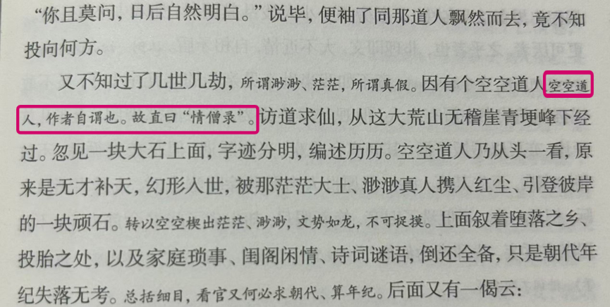

《红楼梦》第一回批书人直接说空空道人是作者的自称

__很显然批书人在直接给出答案，作者自称为“空空道人”，那么答案即是：__

__空空道人=曹雪芹__

__而“空空道人=八大山人”很好解：__

__佛家的“四大皆空、四大皆空”（两个四大）=八大__

__道家的“道人”=山人__

__但是还需要更进一步研究一下：__

三家评本里批书人已经在第一回最开始处提醒过：__看《红楼梦》通部书“要看他自相矛盾处”。__

这里也同样，作者称自己为“空空道人”，显然是个道士的名称=作者是道士。可是紧跟着下一句却说“故直曰情僧录”。自相矛盾之处就是：难道不应该叫“情道录”么？怎么是“僧”？

看过我的其他长文分析的网友当然和我一样清楚，八大山人有独特的个人经历：

__22岁在南昌西山石头口剃度出家为僧→之后尚未正式还俗时有一段时期（36岁～55岁）是亦僧亦道、所以总是戴个斗笠遮住头部（和尚无头发道士有头发无法两全。《个山小像》里有一首跋还专门写到他总是戴斗笠）→55岁装疯烧毁僧袍正式还俗当了道士。__

从明末到清代，可能再也找不出第二个文人有他这般亦僧亦道的独特经历的了。当然单看“八大山人”和“空空道人”这两个名字，这两个名字其实自身就都是“佛（八大、空空）\+道（山人、道人）”的组合。

（另外，关于头戴斗笠像个渔翁，《红楼梦》里有名场面，前80回宝玉雨夜去探望黛玉，俩人打趣渔翁渔婆；癸酉本有呼应：宝玉想到黛玉曾经对他说“哪里来的渔翁？”泪如雨下）

__八大山人还有一枚印章\[鰕䱇篇轩\]。↓__

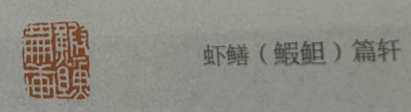

印章\[鰕䱇篇轩\]来自曹植诗，表达自己不被人理解不被人所知的痛苦

因不解其意我查了一下，__\[鰕䱇\]来自曹植的诗，是抒发渺小的自己壮志难酬、不被人理解、不被人所知的郁愤和痛苦。（《红楼梦》里就很爱引用曹植诗。宁藩的藩府刻书里有书名为《曹诗》的独本诗集，收录了曹植全卷）__。

阅读八大山人的传记文章，我一直深深感受到：八大山人写出了旷世之作《石头记》，为了躲避文字狱保护自己，他不得不设谜隐藏自己（编了那么多假名字、用了那么多批书人小号、为了掩人耳目还让作者曹雪芹提前销号下线）。

可是以自己的才华为傲的八大山人，内心又是多么希望后世读者能知道作者曹雪芹就是他，所以他才留下那么多奇奇怪怪、晦涩难解的画作、书法、诗句和印章，其实都是在为《红楼梦》留密码。

当初解出印章\[鰕䱇篇轩\]的含义后我难过了很久。因为对绝世大天才曹雪芹八大山人的痛苦感同身受，所以渺小的我努力研究八大山人、努力一点点找出关联证据，尽管文笔不好其实并不擅长写文章，也依然想不遗余力地向大家宣传：

__八大山人=曹雪芹__

__==========__

__【20260504更新 考据证据之二十六：1694甲戌年的《安晚册》就是专为《石头记》所画】__

__八大山人《安晚册》创作于1694甲戌年，全册二十二开。__

现藏：日本京都・泉屋博古馆（住友家族旧藏）__↓__

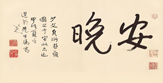

作于1694甲戌年的《安晚册》是专为《红楼梦》而创作

如果阅览八大山人的画作和书法数量足够多，就会发现：__癸酉年（1693）、甲戌年（1694）、己卯年（1699）、庚辰年（1700）__这些年份的作品特别多。而《红楼梦》读者都知道，这些年份正好对应四个版本的脂砚斋评本，这些年份，对作者曹公八大山人而言都具有特殊的纪念意义。

下面列举的仅是该年份的小部分画作，仅是举例。

（1）1693癸酉年，八大山人为“舜老年词翁”画了《书画合册》十六册。

（2）1694甲戌年，八大山人为“退翁先生”画了《安晚册》二十二开。

（3）1699己卯年，八大山人为“叙老年翁”画了《山村暮霭图轴》等。

（4）1700庚辰年，开始启用__\[真赏\]__印章。（——脂砚斋点评多次用“真赏”一词，庚辰本出现3次；甲戌本出现2次）

（看过一篇网上他人的文章，该笔者认为“舜老年词翁”“退翁先生”“叙老年翁”都是八大山人自己。我暂时仅对“退翁先生”有研究，我自己的结论是“退翁先生”就是八大山人自己。举一反三，从八大山人的习惯来看，那位笔者的观点大概率是正确的。）

本篇分析对八大山人而言非常重要的__“1694甲戌年”画的《安晚册》__。我之前在其他帖子里说过：“八大山人”四个字连笔缀写为“哭之笑之”的签名，经书画界研究，有一个__“甲戌年问题”。__在1694年之前八字写为“><”；1694年之后写为“八”；而1694甲戌年的画作里两种写法都有。__从事艺术或写作的人可能更容易理解，这说明1694甲戌年对于八大山人而言是具有重大纪念意义的转折之年。__

认可《吴氏石头记增删试评本》（1693癸酉本）的读者应该能很快反应过来：1693年的癸酉本既然叫《试评本》，那么1年后的__《脂砚斋重评石头记》（1694年甲戌本）就是曹公自己认为可以作为“正式面世”的正式版本了，几十年的心血终于完成，当然值得纪念。__

__于是，1694甲戌年，曹公八大山人不仅更改了签名中“八”字的写法，还画了大量留下密码的画作，其中就包括《安晚册》。__《安晚册》值得单独写成一篇论文详细分析，篇幅有限，我仅抛砖引玉略写一些我的研究结论。

__一、第一页引首题跋写到《安晚册》是为退翁先生所画。__可是“退翁先生”历史上查无此人，结合《安晚册》上几首诗的含义（篇幅有限此处省略），我的结论是：退翁先生就是“曹雪芹”这个人格分身。1694年甲戌本完成后，“创作者曹雪芹”使命完成，可以“功成身退“了。

八大山人有很多人格分身名字，每个名字扮演不同角色（从不会穿帮），不同人格分身之间互相对话=自己和自己对话（例如书中脂砚斋对贾宝玉说“石兄你如何如何”）、自己作画送给自己（梅花图题诗“分付梅花吴道人”、还有《安晚册》等、还有很多），都是八大山人的自我告诫、自我勉励、自我犒赏。

假托为退翁先生所画的《安晚册》，目的是为《石头记》留密码，但应该同时也含有犒赏自己（完成了《石头记》的曹雪芹即隐退的退翁）、作画送给自己的意思。就像现代人自己一个人过生日时会对着蛋糕对自己说一句“生日快乐”。

假托为退翁先生所画的《安晚册》的主要目的（其实是唯一目的）不是为了自我欣赏，而是为《石头记》留密码，，所以完成后就交给信任的皖浙的画商带走了，我相信同时带走的还有1694甲戌本《石头记》手稿。

__二、、抛砖引玉详细分析一下下面这幅画：__

这幅画和之前单独分析过的“耗子精偷香芋”图都属于《安晚册》。

因为极爱八大山人的画，这幅画我也盯着看了很久，然后也是奇怪：为什么花瓶要画成这样像有裂纹一样？查询后得知：这种瓷器叫“汝窑”，极其珍贵，蜘蛛网状的裂纹叫“开片”。↓

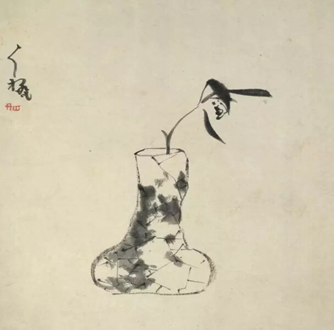

1694甲戌年八大山人《安晚册》中汝窑花瓶对应王夫人房中汝窑美人觚

__真正宋汝窑（宋代老汝）__到了明代已经是传世稀世古董，数量极少，价格天价。只在__皇宫内府、藩王王府、顶级大收藏家__手里流转，民间普通贵族都摸不到。

__明代的「仿宋汝窑」__就是宣德、成化、嘉靖官窑的仿汝釉，本身就是__皇家官窑专属__，民间不许私造、民间也烧不出那个釉色水准，只供__皇帝、后宫、赏赐给亲王、重臣__。

接下来看看《红楼梦》第一次出现的“汝窑花瓶”描写：第三回，黛玉进贾府拜见王夫人，看到王夫人房中的陈设：

……于是老嬷嬷引黛玉进东房门来。临窗大炕上铺着猩红洋罽，正面设着大红金钱蟒靠背，石青金钱蟒引枕，秋香色金钱蟒大条褥。两边设一对梅花式洋漆小几。左边几上文王鼎匙箸香盒，【__右边几上汝窑美人觚 —— 觚内插着时鲜花卉】__，并茗碗痰盒等物。地下面西一溜四张椅上，都搭着银红撒花椅搭，底下四副脚踏……

显然，作为《安晚册》正页第一幅画，八大山人画的这个一般只会出现在皇宫或藩王府的稀世瓷器珍品汝窑花瓶，就是画的林黛玉进贾府在王夫人房中看到的插着鲜花的汝窑美人觚。\(虽然美人觚的形制不长这样，但不能要求画文人写意画时一摸一样画个美人觚，那就不叫文人写意画了\)

现代人大多不认识“汝窑”，不知道它在明（清）时期的稀有珍贵程度。咱们现代人看《红楼梦》时看到汝窑二字不会联想到__在明（清）它只会出现在皇宫或藩王（铁帽子王）等顶级贵族家里。__

__《红楼梦》里一共出现三次汝窑：__

__第三回（黛玉进府）—— 王夫人耳房：汝窑美人觚__

__第二十七回 —— 凤姐屋里：汝窑盘子__

__第四十回（大观园）—— 探春房里：汝窑花囊__

__明代的宁藩王府，当然有汝窑，八大山人家当然有汝窑！__

顺便提一句：那么清代的包衣奴才曹家里会有汝窑吗？曹家沟们可以自己搜索资料论证，我已搜索过，结论如下：

__1、康熙朝的稀世珍宝宋汝没有赏赐给曹寅及曹頫等曹家任何人的记录。__

__2、1728年曹家被抄家，1728雍正六年清朝才第一次开窑烧制“雍正仿汝”，2～3年后技术才成熟。__

__3、曹家被抄没的物品全都登记在册，并没有任何关于“汝窑”“仿汝”的记载。__

那么，一个“家里不曾拥有、自己不曾见过汝窑”的清代包衣奴才曹公子是如何把只属于皇家和王府贵族的这些顶级皇家汝窑瓷器珍品信手拈来写进小说的呢？全凭想象臆造么？没有参照物怎么想象？他把皇家和铁帽子王们这些顶级贵族才能拥有的顶级瓷器珍品写进小说，他不怕给自家招祸么？

__三、我继续往后翻阅《安晚册》，发现后面出现了独属于《红楼梦》的专属密码“耗子精偷香芋”图，至此我能肯定：整个《安晚册》，里面的所有画都对应《红楼梦》里的内容。__

既然《安晚册》是专为《红楼梦》所画，那么首跋写的“退翁先生所属”这个历史上查无此人的“退翁先生”，自然就是喜欢在画上题诗自己与自己对话的八大山人自己（有其他诗画为证）；1694年甲戌年“隐退”的，自然是写完了《石头记》的曹雪芹。之后1702壬午年再安排曹雪芹“泪尽而亡”提前销号掩人耳目。

__四、再简单写几句我对《晚安册》中这幅“花”图的解析： __

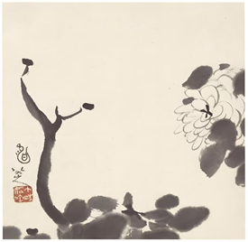

1694甲戌年《安晚册》中的“花”对应《红楼梦》的玉带林中挂

↑画左边有八大山人著名的“合文书写法”书写的花押“三月十九日”，是崇祯皇帝自缢殉国日。

画的右侧（东边——辽东）是气势逼人的牡丹花（宝钗是牡丹花）；

而左侧的花（华——北京在辽东的西边）已从树上掉落，只剩两枝光秃秃的树干。

再复习一下《红楼梦》第五回黛玉的判词画：【只见头一页上便画着__两株枯木__，木上悬着一围玉带】

__这幅画就是 ：黛玉“玉带林中挂”，满清入侵、崇祯殉国。__

__==========__

__【20260504更新 考据证据之二十七：顶级文人画大宗师八大山人亲自为自己的《石头记》画了上百幅插图】__

之前我已阐述过:《石头记》的批评版本有两个系统：除了脂砚斋、畸笏叟等人的脂评本系统之外，曹公八大山人还用蛟川大某山民、东洞庭护花主人、明斋主人、太平闲人的马甲小号，写了另一个批评版本、并且亲自为《石头记》画了上百幅人物绣像和情节插画。

大某山民系统的批评本以及八大山人亲自画的绣像和插画，被明朝遗民一直小心地珍藏保存了下来（没有在乾隆年间程伟元花数年的重金收缴中全军覆没。现在看来癸酉本也没有全军覆没）。

嘉庆年间改琦画和出版的《红楼梦图咏》人物绣像，应该也是参考了八大山人的原作，然后保留的保留（比如保留了黛玉绣像背后的背景怪石）、删除的删除（八大原作上非常繁复细致的背景细节）、省略的省略（比如惜春画桌上的画具凑合画了部分）、修改的修改（比如把人物衣服的交领右衽都改了），自己进行了“二次再创作”。

道光年间，王希廉、姚燮、张新之等人说自是蛟川大某山民、东洞庭护花主人、明斋主人，然后打着“悼红轩原本”的名义出版了带插图的《石头记》，后来光绪和民国年间，陆续有以《增评补图石头记》、《增图全评石头记》、《绘图全评金玉缘》等各种书名出版的带插图批评本。之前我已阐述过：这些版本为了出版只能以程高本120回本来点评，所以评语里只有一部分是曹公八大山人的原汁原味。

本篇不谈论批语，只想给大家分享我对曹公八大山人亲自画的《石头记》插图的分析。

现在存世的带插画版本，从清代古籍到近年出版的《三家评本》，这些带插画的《石头记》里的插画，绝大部分都不是曹公八大山人原汁原味的原画作，而是从清代开始的各出版商的仿作（有的甚至很粗劣）。建筑物线条极其生硬、背景简陋，男士人物帽子上有帽正，等等…

__一、仿画里特意把八大山人原画里的独脚仙鹤删掉了。__

用《增评补图石头记》举例说明。这套书里的插画都不是八大山人原作，只是仿画（复刻母本是光绪年间的《增评补图石头记》）。仿画特意把真画古籍里亭子上独脚站立的仙鹤去掉了，很耐人寻味的删除举动。而且能看出仿画的亭子也不如真画美，估计就是明代审美和清代审美的区别吧）。

除了白眼瞪人之外，独脚站立的鸟兽是八大山人画作的另一个显著个人标签。我想，带有八大山人强烈专属个人风格的“独脚鸟兽”正是从清代开始到民国，由官方出版的《增评补图石头记》版本里没有那只独脚站立仙鹤的原因吧。

下面左图是清代古籍里八大山人原作插画；右图是官方出版的《增评补图石头记》插画。__↓__

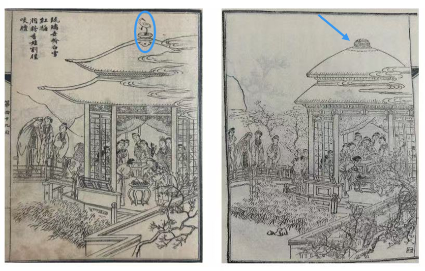

左图是八大山人原作插画（亭上有独脚站立仙鹤）；右图是官方版本临摹删改后的插画

__二、文人画顶级大宗师八大山人为自己的《石头记》创作的插画里，在很多屋中陈设和背景里留下了密码线索。__

我大量地看各种红楼梦插画并不停地比较，很快我就注意到有些古籍中的插画非常讲究细节，连贾府屋中墙上挂的画、以及雕花床上的瓷片装饰、屏风上的四条屏，竟然都仔细画上了各种画、书法、还有题诗、题款、印章。—— 我很吃惊，随即就意识到这些背景画里应该有喜欢留密码的八大山人留下的线索。

作为被红学家和曹家沟嘴里嘲笑的“民科”，我没有渠道获得高清晰度的印刷版本，所以虽然我非常想看清曹公八大山人亲自画的插画里的背景细节（诗句、题款、署名、印章等），但终究无法实现。

作为大写意画的开派大宗师，八大山人亦擅长文人山水画，也达到了登峰造极的高水准。《石头记》插画的背景图里有很多山水画。我的研究刚开始，希望以后我能在某些八大山人的山水画的局部图里找到《石头记》插画背景里的山水画（就像前文阐述过的青埂峰顽石图和黛玉绣像图里的怪石）。

现阶段我找到一个有意思的线索。孤证不立，单独这一条线索，不能直接成为八大山人=曹雪芹并且亲自画了《石头记》插画的证据（清代古籍某个版本的插画是八大山人本人所画的“铁证”我之后再论述），但是如果坚持看我的分析文章看到这里，我已经罗列了二十多个硬核证据、已经构筑了一个完整庞大的证据链。对于不带预设立场的人来说，对于“八大山人=曹雪芹”这一结论应该是确信无疑了吧。

因为“民科”的天然劣势，我无法看到更高品质印刷的《石头记》插画里更多的密码细节（因为模糊看不清），但我发现，贾府屋中这些墙上的背景画，题款处签署的用天干表示的时间，放大后能看出竟然都是“己亥”年。↓

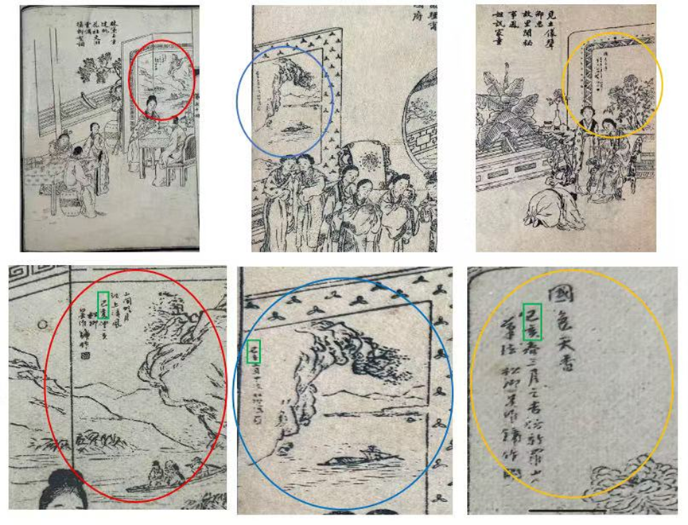

清代古籍《石头记》插画里贾府屋中背景墙上的文人画都签署“己亥”年

__那么“己亥”年对于曹公八大山人来说是不是什么特殊年份呢？__

__我查阅资料后得知：“己亥”年对于曹公八大山人来说还真是具有特殊意义的年份：__

__八大山人所有传世的书画艺术作品，都是始于“己亥”年！↓__

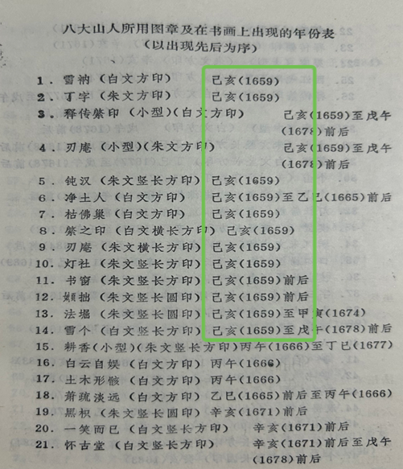

八大山人所有的传世书画艺术作品都是始于1659己亥年

__三、补图说明上一篇提到的“汝窑美人觚”。__

细节控八大山人亲自画的《石头记》插画里，下图贾宝玉房中桌上这个花瓶的形制就是“美人觚”。当然因为没有蜘蛛纹开片，所以宝玉房中这个不是汝窑。

大家还可以看看雕花木床上镶嵌的瓷板上都仔细画上了花卉和书法。

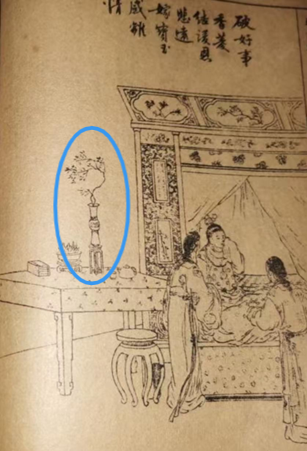

八大山人亲自画的《石头记》插画，桌上花瓶是美人觚

__四、看过明代顶级文人画大宗师八大山人亲自画的《石头记》插画后，作为对比，请大家看看高鹗程伟元作为清代官方皇家出版商出版的程高本里的插画。__

《石头记》是出身在明代、在明代接受教育、具有明代高级审美的王府贵族出身的大艺术家大天才八大山人创作的。《石头记》的书和插画一体，都属于文化审美辉煌灿烂的明朝。程伟元高鹗身为官方出版商，他们奉皇命能找到的画坊画师，最高水平也就如此而已了，他们代表清朝官方出版商的最高插画师水准（见下图）。

__审美差距高下立现！__

__重点是：如果不是明代王府贵族出生，写不出处处带有明代皇家印记的《石头记》，清朝的画坊画师，那怕你是官方出版商的画师，也画不出明代王府贵族家里琳琅满目、审美高级的陈设细节。__

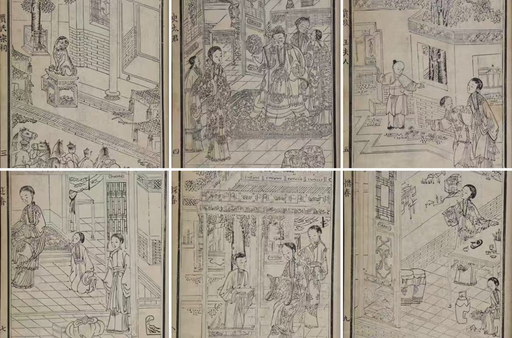

清代高鹗程伟元版本《新镌全部绣像红楼梦》（俗称程甲本、程乙本）里的插图

补充一句看图说话：高鹗程伟元版本的人物衣服都是高领立领对襟和厂字襟。

==========

__【20260505更新 佐证证据之二十八：宁藩的家族气质和刻书扬名的治学传承造就了集百科全书于一身的大艺术家曹雪芹】__

研究曹雪芹八大山人，建议阅读一些关于宁王朱权和宁藩的史料，有助于理解八大山人为什么要写《红楼梦》以及为什么是宁藩朱权的后人八大山人写出了《红楼梦》。

__1、《明代藩府刻书研究》这本书介绍了宁藩辉煌的藩府刻书，诠释了何为“世代簪缨之家”和“百科全书之家”。__

不考虑因战祸损毁、轶失，以及被后世清人鸠占鹊巢的，__宁藩的藩府刻书为112种，总数占明代藩刻的五分之一，总数最多。涉及经易类、音乐类、小学类、史及史评类、传记类、儒家类、医家类、法书类、杂艺类、类书类、道家类、诗文及诗文评类、词曲类。↓__

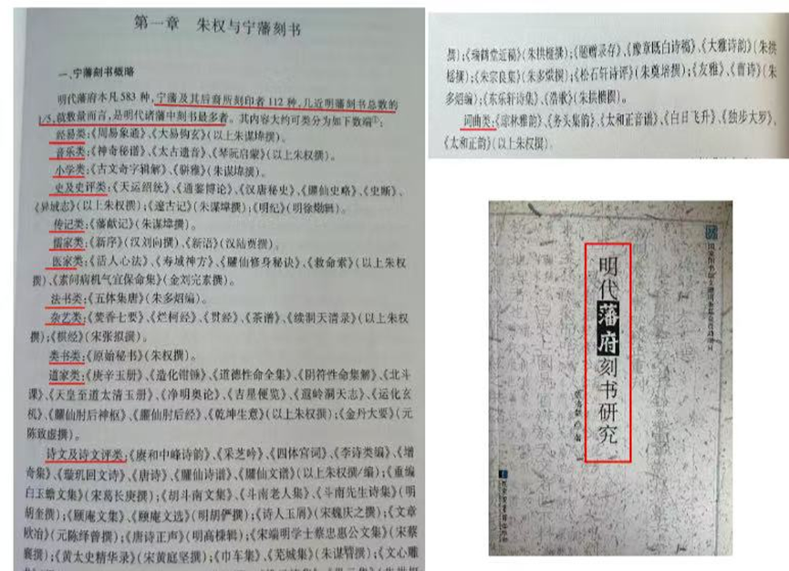

《明代藩府刻书研究》诠释了何为“世代簪缨之家”和“百科全书之家”

__2、宁藩自朱权开始就有编纂历史论著的家风传承。__

朱权自幼好学，博览群书，年少时就奉太祖朱元璋的钦命编著了两部史论著作《通鉴博论》二卷和《汉唐秘史》。末世王孙八大山人写的奇书《石头记》不仅是小说、亦是史书。↓

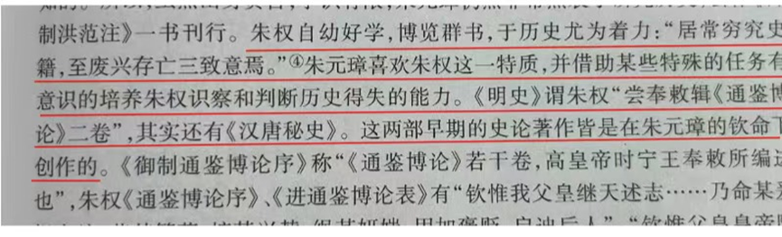

朱权奉太祖钦命编著了《通鉴博论》和《汉唐秘史》两部史书

__3、“立言不朽、刻书扬名”是宁藩的家族气质和治学传承。__八大山人的祖父朱多炡就曾把诗刻在石头上，说要让后人知道历史上曾有过他这么一个人。↓

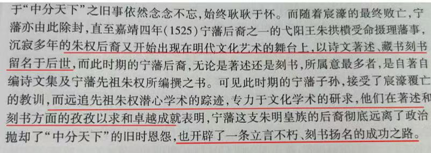

“立言不朽、刻书扬名”是宁藩的家族气质和治学传承

__4、贾探春说的家族败亡于内斗的观点，在曹雪芹的先祖宁王朱权编著的《汉唐秘史序》中早已有相同观点的论述。__

《红楼梦》第七十四回 贾探春言：……可知这样大族人家，若从外头杀来，一时是杀不死的，这是古人曾说的‘百足之虫，死而不僵’，必须先从家里自杀自灭起来，才能一败涂地！

__朱权：“盖祸由于外者，必延数十年而后败，事犹未可必；机泄于内者，不逾期年而倾覆，有可必者矣“。”乱不生于郊而生于肘掣之间”。__↓

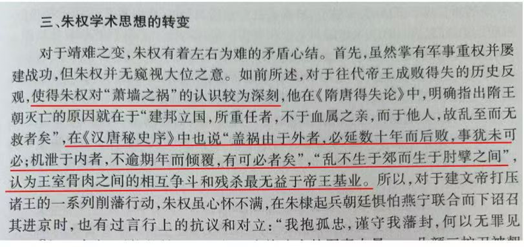

朱权曾在自己编著的《汉唐秘史序》中论述过家国败亡于内斗的史观

__==========__

__【20260505更新 考据证据之二十九：曹雪芹这个笔名关联八大山人的字号等个人信息，笔名的含义为：朱家不向满清低头的隐士】__

本贴作为证据汇总，把之前我分析曹雪芹这个笔名的含义的文章链接放在这里：

[我破解了曹雪芹三个字的意思：朱家不向满清低头的隐士](https://zhuanlan.zhihu.com/p/1988337276011435926)

关于“八大山人=曹雪芹”，我看到全网最早是在2017年就有网友提出这一观点，然后知乎上好像是2022年有网友提出。我内心把这些网友都视为同道前辈。

关于“曹雪芹”这个八大山人特意取的笔名，我的解读只是我的方式，其他网友也有自己的解读。__我们这些“八大山人曹雪芹”派，大家的解读都殊途同归，无论怎么解，“曹雪芹”三个字都指向“八大山人”。__

__==========__

__20260505更新 考据证据之三十：八大山人同时代文人写的《八大山人传》里记述了八大山人有秘不示人的诗稿藏于篋中，肯定是《石头记》手稿无疑】__

研究八大山人的第一手史料，是与八大山人同时代的文人邵长蘅（1637～1704）所写的《八大山人传》（创作年份 1690 年）。（癸酉本面世是1693年）。

当年邵长蘅客居南昌，经八大山人的好友__澹雪和尚__（下文中的澹公）引荐，在北兰寺与八大山人会面，依据亲身见闻撰写此文。该文收录于邵长蘅《青门簏稿》卷五。是最早最权威的八大山人传记史料。

清代邵长蘅《八大山人传》古籍原话__：__

__澹公语予：山人有诗数卷，藏篋中，秘不令人见。__（篋指竹木匣子或箱子）

八大山人有大量传世的诗、画、书法，如果不是会招祸的禁书反书，是不必、也不会“秘不令人见”的。今天的我们看到这句描述，自然能做出合理推断__：八大山人秘不令见人的篋中所藏诗卷不是“诗卷”，而是《石头记》手稿。 __

下图是1981年上海人民美术出版社出版的汪豆子先生编写的《八大山人诗抄》，引用了邵长蘅《八大山人传》里的话。

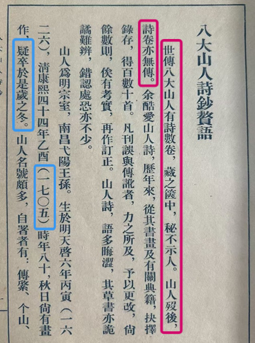

1981年上海人民美术出版社出版的汪豆子先生所著《八大山人诗抄》

另外，__汪豆子先生写的“八大山人疑卒于1705年”__，是用1705秋季还能看到大八大山人的画而做出的一种推断，不是确凿史料。之后研究八大山人的文章多采用汪豆子先生的这段话，有的写了“疑”、“约”，有的直接写“卒于1705年”。

1705这个卒年不对，八大山人的卒年应该是1707丁亥年。理由：1705年冬季之后没有八大山人的存世画作，有两种可能：

（1）真的停止了创作（通过八大山人给友人的书信可知，八大山人晚年手有疾患）。

（2）有创作但是没能保存到今天（比如从八大山人的自题诗可知：八大山人80岁时还有自画像，可是《自画像》却没有存世）。

__无论是以上哪种情形，都不能认定八大山人卒于1705年冬。八大山人的正确卒年应该采用他的别名之一牛石慧的卒年，即1707丁亥年。__

__==========__

__【20260505更新 考据证据之三十一：补充关于大观园的营造者“老明公山子野=八大山人”的解析（借用乎友泛山的观点）】__

乎友泛山在本楼回复中对“老明公山子野=八大山人朱耷”的一段论述，仔细读之我觉得泛山解析得非常准确，放到正文中分享给大家。（感谢泛山在几次回复中提供的一系列非常有价值的证据）

__以下为泛山的原文：__

红楼梦中大观园的营造者，老明公山子野为朱耷之隐称。山子野即山子quan\(上林下金\)。

朱耷其真实谱名朱统𨨗（quan），字上林下金，为皇室生僻专属字。在清代文字狱高压之下，明宗室本名直书即涉忌讳，无法明载，故以字形埜\(现代的野字\)字近替、暗码藏名之法隐入文内。

__1\. 野字字形暗替__

“𨨗（林\+金）”形涉明宗室，不便直书，作者取其形近且同义之古文埜（野字的古代写法，林\+土），上同作“林”，下易“金”为“土”，既避文网，又存本字之形。实际上，古代经常不用野这个字，而是常用埜这个野的异体字。一目了然，作者既暗示山子野是谁，又要去金存土，即要向后金讨回国土。一迷两猜。

__2\. 名号合成__

朱耷号个山，时人亦称个山子，山僧，山子，与隐字“埜（野）”相合，即成山子埜，后世通行写作山子野。

__3\. 身份印证__

“老明公”三字直指明代遗老、前朝宗室，与朱耷明宁王后裔、国亡出家、终身不仕清廷之身份完全吻合。

__4\. 历史典故__

山子野作为朱耷隐称，其绝妙之处并不只在埜字。请注意了，山即丘，山子野即丘子野！丘子野是谁？丘子野，南宋隐士，朱熹的表兄，而朱熹被朱明王朝奉为正溯甚至远祖，作者这里已经在疯狂暗示观众，大观园营造者山子埜也是皇室血亲。

我们说，一处巧合只是巧合，多处巧合就绝不是巧合了。那么，南宋朱熹的血亲，丘子埜的号是什么？

丘子野号芹溪！

是创作者的另一个代号。

__妙哉！妙哉！脂砚斋在此处专门重点表扬了这个随事生名的妙号！__

综上，《红楼梦》中“老明公山子野”并非虚构造园家，而是为避文字狱，以朱耷谱名朱统𨨗之字形、字号、身份暗构的化名，所指即八大山人朱耷本人。

__红楼梦中，惜春为朱耷入世现身，山子野为朱耷化名真身，一绘大观园、一造大观园，实为一人在书中的双重投影。以上，供诸公明鉴！__

__==========__

__【20260505更新 考据证据之三十二：牛石慧是八大山人的别名之一，八大山人卒于1707丁亥年，与畸笏叟最后批语丁亥夏吻合】__

有一首诗云：__“八大山人牛石慧，石城回首雁离群。问君哭笑因何事，兄弟同仇不拜君”__。由此很多人误以为牛石慧是八大山人的弟弟。

其实不是，牛石慧（经常只出现在画作上的名字）亦是八大山人的别名之一，诗作也是八大山人写出来故意混淆视听，想让别人认为牛石慧是他弟弟。

就像《个山小像》是假托“好友黄安平”之名，《安晚册》是假托替“退翁先生”所画，牛石慧也一样，都是和黄安平、退翁先生一样的假名字，都是他自己。

__要确认牛石慧是八大山人的别名这一点非常重要__，因为如果要全面解开《红楼梦》的作者和批书人之谜团，不留下似是而非、无法确认的模糊解释，我们一定需要确认作者八大山人（他同时也是脂砚斋、畸笏叟等所有批书人）的卒年，因为畸笏叟（作者本人）在1707年丁亥夏还留下了最后的批语。

我们必须知道作者八大山人在1707丁亥夏是否还在世？否则只会陷入很多人做的那样无视楔子里提示的“作者即批书人”，毫无根据全凭想象给曹雪芹乱安一些“红颜知己批书人”、“家里年长亲戚批书人”……

__我的研究结论是：牛石慧是八大山人的别名之一，八大山人的卒年应该采用史载的牛石慧的卒年1707年。__

关于牛石慧是八大山人的别名，我之前有专门的文章分析：

[很多人说八大山人和牛石慧都参与了《红楼梦》的创作，他俩是同一个人吗？](https://zhuanlan.zhihu.com/p/2022700362172219554)

确认了八大山人卒于1707丁亥年，那么：

__【八大山人=曹雪芹=脂砚斋、畸笏叟、栖霞客等所有批书人=现实中修建了大观园（青云圃）的山子野=现实中画了《大观园图》和《石头记》插画的惜春=贾宝玉=癞头和尚=空空道人】这一终极唯一正确结论，已无懈可击、没有任何立不住脚的牵强解释、将立于不败之地！__

__这一终极答案，是将来某一天（不知道是否还很遥远？）能真正打败曹家沟的唯一正确答案。__

__==========__

__【20260506更新 考据证据之三十三：八大山人最古怪的印章\[忝鸥兹\]解析：它就是戴斗笠披蓑衣的“渔翁贾宝玉”】__

我研究八大山人那些奇奇怪怪的印章时，因我不具备丰富的古典文学知识和佛家、道家的知识，一开始都是懵圈状态。但因为深信八大山人在印章里留下了关联《红楼梦》的密码线索，所以即使一开始看不明白我也没放弃。（做研究时信念真的很重要！）

我会盯着印章的样子（其实就是高级图案设计）反复看，也会查询印章上刻字的含义。

比如下面这枚印章，书画界人士至今没人能解释清楚这枚古怪印章代表了什么。↓

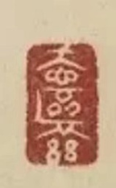

八大山人最古怪的的印章\[忝鸥兹\]

这枚印章出现在我上文论述过的为纪念1694年甲戌本《石头记》面世而创作的《安晚册》里，22开的第16幅，画的是“芙蓉”。↓

1694甲戌年《安晚册》的“芙蓉”里出现这枚古怪印章

《红楼梦》里芙蓉指黛玉（以及晴雯），在画黛玉的画里出现这枚古怪的印章（书画界解释是“忝鸥兹”三个字），那我想一定和黛玉有关

某天我依然长时间盯着看时，突然灵光一现：这枚印章刻的是“渔翁”！

《红楼梦》前80回出现渔翁渔婆的对话；而癸酉本亦有呼应：宝玉乞讨流离，只把光阴虚度。展眼黑发更换白发，不觉到了暮年\.\.\.\.\.\.这日宝玉往南行走，来到湘江地界。因下了一夜大雪，地上积了厚厚棉絮，宝玉饥肠辘辘，见江上停一孤舟，不知是谁家渔船，披了蓑衣，头戴斗笠，坐在船上独钓。忽然一阵冷风吹来，急忙抱紧了双臂，实在撑不住，只得划到岸上，猛然想起当年黛玉说过的一句：__“那里来的渔翁？”__那眼泪又似断了线的珍珠往下堕。音容笑貌如在眼前，宝玉忍不住，竟痛哭出声，蹲在雪地里，哭得浑身乱颤，口中只叫：”林妹妹！林妹妹！“\.\.\.\.\.\.

对照着《红楼梦》108回本的描写，这枚古怪印章的造型活脱脱就是戴着斗笠、披着蓑衣的“渔翁贾宝玉”。

而且可以再看看缩小版的八大山人自画像《个山小像》，这枚代表“渔翁贾宝玉”的印章造型，完全就是《个山小像》八大山人！具有高级审美的大艺术家八大山人自身是很幽默的，这枚令人心酸的印章造型太可爱了！八大山人费尽心思为我们后人留下的密码线索，我们终于解开了！

八大山人自画像《个山小像》和这枚古怪印章就是“渔翁贾宝玉”

__==========__

__【20260506更新 考据证据之三十四：“石癖”八大山人画的《自画石》和《玲珑石》】__

我看到网上更早年间就已经探寻到“八大山人=曹雪芹”的一些前辈，都提到了《题自画石》这首诗：

__曹雪芹《题自画石》__

__爱此一拳石，玲珑出自然。__

__溯源应太古，堕世又何年？__

__有志归完璞，无才去补天。__

__不求邀众赏，潇洒做顽仙。__

前辈们都说这首题在《自画石》画作上的题诗《题自画石》就是《红楼梦》作者八大山人所作，我当然完全赞同此观点。

我在网上搜寻这幅《自画石》画作，遗憾的是搜寻无果。网上没有任何这幅画作的图片。

查询得知：《题自画石》据说是清末民初一位叫富竹泉（1855—1928）的人写的诗，民国年间他将此诗收入自己的诗集《考槃室诗草》。1970 年代，富竹泉的外孙孔祥泽将此诗从外祖父诗草中抄出，伪称 “曹雪芹佚诗”， 交给红学家吴恩裕，1973 年吴恩裕公布 “曹雪芹佚著《废艺斋集稿》”，将此诗署为 “曹雪芹”附入伪造的《废艺斋集稿》，后被学界揭穿。

那么把这首诗说是自写的并放入自己的《考槃室诗草》的富竹泉是什么身份呢？查询可知：富竹泉是旗人，从祖上开始世代都为清代头号王府恭王府服务，其父盛紫川是恭王府大总管，他本人是恭王府福晋的史官，负责给恭亲王福晋做文字记录、文书、课读等，属王府高级文职。

根据以上查询信息请大家自己判断故事的逻辑和真相吧。

我自己的判断是：富竹泉收入自己的诗集《考槃室诗草》里的《题自画石》，和据说是敦诚敦敏兄弟写的、并收入自己的诗集《四松堂集》里的《寄怀曹雪芹》等著名诗作（这些诗作被胡适用来判断二敦兄弟是曹雪芹的好友）一样，都是真正的曹雪芹八大山人的诗作，但最终都被满清贵族鸠占鹊巢了。

另外，为什么《自画石》这幅画只出现在传说中，但是网上连半片纸角的照片和图片都没有呢？我的答案是：因为画作一旦露面，有强烈个人风格的八大山人画的《自画石》\+画上题诗\+签名\+印章，应该会毫无争议地被判定为是八大山人所画。那么，曹包衣不是曹雪芹的谎言马上就会被揭穿。所以 ，《自画石》这幅画，应该早就被有心人私藏或者毁掉了。

曹公八大山人专为《石头记》画的《自画石》画作我们看不到，不过__大家可以一起欣赏一下有“石癖”之称的 八大山人（爱画石、有名为\[石癖\]的印章、一生喜欢治印刻石、对各类石材爱不释手）1659己亥年画的《玲珑石》（又叫《奇石》），是《传綮（qing、四声）写真册》里的一幅画，现藏于台北故宫博物院。↓__

八大山人1659丁亥年画的《玲珑石》也是来自神佛圣山的奇石

__画上题诗为《题玲珑石》：__

__击碎须弥腰，折却楞伽尾。__

__浑无斧凿痕，不是惊神鬼__

解读诗意：须弥即须弥山，山在海中，上为帝释天所居，此山为纯宝所成。楞伽为锡兰岛本名，岛上有山。八大山人把一块占据着画面五分之三的莫名其妙的石头，说成是来自神仙居住的地方。按主观意图将具象任意变形，甚至完全抽象，让一块玲珑剔透、洞空怪异的石头有了灵魂。诗中说__这块没有人工斧凿痕迹的天然奇石，是从楞伽山折断下来的，应该没有惊动须弥楞伽这些佛和神仙聚集的圣山上的神鬼吧！__（诗句解读引用自陈世旭老师著《孤独的绝唱——八大山人传》）

请大家各自阅读理解。__我的理解是：1659己亥年（八大山人34岁）画的这幅来自神佛居住的圣山上的玲珑石，就是后来八大山人写《石头记》里女娲补天遗漏的顽石。思想和设定是一脉相承的。__

另外，想再次强调加深大家的印象：请别忘了我在之前的文章里写的，清代某个版本的《石头记》古籍里八大山人亲自画的插图上，作为背景的贾府房中墙上挂的山水画和花卉画，时间全都签署为“己亥”年。__而己亥年，正是画了这块来自仙山圣山的玲珑石的年份，是八大山人所有传世艺术作品的起始年份！__

__八大山人用他的所有艺术作品编织成的这张“《石头记》大型迷宫网”（一边设谜一边留线索），大家能领略体会一二了吧。__

__==========__

__【20260507更新 考据证据之三十五：《红楼梦》是八大山人的自传体小说】__

本篇不谈论以家喻国等话题。只阐述八大山人的家世背景和人生经历。

__从明末到清代，如果要问谁的家世背景和人生经历更符合贾宝玉，如果八大山人排第二，那就没人敢说排第一。而八大山人不是“更符合”，他是100%符合。__

作为“八大山人=曹雪芹”的证据汇总贴，我补贴出八大山人的个人经历供大家参考。

__1、与八大山人同时代的古人对八大山人的记述：__

__八岁能赋诗，十一岁能画青山绿水，少时能悬腕写米家小楷。善书法，工篆刻，尤精绘事。颖异绝伦，少时善诙谐，喜议论，娓娓不倦，常倾倒四座。晚岁悬腕作书，笔力坚劲，无衰老态。年八十，犹能于扇面作小楷，精整不减盛年。__

__2、我汇总的八大山人的人生经历如下：__

1626天启6年出生，1707丁亥年去世年，享年82岁（虚岁）。

17岁时主动放弃世袭爵位（他可承袭奉国中尉），参加科举考试，一举中了秀才，可惜没等到三年后的乡试大明就亡了。（明朝自万历年间开始允许宗室子弟可以选择放弃世袭爵位参加科举）

1644甲申国难时19岁。明亡后避祸途中父亲去世，在南昌西山祖坟为父守孝，同时在山野中避难。3年后妻、子先后离世。突然某天西山石头口出现漫山遍野的清军，八大山人在石头口剃度出家。（为什么那些满清贵族公子收录进自己诗集里的纪念曹雪芹以及和曹雪芹同游郊外古寺等诗歌里出现那么多“西山”两字？那些诗到底谁写的？）

明末江西先经历戊子之难（张献忠的农民流寇），各王府屡次遭劫。有书籍介绍农民流寇的特点与清军不同，流寇劫掠过后，外出躲藏避难的王府贵族会再重返家宅。而清军是彻底屠杀，对朱明皇室更是斩尽杀绝。

（插播：癸酉本第92回对张献忠农民流流寇的描写如下：黑山村乌进孝（张献忠）带四个养子闯园杀人，高喊：“天有恩与人，人无报于天，当杀尽天下人，以合天意，妇则淫之杀之，孺则煮之食之。”黛玉骂：“管他八大王（张献忠自号）、九山王的，迟早有报应，真真人若无知可以祸国殃民矣！”）

传说八大山人结婚当日清军破城，八大山人逃往山野避难。不知道这种传说的可信度多少，如果历史传言为真，那么与癸酉本贾宝玉成婚当日的情形可谓是一模一样。

史载清军南下后八大山人全府90余口被屠杀；并且八大山人亲身经历过南昌之屠。癸酉本里堆成小山似的尸首、以及有的尸首经年累月化为白骨也得不到安葬等情形应是八大山人亲身经历。

23岁的八大山人拜在禅宗曹洞宗寿昌派高僧弘敏禅师门下，释名传綮（qing）、号刃庵、雪个、个山、个山子。聪颖过人、佛法精湛，28岁时得正法，被弘敏禅师指定为鹤林寺和耕香院两座寺庙的衣钵传人。此时画作喜欢签名“灌园长老”（灌园：神瑛侍者？另外，黛玉避讳母亲的“敏”字，应该就是借著书感怀恩师弘敏禅师。八大山人亦僧亦道时也是恩师弘敏禅师替他打掩护掩人耳目，以“身在耕香院”为名，其实以朱道朗的道士身份在青云圃。）

在南明最后一个政权永历政权覆灭后，起心动念要写《石头记》，36岁尚未还俗的他在弘敏禅师掩护下以良月道人身份去南昌郊外修建了江南园林青云圃道院（现实中的大观园），42岁道院基本建成，作为住持入住，开始正式创作《石头记》。

宁藩弋阳荣王府原先有园子叫“阆（lang）园”，王府败亡后被一个叫李明睿的姓李之人获得。阆园→阆苑仙葩？朱家王府园子被姓李的人得了去→最后是李纨获得了贾家。——现实的地名和人物姓氏也都被还原写进了书里。

弋阳荣王府的“阆园”→所以修建青云圃时给自己取名“良月道人”、朱道朗。

49岁时为脱下僧袍彻底还俗作准备，假借“朋友黄安平”的名义画了自画像《个山小像》，历时4年和友人一起在画作上写了9个题跋，透露自己弋阳王孙的身份、透露自己即将还俗、并记录了自己的生平 。（曹雪芹八大山人心思缜密，和先祖朱权一样善谋善布局）

因为身份同时是和尚和道士，所以八大山人长年戴着一顶斗笠，道士有头发和尚无头发不能两全。《个山小像》历时4年写了9个题跋，除了6个自跋外，还邀请了3名历史上确有其人的真实朋友写题跋（如果画上签名都是历史上查无此人，那么写100个名字可信度也为零）。

《红楼梦》一个字都不能改，一个字都无闲笔，同理，非常重要的《个山小像》9个题跋也都各有深意缺一不可。那么其中一个跋专门写了他总是戴个斗笠必有深意，他是希望后人探究其因——我有自己的结论：八大山人想透露斗笠之下的秘密——他身为和和尚却留着道士发髻，他是“亦僧亦道”！

除了当时现实中掩人耳目的需要，要专门写进自画像里想让后人知道他“亦僧亦道”有那么重要么？当然很重要！—— （1）告诉大家修建青云圃的良月道人就是他雪个和尚！（2）告诉大家《红楼梦》总是同时出现的一僧一道就是他！到了晚年，批书人说癞头和尚不见了。当然了，癞头和尚55岁时烧毁了僧袍，之后就不再是“亦僧亦道”，只剩空空道人了。

青云圃道院（大观园）是八大山人为大明王朝逝去的皇族、忠臣义士、以及罹难后得不到妥善安葬的自家亲人们修建的纪念陵园，从36岁开始修建，42岁建成，直到八大山人82岁离世，八大山人在青云圃道院前前后后居住生活了大约46年。不朽巨著《石头记》就是在这里诞生的。为什么说《石头记》是“哭成此书”？了解了八大山人的人生经历后肯定能感同身受。八大山人写《石头记》时，书中人物全都早已离世了。

《个山小像》历时4年先后共写了9个题跋，完成后八大山人把《个山小像》永久留在了鹤林寺。后世徒子徒孙小心珍藏先代住持（透露自己身份的）的遗作，解放后五十年代被江西人献给新中国相关政府，这才彻底解开了画坛大宗师八大山人的身份。

55岁时借机装疯烧毁僧袍，彻底还俗离开佛门当了道士。因为如果作为佛门住持，再说可以借口长期闭关，毕竟无法长久，每天带领僧众雷打不动的清规戒律和修行活动、以及各种节日的佛事活动会挤占时间，让他无法自由创作《石头记》。

作青云圃住持时八大山人把自己居所命名为“黍居”，黍就是粟，《红楼梦》三家评本里点评平儿时说“一粒粟可现大观矣”——看到这里可以理解八大山人曹雪芹为什么命名自己的居所为“黍居”。青云圃副开业祖师马道常（原姓上官的四川人）的屋舍取名“鹤巢”。

61岁把青云圃道院住持之位传给弟子，说要过以诗画会友的生活云游去了，此后行踪成迷。除了住在好友的寺院里，我分析他秘密隐居在他自己修建的青云圃（青云圃鼎盛时有300间屋舍）。

八大山人晚年把自己的居所命名为“寤（wu、醒着的意思）歌草”，但是后人找遍南昌也确认不了寤歌草堂的具体位置，我认为应该就是在青云圃里。在一些诗里还把自己住的地方叫做“黄竹村”、“黄竹园”。（被清朝贵族公子收入诗集的曹雪芹相关诗稿“不如著书黄叶村”就是八大山人诗画里自称的“黄竹村”“黄竹园”，八大山人还有两枚“黄竹园”印章。应该是八大山人在1702壬午年安排曹雪芹提前销号后用脂砚斋畸笏叟之名自己写了那些纪念曹雪芹的诗稿。）

八大山人享年82岁（虚岁）。80岁时尚能悬腕在扇面上写小楷，笔力不减。1644年明亡时他19岁，回顾这一生，已经过去了60年。作为批书人的马甲小号畸笏叟，最后批语“丁亥夏”，八大山人（牛石慧）1707年丁亥年去世。—— 吻合！

而大某山民等另一套批书人系统的版本里，批书人最后写到“上下六十年，始泄其中秘。何乐亦何悲，笑啼应两置”。这里的“上下六十年”何解”？就是明亡后以明朝遗民身份在新朝生活了六十年—— 吻合！“笑啼应两置” 则更是完全对应八大山人的著名签名“笑之哭之”。

八大山人80岁时还画了自画像（可惜自画像没有存世），自题跋写到：“守道如约”。——智商极高、艺术天赋惊人、具有大智慧的八大山人铮铮铁骨、一生不仕清，作为朱元璋和朱权的子孙，守住了自己心中的“道”，完成了自己对自己的约定，并为我们华夏后人留下了不朽巨著《红楼梦》。

__考据八大山人的家世背景和生平，全部信息都与《红楼梦》吻合得天衣无缝！__

__==========__

__"nolink">【20260508更新 考据证据之三十六：八大山人的\[拾得\]印章解析：①是八大山人=惜春以及八大山人亲自画了《石头记》插画的铁证；②是《好了歌》的出处】__

__本篇和大家分享我对八大山人晚年的两枚印章\[拾得\]\[十㝵\]的解析。__

1702壬午年开始启用的\[拾得\]\[十㝵\]（缺笔异体字）印章

八大山人因为聪颖过人、佛法精湛，年纪轻轻就是禅林拔萃，三十多岁时就被弘敏禅师指定为江西鹤林寺和耕香院两座寺庙的衣钵传人。八大山人虽然入的是曹洞宗寿昌派（讲究看破不说破打禅机），但是也兼修临济宗（讲究当头棒喝式警醒）。关于自己同时兼修禅宗的曹洞临济两宗这一点，在《个山小像》里八大山人的自跋里有说明。

__八大山人晚年启用的印章\[拾得\] \[十㝵\]（缺笔异体字）,是历史上著名的“寒山问拾得”禅门典故里的拾得和尚。__相传寒山大师是文殊菩萨的化身、拾得大师是普贤菩萨的化身。

看八大山人的传记可知，八大山人虽然55岁时故意装疯烧毁僧袍还俗当了道士，之后61岁时又把青云圃道院的住持之位传给弟子行踪不定云游去了。但是晚年的八大山人，虽然身作道士打扮（终生没有剃过金钱鼠尾），但其实并没有真正离开释家，一直和佛门和尚有密切交往，内心依然是儒释道三家兼修。

在我研究八大山人的\[拾得\]\[十㝵\]印章时，功夫不负有心人，__我竟然找到了八大山人=惜春、以及八大山人亲自画了《红楼梦》插图的【铁证】。__

请看下面这幅__清代古籍《石头记》里的惜春绣像__，我看过大量古本《石头记》的人物插图，仔细对比每个版本的细节，我很确定下面这个古籍的插画是大画家曹雪芹八大山人本人亲自画的。

清代古籍《石头记》里的惜春绣像是曹公八大山人亲自所画

且不说惜春身后竹椅和竹笔筒上的竹节、印花桌布上面还铺了纯色毛毡、桌上那些画轴（画轴顶端的小横突起都画了）、画具（那个调色盘居然和现代的长得一样！难怪我大明朝有成套外科手术刀，现代的东西如果某天出现在明代的古画、古籍、出土文物里，我都不会吃惊）、以及我叫不出专业名称的弹子/ 拂尘？这幅极其注重细节的高水平文人画，一定来自真正高水平的大画家。

（插播一句：惜春里面衣服的领子是交领右衽）

__让我确信这幅画是曹公八大山人亲笔所画的【铁证】是画中的题诗（惜春赞/惜春咏）：__

__漫道扫眉班马，休论傅粉荆关。__

__解识名园是画，居然拾得寒山__。

这首诗里的“拾得寒山”的“拾㝵”，竟然和八大山人的\[拾得\]\[十㝵\]印章一样，也用了缺笔异体字。

这就是八大山人特意留下的非常明显的线索密码！还会有人说古籍上的这幅惜春的插画不是八大山人本人亲笔画的么？！

“异体字”就是缺笔或者多笔的错别字，这是懂各种古体字的书法家和金石篆刻家才懂的，有的异体字是仿古文字和古碑帖的，有的是自创，而__八大山人特别爱使用自创的异体字__是书画界的共识。这首题诗里，除了“拾㝵”，其实还有几个字也是异体字：

↑漫道扫眉班马，休论傅粉荆关。解识名园是画，居然拾得寒山。

扫眉的“扫”用了土字旁；

居然的“居”字下面写成“立”、“然”字没有四点水；

拾得的“得”缺了左边双人旁。

__这四句诗的首句“漫道扫眉班马”，意思是：“别说我是女中的班固司马迁”—— 写了《汉书》和《史记》的班固和司马迁大名鼎鼎，可是《红楼梦》里的惜春和“写史书”有关系吗？__

__所以答案很明显，画插画并题诗的这位“插画家”在告诉所有人：惜春画的《大观园图》就是记录历史的史书！惜春是在写史书！__

__知道惜春是在写史书的“插画家”会是谁？答案难道不是唯一的么？除了作者曹公曹雪芹本尊之外，还能有谁？！__

__当初我就是看到惜春插画上的“拾㝵”二字，联想到了八大山人的缺笔异体字印章\[十㝵\]，再读到题诗把惜春比作写《汉书》《史记》的班固司马迁，至此我能100%确定：画此插画的人非曹雪芹八大山人本人莫属！__

__而四句诗的最后一句，就是作者（惜春本人）在自比寒山拾得，这也与八大山人晚年（1702壬午年让曹雪芹提前销号下线之后）启用\[拾得\]印章完全吻合。__

=====

搜索查询阅读了寒山拾得的禅门典故之后，我发现__红楼梦的《好了歌》原来借鉴了寒山拾得的《忍耐歌》__。

__《忍耐歌》 ，又称《寒山拾得忍耐歌》，来自寒山拾得的著名对话：__

__昔日寒山问拾得曰：世间有人谤我、欺我、辱我、笑我、轻我、贱我、恶我、骗我、如何处治乎？__

__拾得曰：只要忍他、让他、由他、避他、耐他、敬他、不要理他，再待几年你且看他。__

寒山云：还有甚诀可以躲得？

拾得云：我曾看过弥勒菩萨偈，你且听我念偈曰：

老拙穿衲袄，淡饭腹中饱，补破好遮寒，万事随缘【了】。

有人骂老拙，老拙只说好；有人打老拙，老拙自睡倒；涕唾在面上，随他自干【了】。

我也省力气，他也无烦恼；这样波罗蜜，便是妙中宝。若知这消息，何愁道不【了】。

人弱心不弱，人贫道不贫，一心要修行，常在道中办。

世人爱荣华，我却不待见；名利总成空，我心无足厌；堆金积如山，难买无常限。

子贡他能言，周公有神算，孔明大智谋，樊哙救主难，韩信功劳大，临死只一剑。

古今多少人，哪个活几千？这个逞英雄，那个做【好】汉，看看两鬓白，年年容颜变。

日月穿梭织，光阴如射箭，不久病来侵，低头暗嗟叹。

自想年少时，不把修行办，得病想回头，阎王无转限，三寸气断【了】，那时哪个辨？

也不论是非，也不把家辨，也不争人我，也不做【好】汉；

骂着也不言，问着如哑汉，打着也不理，推着浑身转，

也不怕人笑，也不做脸面，儿女哭啼啼，再也不得见。

【好】个争名利，须把荒郊伴。我看世上人，都是精扯淡，劝君即回头，单把修行干。

做个大丈夫，一刀截两断，跳出红火坑，做个清凉汉，悟得长生理，日月为邻伴。

__红楼梦《好了歌》借鉴了寒山拾得的《忍耐歌》。__

__使用\[拾得\]印章的八大山人，题诗将惜春（他自己）称为“寒山拾得”__。

__拾得曰：只要忍他、让他、由他、避他、耐他、敬他、不要理他，再待几年你且看他。__

__==========__

__【20260508更新 考据证据之三十七：通过各种清代古本《石头记上》的插画对比，可识别出曹公八大山人亲笔所绘版本】__

乾隆年间1691、1692年出版的程甲本、程乙本全称《新镌全部绣像红楼梦》，书里带人物绣像和插图；之后有嘉庆、道光、光绪、民国出版的各种带人物绣像（人物咏/人物赞）和插图的《石头记》版本。

__各种版本对比之后，正像我在上一篇详细分析的惜春绣像图一样，一定能从真真假假的插画中发现画坛大宗师曹公八大山人亲笔所绘的版本。曹公八大山人亲自绘制的插图里留有他暗藏的各种密码线索：不仅细节、审美、画工笔力断层式碾压、还有自创异体字、以及印章、诗词等各种指向八大山人个人烙印的线索。__

因为曹公八大山人一直都想让后人知道他才是真正的曹雪芹（这也是他要历时4年绘制自画像《个山小像》并写下9个题跋的原因），曹公八大山人想让后人知道《石头记》是他这位明朝遗民、朱明王朝的末世王孙写的。

__300多年前的绝世大天才曹雪芹留下的密码线索，今天的我们努力去识别它、找到它，把因为满清文字狱不得不隐姓埋名的国宝级大艺术家曹雪芹八大山人介绍给读者、推荐给读者、并推荐给全世界，我认为这才是“官方红学家”应该干的“正事”。今时今日，没有读者愿意再继续听曹家沟那些全凭造假和杜撰、完全是胡说八道的所谓满人轶事、满人趣事、清廷宫斗。__

我上篇给大家分享了八大山人亲自绘制的惜春绣像（惜春赞/惜春咏）。本篇以惜春为例，大家请看各种版本的惜春绣像的对比图，不需要专业知识，只要你具备正常审美和拥有逻辑思维能力，“民科“、”外行”也能超越眼瞎心盲的所谓“专家”。

各种清代古本《石头记》里惜春绣像对比，八大山人的亲笔画断层碾压

对比图如上所示，大家自己看吧。那些和我辩论、从各种角度极力否定八大山人等于曹雪芹的人，他们的审美能力和逻辑分析能力让人无语；更或许，藏在他们语言背后的，其实是因为他们的屁股早就坐歪了。

__==========__

__【20260508更新 考据证据之三十八：八大山人画作上的三翎孔雀竟然出现在了《大观园总图》上】__

__本篇纯属意外之喜。前几天我仔细研究清代古籍上八大山人画的《大观园总图》时，竟然在一个不起眼的角落里发现了两只孔雀：雌孔雀趴在地上，雄孔雀耷拉着长尾巴。耷拉尾巴、扭过头、鼓着腮帮子的形态，具有八大山人著名的三翎孔雀图的【神形】。__

八大山人的《孔雀图》一直有争议，有人说八大山人把孔雀画得这么丑陋，鼓着腮帮子就三根羽毛，是借机讥讽头戴三眼花翎的清朝官员，反对的人说你想多了，那就是正常的孔雀。哈哈，八大山人太可爱了。尽管经历亡国之痛和家人惨遭屠杀，悲愤郁结无处诉，但天生的诙谐幽默亦是八大山人艺术的的底色。否色也不会有《红楼梦》笔下的刘姥姥、阿呆兄这些令人忍俊不禁的幽默描写了。

__八大山人画的孔雀跑到《大观园总图》里去了，我认为这个可列为证据。__

如果清代出版的古籍里的《大观园总图》（我是说我文中贴出的这个版本，不是那些仿画）不是《红楼梦》作者曹公八大山人亲自画的，清代皇家官方出版商聘用的插画师水准在之前的文章里大家也见识过了，能画出这个水准么？

再者说，如果是插画师，像嘉庆年间的改琦那样画几幅人物图咏就了不得了，吃力不讨好地用工笔画一大张《大观园总图》，有必要么？而且这又回到我之前说的__铁证__上去了：__《大观园总图》里的省亲别墅石牌坊与江西南昌的八大山人纪念馆里的石牌坊长得【一模一样】。__

回到孔雀图对比，请大家自己欣赏鉴别两幅画中的雌雄孔雀。↓

八大山人画的孔雀跑到《大观园总图》里去了

__正经的证据论述说完了，下面说一个开脑洞的分析（纯属瞎猜），权当一乐：__

图中孔雀右侧的屋里有两名女子，一人正在写信（纸不大，不是画画）。出现孔雀，那么这个院子应该和三眼花翎有关，难不成写信的女子影射的是明末某个给后金写泄密信的人？哈哈，我不知道，此画的线索不够，圆形门洞和房屋牌匾上没写院落名字（估计是故意不写），无从猜测。

最近略微读了一些明末历史，好像大家都在说当时出卖大明军事机密，给后金提供情报的明朝败类很多。那么在《大观园总图》里出现这么一只代表三眼花翎后金的孔雀，旁边屋里有人在写信，估计就是影射那些大明败类吧。

还有一个细节：孔雀右侧有茂密的松树，左侧树干倒伏的是柳树，地上成堆应该是柳絮？有三眼花翎、有松树、有柳絮、有两个人、难道这幅场景其实画的是导致某人被俘的松锦之战？那间故意空着匾名的房屋是后来的SG庙？……哈哈，我不知道，纯属看图瞎猜，大家当个乐子看吧。

==========

__【20260508更新 考据证据之三十九：甲戌本《石头记》上通灵宝玉和金锁上的文字叫古篆（石鼓文），精通各种字体的大书法家和金石篆刻家八大山人精通古篆】__

古代不像现在有网络和各种对照字典可以随时查询，在《红楼梦》成书的年代，如果不是精通各种书法字体、特别是古篆（石鼓文），那么不可能在《红楼梦》手稿上轻易就写出通灵宝玉和金锁上的古篆（石鼓文）。

之前的章节里简单介绍过宁藩的藩府刻书可以诠释何为__“世代簪缨之家”__、__“戏曲之家”__、和__“百科全书之家”__。宁藩的藩刻里有一套二十卷崇祯六年刻印的《历代钟鼎彝器款识法帖二十卷》，是八大山人的一位族叔整理刻印的。成年后有“石癖”之称的八大山人自小就对钟鼎彝器、古碑文临摹、金石篆刻感兴趣，自小就精研并勤加练习。

被多位清朝贵族鸠占鹊巢的曹雪芹相关诗稿、以及谈论校字、篆刻、造园等各种艺术的文稿里有很多异体字，来源就是这些八大山人自小就感兴趣并刻苦训练临摹的钟鼎彝器和古碑文，当然八大山人尤其喜爱自创异体字。__异体字正是不得不隐姓埋名用曹雪芹这个笔名写《石头记》的八大山人留下的个人烙印密码之一。也是那些清朝贵族公子鸠占鹊巢的马脚破绽。__

大家请看甲戌本《石头记》第八回，曹公八大山人信手拈来地用古篆（石鼓文）写下了通灵宝玉和宝钗金锁上的刻字。↓

甲戌本《石头记》第八回 通灵宝玉和宝钗金锁上是古篆（石鼓文）

请欣赏《八大山人书法集》里收录的几幅八大山人临摹的古篆（石鼓文）。↓

大书法家和金石篆刻家八大山人写的古篆（石鼓文）书法帖

==========

__【20260508更新 考据证据之四十：画坛大宗师曹公八大山人亲自绘制的贾宝玉人物绣像里的通灵宝玉竟然是传国玉玺！！！】__

从第一个证据开始，截止到目前，我已经罗列了39个关于“八大山人=曹雪芹”的考据证据，无一不提供了考据资料。__身为索隐派，我做的是“认真考据”，绝无造假和凭空虚构。__时间仓促写成此文，难免有某些措辞不准确或有疏漏之处，欢迎大家指正，我会虚心改正。

我之前已经详细分析过：画坛大宗师曹公八大山人亲自绘了《大观园总图》和几百幅《石头记》人物绣像（人物咏/人物赞）和情节插画。

__作为本贴的最后一个【硬核铁证】，我展开论述开篇作为“镇楼图”贴出的“贾宝玉人物绣像（贾宝玉咏/贾宝玉赞）”，以此收尾。__

__我利用5个月的业余时专心研究八大山人=曹雪芹的“研究成果分享”暂告一段落。__其实还有很多想和大家分享，以后时间充裕再续吧。

我对“八大山人=曹雪芹”的研究不会停止，我坚信我以后还会不断发现新证据。__开此楼的目的，是抛砖引玉和撒播种子，我想呼吁更多网友都来关注真正的曹公曹雪芹八大山人。__

__审美高级、聪慧绝伦、特立独行、在艺术上开宗立派的国宝级大艺术家八大山人曹雪芹，值得每一位爱好艺术、爱好文学、喜欢明史、喜欢《红楼梦》的读者去研究。八大山人曹雪芹值得每一位研究者终其一生去探索研究。__

言归正传，贴出清代某版古籍里的“贾宝玉人物绣像（贾宝玉咏/贾宝玉赞）插图”。

__它与我之前详细分析过的必定是出自作者曹公八大山人之手的惜春绣像来自同一册古籍，这是判断此插图是八大山人亲手所画的证据之一；而第二个放之四海皆成立的证据就是贾宝玉胸前佩戴的通灵宝玉。__

__大家请看：贾宝玉佩戴的通灵宝玉竟然是“一枚印”！！！！！！！！！ __

曹公八大山人亲手绘的贾宝玉佩戴的通灵宝玉竟然是一枚印

__在这个世界上，除了《石头记》作者曹公曹雪芹本尊之外，请问如果只是一名阅读过《石头记》的读者，更遑论如果只是阅读过高鹗程伟元版本的《红楼梦》的读者，哪位画家的脑洞能大到画贾宝玉人物绣像时把通灵宝玉画成 “一！枚！印！“？！__

我不知道“贾宝玉象征传国玉玺”这个说法最早是谁提出来的，这位索隐派前辈堪称神人！

五一期间我翻看古籍，看到贾宝玉胸前的传国玉玺时，激动万分，眼泪一下子涌了出来\.\.\.\.\.\.……一直被官方红学家们党同伐异打压批评的索隐派们，太不容易了……（这幅贾宝玉画像其实已经被我多次翻看，可之前我竟然一直都没注意到）。

看到这幅曹公曹雪芹八大山人亲笔画的“__贾宝玉佩戴的通灵宝玉是传国玉玺”__，所有一直以来都坚信“贾宝玉象征传国玉玺”的索隐派们真的值得弹冠相庆！

__之前利用官媒痛心疾首地批评：“索隐派说贾宝玉象征传国玉玺是僭越、是想入非非、是玷污经典”的红学会领导，看到这幅清代古籍贾宝玉绣像，他们的反应会是什么？__

__他们会说这本清代古籍是当代人伪造？还是他们想组团穿越到清代去痛斥清代出版商“想入非非、玷污经典”？__

一切用事实证据说话：我贴出各种版本古籍里的贾宝玉绣像的对比图，请大家自行判断。 ↓

五个版本的清代古籍里的贾宝玉人物绣像插图中的通灵宝玉对比：八大山人画的是玉玺印信

__最后，贴出我顶礼膜拜的国宝级大艺术家八大山人的自画像《个山小像》（时年49岁）与八大山人亲手绘制的贾宝玉人物绣像（明亡时八大山人19岁）对比图：__

__俩人都是椭圆鹅蛋脸、悬胆鼻、大耳朵。__（癞头和尚赞里诗句为：“鼻如悬胆两眉长”）

__不强求大家与我看法一致，我自己从贾宝玉人物绣像上看出了《个人小像》里八大山人的影子。本来嘛，我从一开始就对“《红楼梦》是八大山人的自传体小说”、对“八大山人=贾宝玉”坚信无比，正是这份坚定的信念和心中的正义感与愤愤不平，推动我拼命去寻找八大山人=曹雪芹的各种证据线索。__

我从贾宝玉人物绣像上看出了《个人小像》里八大山人的影子

2026年5月8日，现阶段的40个证据分享完毕，本楼的更新暂告一段落。感谢大家的阅读，感谢一直以来留言支持鼓励我的各位乎友，感谢在留言中分享提供有力证据的各位乎友。祝好人一生平安～

__【20260522追更 补充曹公八大山人亲绘的四张绣像图：黛玉赞、癞头和尚赞、青埂峰石/通灵宝玉赞、李纨赞】__

__（一）黛玉赞/黛玉咏__

__人间天上总情痴，__

__湘馆啼痕空染枝。__

__鹦鹉不知侬意绪，__（此处“鹦鹉”是异体字，都去掉了鸟兽偏旁）

__喃喃犹诵葵花诗。__（感谢留言网友的指正，此处改为葵花诗）

曹公八大山人亲绘的林黛玉绣像

===

__（二）癞头和尚赞/癞头和尚咏__

__鼻如悬胆两眉长__，

__目似明星有宝光。__（不知道这里识别为“宝”字是否正确？）。

__破衲芒鞋无住迹，__（此处“無”是异体字，下面写成了“火”）

__腌臜更有一头疮__。

注意：曹公画上原诗里好几个异体字，应该都有想传递的含义，我分析不出来。但我看出一个明显的：“無”字去掉象征清的四点水，改成了象征明的“火”字。

曹公八大山人亲绘的癞头和尚绣像

===

__（三）青埂峰石/通灵宝玉赞__

__石耶？玉耶？顽耶？灵耶？__

__乾端坤倪铸尔形耶？__（乾端坤倪出自八大山人最喜欢的《庄子》）

__痴海情天炼尔神耶？__

__来无始去无终耶？__

__渺渺茫茫各安穷耶？__（此处的“茫茫”里面嵌入了“人亡”俩字）

异体字“茫茫”里面嵌入了“人亡”俩字

诗末尾的“陆子常绘”这个名字想传递什么信息，我暂时无解。插播一个题外话：网上资料说近些年有江西宁藩几座王爷墓葬考古性发掘，里面记载的宁王朱权的信息，与清修《明史》不同，朱权是太祖朱元璋的“拾陆子”，可是清修《明史》却写为“拾柒子”。清修《明史》为啥连这个都要篡改？……

===

__\(四\)李纨赞__

__抱得松韵操，青青耐早霜。__（此处的字识别为“操”字不知道是否正确？）

__鸾飞孤月影，桂发一枝香。__

__爱雪邀开社，追凉玩插秧。__

__教儿知稼穑，妇德自流芳。__

画面是一位“妇女”在教导幼子“知稼穑”。

此诗句里也有几个异体字，应该有深意，我分析不出来。诗句我不详解了，以后另开楼吧。希望大家阅读理解诗句时，不要犯了看风月宝鉴时容易犯的错误，这首诗也请“看背面”。

提示：根据知乎网友“在路上”的观点，贾雨村=贾瑞=李纨。我赞同此观点，曹公八大山人亲绘的李纨绣像题诗，可以石锤“在路上”提出的观点。

李纨在教导幼子“知稼穑”

__作为对比，下面贴出乾隆年间高鹗程伟元的官方程高本里的李纨绣像和题诗。程高本的题诗照搬了曹公八大山人的诗，绣像画作估计是风月宝鉴照了正面，高鹗程伟元以为“稼穑、追凉插秧”就真的是大冷天里插秧。__

高鹗程伟元以为“稼穑、追凉插秧”就真的是大冷天里插秧
