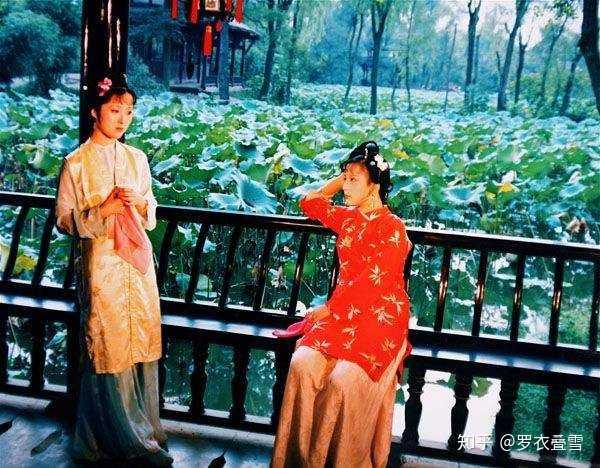
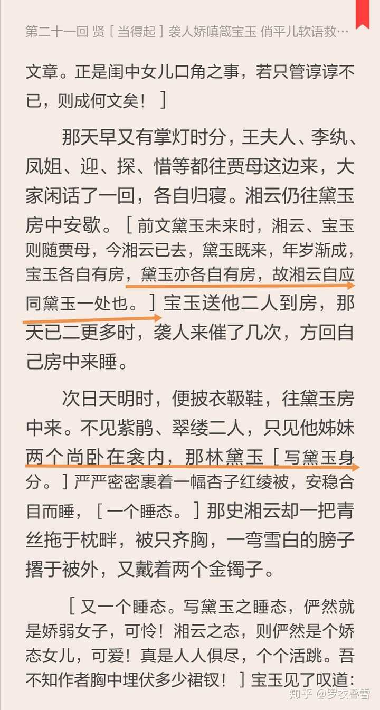
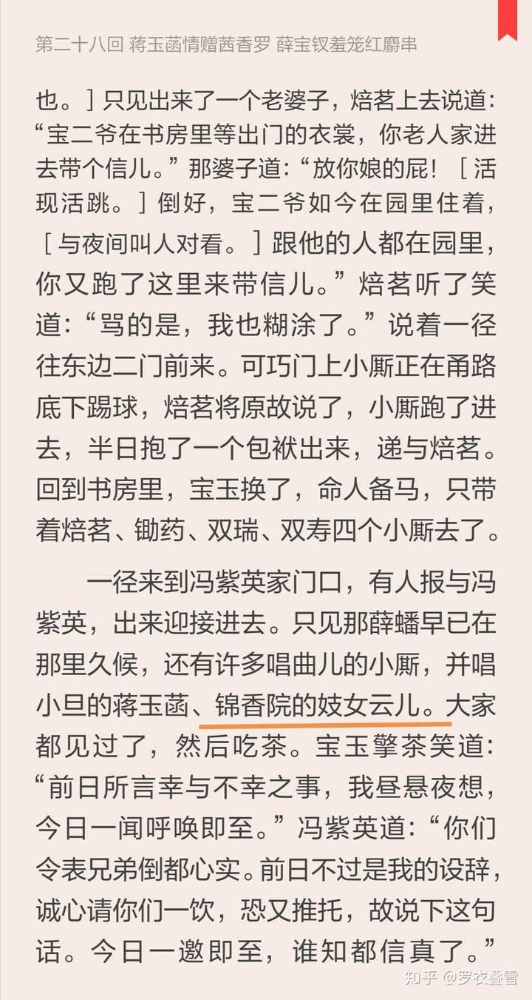
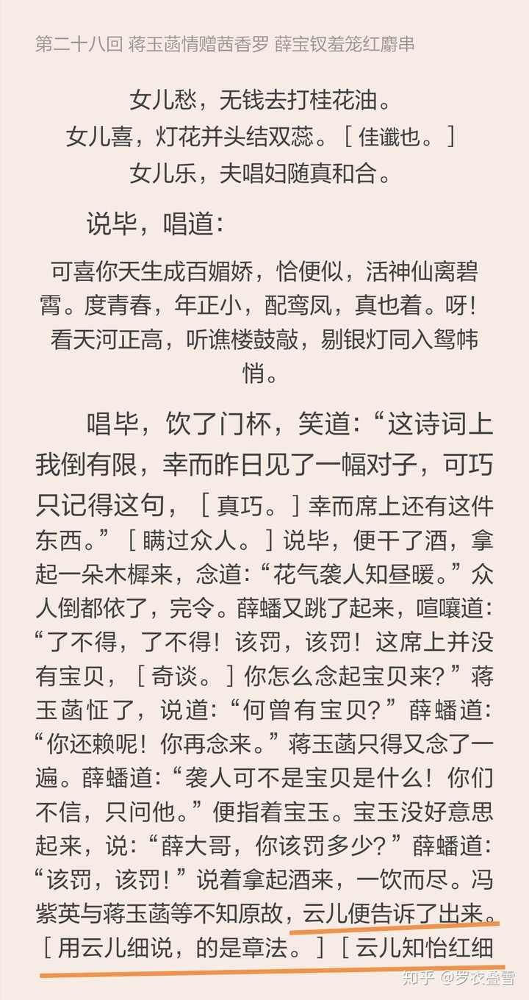
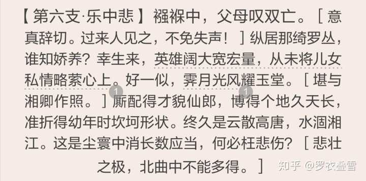
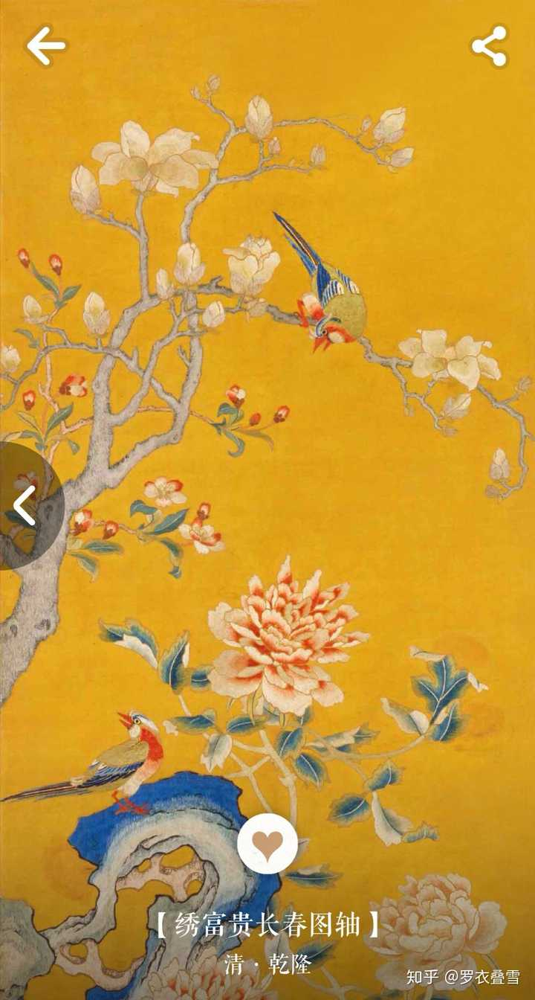
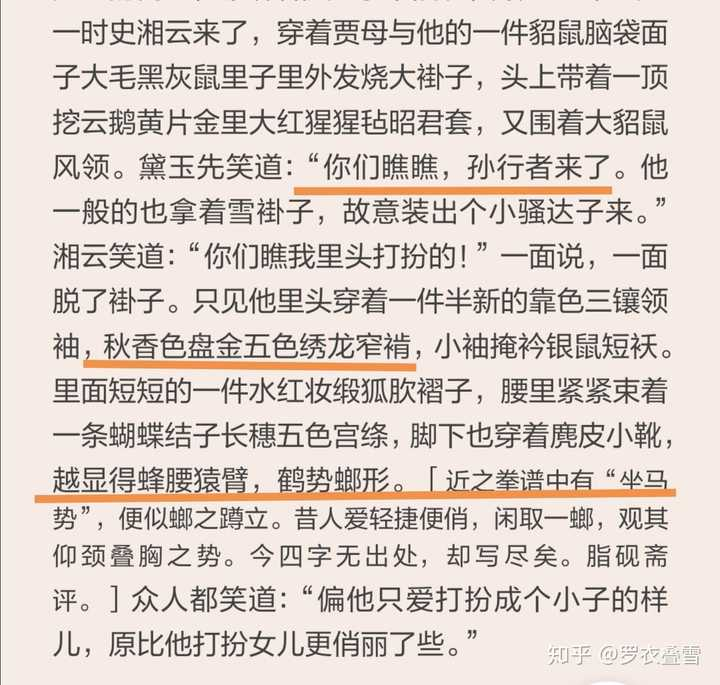
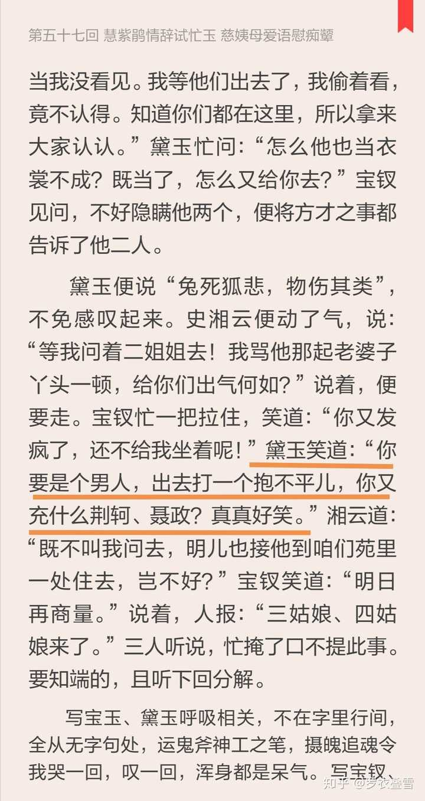
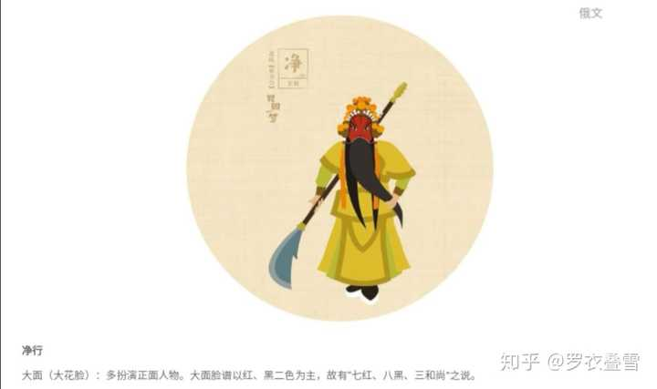

87版《红楼梦》里史湘云的结局为何沦为船妓一般的角色？ \- 罗衣叠雪 的回答

87红楼电视剧是经典，有不少老专家学者作顾问，按说各方面情节设定相对都是经得起推敲的，但我对湘云的结局一直不解。望各位解惑 从书中内容、判词和脂批来看…

87红楼梦里史湘云沦为船妓的思路应该来自第二十八回里出现了一位锦香院的妓女名叫：云儿，大家知道史湘云也被称为云儿，此处重名。还有甄士隐对《好了歌》的注解“择膏梁，谁知流落在烟花巷”（包括脂批都没有说指的是谁），因为前八十回史湘云是定了婚的，所以编剧进行了这种猜测。

我认为史湘云的结局跟这两点有关联，但我并不同意普通船妓结局的说法。《红楼梦》里多次在写一个内容，有人的心爱之物或者心爱之人被人强行抢走了，比如薛蟠抢走香菱打死冯渊、石呆子爱如性命的湘妃竹扇被贾雨村抢走，我觉得被抢走的人，一直在暗自映射主角宝玉的心爱之人（这个是另一个话题，以后专栏里再写）。

__我认为林黛玉的潇湘妃子是史湘云身份结局的大关联。在传说中潇湘妃子其实一直是两个人，她们是帝尧的女儿娥皇、女英，一起嫁给了帝舜，帝舜去世后，二妃在湘江边上泪洒斑竹，因此“斑竹”也称湘妃竹。后来二妃投湘江自尽，传说化为湘江的水神，又称为“湘夫人”，《红楼梦》中的潇湘妃子应该也是两个人。__史湘云的“湘”字已经跟潇湘妃子重合，她的判词：湘江水逝楚云飞，再次印证了这一点，我认为楚云飞，其实就对应的是她的笔名“枕霞旧友”，云就是霞，史家已无枕霞阁，所以__只有史湘云的居住地是虚的__，别人都有自己的房子。我们看书会发现作者安排史湘云开始到贾府是跟林黛玉同住的，而且还具体描绘了这个景象。

alt="Image">

林黛玉跟史湘云是有血缘关系的，其实她们本来就算是姐妹。而且作者还安排了神奇的一幕，清早宝玉就去了黛玉房里，还让史湘云给自己梳头，古代男子的头发不是随便梳的，自古“结发同枕席”，丫鬟梳头是另一回事了，所以袭人带着宝玉房里的丫鬟甩了一天脸子，袭人觉得自己不是普通丫鬟。

我觉得宝玉在卧室看到黛玉、湘云同卧这一幕之奇特，亦幻亦真，仅次于宝玉去秦可卿房里而游太虚幻境。红楼梦有时候会出现一些幻境，太虚幻境跟现实中的贾府有时会交织重叠。宝玉披衣拖鞋，倒像在回自己的房里，联想后来__黛玉曾对宝玉说“我之窗，即可为你之窗”足够让人浮想__；黛玉、湘云共卧，仿佛娥皇女英。

下面括号里是脂砚斋的批注：

alt="Image">

加上大家都知道，宝玉和史湘云都有过金麒麟，宝玉的金麒麟比史湘云的又大又有文采，怎么看都像一对，这是个明显的线索。而且金麒麟和宝玉的玉，也是一对“金玉”。我认为史湘云嫁贾宝玉的可能性很大，但有可能是四大家族衰落后，她的丈夫或者定婚的未婚夫去世后，嫁的宝玉。

再看28回出现的锦香院妓女云儿，是个唱曲的，跟宝玉颇为熟悉，

alt="Image">

她知道宝玉的一些私事，比如宝玉房里的袭人。而史湘云跟袭人关系也不一般。所以87红楼梦的编剧这么安排也算有迹可寻

alt="Image">

但是我个人认为这个弹琵琶的云儿也只是个隐喻，犹如《红楼梦》中的游戏“__射覆__”，不是直接对应，而是转折对应，作者写《红楼梦》就用了射覆的方法。因为从史湘云的判词、曲子、诗词来看，比较大气，不是船妓这个方向，而是有英雄本色的巾帼。

（我认为宝玉的姽婳将军林四娘写的就是史湘云，具体在专栏里）

alt="Image">

我认为很多地方、包括百度之类解释史湘云的曲子，都不太让人满意。“霁月”应该是形容史湘云胸怀磊落，同时也符合史湘云给翠缕讲解的“日为阳，月为阴”，“玉堂”是指府邸中荣禧堂这类地方，四大家族里贾府正是“白玉为堂金做马”，荣禧堂也是展示家族荣耀的正堂。古代宫里常用“玉堂”的图案，用的是玉兰海棠图案，寓意是“贵”。

alt="Image">

史湘云的霁月风光耀玉堂，跟贾府应该有极大关系。甚至史湘云很可能后来会替贾府打抱不平。

书里多次写史湘云穿男装，史湘云甚至应该是学过武的，书中说她像孙行者，“蜂腰猿背、鹤式螂行”，这根本不是形容美女的话，而是形容练武术的姿势！

alt="Image">

说实话，穿五龙的衣服，还是妃的级别。史湘云喜欢武扮的原因应该就是她本来就学过，史家是将门，而清代将门女子学武、骑马出门都正常。作者不敢写，因为一写就暴露年代了，容易文字狱。

史湘云一直有侠客风范，她要替邢岫烟打抱不平时，黛玉就说：你又充什么荆轲、聂政。大家都知道，荆轲、聂政都是有名的剑客。

alt="Image">

大观园解散戏班时，把小戏子分给大家做丫鬟，很多小戏子的名字跟主子的属性暗合。芳官跟怡红院中遍植玫瑰等花暗合，蕊官跟宝姐姐吃的冷香丸是用各种花蕊做的暗合，藕官跟林黛玉芙蓉（风露清愁）属性暗合，__唱花脸的葵官给了史湘云。__红楼梦里的戏班唱的主要是昆曲（那时候还没有京剧），昆曲中的大花面，很多都是忠肝义胆的文臣武将，比如关羽……

alt="Image">

__史湘云给葵官改名“韦大英”，取“惟大英雄能本色”之意。书中写到：湘云素习憨戏异常，他也最喜武扮的，每每自己束銮带，穿折袖。近见宝玉将芳官扮成男子，他便将葵官也扮了个小子。__

其实在清代，史湘云这种身份的将门女子穿着男装骑马出行，也是有的，据说孝庄太后的侍女苏麻喇姑在皇太极去世时，就是自己骑马去多尔衮府上联络。

__黛玉说湘云小騷鞑子样儿，其实就是指她的样子是马背上的民族，并不是贬低她，估计作者想写又怕文字狱，不敢露出太直接的满蒙证据。所以如果史湘云跟卫若兰有交集，也不奇怪，未必就是他跟史湘云有直接交集，就像宝玉和蒋玉菡一样。__

湘云的结局应该跟贾府和宝玉相关，不会是个普通受气的船妓。

回答的比较简略，详细的《红楼梦》分析文章请在我的专栏里查看，会陆续更新

[https://zhuanlan\.zhihu\.com/c\_1096042564402192384](https://zhuanlan.zhihu.com/c_1096042564402192384)
