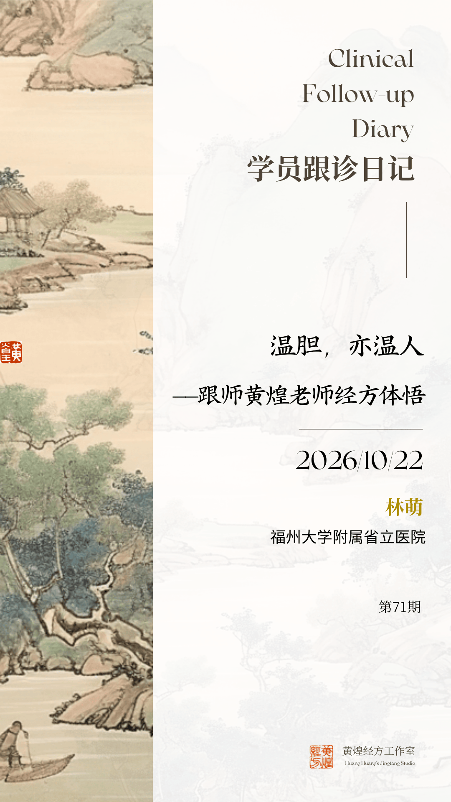
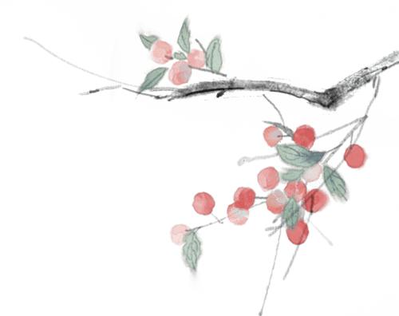

公众号名称：经方医学工作室

作者名称：林萌

发布时间：2026\-10\-2212:10

跟诊学习，不觉已是半年。金陵落下今年第一场秋雨，气温骤降，恍如一夕入冬。独坐诊室一隅，心头却漾着一份柔软而温热的触动。

这个月最让我欣喜的，是黄煌老师圆了沉淀十年的经方之梦：经方的火种，已然传向四大洲、三十余个国家。我家闺女看完专题视频，仰着头跟我说：“妈妈，你的老师说，他做了一个经方的梦。” 想来小姑娘是认认真真看完了全程，这一句童言，格外动人。

老师周日尚在新加坡，周一凌晨一两点才踏上归途，清晨八点，已然安坐诊桌，门诊一直忙碌到将近午后一点。多少个连轴转的周末，这位已届七旬的师长，一边奔赴海外，播撒经方火种；一边心系基层，盼一线医者学得明白、用得踏实，愿更多普通人借经方远离疾苦，一路奔走宣讲，倾囊相授，不曾停歇。

他扛着这样一个沉甸甸的经方梦，不辞山海、不惮辛劳，可一走进诊室，目光最先、也最专注投向的，永远只是眼前这一个活生生、正在承受病痛的人。

本轮门诊两则医案，一则精神分裂症合并 2 型糖尿病，一则幽门螺杆菌根除后脾胃失和、睡眠紊乱、焦虑缠杂。同样主诉乏力、口苦、眠差，老师并不急于堆砌安神、健脾之品，必先望其神、察其形、细做腹诊、体察藏在症状背后的心结，让方证落在 “人” 上，而非仅仅落在症状之上。这一次，我对 “望神为先，方证对应，方随人出”，才有了真切的体感。

现将两案问诊经过、辨治思路与随诊心得整理记录于此。

## 一、从一场噩梦问起：

## 温胆汤擦去的不是症状，是心头的“魔咒”

26岁青年男性，诉读高中时因被同学欺负后，逐渐出现厌学、幻觉等，经专科确诊为精神分裂症，长期服用“奥氮平、氟西汀”等药物，目前能够正常上班。2型糖尿病也有6年，现同时服用降糖药物。

此次就诊以乏力为主诉：感到困，懒得动，情绪低落，开心不起来，伴口苦，但无反酸、无嗳气、无腹胀；大便日行三四次，多在餐后即行，质黏；偶有心慌、胸闷，怕热，气温20℃还要开空调；无口腔溃疡；噩梦，所梦多为既往受刺激之事，且情节相对固定。

查体：体壮，头发油，面部皮肤粗糙稍油，表情不丰富，神情闷闷不乐，两胁下按之稍抵抗，咽红，眼睑红，舌苔厚，脉滑。老师触诊其腹壁脂肪厚，两肋弓下稍抵抗。加之糖尿病病史、口苦，我乍看颇有“大柴胡汤证”之象。但老师随即追问：“有没有反酸？吃东西肚子胀不胀？”患者皆答无。老师点头：“虽然两肋弓下稍抵抗，*但无心下痞满，无呕逆，无便秘，非大柴胡汤证。*”这一问一按，让我真正体会到“腹诊定虚实”的分量：腹部症状必须与全证合参，单凭“腹部充实、按痛”不足以定方，必须兼看人，桂枝茯苓丸证也可出现两肋弓下抵抗、腹部充实，注意鉴别。

真正让我触动的，是问诊的切入点。老师从众多症状中抓住症眼：问有没做噩梦，梦的是什么场景，患者淡淡低语：之前受到刺激的梦，像过电影一样放映。老师读懂了他：噩梦是既往创伤的回放。这个人身上的病，是从一桩没有安放好的创伤里长出来的。再看体格，明明是一个壮实的成年男子，逻辑表述清晰，表情却不丰富、闷闷不乐，话不多、气不扬。体格与神情之间的这道反差，被老师一眼捕捉到：高中时被同学欺压的他当时是一个胆气不足、心理憋屈，不敢反抗的孩子，这段经历是他始终没能解开的一个结；此后所有的情绪低落、乏力懒困、噩梦纷纭、口苦、苔厚脉滑，都可以顺着这条线串起来。

老师开出处方：一为葛根芩连汤，二为温胆汤加黄连。并安慰患者说：温胆汤这个方子是宋代的古方，非常安全，它就像一块心灵的橡皮擦，增加你的胆气，把那层蒙在心底的黏腻一点点擦去，把当年的事视作一道外来的“魔咒”剥离出去，逐步忘却往事，从那个阴影里走出来，重新做回自我。字字抚慰人心，就像有人俯下身，轻轻擦拭那道旧日的伤口，不触碰痛处，却让温暖一点点渗进去。在旁抄方的我听之都为之动容。

## 二、半夏泻心汤案：

__吃得下、睡得着，焦虑自减一半__

第二则是中青年患者常见的“社会病”。45岁中年男性，现症：容易疲倦，口干口苦，进食易胀气，大便偏稀，便前矢气较多，无反酸；夜间易醒。追问久坐、熬夜已成常态；去年因胃镜检查发现幽门螺杆菌（Hp）感染，行抗Hp治疗后复查已转阴。尚有手部湿疹、过敏性鼻炎、脂肪肝等病史。查体：体格壮，双眼皮，大眼睛，眼睑红、咽红，舌边有齿痕，舌面有裂纹，腹软。老师处以半夏泻心汤加茯苓。

辨治要点，老师讲得极朴素：此人营养状况并不差，腹部按之是软的；有粘膜充血的咽红、眼睑红表现，正是方中黄连、黄芩所治之热；又有食后胀气、便溏、便前矢气多这些寒热错杂、中焦升降失序的消化道表现；再加上夜醒。寒热错杂于中、升降失司，则胃不和而卧不安；把中焦这条路理顺，胃能和、卧能安，焦虑自然减去大半。故半夏泻心汤不只是脾胃病的常用方，也是调理精神心理问题的常用方，尤其是伴有消化道症状的焦虑中青年患者。

当下中青年工作与生活压力大，久坐熬夜，先垮的往往是“吃”与“睡”：吃不好、睡不好，接着便是疲乏、口苦、胀气、易醒，再往下就是焦虑、抑郁一类身心疾病。若一见失眠便堆夜交藤、合欢花，一见疲乏便投健脾益气，看似对症，实则是把“人”拆成了症状的集合。老师从饮食、睡眠、肠胃这条主线切入，通过调理肠胃、改善睡眠来缓解焦虑，把问题放回它的来路上去解决，思路干净，落点也稳，恰与当下西医研究的热点——脑肠轴与身心疾病相互印证。

## 三、“辨病专治”更要“辨人论治”：

__中医治的是“患病的那个人”__

老师常引《金匮要略》“辨病专治”之训，也作了分辨：西医所治，是“某个人所患的某个病”；中医所治，是“患病的那个人”，所望的首先是这个人的神。望诊绝非只看神情、形态、走路姿势与舌象等，还要通过望及问诊，去了解这个人的心理行为特征。一个闷闷不乐、表情不丰富的，如一位忧郁的王子，背后往往有一段未曾言说的创伤史；再追问噩梦的场景，闷闷不乐的来由便豁然明白，此时医者能给出的也就不只是一张处方，还有一句恰在关键处的劝慰与鼓励。

由这两案，老师又引到《伤寒论》，《伤寒论》讲的是个体差异，以六经为纲，六经不是一张贴在病人身上的标签，而是对六种不同体质状态的人的概括，辨的是寒热虚实，落脚点在“人”。也正因如此，一个精神分裂症患者坐到面前，你的脑子里不该只跳出“精神类疾病”这一格，而应当同时浮现出多个候选方：柴胡类方（如柴胡加龙骨牡蛎汤）、半夏类方（如温胆汤）、附子类方（如茯苓四逆汤）、麻黄类方（如麻黄附子细辛汤）、桂枝汤类方（如桂枝加龙骨牡蛎汤）等，谁与这个人的神情、体格、腹证、脉舌相合，方就归谁。

这一层功夫，我体会一半在书本，一半在生活阅历。不过医者对病人的理解，并不等于陪他一同沉进那段情绪里去，要紧的是“体察”二字：懂他当年为什么怕、为什么憋着，看得清这桩旧事在他身上留下的纹路，却不被他的悲喜牵着走。老师之所以能在片刻之间读出患者脸上的闷闷不乐，靠的正是这份被阅历与理性共同养成的理解力。

## 四、伤寒论条文要落实到具体的人身上

《伤寒论》条文多拗口，老师一句话点破：条文不是用来死记硬背的，仲景写下的本就是当年那位病人躺在榻上说的原话，只是被压缩成了十几个字，当时东汉末年尚无纸张普及，只能写在竹片上存留，惜字如金啊！我们就是把这些被压缩掉的画面，在眼前这个人身上重新展开，把病人的大白话，也称为自然语言“翻译”成条文语。本轮两案，恰是最好的练习。说“口里发苦、懒得动、话不多”，这正是“口苦”“默默不欲饮食”；触诊“两胁下按之稍抵抗”，就是“胸胁苦满”在腹诊上的说法；十年前的一桩委屈至今反复入梦、梦中惊醒，便是“烦惊”。“一吃饭就胀，可是并不痛，大便偏稀，便前矢气多”，几乎逐字对上“但满而不痛者，此为痞”与“肠鸣下利”。逐条对照，再一个词一个词还原为条文关键词，还原得越准，方证就落得越实。

## 五、临证之要：

__腹力定虚实，黏膜辨寒热，心理行为特征不可缺__

把两案并置来看，老师的诊法有一条清晰的路径：不凭“理法方药”的机械推演去套病人，而是从整体出发，腹诊的腹力定虚实，以黏膜（咽、眼睑、口腔、舌面）之赤与淡辨寒热；再以病人的心理与行为特征（胆小、怕憋屈、久坐熬夜、创伤经历）定其体质类型与方证归属。精神分裂症如此，胃病合并焦虑亦如此。所谓方证对应，本质上是把这些看得见、问得出的客观信息，与一张方所适应的那类人严丝合缝地对起来。

## 六、医者，也是心灵疗愈者

目前处于一个不能忽视的时代背景：学生因学业、家庭与人际等压力出现厌学、社交问题乃至心理危机；中青年因工作生活经济等压力，熬夜久坐少动，陷入失眠、消化不良与焦虑互相加重的循环。身心疾病是这个时代门诊的常态。经方在这种局面里并不“偏科”，它既能处理幻觉、情绪低落这类“神”的问题，也能处理血糖、胃黏膜炎症这类“形”的问题，因为它面对的是形神合一的那个人。

两案之后，最让我佩服的是老师身上那种由敏锐观察与丰富阅历共同酿成的东西：能在几十秒内看出一位壮硕男子脸上的闷闷不乐，能从一个噩梦追到十年前的一桩委屈，能在胃镜报告之外听见一个人“吃不好、睡不好”背后的生活失序，也能在附子、柴胡、半夏、桂枝等类方之间一眼选定属于眼前这个人的那一方。医者不能只医病，还要医病的人的心理状态，这句话在我听来，是本轮跟诊最大的收获。

人是活的，要把方落在人身上，先要学会把人望清楚。经方之路还长，望诊还需训练，还需沉下心，一点一点把感觉练出来。

学员：福州大学附属省立医院，林萌

2026\.10\.21

黄煌经方工作室

2026/10/22
