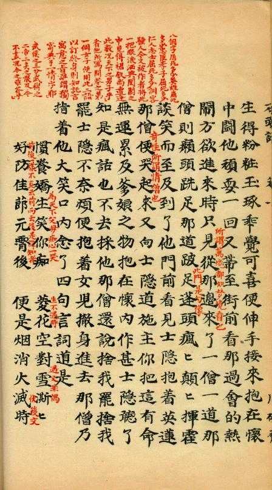

一开始看到觉得很像真本，后来觉得是依照脂批写的续本。想先问问大家的看法。

准备写一个回答收集一些我认为较为明显的证据，长期更新，逐步完善。解读方法依赖于以下四个原则：
一\. 真事隐去，假语村言。
此为红楼梦第一回作者说明。
二\. 一句不可更，一字不可改。
脂批：是作者具菩萨之心，秉刀斧之笔，撰成此书。一句不可更，一字不可改。
三\. 满纸荒唐言，一把辛酸泪。都云作者痴，谁解其中味？
此为红楼梦第一首标题诗。
四\. 凡野史俱可毁，独此书不可毁。
此为红楼梦第十二回脂批。
有了这四个原则的指导，我们可以在书中任一处尝试去解读假语背后的真事，挖掘作者悲凉心境产生的历史原因。

__本回答将会收集100个支持癸酉本为真的证据，根据证据力度进行打分，分值在0与1之间，同理也会收集100个支持癸酉本为假的证据进行同样的打分，最终根据贝叶斯方法，计算得到一个癸酉本为真的概率值。这么做仅只是应付未有铁证时对癸酉本的真假判断，以期形成一个当下的共识。为了尽量客观，打分标准将根据其他领域的概率判断制定，细节将不日公布，欢迎知友提供支持癸酉本为真或假的证据。__

__一\. 支持癸酉本为真的证据__

__1\. 这年正是十一月三十日冬至__
__该句出自《红楼梦》第十一回，这个日期标注过于具体，显然含有深意，这个日期在历史上具体指代的年份也是考据派和索隐派的必争之地。经过大量的科学推算\[1,2\]，无论是根据明朝历法《大统历》，清朝历法《时宪历》还是现代历法，都可以发现在整个明、清朝只有三个年份中才有这个日期，分别是：__
__\(1\)明崇祯四年（1631年），这一年的冬至日为农历十一月三十日，对应公历为1631年12月22日。__
__\(2\)崇祯十五年（1642年），这一年的冬至日为农历十一月三十日，对应公历为1642年12月21日。__
__\(3\)清嘉庆十八年（1813年），这一年的冬至日为农历十一月三十日，对应公历为1813年12月22日。__
__书中凤姐戏贾瑞是在这年十一月三十日冬至，而洪承畴战败降清的1642年，正是十一月三十日冬至，刚好贾瑞字天祥，而文天祥字宋瑞。因此索隐派认为这是用贾瑞隐喻战败投降的洪承畴，分析下来确实很有道理。__
__考据派是这样认为的，首先是周汝昌，他在《红楼梦新证》的第六章红楼纪历中写道：__
__【“这一年正是十一月三十日冬至。”按检雍正朝年历，无十一月三十日冬至者。十一年十一月十七日冬至，十二年十一月二十八日冬至，最相近。】__
__显然，周汝昌是直接回避了这个问题，意思是把这里当作了闲笔，这与原则二是违背的。再比如俞平伯，他认为小说作者用了改变笔画的“作弊”手法，这一处日期实指十一月二十日冬至的1717年\[3\]，这太扯淡了。因此，在这一个问题上的解读，考据派完败。近年来网上考据派的解读基本与俞平伯的方法类似\[4\]，就不多赘述了。__
__但事情没这么简单，按大统历推算，正常冬至是在十一月初一至十一月三十日之间，大统历由于采用的是“平气法”，当时间足够长后，累计误差会变得很大，这导致冬至滑向理论上的最晚时间，也就是十一月三十日，这个日期在明朝容易出现，在清朝的时宪历中很难出现。因此，十一月三十日冬至恰恰是大统历的核心特征，作者设置这个日期极其用心良苦。对于普通的文人来说，对这样的历法知识绝对不熟悉，除非他身边有真正的天文学家。好，那我们看看明末遗民中有没有这样的天文学家呢，真的有，他就是王锡阐\(1628\-1682\)，江苏吴江人，明末清初天文历算学家，好友圈是明末清初江南遗民学术共同体。对中、西历法，他总的看法是，"__[__大统历__](https://link.zhihu.com/?target=https%3A//baike.baidu.com/item/%25E5%25A4%25A7%25E7%25BB%259F%25E5%258E%2586/0%3FfromModule%3Dlemma_inlink)__年久失修，积弊甚多，不能不加以改革"，对于大统历的弊端与特征当是了如指掌，十一月三十日冬至这个设置出自他手可谓理所当然，这再一次印证了红楼梦作者系明末遗民这一猜测。__

__2\. 巧姐判词__
__【留余庆，留余庆，忽遇恩人；幸娘亲，幸娘亲，积得阴功。__
__劝人生，济困扶穷，休似俺那爱银錢忘骨肉的狠舅奸兄！正是乘除加减，上有苍穹。】__
__判词最后的乘除加减显得很突兀，但是如果将巧姐，凤姐，贾琏一家三口的生日相乘，就会得到7\.7\*9\.2\*3\.9=276\.276，这个连续的276太巧了，刚好与明朝国祚276年对应，也与前面的连续的留余庆和幸娘亲在格式上完全相同。进一步地，如果任取三个随机的生日相乘，想得到abc\.abc这种叠式结果的概率约为百万分之二，同时还要注意到，古代的小数乘法需要同时用上乘除加减四个运算，这已经不能用巧合来解释了\[6\]。__
__现在我们可以来猜测一下，站在作者的角度是如何设计出这个谜语的。第一点，首先是要心系故国，作为明末遗民当然满足这一点，同时在中华文化上也特别在意王朝的国祚，如成书于元末明初的《三国演义》中，司马徽赞诸葛亮“可比兴周八百年之姜子牙，旺汉四百年之张子房__”。在这个基础上，作者必然有在书中设计明朝国祚276年的动机。如果敲定了要设计276276这种循环数或者叫走马灯数，应知276276都是1001的倍数，也就是276276=276\*1001，把这两个数继续分解，便得到 276276=red276× blue1001=red2× 2 × 3× 23× blue7×11×13 。现在可以设计生日了，也就是选取因数相乘即可，将77=7\*11设为巧姐生日，表意乞巧节，里意数学巧解，将39=3\*13设为凤姐生日，将92=2\*2\*23设为贾琏生日。但作者怕谜底太深，也给了作者提示，句中的“正是乘除加减，上有苍穹”最开始的版本是“正是承除加减，上有苍穹”，一个承一个天，正好指向南朝宋历法家何承天\(370年－447年\)，告诉读者要从日期上去猜。至此，作者饱含对故国的深情，设下了这个精巧的谜语，以待后世子孙能与他心意相连。
这里我还想补充一下细节，根据计算我得到符合要求的生日组合有6个\(代码见文末代码1\)，
\(4\.4,6\.9,9\.1\) \(3\.3,9\.1,9\.2\) \(5\.2,6\.9,7\.7\) green\(3\.9,7\.7,9\.2\) \(4\.6,6\.6,9\.1\) \(4\.6,7\.7,7\.8\)计算概率时要求放宽点，考虑小数位为1,2,3的同时表示两个日份，如9\.1既可以是九月初一，也可以是九月初十，再考虑排列组合，这样能增大巧合的概率。再退一步讲，假设巧姐生日因为乞巧节的原因定死了，作者已先用作此意，那么此时计算出巧合的概率约为百万分之七十七，哎，这概率就是上不去，哪有那么多巧合啊！另，还有人发现，贾史王薛在百家姓种的位次分别是第137、63、8、68位，加起来就是137\+63\+8\+68=276，有点离谱。如此说来，在书中一些可自由设定之处，很可能可以再找到276这一数字。

__3\. 昨夜朱楼梦，今宵水国吟。__
__该诗出自第五十二回薛宝琴，一般认为是悼明之证，算是尽人皆知了，但其很可能另有深意。明末遗民陈子龙\(1608\-1647\)有一首诗作《春日早起》，__
__独起凭栏对晓风，满溪春水小桥东。__
__始知昨夜红楼梦，身在桃花万树中。__
__因此薛宝琴的诗很可能是化用了陈子龙的这首《春日早起》。而陈子龙，崇祯十年进士，官至绍兴府推官\(正七品\)，明亡后与太湖民众武装组织一起开展抗清活动，事败后被捕，投水殉国，此谓昨夜朱楼梦，今宵水国吟，正是陈子龙反清复明的写照\[5\]。__
__陈子龙有位挚友，叫吴伟业，号梅村。红楼梦作者众说纷纭，其中有一种说法即吴梅村。陈子龙为避兵祸，曾经隐姓埋名，出家为僧，出家的那个庵实名为“水月庵”，也就是红楼梦中的尼庵，位于贾府北门外，该庵串联宝玉私祭__[__金钏__](https://link.zhihu.com/?target=https%3A//baike.baidu.com/item/%25E9%2587%2591%25E9%2592%258F/936433%3FfromModule%3Dlemma_inlink)__、__[__秦钟__](https://link.zhihu.com/?target=https%3A//baike.baidu.com/item/%25E7%25A7%25A6%25E9%2592%259F/7043836%3FfromModule%3Dlemma_inlink)__与__[__智能儿__](https://link.zhihu.com/?target=https%3A//baike.baidu.com/item/%25E6%2599%25BA%25E8%2583%25BD%25E5%2584%25BF/7910932%3FfromModule%3Dlemma_inlink)__私会等情节\[10\]。__

__4\. 林四娘__
__《红楼梦》第七十八回，贾政讲述了林四娘的故事。__
__恒王镇守青州期间，喜爱骑射，选练美女为姬妾，令她们习武，并让林四娘统辖诸姬，称为“姽婳\(音同鬼话\)将军”。次年，流寇攻打青州，恒王轻敌战死，城中官员商议投降。林四娘率众女将夜袭贼营，欲为恒王报仇，最终寡不敌众，全部战死。后来朝廷平定叛乱，褒奖林四娘的忠义，为她建祠祭祀。__
__这个故事实际意指明代青州衡王朱由棷。聊斋志异中的林四娘也是衡王府的人，尽管蒲松龄弱化了背景，但这个故事仍被看作是林四娘悼念故国，有反清复明之意，而红楼梦中林四娘的武装斗争行为更加赤裸裸地指向了反清复明之意。也就是说，在当时，单把这个故事中从书中拎出来，没人质疑它有反清复明之意，结果红学家直接对这个证据忽视不见，实在令人叹为观止\[5\]。__

__5\. 妙玉瓜州渡口批语__
__原文中该批语有缺失，__
__【他日瓜州渡口□□\(似“各示”两字）劝惩红颜□□□屈从枯骨，□不哀哉】__
__周汝昌花了一辈子，给出的是，__
__【妙玉偏僻处，此所谓“过洁世同嫌也。他日瓜州渡口，各示劝惩，红颜固不能不屈从枯骨，岂不哀哉】__
__意思是，这时候的妙玉洁癖到令人生嫌，来日瓜州渡口，听从了不同人的劝诫，妙玉当然不得不屈服干瘪老头，难道不是悲哀的事情吗？__
__而癸酉本第四十一回给出的是，__
__【妙玉偏僻处，此所谓“过洁世同嫌也。他日瓜州渡口客示劝惩，红颜固能不屈从枯骨，不哀哉？】__
__意思是，这时候的妙玉洁癖到令人生嫌，来日瓜州渡口要是听访客的话，本不该发生屈服与干瘪臭老头，大悲哀啊！__
__这里对应了后文妙玉在瓜州时拒受陈也俊公子之邀，最后沦为老和尚玩物的悲惨命运。原文的是客 __被虫蛀掉了宝盖头，靖藏版出现为__各，__所以周汝昌花了一辈子填了个不太通顺的批语。那么这三百年来，有谁能够正确指出这个字是客，并且完美的跟后文妙玉的伏笔对应吗\[7\]？

因此，靖藏本和癸酉本互证为真，这一证据相当过硬，导致红学家束手无策，在经过绞尽脑汁地思考后，他们创新性地提出，靖藏本是假的。这一点就很搞笑，上个世纪五十年代面世的靖藏本，一开始被他们奉若圭臬，苦心孤诣地钻研了50年，因癸酉本面世后，反倒被他们打入了假本序列。当然，如果以后还有其他版本的红楼梦面世，只要不符合红学家的解读，同样会被打入假本序列。

__6\. 同时代作品对红楼梦的记载\(\*该点存疑，待考证\*\)__
__见参考资料\[8\]。__

__7\. 嫣红__
__在第四十七回里\[9\]，贾赦要鸳鸯不成，花八百两银子买了一个女孩叫嫣红，有名有姓的一个人物，然后后面七十四回无关紧要的出场一回，程高本后四十回从未出场，而在癸酉本，嫣红在组织家丁抵御贼寇时戏份不少，最终的结局是被钱槐手下的一贼持剑刺死，情榜中嫣红对应的是情让__。原文为，
【赵姨娘、贾环见嫣红已死，舒了一口气道：“又死了一个主子，这回好多了，家里就剩姓林的一个了，好对付的很。】

__8\. 至次日乃是四月二十六日，原来这日未时交芒种节__

第二十七回中写道，【至次日乃是四月二十六日，原来这日未时交芒种节】。此处经已故数学家严敦杰考证，这一日期对应的是顺治六年\(1649年\)。原句是【得申初二刻一十二分，后编较前编迟三刻十分，即顺治六年四月二十六日未正三刻二分交芒种节】。也就是说，红楼梦作者使用的是顺治六年的节气，按照习惯，作者很可能是在确定创作意图后，翻阅手头的历书埋下真实日期。另需要补充的是，网上有一篇文章\[3\]认为严敦杰的计算是错误的，但是该文章作者一开始就犯了计算错误，直到被评论区指出后才进行纠正，同时这篇文章也不是发表在正规期刊中，作者也坦然自己的历法知识不够专业，因此该文可靠性较低，属于信息污染，故不应采纳。

这里我经过细致考证，发现清代的时宪历一共有四套计算规则，分别是《西洋新法历书》\(1645\-1679\)、《康熙永年历法》\(1680\-1726\)、《历象考成》\(1727\-1733\)和《历象考成后编》\(1734\-1913\)，那么根据历法计算细节可进一步完善严敦杰的计算过程，相关论文已经在撰写中，不日将投稿到正规学术期刊。

上述讨论使用的是考证方法，独立于红楼梦原文内容之外，这里还是要强调一下这个日期的索隐内涵，一般认为是与黛玉葬花和扬州十日相关，诸多分析较为常见，此处不赘述。

__9\. 雪芹曾随其先祖寅织造之任__

该句出自《四松堂集》，且不论其造假的低劣性，我们来看看这句话的语病。造假者原本是想表达，曹雪芹跟随祖父曹寅赴任织造，但是事实是，曹寅1712年去世，曹雪芹1715年出生，这下矛盾了，于是造假者提出，原句要进行合理断句，应为【雪芹曾随其先。祖寅，织造之任】，意思是曹雪芹曾经跟随先祖。曹寅，织造之任。有没有觉得很搞笑。先说第一句，古代汉语不可能有这种用法的，【雪芹曾随其先】后面一般都会有随字的补语。为了反驳该语法，曹家沟粉丝\[11\]找出了单独成句的例子，例如，

（仲氏女）湖州人。随父贾汉阳。崇祯中，汉阳陷，从群妇将出城，贼守门者止之。《明史》

祖殁，号跃，绝而复苏，随其父，水浆不入口三日。《大清一统志》

这里的【随父贾汉阳】指的是跟随父亲在汉阳经商，而【随其父，水浆不入口三日】，意思跟他父亲一起三天没有吃喝，这里的随字后面都有补语。注意这两个例子都是曹家沟粉丝自己举出来论证【雪芹曾随其先】合理性的，结果自己学业不精不理解原文意思，反倒反驳了自己的观点。然后他们又举出明史中的三个例子，

邵为寇所得，问洞所在，绐之行，寇喜，随之。

渤泥王迎其妹归，彭亨王随之，而命其长子摄国。

仪仗鼓乐导龙亭入，使者随之。至殿上，置龙亭于正中，使者立香案东，蕃王位殿庭中北向，众官随之。

但实际上，这三句“随之”前文都交代了“之”做了什么动作，可以理解为补语承前省略：“寇喜，随之（行）”“彭亨王随之（迎其妹）”“使者随之（入）”“众官随之（位中北向）”。请问“雪芹曾随其先”承前省略了哪个补语？或者你再找一句“甲随乙”且上下文没说乙做了什么事的句子来。

结局是当然找不出来，曹家沟粉丝就此沉默。所以事情至此，《四松堂集》这个伪劣的证据应该彻底打进垃圾堆，凡有人见到持此证据做论述者，应采用这里的分析进行反驳。

__10\. 乾隆二十一年五月初七日对清__

在庚辰本第七十五回回前页中有段话：“乾隆二十一年五月初七日对清。缺中秋诗俟雪芹。”很多人由此认为这段话是《红楼梦》成书于乾隆年间的证据。这一条早就被批驳过了，因为红楼梦原文和批语是不可能使用皇帝年号的，仅此一例而已，最合理的解释是，这个日期是抄书人留下的时间戳，才有对清一词。但由此我发现了一个重要的信息，根据曹家沟说法，红楼梦最早的手抄本甲戌本指向的是1754年，但是乾隆二十一年是1756年，抄书人留下时间戳，说明抄写工作是有人成规模地组织起来的，这必然是在红楼梦流传成名以后，受到不少关注后才有的结果。而从1754年到1756年，仅有不足两年时间，流传时间不够，我认为是不足以达成这种影响的。因此，甲戌本成书于1694年才是合理的。

__11\.八个字屈死多少英雄__

众所周知，《红楼梦》早期的手抄本上有非常珍贵的红笔批注，其中时间最早、价值最高的“甲戌本”在胡适手里（30块银元买的），第一回一僧一道跟甄士隐抢夺甄英莲时，旁边有这么一条批注：

__八个字（僧道二人评价英莲的“有命无运、累及父母”）屈死多少英雄？屈死多少忠臣孝子？屈死多少仁人志士？屈死多少词客骚人？今又被作者将此一把眼泪洒与闺阁之中，见得裙钗尚遭逢此数，况天下之男子乎？看他所写开卷之第一个女子便用此二语以定终身，则知托言寓意之旨，谁谓独寄兴于一 “情” 字耶！武侯（诸葛亮）之三分，武穆（岳飞）之二帝，二贤之恨，及今不尽，况今之草芥乎？家国君父事有大小之殊，其理其运其数则略无差异。知运知数者则必谅而后叹也。__

就凭这么一条批注就可以确定《红楼梦》不可能是任何家族的自传，而是亡国之恨：谁家读者在读到“和尚抢孩子”时会联想到诸葛亮出师未捷、岳武穆壮志未酬？然而胡适明明看到这条批注，却将其私藏起来不公诸于世，以免影响他强行附会出来的“曹家说”，这不是学术造假是什么？

alt="Image">红楼梦甲戌本原页：八个字屈死多少英雄

__二\. 支持癸酉本为假的证据__

__1\. 无实体书__

这是癸酉本最为人诟病的地方，且癸酉本内容有过多次更新。如果想要癸酉本为真成为普适性的结论，那么这个问题必须要解决。

【Mathematica代码\-1】

Clear\["Global\`\*"\];
list = \{2, 2, 3, 7, 11, 13, 23\};
n = Length\[list\];
isValidAssignment\[labels\_\] := Module\[\{groups, products\},
If\[Count\[labels, 0\] == 0 || Count\[labels, 1\] == 0 ||
Count\[labels, 2\] == 0, Return\[False\]\];
groups = \{Pick\[list, labels, 0\], Pick\[list, labels, 1\],
Pick\[list, labels, 2\]\};
products = Times @@@ groups;
AllTrue\[products, 10 <= \# <= 99 &\]\];
generateGroupVectors\[labels\_\] :=
Table\[Which\[labels\[\[i\]\] == 0, \{1, 0, 0\},
labels\[\[i\]\] == 1, \{0, 1, 0\}, labels\[\[i\]\] == 2, \{0, 0, 1\}\], \{i, n\}\];
allResults = Reap\[
Do\[
labels = IntegerDigits\[code, 3, n\];
If\[
isValidAssignment\[labels\],
groups = \{Pick\[list, labels, 0\], Pick\[list, labels, 1\],
Pick\[list, labels, 2\]\};
products = Times @@@ groups;
groupVectors = generateGroupVectors\[labels\];
Sow\[\{groups, products, groupVectors\}\]\], \{code, 0, 3^n \- 1\}\]\]\[\[2,
1\]\];
Print\["列表: ", list\];
Print\["原始方案数: ", Length\[allResults\]\];
If\[
Length\[allResults\] > 0,
uniqueResults = DeleteDuplicatesBy\[allResults, Sort\[\#\[\[2\]\]\] &\];
Print\["去重后的方案数: ", Length\[uniqueResults\]\];
Do\[
\{groups, products, groupVectors\} = uniqueResults\[\[i\]\];
Print\["方案 ", i, ":"\];
Print\["分组: ", groups\];
Print\["乘积: ", products\];
Print\["组标签向量: ", MatrixForm\[groupVectors\]\];
Print\[StringRepeat\["\-", 30\]\], \{i, Length\[uniqueResults\]\}\]\];
Print\["生日巧合的概率: ", 102\./\(12\*30\)^3\]

注：如有评论质疑，请先参考原帖，绝大部分疑问在原贴评论区已有回答。
【参考资料】
\[1\][《红楼梦》中“这年正是十一月三十日冬至”到底说的是哪一年？](https://zhuanlan.zhihu.com/p/22898749741)
\[2\] [如何评价《红楼梦》里的秦可卿？](https://www.zhihu.com/question/38320149/answer/1342582693?utm_id=0)
\[3\] [冬至与芒种\-\-《红楼梦》中两处时间细节虚实辨 \- 哔哩哔哩](https://link.zhihu.com/?target=https%3A//www.bilibili.com/opus/838532295133495362)
\[4\] [红楼梦“十一月三十日冬至”是何年\_陈林横扫百年红学\_新浪博客](https://link.zhihu.com/?target=https%3A//blog.sina.com.cn/s/blog_4a4c11510100ec9k.html)
\[5\] [https://www\.bilibili\.com/video/BV1WMm5BcEum](https://link.zhihu.com/?target=https%3A//www.bilibili.com/video/BV1WMm5BcEum/%3Fvd_source%3De50491cdb7406df4688bbd9068c1119c)
\[6\] 【理科生对红楼梦的降维打击！索隐派up：已老实，求不学数学！】 [出错啦\! \- bilibili\.com](https://link.zhihu.com/?target=https%3A//www.bilibili.com/video/BV1e4BFBEE4j/%3Fshare_source%3Dcopy_web%26vd_source%3D46a9cb964916019f001705ef210ce017)
\[7\] [主流红学为什么不肯接受《癸酉本石头记》？癸酉本有什么优缺点？](https://www.zhihu.com/question/496095431/answer/1946919354290664520?utm_psn=1992687678475494716)
\[8\] [认为曹雪芹不是《红楼梦》原作者的理由是什么？](https://www.zhihu.com/question/393736492/answer/2498953520?utm_psn=1992763260097806597)
\[9\] [《癸酉本石头记》是否是真本？](https://www.zhihu.com/question/20693393/answer/1992861865122997613)
\[10\] ["昨夜朱楼梦，今宵水国吟。"这句能证明《红楼梦》就是在影射明亡清兴那段历史么？](https://www.zhihu.com/question/11124618261/answer/1987161341115512285?utm_psn=1993016651499734743)

\[11\][为什么越来越多的人相信《红楼梦》是在文字狱下描写的明末历史？](https://www.zhihu.com/question/449260633/answer/1916309999514265380)
