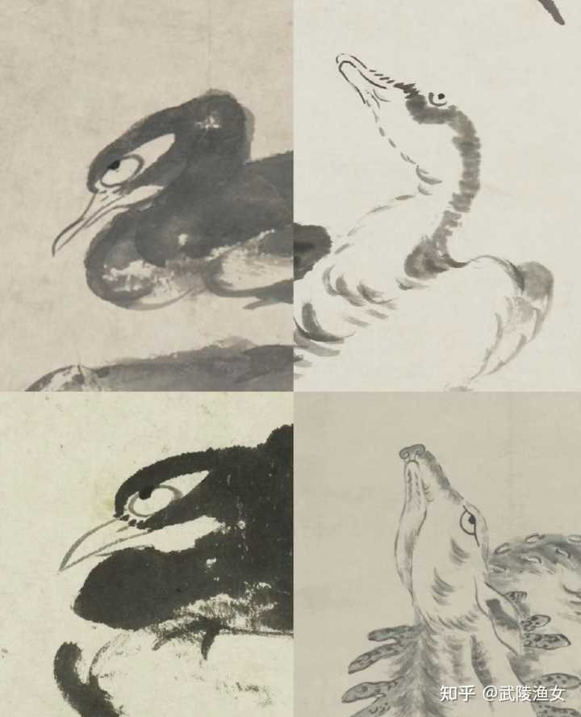
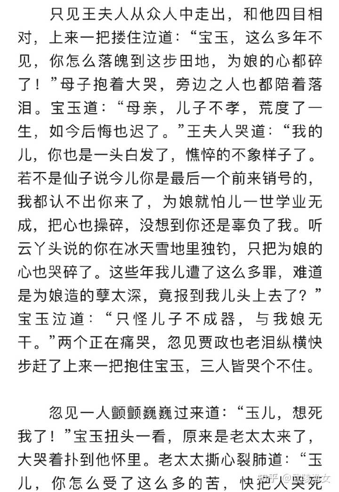
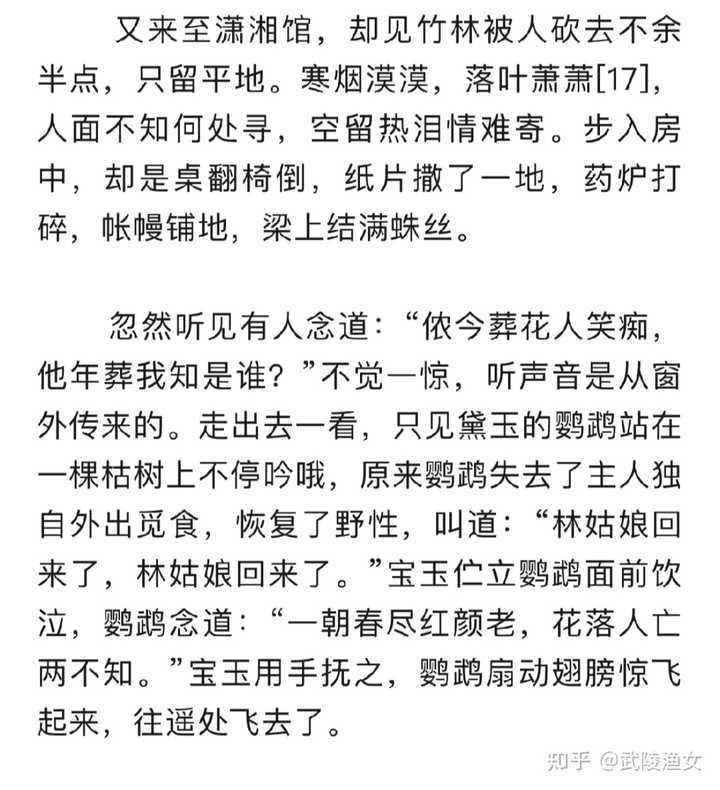

《癸酉本石头记》是否是真本？ \- 武陵渔女 的回答

一开始看到觉得很像真本，后来觉得是依照脂批写的续本。想先问问大家的看法。

今天读书的时候又注意到一个细节。

且说惜春在街上化缘被几个市井无赖上前拉拉扯扯调戏，大为惊惧，匆忙逃往沿路的村子里去了。正是：
莫罕我装聋作哑，莫怪我__白眼瞪他__。
休问我乡居出身，细思量泪洒杈桠。
画一幅__怪鸟残萼__，不稀你惑解图画。
心却似虬根秃枝，情唏嘘分付梅花。

画家朱耷，明朝宗室，去牛去耳，只剩“八大山人”。

alt="Image">

alt="Image">

结局也好感动。

宝玉后半生飘零，湘云去后，投水自尽。

他回到天上，重逢了妈妈、爸爸、奶奶、还有所有年少时期他爱的、爱他的人。

alt="Image">

今儿回头去看宝玉悼黛玉一节。大哭。

alt="Image">

以下是宝玉悼黛玉的引文。

屈子怨深，悲投汨罗；
西施功空，沉江泥葬；
楚王愧心，乌江刎颈；
扶苏情苦，泣昭抛生；
文种愤主，剑逝楚郢；
林林总总，不可尽述。

嘲父辈之仁孝，蔑赫赫之灵天。
朝中梁兮，小丑猖獗。
世代剿袭之难灭，日月亿兆兮不绝。

恨不能操戈被甲兮，以灭胡虏；
车毂短接兮，报切齿痛。
带剑挟弓兮，以破戎羌；
持长矛兮，以除贼首。
帝阳司权，缘何包恶邪兮。
贼寇举国施虐，四野血肉遍地。
胡骑满城扬尘，八方哀声载道。
天何如是之无情兮，龙战于野血玄黄。
地何如是之冷漠兮，宦民奔逐孺妇丧。
华夏饮泪，黎庶含悲。

黛玉是这样剖白心迹的。她守家，为了与宝玉的前缘，又不仅仅是为了宝玉。

黛玉黯然道：“想我从苏州乘舟投奔府中，__祖母、舅舅、舅母无不疼爱__，__姐姐妹妹们也是待我亲密友爱__，__这园中一草一木、一蕉一鹤，一亭一阁莫不让我牵念__。如今人亡物非，再也回不到从前了，这一处处断井颓垣衰草寒烟令人心伤，可是李后主说的‘别时容易见时难，流水落花春去也，天上人间’。”

黛玉——“情情”， 第一个“情”为动词，第二个“情”为名词，即“爱应该爱的事物”。

我很赞同作者的理解，情之极致，便是__家国之情__。

所谓家国之情，自然包括__小家之爱__：亲情、友情、爱情。推己及人，便是__大家之爱__，爱国，爱华夏，爱我们向善向美的中华文明。

所以，哪怕大家如胡适、蒋勋，__若心中无国无家，定不能懂得红楼梦。__
