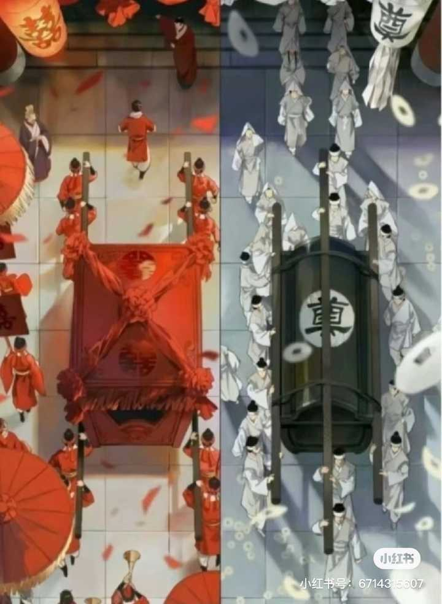
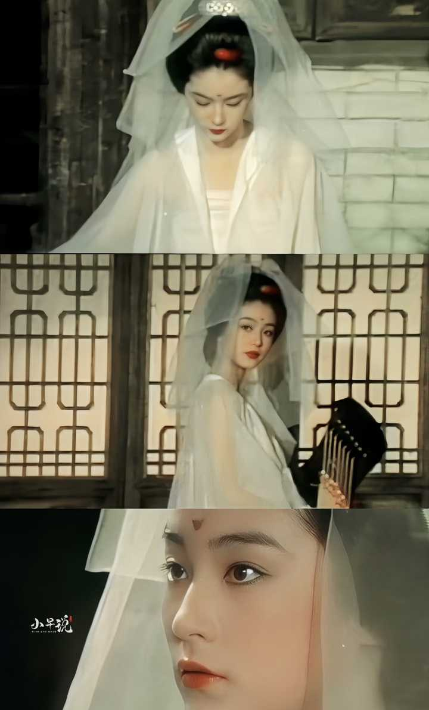
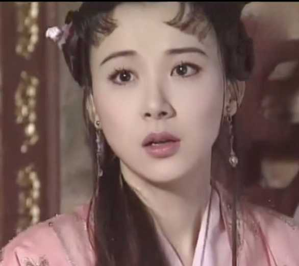
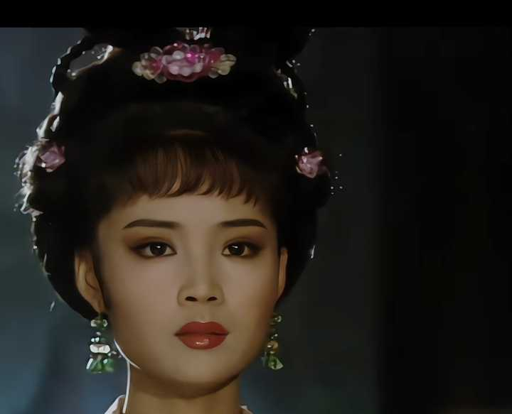
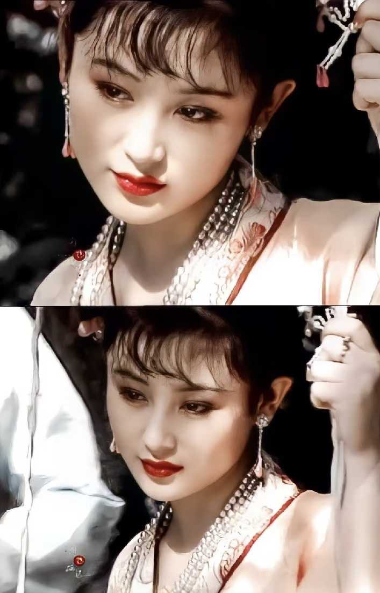
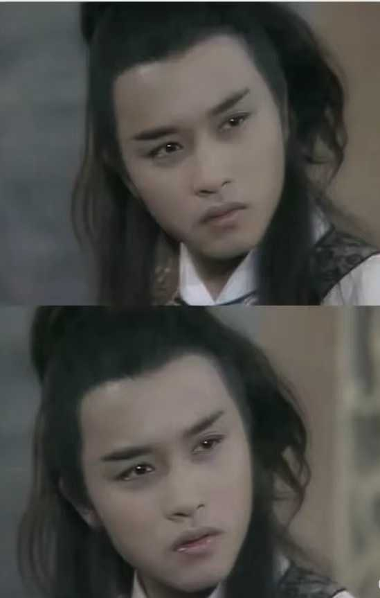

《癸酉本石头记》是否是真本？ \- 琴棋书画诗酒茶 的回答

一开始看到觉得很像真本，后来觉得是依照脂批写的续本。想先问问大家的看法。

红楼梦就是维纳斯，断臂了，鬼本是真本残本，只有骨架，没有血肉，接上断臂粗糙破烂，可是骨头严丝合缝，浑然一体。

alt="Image">

我认为续书的词藻华丽，文笔优美其实是次要的，最重要的是它的骨架脉络，主旨立意，这一点癸酉本远超所有续作。

第一“大末世”，癸酉本之前的续作，都不过是四大家族败亡了，格局甚小，历史上显贵家族多了，即使贾家死绝了都不过一个家族覆灭了而已，怎的就担得起末世？过于夸张了，一部家族兴衰史也不至于到禁到后面没有留下任何只字片语的程度，除非它的结局影射了整个大明的灭国，大厦将倾，金兵入关，白骨累累，一片地狱景象，目前只有这个版本读完才给人一种“白茫茫的大地真干净”的感觉，前面是真的花团锦簇，后面是真的烈火烹油，字字血泪，读别的版本都有种前后割裂感，比如程高本宝玉突然就傻了，黛玉很快就死了，情节突然就寡淡无味起来，很多伏笔圆不上，这版那种深深的悲剧宿命感贯穿始终，内核一致。

第二，有些前后呼应太浑然天成了，比如惜春在刘姥姥二进繁华大观园时创作过一幅画，最后刘姥姥三进荒废大观园时又见到了这幅画，画中人栩栩如生，现实早已物是人非，恍如隔世，三进贾府，起高楼，宴宾客，楼塌了，情节完整的符合了明清小说的习惯，比如情榜，谁也没有真正做出这个东西，王熙凤“情雄”，迎春“情懦”，袭人“情箴”…很多人的契合程度真是鬼斧神工，对比刘新武的情榜就能发现云泥之别，比如宝玉和黛玉就是成婚了！薛宝钗假新娘代替更加扯淡，只是后面家族变故太大，没有善终，比如赵姨娘，她这个人后面有大用，可大多续作之平庸，这些不太重要的人物多病死，要么就没有下文，即使是红学集大成者的87版红楼梦，也只是勉强给书里的主要人物续了结局，想安排所有人做不到，红楼梦就像一张密密的网，里面的人物大珠小珠千丝万缕，要把伏笔判词歌词诗词草蛇灰线全部圆上难如登天，单一句“昨日黄土陇头送白骨，今宵红灯帐里卧鸳鸯”就少有合理的情节对应，红学研究了这么多年都没出一个像样的续书，把前面的伏笔都解释清楚，不可思议的是癸酉本做到了，还有前期微不足道的小戏子，马道婆，二丫头等甚至只有一两句话几乎忽略不计的小角色都有结局，死法还各有不同，细到黛玉养的那只的鹦鹉最后都有归处（主人死了，成了野鸟，依旧每天在园子里念着黛玉的诗）如果是现代人整合写出这也太逆天了，仅用了28章就对上所有伏笔。

（宝玉：出家行乞了几十年偶遇同样落魄的湘云，埋葬了她后感到自己时日无多，主动沉湖而死，回归太虚，看到情榜。黛玉：在贾家内忧外患中苦苦支撑导致病情加重，又因错杀好人失尽人心被下人在往日的药膳里动了手脚，自知大限将至，又听说有贼人叫钱槐的看上了自己，为了保清白，支开婢女，独自前往昔日葬花地上吊自尽，给宝玉留下了一方帕子，紫鹃发现后变得疯疯癫癫，吐血而死（杜鹃啼血），宝黛二人最终确实花落人亡两不知，直到一年后宝玉回贾家见到瘸了腿的雪雁才得知黛玉死讯（鸿雁传书）“一只折足雁”。探春：确实因为庶出被嫌弃被赵姨娘觉黄了婚事，后被迫和亲，成为王妃后又联合兵败，不肯屈从敌人最终选择了与山林为伴，呼应她秋爽斋内悬挂的对联：烟霞闲骨格，泉石野生涯，宝玉曾送她颜真卿的墨迹“窃同叨栖处于泉石之间”。

alt="Image">

妙玉：离开贾家，哪知乱世寺庙也绝非善地，被一老僧侮辱，多次寻死未果最终变得麻木，成为庙妓，直到年老才得解脱，黛玉是质本洁来还洁去，强于污淖陷渠沟。妙玉却是可怜金玉质，终陷淖泥中。红颜固能不屈从枯骨，“风尘肮脏违心愿”。

alt="Image">

宝钗：本想督促宝玉上进，反导致他离家出走，偶遇贾雨村后决定改嫁他做妾，后面夫妻恩爱夫唱妇随，贾雨村高升后将她扶正，几十年后两鬓斑白，死在一个大雪天，就地掩埋。）

这版还升华了“黛玉葬花”，以前人们只是觉得黛玉多愁善感，非常的矫情，原来为的是最后家破人亡的时候她要埋葬大观园里的众多女子，最后她自己也吊死在这，死后整整一年都无人收敛，真的“他年葬奴谁是知”，湘云昔年醉卧于芍药花，娇憨美丽，年老沦为乞丐潦倒冻卧在雪地里，几近死亡。（乞讨的湘云偶然路过一片坟茔看到黛玉的墓碑，悲痛欲绝，最后靠着冰凉的墓碑睡了一夜，想起昔日姐妹们一起做诗，是何等的惬意，黛玉还打趣过她的“只恐夜深花睡去”，“‘夜深’两个字，改‘石凉’
，没想到都对应在这里，如今只剩下“寒塘渡鹤影，冷月葬花魂” ）凤姐“死后性空灵”，很多续作都是死后就没了，只有这版原来是真的还魂空显灵，她看到破败的贾家，对着贾母的牌位含着泪说：“我来迟了！”呼应她刚出场时第一句话：“我来迟了，不曾迎接远客！”以前一直有个困惑凤姐如何“知命强英雄”？这版她还魂后真的逞强杀掉了败家之人，“一夜北风紧”，是死后归来时。

alt="Image">

红楼梦前80回有不少还魂托梦，太虚幻境的玄幻情节（一面美人骷髅镜，贾宝玉神游太虚提前看到所有人的结局，金陵有个相差无几的甄府➕相差无几的甄宝玉，通灵宝玉也是活的会说话……）起于太虚，终于太虚，她前期弄权害得一对璧人一个上吊，一个沉湖，原来是早已暗写了宝黛日后的结局，很多曾经几乎没有人注意的描写，后面才发现原来这也是伏笔！真的惊喜太多，抛开垃圾文笔，骨架太合理， 离奇荒诞惊世骇俗，又严丝合缝环环相扣，架构真的是空前绝后（很多续作都逃不开高鹗的框架，总有种放不开的感觉，既没写出末世的凄惨乱象，也没有让贾家彻底“白茫茫的大地真干净”，总是差强人意，下笔温柔，给人一种钟鸣鼎食虽不在，留得青山待复兴的感觉，而癸酉本扯下了前80回温情脉脉的袍子，让你看到里面的森森白骨，带着理直气壮的笃定，仿佛早已知晓结局，一口气把红楼梦从宝黛爱情，四大家族的悲剧提升到了山河破碎，人世无常的高度）很多人觉得雷，觉得太残酷，比如元春被凌迟，黛玉守家，谁能想到林黛玉的结局竟然惨到只剩下一具白骨，真的“未若锦囊收艳骨，一抔净土掩风流。”

alt="Image">

因为不是盛世，是末世了，前80回不断的暗示，“悲天动地”“自杀自灭”白骨如山”…绝不是一般的灾祸，后面要是没有血腥震撼的颠覆性情节，逻辑是难以自洽的，被满纸荒唐言隐藏的真事，绝不只抄家那么简单，甚至都不可能以平淡的悲收尾（好了歌暗示过这个过程，“忽喇喇似大厦倾”，“乱哄哄你方唱罢我登场”，直到“白骨如山忘姓氏”落个“白茫茫的大地真干净”），不然一段才子佳人的风月，一个曹家抄家的故事，怎么会被皇帝讳莫如深删的如此干净的？一定隐藏了一个天大的原因，这一版是真正的适逢改朝换代，天下大乱，一时没了王法，连官府都被流寇占领，朝廷，民间，寺庙无一处清净之地，抄家过后的贾家一息尚存，但贾政后来被赶走已经加入流寇的贾环一剑刺死（贾政在打贾宝玉的时候说：素日皆是你们这些人把他酿坏了，到这步田地，还来劝解！明日酿到他杀父弑君，你们才不劝不成？果然后文贾政被贾环杀了）没了家主，只剩黛玉，前期凤姐提拔的小红，已扶正的平儿几位女子的带领下贾家苦苦撑了一年，抵抗一波波流寇盗贼的入侵，是真的“一年三百六十日，风刀霜剑严相逼”，最终贾家还是被里应外合的攻破了，这才开始真正的自杀自灭，悲天动地，贾家人的尸首在地上堆成了一座白茫茫的小山…直到漫长的朝局逐渐稳定，秩序慢慢恢复，可贾家这时候也变成了甄宝玉家一样，破败凄凉，乱坟荒草的样子了，甄宝玉，小红…所有人都是有用的，无一处闲笔，所有人最终都有归处，无一人雷同，包括那块开篇被一僧一道带下凡尘的通灵宝玉，它都有一个明确结局，谜团尽解。

很多版黛玉是因为不得宝玉相思而死，这着实拉低了林黛玉金陵十二钗之首的格局，癸酉本里她拖着病体强撑着风雨飘摇的贾家直到殚竭力尽而亡，真正升华了黛玉这个人，这比“焚搞断痴情”死前喊宝玉可高出太多了，晴雯死前都没有喊宝玉的名字

alt="Image">

黛玉就更不可能了。黛玉和宝钗，从诗词到名字，一直都是一种对比呼应的关系，她俩后期的结局也本该浓墨重彩。晴为黛影，袭为副钗，晴雯和袭人这两个丫鬟太关键了，他们的性格和命运就是日后放大版的林黛玉和薛宝钗的命运，黛玉和晴雯一样，孤傲但心诚，和宝玉有名无实，最后也因为性格原因被身边人害的早死；宝钗和袭人一样，温婉但冷酷，袭人这个人，看似贤良，其实工于心计

alt="Image">

早早就勾引了宝玉，再使计赶走晴雯，最后改嫁，黛玉一定会和晴雯一样被宝钗使计间接害得惨死，一样和宝玉有名无实，宝钗会和袭人一样同宝玉春风一度，最后改嫁，改嫁之人投靠新主位高权重，庇护她活的比较长，这就是红楼梦严格工整的对仗

（黛玉的住处有竹林，宝钗的房间似雪洞，房间陈设是主人内心的一个重要投射，这里对宝钗的暗示也是非常隐晦的，袭人直到吐血自言自语才暴露她素日也有颗争强好胜的心，只是藏的好，宝钗只会是更会勾引人，更加工于心计善于隐藏的袭人）绣春囊的始作俑者就是宝钗故意把薛蟠的春宫图带进了园子，引起的轩然大波，宝钗第二天马上搬离了大观园，后面贾府被抄，她和薛姨妈又立刻逃离了荣国府，宝钗曾说好风凭借力，送我上青云，宝玉无心仕途，后面一定会有一股真正的“好风”，送她青云直上，实现经济仕途的理想，高鹗不但黑林黛玉只会懦弱哭泣而死，还把宝钗黑的庸碌无为，只会守寡枯槁而死，如此不过蠢妇人，“奇”在哪里？（凤姐曾评过贾府三个人有能力管理贾家：探春，黛玉，宝钗，只是黛玉身体不好，宝钗事不关己，这也不是闲笔，后面三个人都先后管理了贾家）癸酉本写活了宝钗的复杂，黛玉是于风雨飘摇中力挽狂澜，最后自己选择了宁为玉碎的结局，真正的用命报恩，泪尽而亡。

宝钗则在乱世裹挟的时代洪流中，哥死妈亡，丈夫抛弃的悲惨处境里，硬靠着自己一介女子的色相与智慧为自己谋得一个好前程，颇具野心和手段，任是无情也动人，东野圭吾的唐泽雪穗才能与之媲美，这两位真的在乱世大放异彩，其中智慧与谋略，挣扎与血泪，堪称“奇女子”，不愧金陵十二钗双绝，宝钗不但随着贾雨村的高升又住进贾府，还给窗换了新纱，“蛛丝儿结满雕梁，绿纱今又糊在蓬窗上……”可惜只过了十几年风光日子，贾雨村就被自己曾陷害的门子报复流放了，宝钗最终也冻死在流放路上。玉带林中挂，金簪雪里埋，大众普遍认为宝钗死在了一个大雪天，和雪有关，那林黛玉的结局一定和林中挂有关，至少和她的死相，死法有关（癸酉本贾母病重，督促宝黛成婚，贾政同意甚至想让妙玉和黛玉一个正一个副，但妙玉不想破坏二人的感情自己走了现实黛玉不可能做妾，但如果是一则寓言，为了说真事，则是可以的，红楼梦不是正剧，半玄幻半真实，王夫人并没有反对，二人在贾府上下早已是默认的一对儿，但成亲当日官府抄家，贾母病逝，宝玉被抓，没来得及圆房，但黛玉已是无可置疑的宝二奶奶，可以管理贾家，呼应前面黛玉曾为贾家算账，有理家之才，可惜黛玉接手的是个烂摊子，为了保护贾家，她指挥家丁抵抗流寇，最后还是不敌入侵而死，年仅 17岁。

alt="Image">

（“堪怜咏絮才”说的是东晋谢道韫，一位兼具绝世才华与刚烈气节的贵族少女，最震撼人心的事迹是面对叛军兵临城下，亲自带领家丁突围，在乱世中坚韧不拔、令人敬佩从而名留青史。）

（《姽婳词》说的是“姽婳将军”林四娘，容貌美丽，精通诗词，抵抗清军宁死不屈，最终壮烈殉国，被后世称为“巾帼英雄”）

alt="Image">

宝钗和黛玉一样，都不是平凡人，乱世也不会做平凡事，凤姐还谋财害命背上几条人命呢，可不妨碍她是“脂粉堆里的英雄”，林黛玉才华出众，美貌绝俗，为人至诚至性，善良重情，但很多心，远不如温柔知性的宝姐姐受下人待见，但宝钗只有利益，从无半点真情，看着温婉可亲，害起人来和袭人一样都片叶不沾身。（袭人都不是个只会认命的主儿，想尽办法争强好胜排除异己不昔背叛旧主都要做姨娘，宝钗就更不可能了，安心做个别人的替身，丈夫出家就只会傻傻的苦等他归来，成为一个苦逼的寡妇郁郁而终…谁这么瞧不起宝姐姐呢？）

alt="Image">

这个版本真正展现了宝钗青云直上的手腕：

“女儿悲，青春已大守空闺。女儿愁，悔教夫婿觅封侯。”宝钗劝学太狠，奈何宝玉死都不肯读书，直接离家出走了，宝钗后悔不已

“女儿喜，对镜晨妆颜色美。
女儿乐，秋千架上春衫薄。”在等待宝玉的时候，宝钗偶遇了贾雨村，她像曾经露手臂勾引宝玉一样，轻解薄衫，荡起秋千，贾雨村果然上钩，送她一枚金簪定情，后面由妾转妻，做了几十年的富贵花。（可惜宝钗是个女子，在古代只能凭借力，但凡她是个男子，根本不需要依靠旁人，她自己就直接考取功名了。宝钗坚韧不拔，堪称中国版斯嘉丽。）

如果用红楼类比三国，单看这个结局，黛玉气节不输诸葛亮，宝钗的谋略堪比曹操，她俩奇女子都是当之无愧的。

还有秦可卿，清丽无双，集钗黛的优点于一身，贾母最得意孙媳第一人，擅风情，秉月貌，即非常漂亮，还和凤姐关系好，说明也聪明能干，近乎完美，但她和贾琏一样淫荡，老的俊的都要，还和公公乱伦，最后淫丧天香楼

alt="Image">

但作者爱她，曹雪芹比现代的作家都高出太多，在极度封建的古代罕见的女本位，把女子当男人一样写，她们不再是男作家叙事下普遍的一种漂亮点缀，一个模糊挂件，主体，自然有刻薄狠毒，好色淫乱，自私虚伪一面，也有无奈智慧，才华美貌，聪明善良的一面，没有一个工具人，小到一个厨房丫头都有自己的私心的想多吃几个鸡蛋，婆子们都会借势，一个外室说善良是真善良，生性温柔从未害人，但嫁给豪门公子也期盼着大房死了自己能上位，合情合理，符合极度复杂的人性

alt="Image">

当乱世开始，贾府所有人的命运都会发生惊天巨变，灾祸绝不仅是抄家，探春曾说：我们这样的大族人家，外人一时是杀不死的，百足之虫死而不僵，抄家只是开始，等到元春贾母王夫人凤姐皆死，抄家男丁全下狱，剩下些老弱妇孺，贾府往日内斗被压制的矛盾会集中爆发，兵荒马乱没了王法约束，饥荒流寇家中这些不肖子孙会出强盗，曾被赶出去的人会再次回来，不断的从内部自杀自灭，贾家这才一败涂地，彻底灭亡。前80回铺垫的非常多，贾家一定是被天灾（乱世）➕人祸（不肖子孙），外部（抄家）➕内部（矛盾）一起绞杀覆灭的，（赵姨娘这个人，尚在贾府鼎盛时期她都敢诅咒宝玉和凤姐，后面贾府衰败，她一定会搞出更大的事情，贾环更是恨毒了宝玉，曾企图弄瞎他的眼睛，后面有了机会当然会加倍的折磨宝玉，太平年景贾府这些人才会守规矩，饿殍遍野的乱世就只剩下弱肉强食，人性暴露无疑）癸酉本把这惨烈的过程近乎直白的描写了出来，非常符合我心中红楼梦的结局，真的是悲天动地，家破人亡，读完觉得惊心动魄，震撼非常，深觉这和真正的结局相差不远，抄家也是瘦死的骆驼比马大，只有比这更大的变故，才会导致繁盛的家族，人死的死，走的走，最终一个都不剩，只留一座空荡荡的荒宅。

还有真本的一个原因是书里人物性格都极度真实，和前80回一样是活的，巧姐的故事，救风尘，很多书电视剧都爱美化青楼妓院，把它想的很纯洁，把老鸨和嫖客写的很讲理，其实根本不可能，开妓院的背后都是官商撑腰，是真正的黑 社会，真实的是《姐姐妹妹站起来》，年纪小不接客？不存在的，最大限度榨取价值，想靠什么智慧保持清白之身，卖艺不卖身更扯淡，癸酉本巧姐已经接客，艳名远播，刘姥姥才知道她，找到她，想拿钱就简单赎出来？更不可能，你一个无权无势的穷老婆子，我前脚拿了钱，后脚再把人抢回去你又能如何？正因为刘姥姥世事洞明，一眼看出老鸨根本不想赎人，才带着村里几十个庄稼汉扛着农具，和妓院的打手们僵持起来，这才有了谈判的筹码，老鸨还会漫天要价，最后还价到300倆才终于把人半抢半赎出来，万艳同悲，巧姐不能幸免，但被救已经极其幸运，这才是真正的痛，黛玉被逼的只能上吊，爱描眉的平儿被用剑划花了脸，一剑刺死，妙玉这么洁癖的一个人要屈从枯骨，国破家亡的大背景，哪怕是皇室女子都有靖康耻，公主太后都成为金人的⭐奴，没有笔下留情，没有天真幻想，刘姥姥真实的救风尘，要比坏人恶人更有手段有能力抗衡，才堪堪把人救出来。而刘姥姥在瓜州渡口这段，错过妙玉，遇见惜春，救了巧姐，这三段写的也无比高明，真不是一般续书能想出来的情节，前面给贾母众人讲乡野故事就明显是个懂察言观色，极富阅历的老人，只有鬼本的刘姥姥能和前80回的形象契合上，极具智慧与狡黠，这是其他版本骑马追着都赶不上的。

还有寺庙，很多故事都以主角或坏人出家为最终结局，佛门是很多人心中的世外桃源，是远离尘世的理想归宿，再大的仇怨只要皈依佛门就都烟消云散了，看破红尘，出家为僧，颇具出尘禅意，但红楼梦不是，它极度写实，寺庙不养闲人，更不是幻想中与世无争的清净之地，在法制完善的现代社会，普通人想住都需要交钱或做杂役，没钱不能干活了最终会被赶出去，年老的僧人没有价值了也会被驱逐，稍加了解都知道是这普遍现状，僧侣间也有等级之分，何况是古代，贾宝玉不爱读书，种地不会，经商也不懂，真真是世上无能第一，他本想着出家避世，结果两次出家都发现僧人和俗世恶徒无甚分别，白天披着袈裟念经，夜间却当强盗贼寇，要么就是藏污纳垢，拐卖女子把寺庙当淫窝，什么脏活累活都逼迫他做，佛门庵堂只是外在形式，披上袈裟也根本改变不了人性的黑暗，宝玉不愿与他们同流合污，痛恨至极却又无可奈何，只能逃跑，最终流落街头选择了最适合他的职业：要饭。

alt="Image">

《癸酉本红楼梦》先抄大观园，再抄管家，最后抄贾府，层层预演，环环相扣，越来越惨，直到白骨如山，林黛玉真的和谢道韫，林四娘一样，守家失败，家破惨死，凤姐梦中说我要杀人，后面还魂真的杀了很多人，终年行乞的宝玉偶遇另一个乞丐，看到她怀中的金麒麟认出湘云，“木石前盟，金玉良缘，麒麟之缘”三段感情都非常完整，海棠诗社宝钗说“皑皑轻趁步”，黛玉说“剪剪舞随腰”，不只是单纯的形态描写，结局宝钗发配边疆行走在雪地而死，黛玉林中上吊自杀，枯骨随风摇动，玉带林中挂，金簪雪里埋的另一重写法，看过结局再看这段真的头皮发麻…正是因为探春和亲有功，才保全贾家得以“一时”杀不死，开始从内部自杀自灭起来，宝玉本就不禁色，很早就和丫鬟们有染，和蒋玉菡互换贴身内衣，后面果然和他滚在了一起

alt="Image">

（除了作者，谁还记得宝玉是男女通吃的？）巧姐之悲惨，以前贾琏王熙凤欺负过的人，以及那些不如贾府的人，都争先恐后的去做她的恩客，这才是人性，以前你们高高在上欺负我，现在你们落魄了我使劲糟蹋你们女儿，直到刘姥姥这个乡下人也有所耳闻，从而去拯救巧姐，宝钗扑蝶，宝玉看痴，一写后续宝钗再次勾引宝玉，二写她扑的两只玉色蝴蝶，林黛玉和林红玉，被宝钗的离间计双双害死…没有一句话是白写的，环环相扣，层层递进，字字血泪，贾家，大明，都是被自己人带领着攻破的…为什么独此书不可毁？因为不单是讲正面，贾家的故事，贾宝玉，假故事，假语存，更重要的是要讲背面，大明是如何覆灭的，甄宝玉，真故事，真事隐，两个宝玉还长得一模一样，就差明着告诉你了。

（红楼梦，实是朱楼梦，贾家的家族群像衰败史，隐写朱家明朝的亡国血泪史，又名风月宝鉴，正面是美人，姐姐妹妹莺莺燕燕，反面是骷髅，帝王臣子皆是亡魂，钟鸣鼎食之家，实是大坟场，和尚道士对着一块刻字的石头说话，刻字的石头就是墓碑，为避文字狱，满纸荒唐言，甄士隐，真事隐，通灵宝玉，下刻八字：莫失莫忘，仙寿恒昌，传国玉玺，上刻八字：受命于天，既寿永昌，黛玉误信奸人被害，崇祯误杀忠臣自缢，玉带林中挂，崇祯上吊时，元春，晴雯含冤而死，袁崇焕，熊廷弼忠良被杀，王熙凤的判词配画：冰山雌凤，古代凤凰是一对，凤为男，凰为女，雌凤怪异，不男不女，实为魏忠贤，善弄权，破落户，不识字。王熙凤支撑着贾家 被休，贾家很快没落，魏忠贤支撑着大明 被杀，大明加速灭亡，空对着山中高士晶莹雪 宝钗，终不忘世外仙珠寂寞林 黛玉，即通灵宝玉落入金人，终究意难平。（黛玉的父亲叫林如海，取自古诗：日边清梦断，__镜里朱颜改__，春去也，飞红万点愁如海。）“昨夜朱楼梦，今宵水国吟”，骂清，悼明，遂被禁，只有这版结局才解释了红楼为何伟大，钗黛为何双绝。末世就是末世，被禁丝毫不冤。（以上这些解读观念很多来自b站up女王泡面，都是戏言玩笑，但很有意思）

这版有很多的质疑，主要就是文笔稀烂，这个很好理解，据说发布者根据回忆➕抄录写的，初中文化，所以抄的错漏百出，这可能只是红楼梦原稿的草稿本，只有大纲， 没有润色，发布者也有自己的私心，遮遮掩掩，总之公认的奇怪：小学生的文笔，大师级的构思。发布者为什么遮遮掩掩的，这个就更好理解了，你家有疑似红楼真本的无价之宝，你会上交给国家？愿意放到网上已经很好了，起码让很多人知道还有这一版结局，至于情节鬼畜？我的理解是细思之下也有合理之处，假如《水浒传》后半部遗失，有一版结局最后梁山好汉全部归顺朝堂，宋江还杀了李逵，你也会觉得鬼畜：谁把梁山聚义最后写招安了？《西游记》后半部也没了，所有续书必定都是皆大欢喜，功德圆满，偏偏真正的结局是到了西天，佛祖坐下弟子开口和唐僧要钱，没钱不给真经，这规矩居然还是佛祖亲口认可的，最后是唐僧献出了紫金钵才拿到了经书（多么荒唐讽刺），你会不会觉得这本续书一定是假的？哪怕红楼原著前80回，元春的封号贤德妃，黛玉一个神仙妹妹也会说刘姥姥是母蝗虫，这些要在续书里出现都必被说一眼假，总之四大名著细究起来都很耐人寻味，也许有时候真相就是如此，见仁见智吧。

另外讨论是还需开放心胸，不要动不动就垃圾不配，一棒子打死，红楼梦至今没有确定的结局，除了原作者，自然不存在权威，傲慢与偏见。
