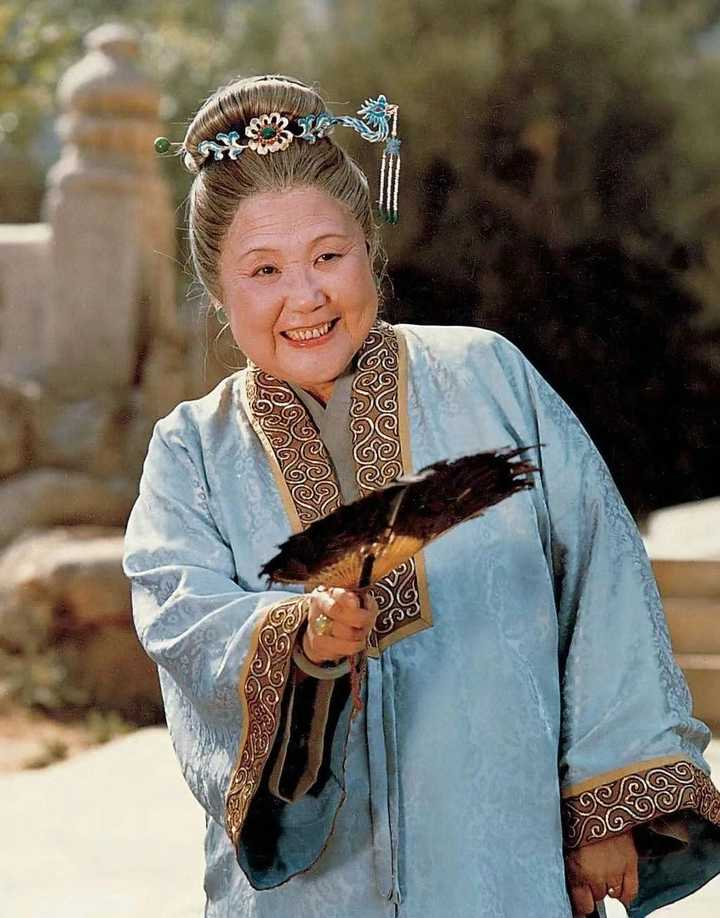
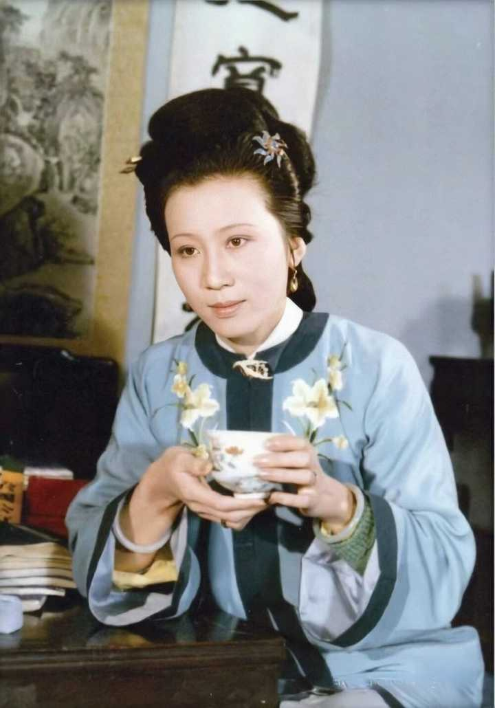
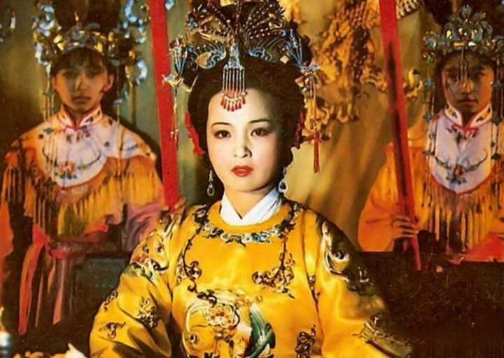

__说一个没人提过的细节：婚嫁降级。__

__贾府的媳妇和女婿，都是一代不如一代的。__

先看看媳妇们：

贾母（史家）——王夫人（王家）——李纨（国子监祭酒），至于后面宝玉娶妻，竟然是商贾出身的薛家。

alt="Image">

贾母，侯府小姐，有情调有格局有智慧；

王夫人，王家姑娘，没文化没头脑没情趣；

李纨，文官清流世家，有文化，有科举仕途资源，但综合实力显然不如史王两家；

alt="Image">

薛宝钗，商贾出身，还有个又蠢又坏的杀人犯哥哥，唯一能拿出手的，只有宝钗个人素质了。

更有意思的是，湘云那么喜欢贾府，贾母那么喜欢湘云，史家却从未考虑把湘云嫁给宝玉。

还有一个小细节，别看宝黛爱得死去活来，林如海夫妇却压根就看不上宝玉，不信看贾敏怎么跟宝贝女儿描述这位表哥的：

二舅母生的有个表兄，乃衔玉而诞，顽劣异常，极恶读书，最喜在内帏厮混，外祖母又极溺爱，无人敢管。《红楼梦》第3回

__曾经的贾府公子能娶到史家的小姐，如今的贾府公子，史林两家都不愿正眼看了。__

再看看贾府的姑娘都嫁到了什么人家：

贾敏，嫁给林如海，侯门独子\+探花，钦点的盐政（肥差\+皇帝亲信），面子里子都有了；

贾元春，入宫为妃，虽过得艰辛，但也算光宗耀祖，有面子没里子；

alt="Image">

贾迎春，嫁到（应该说“被卖到”？）武夫孙家，被禽兽虐杀，面子里子都没有；

贾惜春，出家（姑且算终身不嫁？），古代女子终身不婚可不是什么独立大女主，惜春出家也不是享受自由人生，纯粹是对家族心灰意冷；

贾巧姐，被卖入青楼。

__如果说贾府的“娶妻降级”是家族没落，那么“嫁女降级”简直是家族灾难了。__

__封建婚姻基本都是资源交换，婚嫁获得的资源越来越少，说明贾府能给出的资源已经不多了。__

### 作品不多，挑几篇自认为还行的给大家看看：

### [宝玉衔玉而诞是何寓意？](https://www.zhihu.com/question/640812128/answer/3376621200)

### [袭人的升职加薪秘诀是什么？](https://www.zhihu.com/question/591513134/answer/3422970241)

### [贾探春管家，为什么越管越乱？](https://www.zhihu.com/question/609910284/answer/3479012603)
