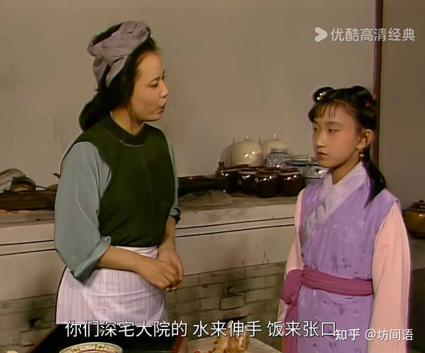
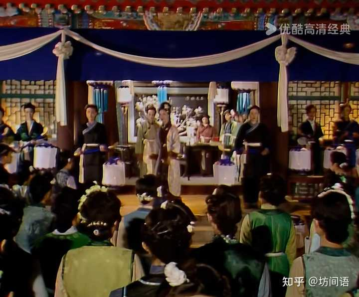
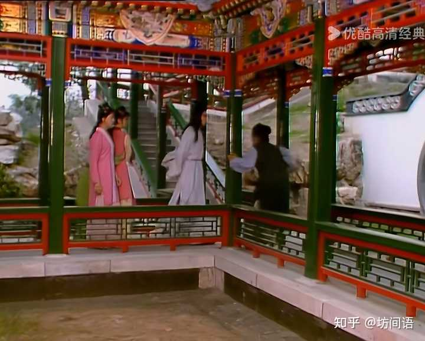

非常多的细节，比较明显的是太监对贾府的态度，以及贾府里的供给，比较隐藏的是贾府下人的行为。

## 太监对贾府的态度

在故事开始，秦可卿刚刚去世的时候，为了灵幡经榜上些的好看，所以想要给贾蓉提一提官职，这个官职是要用钱来买的，叫“捐个前程”。

戴权道:"事倒凑巧,正有个美缺,如今三百员龙禁尉短了两员,昨儿襄阳侯的兄弟老三来求我,现拿了一千五百两银子,送到我家里\.你知道,咱们都是老相与,不拘怎么样,看着他爷爷的分上,胡乱应了\.还剩了一个缺,谁知永兴节度使冯胖子来求,要与他孩子捐,我就没工夫应他\.既是咱们的孩子要捐,快写个履历来\."

这段说得非常清楚，两个缺，一个是襄阳侯，一个是永兴节度使，都是为自家人捐，这个永兴节度使就被戴权给pass了，这个缺，给了贾蓉。

也就是说，此时的贾府，跟有实权的节度使给家里儿孙抢个位子绰绰有余。

并且，这个抢，可不是因为“价高者得”。都是送到家里，襄阳侯给了一千五百两，贾珍给一千二百两就行了。

此时元春还没有被封妃，贾府的权势还是很值得一看的。贾雨村的应天府知府，这种地方官员的实缺，也是贾政周旋得到的。

待到元春封妃，在皇宫内就是太监夏守忠出来道喜的，也是他来家里宣旨的，而且，“也来不及吃茶”。

早见六宫都太监夏守忠乘马而至,前后左右又有许多内监跟从\.那夏守忠也并不曾负诏捧敕,至檐前下马,满面笑容,走至厅上,南面而立,口内说:"特旨:立刻宣贾政入朝,在临敬殿陛见\."说毕,也不及吃茶,便乘马去了\.

这会儿，可是完全没有提到从贾府拿任何银两。

到第七十二回，贾琏前脚刚刚跟鸳鸯借贾母的私产来周转，事情还没商定，后脚就有人通报说夏太府派人来，人进来，开口就要借二百两银子。和凤姐言语谈论，前面还有一千二百两银子没还。紧接着贾琏和凤姐私下说，周太监刚来要过一千两。

显然这已经成为一种惯例了。

之前贾府能够拿钱办事，还是花销小的那个，后面就被太监各种薅羊毛，还不敢吭一声。太监最知道朝中谁家得势，谁能要钱，谁得恭维着，谁就算不给钱也不能掉脸子，他们门清，可以说是风向标一样的存在。夏太监来宣旨的时候，怎么连口茶都没吃？贾府这个下坡路，从太监们的态度就看得清楚。

## 贾府里的供给

这个也很明显。

第六十一回，司棋想要吃鸡蛋羹，派小丫头来跟大观园的小厨房说，小厨房管事的柳家的不肯，说没有鸡蛋，小丫头翻出来十几个鸡蛋，柳家的说，鸡蛋难买，如果主子们不要，是不会送上去的。

柳家的忙丢了手里的活计,便上来说道:"……通共留下这几个,预备菜上的浇头\.姑娘们不要,还不肯做上去呢,预备接急的\.你们吃了,倘或一声要起来,没有好的,连鸡蛋都没了\.你们深宅大院,水来伸手,饭来张口,只知鸡蛋是平常物件,那里知道外头买卖的行市呢\.别说这个,有一年连草根子还没了的日子还有呢……"

alt="Image">柳家的说鸡蛋不好买

此时不仅是贾府衰败，连同外面的环境，都呈现衰败之象。

第七十五回，尤氏来贾母这边吃饭，等着添饭的下人手里缺并不是主子的饭，而是下人的饭。

这事儿被看大家吃饭取乐的贾母看见了，特意问起来，鸳鸯便解释说是按人头做饭的。

因见伺候添饭的人手内捧着一碗下人的米饭,尤氏吃的仍是白粳米饭,贾母问道:"你怎么昏了,盛这个饭来给你奶奶\."那人道:"老太太的饭吃完了\.今日添了一位姑娘,所以短了些\."鸳鸯道:"如今都是可着头做帽子了,要一点儿富余也不能的\."王夫人忙回道:"这一二年旱涝不定,田上的米都不能按数交的\.这几样细米更艰难了,所以都可着吃的多少关去,生恐一时短了,买的不顺口\."

按照以往的规矩，贾母这里会有很多饭菜，吃不完的，都会赏给这个那个，此时仍然会赏，但贾母已然知道不济了：

贾母见自己的几色菜已摆完,另有两大捧盒内捧了几色菜来,便知是各房另外孝敬的旧规矩\.贾母因问:"都是些什么?上几次我就吩咐,如今可以把这些蠲了罢,你们还不听\.如今比不得在先辐辏的时光了\."

## 贾府下人的行为

这个比较隐晦。

在秦可卿去世的时候，尤氏旧病复发不能理事，于是贾珍请凤姐来料理丧事。

凤姐很勤奋，早早的来，安排得妥妥当当的：

凤姐儿见自己威重令行,心中十分得意\.

alt="Image">凤姐在办理秦可卿葬礼的时候威重令行

并且所有的下人们都听她的号令，即便有人睡迷了，也并不是故意的，还被她当众发落，打了板子又罚了钱。

此时的凤姐，说的话是非常好使的，是让下人顺从的主子。

到了故事的后来，大观园里发生了几次很“搞笑”的事件——赵姨娘同芳官厮闹事件，春燕的娘当着宝玉的面打了芳官打春燕。

赵姨娘因为芳官给了贾环茉莉粉，认为是瞧不起自己，于是跑到怡红院同芳官动手打架——字面意义上的动手打架，并且还有同芳官交好的蕊官藕官等人跑来一起同赵姨娘冲突，成了下人打群架。

春燕的娘，因为芳官要洗头，和芳官犯口舌，打了芳官，没多久，又恼恨春燕不遂自己的心，一路追到怡红院里，完全不顾宝玉在场，还是要打春燕。

alt="Image">春燕的娘当着宝玉追打春燕

无论是不是因为赵姨娘不懂事，还是春燕的娘不知道规矩，这都意味着一件事——贾府对于下人的约束力变弱。

这种变弱并不是因为贾府的主子们都不在家，而是一种崩坏感，一种无力感。

此时凤姐病着，已经对贾府的管理十分心灰意懒，平儿需要用赶人出去这种直接几损害利益的手段才能震慑得住人。

同样的，春燕的娘这种完全不懂规矩的下人的出现，也昭示了贾府力的下人规矩学的不到位，颇有点青黄不接的意思。

这还是小的方面，还有一个很大的方面——管家的娘子们，开始撕扯权力、扩张地盘。

在查出厨房柳家有玫瑰露和茯苓霜，疑似偷盗以后，林之孝家的趁着柳家的监禁，立即派秦显家的来管厨房，并且直接回复平儿说“姑娘一并回明奶奶，她倒干净谨慎，以后就派她常伺候罢”，这已然涉及自己安排人手，插手贾府的人事任命了——大观园小厨房的管事的，这并不是一个粗使丫鬟的任命，这个职级并不低，林之孝家的直接换人，想“先斩后奏”，已经逾矩了。

旺儿家也在做类似的事情。王夫人的大丫鬟彩霞要被放出来了，旺儿家的直接求到凤姐面前来，要给自己的儿子讨要彩霞做儿媳妇。这一点，和贾赦看中鸳鸯是一样的，是因为彩霞是跟着王夫人的大丫鬟，所以旺儿才要去占一把。贾母不允许贾赦染指鸳鸯，发了那么大的火儿，可见这件事有多严重。

这两件事里，林之孝夫妇、旺儿夫妇，都在极力揽权，巩固自己的势力，并且隐隐有侵犯主子利益的态势。

这从一个侧面显示贾府主子威严的流失，已经到了下人可以觊觎的地步了。

贾府的衰败，从太多方面都可以看出来，那种崩塌感，已经不是人力所能控制的，像是一场雪崩，随着时间的流逝，只会越来越明显，却在意识到的那一刻起，就无法逃脱。

书里事便是世上事，世上事都可坊间谈。

世上的答案，书里都写过。

我是坊间方子，一起读读书，一起找找答案，一起，随便聊聊。
