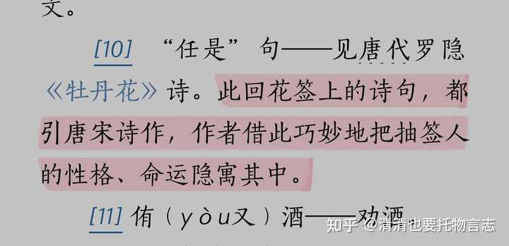
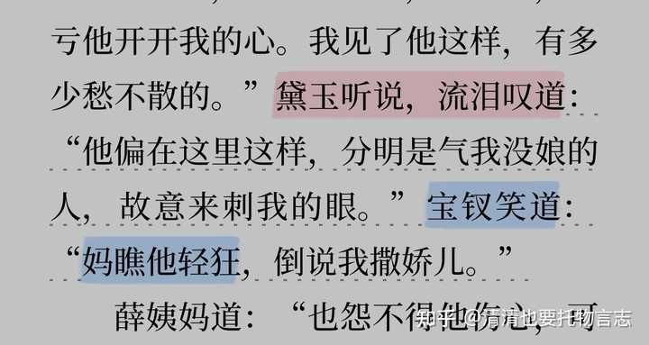

群芳夜宴宝钗抽到的花笺是牡丹，是偶然的巧合，还是作者的设置，目的是什么？

曹公隐秘的恶趣味。谁夸美女用罗隐的诗啊！

罗隐在唐朝就是个大喷子，阴阳怪气第一人。来一段经典的：

何光远《鉴戒录》：“罗秀才隐，傲睨于人，体物讽刺。初赴举之日，于钟陵筵上与娼妓云英同席。一纪后，下第，复与云英相见，云英抚掌曰：‘罗秀才犹未脱白耶！’隐虽内耻，寻亦嘲之云云。”

有个妓女叫云英，嘲笑罗隐科举多年不中。罗大才子面不改色心不跳，口占一绝以嘲之：

钟陵醉别十余春，重见云英掌上身。__我未成名君未嫁，可能俱是不如人！——__《嘲钟陵妓云英》

这就是“云英未嫁”的典故。够损吧。

罗大才子类似的讽刺诗还有很多，我随便挑几首：

《蜂》：不论平地与山尖，无限风光尽被占。__采得百花成蜜后，为谁辛苦为谁甜。__（讽刺含义不用说了吧，小学生都会背的）

《雪》：尽道丰年瑞，丰年事若何。__长安有贫者，为瑞不宜多。__（雪这个字儿在老曹的字典里就没啥好联想）

《春风》：也知有意吹嘘切，争奈人间善恶分 。__但是秕糠微细物， 等闲抬举到青云。__（是不是有薛宝钗尬吹柳絮“好风频借力送我上青云”那个调调）

《驾还京》：马嵬杨柳尚依依，又见銮舆幸蜀归。__泉下阿蛮应有语，这回休更说杨妃。__（好家伙，唐玄宗和唐僖宗都骂进去了哦）

真要夸赞牡丹艳丽富贵多的是好词好句，曹雪芹给薛宝钗配了一位这么毒舌的诗人，哪是什么赞美宝钗涅？

我们回到花签。首先澄清一点，__这一回大家抽到的花签都不是把人来比喻花的，而是像判词一样揭示命运的。__人文版红楼梦的注解就说得很清楚。

alt="Image">

下面来扒一扒薛宝钗花签对应的罗隐《牡丹花》全诗：

__似共东风别有因__，绛罗高卷不胜春。若教解语应倾国，任是无情亦动人。芍药与君为近侍，芙蓉何处避芳尘。可怜韩令功成后，辜负秾华过此身。

第一句就讽刺满满，很多红学家都指出来了，这句对宝钗的真正含义是：__她靠着谄媚逢迎东风这股强权而上位，才能因此而盛开，风光一时。__

“东风”是谁呢，当然是扶植娘家势力，不遗余力在贾府安插娘家人的王夫人了。

应该也包括下旨让薛宝钗搬进大观园和贾宝玉住在一起，甚至端午节赐给两人同样礼物的贾元春（这样贾母就再也不能让薛家搬走了）。

王夫人是势力代表，与力挺木石姻缘的贾母抗衡。（顺便多说一句，木石与金玉的角逐其实是贾王两家的权力之争，不要以为是简单的三角恋。）

薛宝钗多么爱东风。好风频借力，送我上青云嘛！

她的确钻到青云里了，这不王夫人都让她参与（搅和）管家了，想想薛宝钗拉踩贾探春利欲熏心，睥睨李纨不讲学问低入流俗的那个劲儿吧。

alt="Image">

__“芙蓉何处避芳尘”__很好理解__，__牡丹花得了东风之力而怒放，招摇过市，芙蓉（黛玉）避之不及。

——这不薛宝钗还得意洋洋地在黛玉面前秀母女恩爱，在黛玉被气哭的情况下，不但一句道歉一句安慰没有，反而还嘲笑黛玉轻狂吗。（还包括“开玩笑”要薛蟠娶黛玉）

alt="Image">

芙蓉这句言下之意就是小人得志，君子遭祸。

但，薛宝钗这股得意只是短暂的。罗隐的讽刺诗有个特点，最后两句特别爱神反转：

__可怜韩令功成后，辜负秾华过此身！__

韩令就是韩弘，唐元和十四年担任中书令，是有名的铁血节度使。韩令砍斫牡丹的故事见《唐国史补》：

京城贵游尚牡丹，三十余年矣。每春暮，车马若狂，以不耽玩为耻。执金吾铺官围外，寺观种以求利，一本有直数万者。__元和末，韩令始至长安，居第有之，遽命劚去，曰：“吾岂效儿女子耶！”__

“执金吾”是掌管治安的武官，这段话意思是，在那个时代，为了从俗世对牡丹的追捧中谋利，执金吾铺官在皇宫周围的寺观种植牡丹，一本牡丹能卖到数万钱。

这种风气为韩弘所不齿，他到长安后下令把他住所的牡丹全部砍光，愤愤地说：老子才不要像个娘儿们那样沉溺在花草里头！

追捧牡丹的人被韩弘斥责为妇人之见，大家想想曹雪芹用这首诗来比薛宝钗是想要闹哪样……

薛宝钗昙花一现的风光，很快就会七零八落。

__罗隐的《牡丹花》原本就是一首讽刺诗，讽刺那种罔顾道义谄媚上位的小人（牡丹）终究会被当权者厌弃、清除。__

所以不要再一提薛宝钗就是什么艳冠群芳曹公心头好十二钗第一钗甚至集阆苑仙葩神瑛侍者于一身了，但凡仔细读读罗隐的生平与诗作呢！
