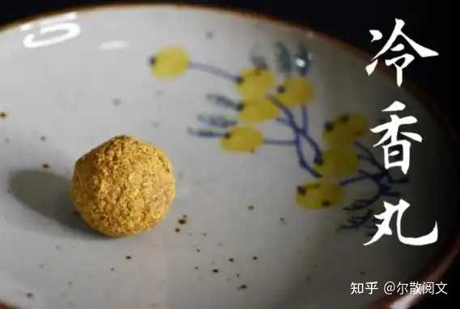
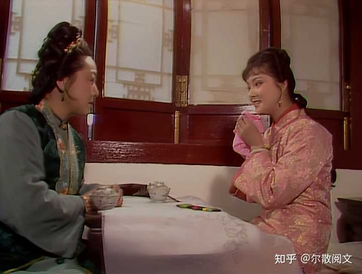
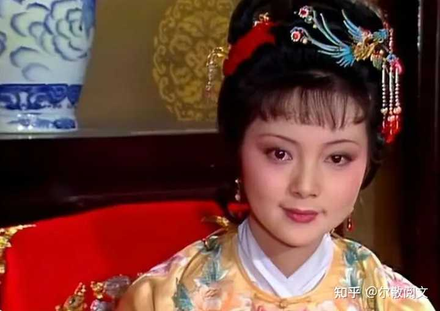
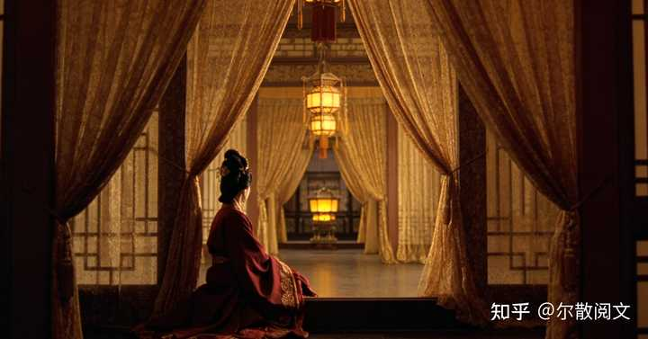

alt="Image">

冷香丸这段，95%的解读都是清冷压抑、礼教吃人。

但你真的细看完整配方就会发现：这根本就不是人设问题，是曹雪芹在跟你开一个最冷的玩笑。

今天换个完全不一样的角度：__不聊人设，聊荒诞。__

我先把原著最细、最完整的配药流程一字不落地捋清楚，你看完就能直观感受到：__这副药，离谱到吓人。__

alt="Image">

__一、全网最完整版：冷香丸到底是怎么做出来的？__

整套方子，不靠医术，全靠天运和运气。

__1\. 四时白花蕊（跨季收集）__

春天白牡丹蕊十二两
夏天白荷花蕊十二两
秋天白芙蓉蕊十二两
冬天白梅花蕊十二两

重点硬性规则：__必须全白，一丝杂色都不能有。__

收集完还不能随便晒，必须等到第二年__春分__当天统一晒干、研粉、混合。

__2\. 四时节气天水（最变态的一步）__

必须集齐四个特定节气、当天自然生成的水：

雨水日的雨水十二钱
白露日的露水十二钱
霜降日的霜十二钱
小雪日的雪十二钱

这一步就完全看天了：当天不下雨、没露水、没霜雪，直接白等一年；不能存旧水、不能人工制造、不能替换替代。

__3\. 合药与封存__

四样天水搅匀，加入十二钱蜂蜜、十二钱白糖，揉成龙眼大小的药丸。

储存方式也很玄学：__装进旧瓷坛，深埋花根底下藏着。__

顺带一提，癞头和尚还单独给了一包异香异气的药末引子，来历不明、成分不明，整本红楼再也没有解释，让这副药从根上就脱离了世俗医理，纯属杜撰仙方。

__4\. 服用方式__

咳嗽发作时挖出来一颗，用极苦寒的黄柏汤送服。

看到没，整套流程走下来，运气顺利一两年方能成型，天时不配合，三五年都凑不齐一料。

也难怪周瑞家的听完直接念佛：__这辈子见过吃药的，没见过求天求地求节气才能吃药的。__

alt="Image">

__二、最扎心的真相：这副天价神药，本质上不具根治效果__

这是绝大多数解读都刻意避开的实话。

站在现实医学视角拆开看：四季花蕊、霜雪露水、蜂蜜白糖，只有仪式象征意义，没有根治病灶的药理作用。__无害，但也无用。__

整副药唯一带真实药性的，只有最后送服的__黄柏__。顶多轻微清热去火，临时压压症状。治不了根，消不了病根。

也就是说：宝钗耗费数年光阴、赌上天时地利才配成的“海上仙方”，__实质就是带点苦味的糖水丸子。__

所以，她吃了十几年，咳喘时好时坏，终身不愈。

这才是曹雪芹真正的高级讽刺：__你用尽世间最极致的规矩、最虔诚的自律、最漫长的坚持，到头来发现——根本没用。__

推而广之，作者哪里是在写宝钗一个人？

他写的是那个时代，一整批最优秀、最体面、最听话的大家闺秀。

她们一辈子守规矩、懂分寸、藏情绪、压本心，耗费一生维持完美端庄的人设。

可到最后才发现：

自我压抑换不来健康，克制天性换不来圆满；

__所有小心翼翼、步步拘束的活着，都是一场没必要的内耗。__

因为这里面包含着的，本身就是一份极致的荒诞：

__材料__：最素、最白、最冷，所以是最无生机；
时间：卡最死、最刻板，所以是最容易出差错；
工序：超长、繁琐、耗心力，所以是空耗时光。

alt="Image">

__三、今天还有不有“冷香丸”？__

我的答案是：__还有，且无处不在。__

我们为了体面，强迫自己时刻情绪稳定；

我们为了合群，刻意收起所有的棱角和喜好；

我们为了符合别人眼里的“优秀”，常年奋斗在所在的主流评价体系里。

甚至，大学专业报考，为了挤进所谓的热门专业，更是放弃自己的理想与追求。

__仪式拉满，自律拉满，规矩拉满，__
__唯独活得紧绷、别扭、不自在。__

凡此种种，难道不是现代的“冷香丸”吗？

曹滚滚红尘里，

我们无不是在用最隆重的方式，压抑最正常的自己。

写到这里，不由的感叹一下：

__很多时候，可悲的不是“身体有病”，__
__是明明无病、无痛，__
__却要用一辈子的克制与内耗，__
__去“治愈”自己的鲜活和真实。__

这，恐怕就是曹雪芹通过“冷香丸”，展示给我们看的，那份不可名状的“荒诞”。

__下一篇继续聊“茄鲞”，《红楼梦》里那道严重背离成本核算的名菜。感兴趣的同好，敬请关注，共同学习探讨。__

__话题：__关于冷香丸，你觉得这种藏在背后的“荒诞”解读合理吗？生活里的你，有没有身不由己吃过属于自己的“冷香丸”？评论区聊聊。

\#红楼梦 \#薛宝钗 \#冷香丸 \#红楼解读 \#古典文学 \#人生感悟
