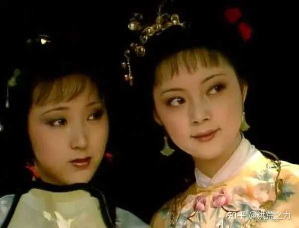
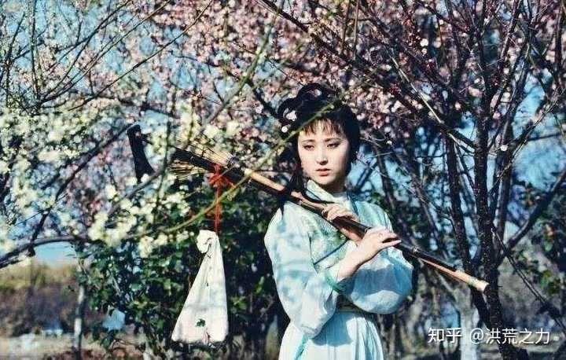

《红楼梦》：为什么林黛玉一死，贾家很快就被抄家了？ \- 桃妍伊切俄欣滴 的回答

何黛玉死后，贾家才倒？一粒人参养荣丸里竟有大秘密

在第五回中，当宝玉在太虚幻境游玩时，他在《红楼梦曲》里唱到：“仿佛吃完了所有的鸟都投入了森林，这片广袤的大地变得如此纯净”。这描述了贾府最终面临的金银四散、家破人亡的悲惨情况。

作为在四王八公中独霸两公的武将，贾家的荣耀已经流传了近一个世纪，但最终还是会崩溃，曾经的富贵和荣华只会成为过眼云烟。无论是贾家的第一回《好了歌》，还是冷子兴在荣国府演讲中提及的贾府的种种问题（例如：以安荣和尊富为主，缺乏策略和计划），亦或是宝玉在太虚幻境的所见所闻，或是探春在大观园进行抄检时的“悲愤之声”，这些都在间接地预示着贾府即将面临的悲惨结局。

alt="Image">

贾府在被查封之前，黛玉已经离世，这一点是大多数读者普遍的看法。实际上，在黛玉的作品《葬花吟》中，有一句“质本洁来还洁去，强于污淖陷渠沟”，这句话清晰地表达了这一点。如果黛玉在抄家的过程中，不得不亲眼见证人间所有的丑恶和黑暗，她的人身将受到控制，人格也将受到侮辱，这不仅背离了黛玉“质本洁来还洁去”的初衷，也与作者的初衷相悖。

因此，贾府是在黛玉去世之后才倒下的。这背后的原因是什么呢？实际上，所有这些都隐藏在黛玉所服用的某种丸药之中。

当黛玉进入府内，大家注意到她的行为显得有些虚弱，因此判断她患有某种疾病。当询问她服用了哪种药物时，黛玉回应说她从小就开始服用，即使尝试了各种著名的方子和药物，效果也不明显，目前她所服用的仍然是名为“人参养荣丸”的药物”。这里的评论是：每个人都应该为自己的荣卫进行自我养护！

在中医理论中，荣卫是指气血。黛玉的先天缺陷可能是气血两虚。尽管人参可以养气血，黛玉服用此药并无问题，但在脂批中，为何要强调人的身体需要自我养护呢？黛玉其实就像一颗珍贵的人参。

我们了解到黛玉在她的前世曾是一株神奇的仙草，被称为绛珠草。这株草得到了神瑛侍者的甘露滋润和天地之精华、雨露的滋养，从而得以化身为人形。这颗绛色的珠子，实际上是红色的小珠子，而从草根变成女性的形态，看起来像什么呢？那明显就是结出果实的人参草的模样。人参也被誉为神奇的草药。他被誉为百草之王，与宝玉这百石之王相得益彰。

因此，当黛玉服用“人参养荣丸”时，她实际上是在“自我养护”。令人深思并感到恐惧的是，这种丸药中的“荣”这个字。

在经典文学作品《红楼梦》中，“荣”这个字被用作荣国府的代称，而黛玉所制作的丸药并不偏颇，如果恰到好处地命名为“养荣丸”，那肯定不只是一个简单的药物名称。这实际上是在隐晦地表示，荣府的兴衰与黛玉之间存在着紧密的关联。那么，黛玉是依靠什么来实现“养荣”的呢？

毫无疑问，林家的资产是最有价值的。

文章一开始就详细描述了林家的家庭背景和家庭成员情况，但直到林如海去世后，也没有明确说明林家那四世列侯和林如海这一代的巡盐御史所积累的财产都去了哪里。毕竟，在秦钟去世之前，作家已经描述了一批远房的叔叔和婶婶来进行财产分割的情景。这难道是因为作者的写作技巧不足，所以选择不给出解释吗？实际上，只要是稍微了解《红楼梦》的读者，就能在许多不同寻常的地方找到解答。

alt="Image">

首先要明确的是，在贾敏生病的那段时间里，贾家并没有人前来探望她，而且在贾敏去世后，也没有看到贾家的其他成员前来表示哀悼。贾敏去世后，贾母非常焦虑，于是提前派遣了船上的男女来接她，她到底在急什么呢？

再者，在林如海生病期间，贾母特别指派贾琏将黛玉送回苏州，并多次强调必须将黛玉带回。根据当时的法律规定，林黛玉作为一个孤女具有绝对的继承权。更有趣的是，当贾琏和黛玉返回贾府的时候，他们是与贾雨村一同前往京城的。这个贾雨村曾两次护送黛玉进京，但究竟是在护送什么呢？

再一次，贾琏向凤姐表达了对荣府资金流转问题的不满，并在谈话中提到“只需再发一笔二三百万的资金即可”。

那么，贾琏那二三百万的财富是从何而来的呢？想象一下，当王熙凤在铁槛寺掌权时，她失去了两个人的生命，但她却得到了三千两。这三千两已经是一个巨大的数目，因为像刘姥姥这样的家庭一年的开销只有二十两，而这二三百万的财富，肯定会消耗掉一个富有家庭的所有。但从整篇文章来看，贾琏到底做过哪些重要的事情呢？在所处理的事务中，有哪一项涉及到巨大的财富呢？在处理林如海的后续事宜时，就像秦钟去世后，他的远房叔婶负责看守一样，林家这个没有子嗣的无依无靠的家庭也将成为旁族人的觊觎对象。贾琏，作为国公府的贵族公子，正是为了与林家的家族进行交涉而来。

因此，黛玉这个行走的人进入了荣府，并带回了为荣府提供营养的数百万银两。可以理解的是，除了每月的月利之外，贾母还会每月派人送银子给黛玉。黛玉在花费上非常慷慨，随手一抓就能给小丫头一把，计算下来大约是小丫头一个月的月钱。

黛玉被视为滋润“荣府”的关键人参，但贾府却选择亲自伤害她。在之前的分析中，我们了解到贾母去世后，宝玉为了避免不幸离家出走。贾雨村向北静王献上了宝物，声称贾府内有一位名为黛玉的绝美女子。北静王对此并不了解，因此有意娶她为妻，这正好符合王夫人的期望，并多次施加压力。正如人们常说的“风刀霜剑严相逼”，黛玉在等待宝玉和被迫嫁人的绝望中，日日夜夜哭泣，最后泪水流尽而去，这就是人们常说的“春尽红颜老，花落人亡两不知”。

alt="Image">

黛玉这颗珍贵的人参一旦死去，荣府便会失去其宝贵的甘露，灾祸也会接连不断地降临。政治上的敌人开始反抗，贾家也遭到了查封。这座在风雨中屹立了近一个世纪的大厦，正如周瑞家所描述的人参：“这东西比其他任何东西都要好，仅用一百年的时间，它就会自行化为灰烬。”贾家的富贵和荣华最终也会化为乌有，消失得无影无踪。
