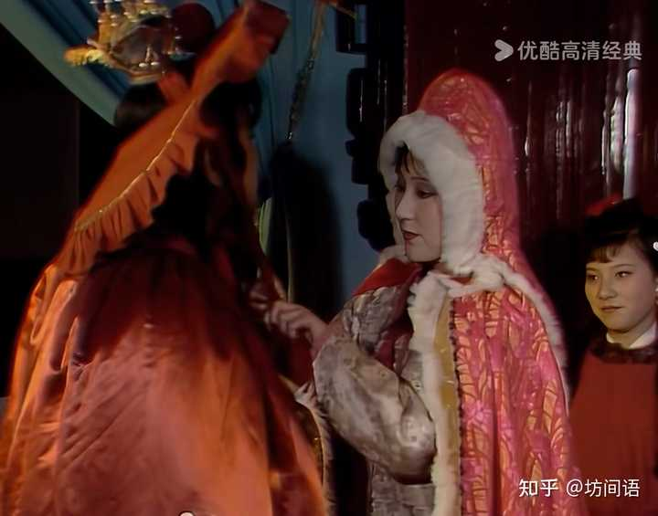
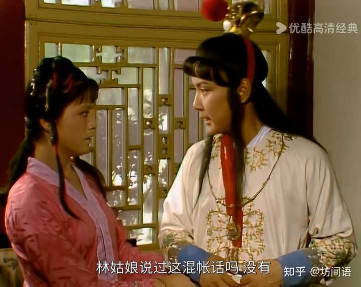

那就得说说黛玉都做些什么了。

宝玉写了三个字“绛云轩”，专门嘱咐贴在门斗上，贴完还仰头去看。

这时候，黛玉来了，宝玉问她哪个字写得好，黛玉的反应是这样的：

黛玉笑道：“个个都好。怎么写的这么好了？明儿也与我写一个匾。”

alt="Image">黛玉说宝玉的字个个都好

情绪值拉满有没有？

不仅赞叹好，还让宝玉给自己写匾去。

别说当时，就是现在，多少人给出的回答会是：

你可拉倒吧，你写的狗爬的字还能看？不用看我都知道个个都不好。

就算有人会说好，又有多少人能进一步说给自己写匾去？

怪不得接下来宝玉就能“嘻嘻的笑”。

他知不知道黛玉哄他？他知道啊。并且他说的是：“又哄我呢”。

平日里黛玉没少哄他。

这种“哄”，特别真心。

如果宝玉真给她写个匾，黛玉真能给挂起来。

字不一定多好，重点这是宝玉给写的。

她真的把宝玉放在心上，连同宝玉的产出，都是好的，都是自己真心赞赏夸耀的。

同一天，还发生了另一件事——宝玉和黛玉不约而同去探望宝钗。

临走的时候，俩人要一起回去，小丫头给宝玉戴斗笠，丫头不会戴，宝玉说她蠢。

这时候，黛玉上场了：

黛玉站在炕沿上道：“啰嗦什么，过来，我瞧瞧罢。”宝玉忙就近前来。黛玉用手整理，轻轻笼住束发冠，将笠沿掖在抹额之上，将那一颗核桃大的绛绒簪缨扶起，颤巍巍露于笠外。整理已毕，端相了端相，说道：“好了，披上斗篷罢。”

alt="Image">黛玉替宝玉戴斗笠

这一系列动作，不仅帮忙戴，还特别细心，又是整理，又是“轻轻的”，又是“掖”，又是“扶起”，搞完了还再三端相，让披上斗篷。原文中说簪缨是“颤巍巍”的，怎么看它都是黛玉把宝玉当成颤巍巍捧在手心里的人。

同样的还有雨夜，宝玉来看黛玉，黛玉催他回去，问有没有人跟着，有人回答说有，又说点着灯笼。

黛玉马上就把自己的玻璃绣球灯拿给宝玉。

宝玉说，自己也有一个，怕跌了所以没用。

这话被黛玉数落了一番：

黛玉道：“跌了灯值钱，跌了人值钱？你又穿不惯木屐子。那灯笼命他们前头照着，这个又轻巧又亮，原是雨里自己拿着的，你自己手里拿着这个，岂不好？明儿再送来。就失了手也有限的，怎么忽然又变出这‘剖腹藏珠’的脾气来！”

alt="Image">黛玉把自己的灯给宝玉拿着用

宝玉是富贵公子哥儿，那么珍惜那盏灯，显然是个稀罕物件，那么对于黛玉来说，也是个好东西，平时都是放在书架上的，看来是有摆设观赏的效用，她能够毫不假思索地拿给宝玉，在宝玉说怕打破的时候又明明白白告诉他“人重要”。

这种时时刻刻把宝玉放在一切物事之前的心，就是一片向着宝玉的炽热心，宝玉能感觉不到？

换到现在，女朋友非常喜欢一个非常昂贵的定制限量款雕刻摆件式样的香薰蜡烛，这天停电，你要去洗手间，她二话不说就拿过来给点上让你照明，你说多浪费，她说你最贵，你什么心情？有没有觉得烛光摇曳中的女朋友比往日都更美了。

如果仅仅是这些，还不算怎么样特别，宝玉爱黛玉，最重要的一件事当然是黛玉和他最契合。这种契合，是知道宝玉的喜好和厌恶，从而从不去触碰他最厌恶的事情。

这是一种发自内心的尊重。

宝玉不喜欢“仕途经济”，湘云也劝，宝钗也劝，袭人也劝，贾政王夫人什么的，大概嘴唇都磨破了。

可偏偏黛玉不劝。

alt="Image">宝玉知道黛玉从不劝自己仕途经济

是因为黛玉出身低、文化差，不懂得仕途经济么？

明显不是啊。

恰恰相反，她反而是大观园一众人中，最懂得仕途经济的那个。

别忘了，元春省亲，夺魁的《杏帘在望》，可是黛玉的手笔。

对黛玉来说，仕途经济根本不是什么高不可攀的东西，而是家常便饭，从小耳濡目染的东西。

毕竟，黛玉是两个进士教出来的，她父亲和老师对仕途经济的敏锐度，都远超过贾政，她所接受到的这方面的教育是非常“接天气”的。

她不是不懂，而是宝玉不喜欢，她就不谈论。

她从来没有想过宝玉如果考取功名，日后迎娶自己，给自己挣个诰命夫人的名号，她在乎的只是宝玉心里有没有她。

这样的一个有能力有才华的女子，一心一念只栓在自己身上，时时刻刻提供情绪价值，时时刻刻只在乎自己的感受，以宝玉追逐真情的性格，自然心心念念的是黛玉。

书里事便是世上事，世上事都可坊间谈。

世上的答案，书里都写过。

我是坊间方子，一起读读书，一起找找答案，一起，随便聊聊。
