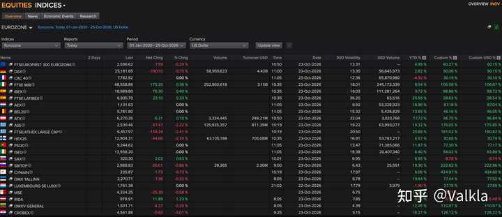
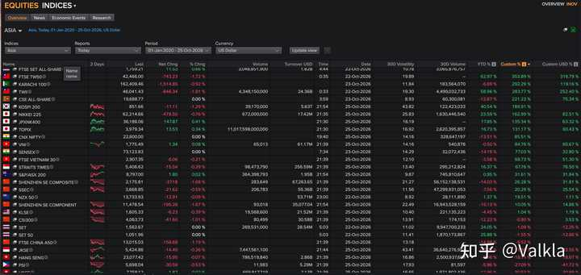
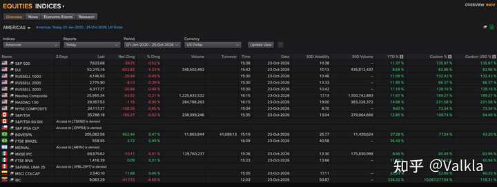

__问题描述：__

看到很多人即使知道利息跑不赢通胀，还是更愿意看着银行卡里的数字，觉得这样才有安全感。想了解一下大家选择存钱而不是投资的原因。

这个问题问的，屁股有点歪哈。首先，全球主要股指过去7年（6年10个月）的回报：

欧元区：

alt="Image">来源：LSEG 谢绝转载

亚洲：

alt="Image">来源：LSEG 谢绝转载

美洲：

alt="Image">来源：LSEG 谢绝转载

字太小可能看不清楚，表格：

## 一、欧洲市场

__市场 / 指数__

__最新点数__

__YTD %__

__区间回报 %__

欧元区 FTSE Eurofirst 300

2,596\.62

\+4\.99%

\+60\.27%

德国 DAX

25,181\.65

\+2\.82%

\+90\.06%

法国 CAC 40

7,782\.82

\-4\.50%

\+30\.19%

意大利 FTSE MIB

48,558\.86

\+8\.04%

\+106\.58%

西班牙 IBEX 35

18,989\.80

\+9\.72%

\+98\.86%

西班牙 FTSE Latibex

6,935\.70

\+25\.59%

\+28\.63%

荷兰 AEX

1,131\.63

\+18\.96%

\+87\.18%

比利时 BEL 20

5,781\.80

\+13\.85%

\+46\.16%

奥地利 ATX

6,270\.26

\+17\.72%

\+96\.75%

希腊 ASE 综合指数

2,530\.46

\+19\.32%

\+176\.05%

希腊 FTSE/ATHEX 大盘股

6,457\.97

\+20\.68%

\+181\.02%

芬兰 OMX Helsinki 25

12,904\.31

\+4\.57%

\+30\.68%

葡萄牙 PSI 20

9,244\.62

\+11\.87%

\+77\.30%

爱尔兰 ISEQ

13,938\.20

\+6\.40%

\+94\.03%

斯洛伐克 SAX

320\.30

\+8\.95%

\-8\.78%

斯洛文尼亚 SBI TOP

2,988\.83

\+19\.36%

\+222\.82%

塞浦路斯 CSE 综合指数

235\.87

\+6\.06%

\+424\.97%

爱沙尼亚 OMX Tallinn

2,270\.71

\+10\.64%

\+77\.44%

卢森堡 LuxX

1,761\.38

\-1\.90%

\+27\.78%

马耳他 MSE

4,324\.25

\+14\.15%

\-8\.27%

拉脱维亚 OMX Riga

978\.91

\+5\.76%

\-5\.52%

立陶宛 OMX Vilnius

1,501\.71

\+12\.25%

\+110\.87%

克罗地亚 CROBEX

4,561\.88

\+18\.27%

\+126\.12%

## 二、美洲市场

__市场 / 指数__

__最新点数__

__YTD %__

__区间回报 %__

美国 标普 500

7,623\.68

\+11\.37%

\+135\.97%

美国 道琼斯工业指数

52,215\.16

\+8\.64%

\+82\.96%

美国 罗素 1000

4,146\.93

\+11\.09%

\+132\.42%

美国 罗素 2000

2,775\.90

\+11\.85%

\+66\.37%

美国 罗素 3000

4,317\.27

\+11\.19%

\+128\.16%

美国 纳斯达克综合指数

25,955\.34

\+11\.67%

\+189\.27%

美国 纳斯达克 100

28,957\.53

\+14\.68%

\+231\.58%

美国 纽交所综合指数

24,117\.27

\+9\.60%

\+73\.34%

加拿大 S&P/TSX 综合指数

35,788\.18

\+12\.85%

\+109\.74%

巴西 Bovespa

205,082\.56

\+27\.28%

\+77\.34%

巴西 FTSE Brazil

558\.95

\+36\.43%

—

墨西哥 IPC

69,879\.62

\+8\.66%

\+60\.49%

墨西哥 FTSE BIVA

1,418\.39

\+11\.46%

\+58\.62%

哥伦比亚 MSCI COLCAP

2,540\.10

\+22\.83%

\+52\.80%

委内瑞拉 IBC

9,083\.29

\+336\.22%

\+10,067,377\.54%

三、亚洲及亚太市场

__市场 / 指数__

__最新点数__

__YTD %__

__区间回报 %__

中国台湾 FTSE Taiwan 50

42,466\.00

\+62\.97%

\+353\.89%

巴基斯坦 KSE 100

162,409\.46

\-6\.69%

\+292\.29%

中国台湾 加权指数 TAIEX

46,041\.43

\+58\.96%

\+283\.77%

斯里兰卡 CSE 综合指数

19,688\.77

\-12\.87%

\+221\.23%

韩国 KOSPI 200

851\.66

\+40\.54%

\+189\.91%

日本 日经 225

62,214\.66

\+23\.59%

\+162\.99%

日本 JPX 日经 400

36,186\.06

\+17\.85%

\+135\.34%

日本 TOPIX 东证指数

3,979\.34

\+16\.73%

\+131\.17%

印度 Nifty 50

22,600\.00

\-13\.51%

\+85\.51%

越南 VN\-Index

1,775\.49

\-0\.50%

\+84\.76%

印度 Sensex 30

73,123\.83

\-14\.19%

\+77\.03%

越南 VN30

2,907\.35

\-3\.58%

\+68\.73%

新加坡 海峡时报指数 STI

5,406\.62

\+16\.37%

\+67\.76%

澳大利亚 S&P/ASX 200

8,797\.00

\+0\.95%

\+31\.61%

中国 A股 深证综指

2,175\.81

\-14\.03%

\+26\.28%

中国 A股 上证综指

3,668\.85

\-7\.56%

\+20\.29%

新西兰 NZX 50

13,733\.93

\+1\.37%

\+19\.51%

中国 A股 深证成指

11,478\.54

\-15\.13%

\+10\.05%

马来西亚 富时隆综指 KLCI

1,605\.33

\-4\.45%

\+1\.04%

中国 A股 沪深 300

4,063\.73

\-12\.23%

\-0\.80%

泰国 SET 综合指数

1,562\.67

\+24\.05%

\-1\.09%

泰国 SET 50

1,051\.96

\+25\.88%

\-1\.55%

中国 A股 富时中国 A50

13,015\.03

\-14\.98%

\-9\.52%

印度尼西亚 雅加达综合指数

5,424\.86

\-37\.26%

\-13\.88%

中国香港 恒生指数

23,077\.42

\-9\.96%

\-18\.14%

菲律宾 PSEi 综合指数

5,698\.04

\-5\.86%

\-27\.09%

世界主要经济体里，中国排第二。但要论股市回报，过去近七年表现为负的市场还真没几个：马耳他、拉脱维亚、印度尼西亚、泰国、菲律宾，还有东大。其中，恒生指数在这份统计中倒数第二，倒数第一是菲律宾。

当然，换个角度说，咱这是价值洼地啊。问题来了，这么好的抄底机会，你们怎么不买呢？

回到问题本身。如果从大感冒那会儿开始投资，买的是沪深300、富时中国A50这类宽基指数，算下来还真不一定比老老实实存银行吃利息强。这种持股体验，凭啥指望人家往里进呢？

反观美国，资本市场过去几十年，确实给普通家庭提供了一条相对简单、可复制的财富积累路径。

你不需要会分析财报，不需要研究技术指标，甚至不需要知道今天纳斯达克涨了还是跌了。通过401\(k\)、IRA，定期买入低成本宽基指数基金，几十年下来，只要没有在市场暴跌的时候把自己吓出去，历史上确实有相当可观的财富积累机会。

而且，这套机制早已深度嵌入美国人的退休保障体系。很多人投资股市，压根不是每天研究哪只股票会涨，而是工资发下来，一部分自动进入退休账户。投资已经成为劳动收入向金融资产转化的一条常规渠道。

根据美联储的消费者金融调查，2022年约58%的美国家庭直接或间接持有股票。

这是什么概念？股市上涨，不仅仅是资本家发财，相当一部分普通家庭的退休账户也跟着增值。当然，持股比例不等于财富分配比例，美国家庭金融资产的集中程度依然很高，但至少，这套机制让普通人有机会通过持有金融资产分享企业发展的成果。

可问题是，中国家庭能照着这么玩吗？

__你让一个2020年开始投资沪深300的普通投资者，坚持到2026年，打开账户一看，指数价格还亏了0\.8%。再看看隔壁的纳斯达克100，同期上涨231\.58%。__

他是什么感受？你再告诉他，应该树立长期投资理念，应该拥抱权益市场，应该承担适当风险以获取更高收益。人家可能只想问你一句：凭啥？

__承担风险是为了获取风险溢价，不是为了证明自己有承担风险的勇气。__

风险溢价当然不是保证收益，七年也不能代表未来七十年。但是，如果一个市场长期不能给普通投资者提供足够有吸引力的风险调整后收益，那么家庭降低权益资产配置、增加储蓄比例，有什么不好理解的？

而且，中国家庭过去也不是没承担过风险。房地产就是最典型的例子。相当长一段时间里，中国居民家庭最重要的财富积累渠道不是股市，而是房地产。大家把积蓄、未来收入，甚至几代人的购买力集中到一套房子上，承担的风险可不见得比证券市场小，毕竟不少人还上了杠杆。

所以你说中国人保守，不愿意投资？那过去二十多年，一个个掏空六个钱包、背上三十年房贷买房的家庭算什么？中国人从来不是不愿意承担风险，而是他们愿意为自己相信的财富增值机会承担风险。

现在房地产的财富效应减弱，股市又没能稳定接过这根接力棒。居民还能怎么办？

存银行呗。

世界银行2025年12月的中国经济报告就提到了这个问题：房地产价格下降削弱了家庭资产负债表，收入和财富的不确定性推动了预防性储蓄。2025年第三季度，中国人民银行城镇储户调查中，62\.3%的受访者倾向于增加储蓄。

换美国人来这个服务器，他也得这么操作。

__当一个家庭对未来收入、就业、医疗、养老和子女教育支出缺乏足够确定性的时候，流动性本身就是有价值的。__

经济学里讲预防性储蓄（Precautionary Saving），说白了就是，未来越没把握，现在越不敢花钱。哪怕存款利率低一点，甚至实际购买力有所缩水，也不代表这个选择一定不理性。因为家庭资产配置追求的从来不只是收益最大化，还得考虑万一哪天出了事，手里有没有能救急的钱。你总不能指望一个上有老下有小的普通家庭，把应急资金也拿去赌市场反弹吧？

这里还有一个经常被忽视的问题：资本市场的财富创造能力，和资本市场的融资能力，并不是一回事。上市公司融到钱了，不代表二级市场投资者一定赚到了钱。经济增长了，也不意味着股票投资者必然能够按比例分享增长成果。

股东最终获得的回报，要么来自企业持续盈利、分红和回购，要么来自市场愿意为这些未来现金流支付更高的估值。如果一个市场长期更擅长融资，却不能让投资者获得与风险相匹配的回报，那么居民为什么要不断把储蓄搬进来？

靠情怀吗？

还是那句话，价格洼地你不抄底，跑知乎来问这个？你可以鼓励居民提高金融素养，可以发展养老金体系，可以完善长期投资渠道。但不能指望普通家庭上几堂金融教育课，就突然愿意承担一项历史表现并不理想的投资风险。

更不能一边让人家承担风险，一边嘲笑人家不懂投资。__美国人愿意投资股市，很大程度上是因为美国资本市场过去证明了长期投资可以创造财富；中国人喜欢存银行，也有相当一部分原因，是因为他们自己的投资经历告诉他们，现金虽然不怎么赚钱，但至少不用天天担心亏钱。__

如果想让更多中国人的储蓄进入资本市场，最有效的办法不是天天宣传长期投资，更不是给储户上金融教育课。*咱能不能，就假如哈*，先让Public Company真正做到Public？上市公司到底是公众股东共同拥有的企业，还是某些人融资、套现、转移风险的工具？__管理层能不能切实履行对公司和股东的Fiduciary Duty，把中小股东的利益当回事？__

整天研究谁有资格写财经评论，谁该参加什么资格考试。真要好好考考道德倒也行，但我觉得更需要接受考试的，恐怕是那些拿着公众投资者的钱，却不把公众投资者当回事的人。

说到底，资本市场最根本的功能，不应该只是把居民储蓄转化为企业融资，更应该让承担了风险的投资者，能够通过企业的成长获得合理回报。融资是手段，资源配置是过程，资本形成和财富创造才是结果。如果一个市场只强调前两者，却长期忽视最后一环，那所谓引导居民储蓄入市，听起来就多少有点让普通人为经济发展承担风险，却不保证他们有合理机会分享发展成果的意思了。

而这恰恰是问题的症结所在。

__一个国家的经济总量可以持续增长，企业可以不断上市，融资规模可以屡创新高，但如果普通人作为股东，长期无法从中获得相称的回报，那么经济增长和居民财富增长之间，就缺了一座桥。__

这座桥不是靠喊口号架起来的，也不是靠教老百姓看K线架起来的。它需要有效的公司治理、真实的信息披露、对侵害股东利益行为的追责，以及能够让企业利润真正回流投资者的制度安排。

资本市场说到底，是一种建立在产权、契约和信任之上的制度。你买下一家企业的股票，本质上是拿今天的钱，交换对这家企业未来收益的请求权。这个承诺能不能兑现，决定了投资者愿意为它付出多少，以及愿意等多久。

所以，__不要总想着怎么把老百姓的钱从银行里赶出来。先想想，怎么让他们相信，把钱交给资本市场，自己的利益能够得到尊重和保护。__

信任不是宣传出来的，是靠一次又一次兑现承诺积累出来的。居民储蓄也不是等待被动员的闲置资金，而是千千万万个家庭用劳动、时间和克制消费换来的财富。人家有权决定把它放在哪里，也有权拒绝一项自己认为不划算的投资。

等哪天，普通人不用靠运气选中十倍股，不用天天猜政策、赌行情，只需要长期持有经营良好的企业，就能相对可靠地分享经济增长的成果，那时候，你根本不需要劝。

钱自然会流过去。

__逐利是人类的天性，又不是美国人的专利。真正需要解释的，从来不是中国人为什么喜欢存钱，而是为什么一个世界第二大经济体，还没能让足够多的普通家庭相信，持有本国企业的股权，是一条值得长期走下去的财富积累之路。__

### 名词解释

1\. 风险溢价（Risk Premium）

投资者因为承担额外风险，而要求获得的高于无风险收益率的预期回报。例如，美国国债收益率为4%，投资股票的预期年化收益率为9%，那么股票的预期风险溢价就是5个百分点。注意，这是投资者要求或预期获得的补偿，并不代表最终一定能够实现。

2\. 风险调整后收益（Risk\-Adjusted Return）

衡量投资回报时，同时考虑投资者承担了多少风险。同样年化收益10%，一个投资组合最大回撤只有10%，另一个却可能腰斩，两者显然不能同日而语。常见的衡量指标包括夏普比率（Sharpe Ratio）和索提诺比率（Sortino Ratio）。收益高不等于投资效率高。

3\. 预防性储蓄（Precautionary Saving）

居民为了应对未来收入下降、失业、疾病、养老等不确定性而增加储蓄的行为。当家庭对未来缺乏信心时，即使存款利率很低，也可能选择持有更多现金。这不是简单的风险厌恶，而是面对不确定性时的一种理性资产配置行为。

4\. 流动性（Liquidity）

资产在不显著影响价格的情况下，迅速转换为可支配现金的能力。银行活期存款流动性很高，股票通常也有较好的市场流动性，但在急需用钱时可能不得不亏损卖出。房地产流动性相对较差，出售往往需要较长时间。流动性本身具有经济价值。

5\. 信义义务（Fiduciary Duty）

公司董事、高管等受托人在特定法律关系下，对公司及相关受益主体承担的法律义务，核心包括忠实义务（Duty of Loyalty）和注意义务（Duty of Care）。简单说，就是不能利用受托地位谋取不当私利，必须以适当的谨慎和忠诚履行职责。在美国公司法中，董事的信义义务通常直接面向公司及其股东，但具体责任和适用标准取决于司法管辖区与实际情形。

6\. 公司治理（Corporate Governance）

一套决定公司由谁控制、如何决策、如何监督管理层，以及如何保护股东权益的制度安排。包括董事会独立性、信息披露、关联交易管理、高管激励和股东投票权等。良好的公司治理能够降低内部人侵占公司利益的风险。

7\. 股东回报（Shareholder Return）

股东通过持有企业股权获得的经济收益，主要来自股价上涨、现金分红，以及股票回购可能带来的每股价值提升。衡量实际投资表现时，通常使用总股东回报率（Total Shareholder Return，TSR），即同时考虑股价变动和分红再投资后的收益。单纯比较股指点位，可能低估高分红市场的真实投资回报。

8\. 资本形成（Capital Formation）

社会储蓄通过金融体系转化为生产性投资，进而增加经济体资本存量的过程，例如企业利用融资建设工厂、购置设备、研发新技术。股票市场可以帮助资本形成，但股票交易活跃、IPO数量多，并不必然意味着资本得到了高效配置。

9\. 资源配置效率（Allocative Efficiency）

资金、劳动和其他生产要素能否流向最有生产效率、最能创造经济价值的用途。资本市场的重要功能之一，就是通过价格发现和融资机制，引导资金流向具有发展潜力的企业。融资规模大并不等于资源配置效率高。

10\. 401\(k\) 与 IRA（美国退休投资账户）

401\(k\)是美国常见的雇主支持型退休储蓄计划，员工可以从工资中缴款，部分雇主还会提供匹配缴款（Employer Match）。IRA则是个人退休账户（Individual Retirement Account），由个人自行开设。两者通常享有一定税收优惠，账户内可投资股票、基金、债券等资产，是美国居民长期参与资本市场的重要制度渠道。

11\. 宽基指数基金（Broad\-Market Index Fund）

跟踪覆盖面较广的股票指数的基金，例如标普500指数基金、全美股票市场指数基金。通过购买一只基金，投资者便可以分散持有大量上市公司的股票，而不必自行挑选个股。其核心优势是分散个股风险、管理费低和操作简单，但无法消除整个股票市场下跌的系统性风险。

12\. 财富效应（Wealth Effect）

居民因持有的股票、房地产等资产升值，而增加消费意愿的经济现象；资产贬值则可能产生相反效果。例如房价持续下跌，即使家庭工资没有下降，资产负债表恶化也可能促使家庭减少消费、增加储蓄。

13\. 善良管理人的注意义务（Duty of Care of a Prudent Manager）

源于大陆法系的法律概念，指受托管理他人财产或事务的人，应当以一个谨慎、勤勉、具备相应专业能力的管理人在类似情况下应有的注意程度履行职责，而不能仅以「我没有恶意」或者「我已经尽力了」作为免责理由。

在公司治理中，这意味着董事和高级管理人员作出经营决策时，应当充分了解相关信息、合理评估风险，并履行与其职务相称的审慎判断义务。

它与美国公司法中的注意义务（Duty of Care）在理念上相通，但具体法律标准并不完全相同。例如，美国特拉华州公司法通常通过商业判断规则（Business Judgment Rule）保护善意、知情且不存在利益冲突的经营决策，法院一般不会仅仅因为决策最终造成亏损，就认定管理层违反注意义务。

核心在于：法律不要求管理者每次都作出正确决定，但要求其以符合职责的谨慎和勤勉作出决定。承担经营风险与玩忽职守，是两回事。
