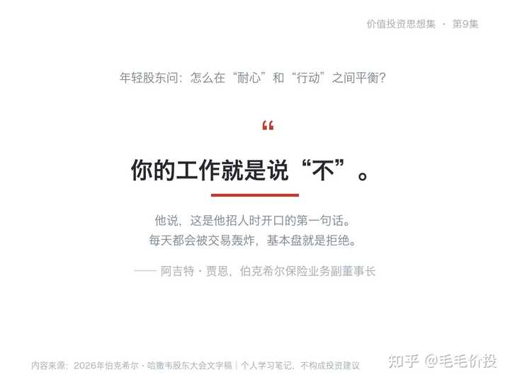

价值投资思想集 · 第9集

2026年5月2日，奥马哈。第一个站起来提问的“巴菲特”，是假的。

那是一段用公开信息做出来的深度伪造影像。声音、神态、那顶帽子，全对得上。他自称“来自奥马哈的沃伦”，说自己95岁了，除了时间就只有樱桃可乐，然后问：我一股都不打算卖，你总得给我个理由，让我去跟别的股东说。

真正的巴菲特，那天坐在台下，旁边是蒂姆·库克。60年来第一次，他不再回答股东的提问。

那是格雷格·阿贝尔的第一场股东大会。球馆顶棚上新挂了一件60号球衣，就在查理的45号旁边——60，是他担任首席执行官的60年。阿贝尔说，这两件会一直挂在那里。

巴菲特接过话筒只讲了几句。他给这次交棒打了分：“而这个决定100%成功……他就是对的人。所以那个决定，我们打100分。”

但这场大会真正的分量，不在交接仪式。整场下来，阿贝尔、阿吉特·贾恩和巴菲特反复在讲同一件事：__不做什么__。

01╱

__“我60年只有五个肥年份”：剩下的时间，都在说“不”__

先看巴菲特自己怎么形容这60年。

“我们经营了60年，我在这个行当里，大概只有五年是真正‘肥’的年份。”

五年。剩下那55年，他在做什么？

等。

这不是谦虚。他紧接着讲了IBM老沃森的一个说法：有人问IBM为什么成功，沃森回答，“我在几个点上很聪明，我就待在那几个点周围。”

换句话说，能力不是“能看懂多少”，而是“__肯放掉多少__”。

阿吉特·贾恩把这件事讲得更狠。有人问他怎么带团队，他说招人第一句话就是：“你的工作就是说‘不’。”

他补了个比喻：你每天都会被交易轰炸，基本盘就是拒绝；偶尔碰到一笔，“像一根两乘四的木棍砸在你头上，朝你大喊‘钱在这里’”，那时候再来找他。

值得注意的是，这不是保险部门的怪癖。阿贝尔被问到怎么定义成功，答案是“确保伯克希尔以现在的形态延续下去”——不是规模更大，是__形态不变__。

阿贝尔还提到一个内部说法。伯克希尔内部把三种病叫“三个ABC”——傲慢、官僚、自满，一旦渗进一家公司，“就会杀死这家公司”。所以有一件事他们绝不做：“__制造官僚层级__，或者在旁边搭一堆决策树”。

对普通人来说，这一节可以直接换一种用法：把“今年我要抓住几个机会”，换成“今年我要__拒绝掉哪几类机会__”。前一个问题让你焦虑，后一个问题让你清醒。

（过去一年，你拒绝过几个“看起来很好”的机会？评论区聊聊。）

alt="Image">

02╱

__3800亿现金躺着：不是没机会，是价格说不通__

再看账本，会更明白“不做”的分量。

一季度伯克希尔营业利润113\.5亿美元，同比增长18%。同期现金和美国短期国债净额3800亿美元——市场上常见的3974亿是账面数字，因为有一笔170亿美元的短期国债还没交割，被重复算了一次。

巴菲特的说法很轻：“就伯克希尔投放现金而言，这不是我们理想的环境。”

阿贝尔把原因讲得更清楚。外面不是没有好公司，“只是价格相对于机会、相对于那家公司未来的经济前景和相应风险，我们__不愿意用那个价格去买__”。

他还补了一句：“这不意味着未来没有机会，这正是我们花时间准备的东西。”

那现在的市场是什么温度？巴菲特用了一个旧比喻。

“我把市场比作一座附带赌场的教堂。人们可以在教堂和赌场之间走动。我要说，教堂里的人更多了，赌场里的人也更多了。”

赌场里在赌什么？他点名一天期期权：“如果你在买一天期的期权，或者在卖它们——那不是投资，也不是投机，那__完全是赌博__。”

他还提到，安飞士上周被逼空了——一家存在了50年的公司。

然后是全场最值得抄下来的一句：“人们从来没有像现在这样处在赌博的情绪里。但这不意味着投资就很糟，它意味着很多东西的价格看起来会__非常愚蠢__。”

价格愚蠢，不等于机会消失。它只是意味着，__出手的门槛被抬高了__。

当然，“愚蠢”是事后才敢用的词。站在今天，没有人能算准哪一段价格是错的——这也正是伯克希尔宁可拿着3800亿、被股东追问一整年的原因。

alt="Image">

03╱

__95岁承认：我懂的公司，比十年前更少__

这一段最容易被漏掉，但它是整场最诚实的一句。

贝姬问他，四处看是不是因为价格太高。巴菲特先承认了另一件事：“以占整体的比例而言，我现在理解的企业比十年前更少。我好些年没有学新行业了，所以我不骗自己。”

一个95岁、被叫了几十年“股神”的人，在几万人面前__说自己懂的东西变少了__。

他解释得很直白：他不会在一批真正跟这些行业一起长大、用过那些产品的年轻人面前，拥有什么优势。所以干脆不去学。

但他也留了句安慰：“如果它们像苹果那样，你不需要懂太多家。”

两句话放在一起，就是能力圈的完整定义。它不要求你懂很多，__只要求你知道自己不懂什么__。

这套标准在被追问时也没有松动。有年轻投资者问“耐心和行动怎么平衡”，他的回答是：“外面可能有20件说得通、但你不懂的事，那就别碰。”

二十件，听起来都对，但你说不清它十年后靠什么赚钱——__那就不算机会__。

他也顺手讲了苹果。十年前，伯克希尔把约350亿美元交给苹果的管理层，“让他们替我们把伯克希尔做得好看，而我们自己什么都不用干——这正是我们最喜欢的经营方式”。十年后，这笔钱连同分红和浮盈变成1850亿美元的税前收益。他说：“而__我什么都没干__。”

这句话里有两个动作：先看懂一家公司的价值，然后__长期什么都不做__。前者靠能力，后者靠性格。

04╱

__先问“最坏能坏到什么程度”：这是保险教给投资的第一课__

转到保险，这套“不做”的逻辑有了更硬的形式。

阿吉特被问到网络险——前几年最热门的险种之一，企业需求巨大。伯克希尔的回答是：我们一直很慢，“是有意地慢”。

第一条理由是技术性的：“在网络险上，我发现很难找到一种真正有意义的方法，去评估和建模‘聚合风险’。”

翻成人话：一次入侵可能同时打中几千家公司，这种“一起出事”的概率，__没人算得准__。而伯克希尔评估任何风险，第一个问题都是：“最坏能坏到什么程度？”——答不上来，就不做。

第二条更简单。网络险这几年很热，赔付不多，保费一路在降。“我们不愿意进入一个价格正在下跌的险种。”

同一天，有人问他们什么时候给霍尔木兹海峡的船只承保。阿吉特的回答只有五个字：“__取决于价格__。”

这就是承保纪律的全部内容。不是不做风险，是不做__价格不对的风险__。

有个数字可以对照。伯克希尔保险业务十年平均综合成本率是93%——收100美元保费，成本93美元，赚7美元。今年一季度主险87%、再保险89\.6%，比十年平均还好看。原因是“上一次有飓风在美国登陆，是19个月前”。

但阿贝尔没把这当好消息。他提醒，环境温和会吸引更多资本进场，市场正在走软；当“我们无法为相应风险拿到应有的价格时”，阿吉特和各业务团队就会少写保费。

盖可的例子更具体。它的综合成本率87\.3%，也就是每收1美元保费能留下12%以上的经营利润——很漂亮。可有效保单只增长了2%，最大的竞争对手前进保险增长了11%。

阿贝尔把矛盾摊开讲：价格要对上风险、要留住客户、还要增长，__三件事必须同时平衡__。他没说哪一件优先，只说团队清楚目标是什么。

这里头的取舍很像普通人的处境：涨价能保住利润，但会赶走客户；不涨能留住人，但风险在积累。没有只赚不亏的选项，只有__愿不愿意承担代价__。

05╱

__看不清十年后，就不做：安全边际不是算出来的__

阿贝尔讲了一个自己亲历的例子，是全场最像教科书的一段。

当年伯克希尔有机会收购一家电力公司NV Energy。他做了一页纸的演示，等巴菲特从中国回来、落地西雅图就打电话汇报。他准备了三个重大风险，想逐个确认。

结果巴菲特听完经济性，__直接跳到最大的那个风险__：屋顶光伏——它会怎么颠覆这门生意、颠覆它的客户。

“我记得我对沃伦说：这大概正是为什么我们有机会收购这家上市公司——公众、董事会和管理层都认为他们看不到我们看到的那个机会。”

阿贝尔说，那个风险确实在12到18个月后浮现了，团队扛了过去。

他把这套方法总结成一句话：“如果我们看不清十年后是什么样……那我们就不做。没有安全边际，或者‘我们可以调整一些数字’‘会有协同效应’之类——不行。”

这里有三个动作，顺序很重要：先看十年后的样子，再问最坏能坏到什么程度，__最后才谈价格__。

顺序反了，就会变成“先算出一个便宜价，再去凑理由”。

当然，这套顺序的代价是可能错过真机会。阿贝尔自己也承认，外面“确实有卓越的公司、卓越的管理团队”，只是价格不对。

06╱

__AI用在铁路上，不用来选股__

这场大会对AI的态度，可能是最容易被忽略的部分。

开场那段假巴菲特，是大会现场放的。他说得很直接：“各位应该都听出来了，那是深度伪造。”而且是在巴菲特本人完全没有参与的情况下，用公开信息做出来的。

他的结论不是“AI很危险”，而是“这就是我们__每天都要管理的风险__”。

转到业务上，伯克希尔的做法更值得看。阿贝尔讲了盖可的技术转型：从技术的“购买者”变成技术的“__建造者__”。过去是买系统、连带买应用，系统和数据是割裂的；现在自己招工程师，自己造。

他们内部不叫“人工智能”，叫“狭义人工智能”，守三条。

第一条，重要决策__必须有人参与__。“我们仍然让自己的员工、自己的高层管理团队参与落实他们提出的架构或框架下的建议。”

第二条，有个“安全阀”：“如果我们要求一个结果、一个建议或一个动作，现在问一次，半小时后再问一次，能不能得到一模一样的结果？”__能复现__，才说明数据集是受控的。

第三条，必须有增量价值：“它必须对我们的业务有增量价值。我们__不会为了AI而AI__。”

落在哪？落在铁路上。BNSF每天有超过750列列车在系统上跑，其中150到200列是多式联运，48小时从洛杉矶到芝加哥。这些调度、编组、周转，是AI真能改变的东西。

至于选股，阿吉特的回答很干脆：“如果你指望AI告诉你该买哪只股票、卖哪只股票，我__不认为那会发生__。”他还说，AI走不到“在定价、理赔这类需要权衡取舍的事情上做决定”的地步。

顺带看一眼BNSF的成绩：去年在六家一级铁路里排第五，今年一季度升到第四；经营利润率34\.5%，提升了2\.5个百分点，但对手联合太平洋是39\.5%。阿贝尔自己的说法是：“我们从第五升到了第四，但团队自己会第一个说，__还差得远__。”

一家市值过万亿的公司，在股东大会上公开承认自己的一项业务排第四。这件事本身，也是一种纪律。

alt="Image">

07╱

__黄金法则：他留给老股东的最后一句__

访谈最后，贝姬问巴菲特：台下坐着的很多人跟了你几十年，你有什么想对他们说？

他没讲估值，也没讲复利。

“我要给他们的第一条规则，就是黄金法则：你希望别人怎样待你，你就怎样待别人。”

他补了一句：“我不是宗教信徒，但两千年来说得比这更好的话还没有。”

这跟投资有关系吗？有。

同一天，他讲起一个朋友最近常说的话：“__我不焦躁，我不担心__。”他说，这大概是过日子的好方式。

还有一句更冷：“如果你看到了，它就不会发生了。”——真正改变市场的事，__从来不在人们的讨论清单里__。

合起来看，就是这套体系的底子。你能控制的只有自己的动作，__控制不了明天会发生什么__。

所以那些“不”，不是消极。是把有限的判断力，留给少数几个看得懂、价格又合适的时候。

阿贝尔在业务更新里说过一句话：在沃伦治下的60年里，伯克希尔有很多东西在演进，“但我们的__文化和价值观从未改变__”。这一次交班，按他的说法，同样不会变。

至于下一段路走成什么样，要看这3800亿怎么用——这个问题，股东大会回答不了，只能一年一年看。

下一集讲2024年伯克希尔股东大会，芒格走后的第一次。明天见。

最后想问问你：过去一年，你有没有拒绝过一个“看起来很好”的机会？事后看，是躲过了一劫，还是错过了一段行情？评论区聊聊。

如果喜欢价值投资思想集，点个关注，下一集继续。

（内容整理自巴菲特、格雷格·阿贝尔、阿吉特·贾恩在2026年伯克希尔·哈撒韦股东大会上的公开问答，仅为个人学习分享，不建群、不荐股、不带操作，不构成投资建议。）
