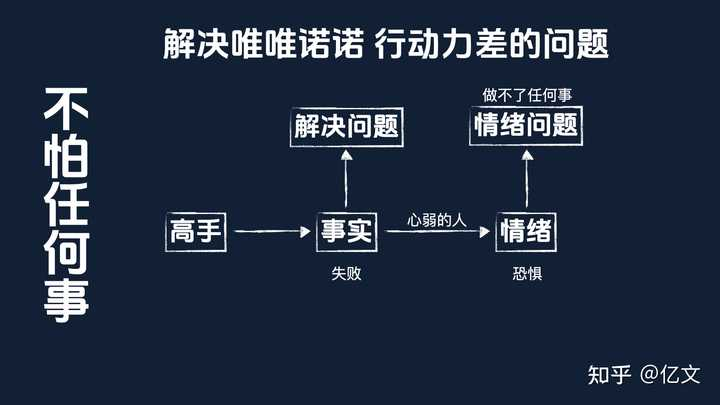
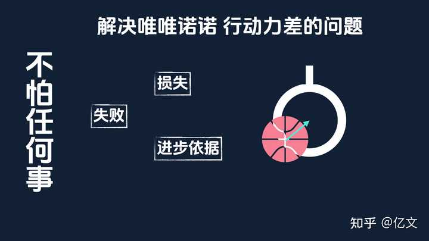
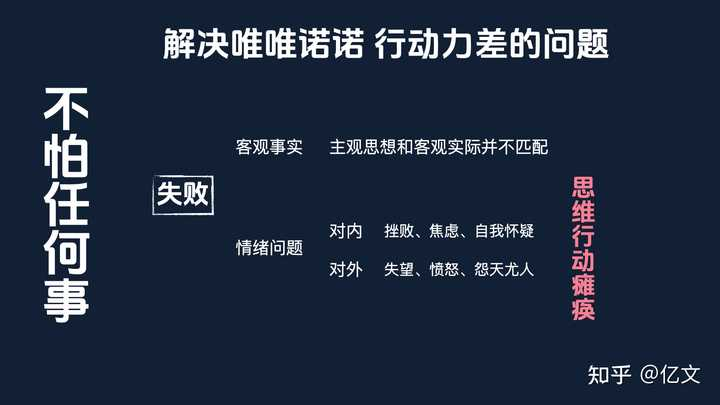
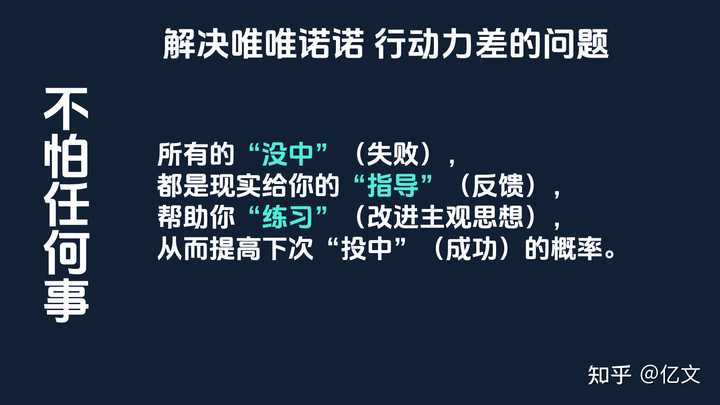
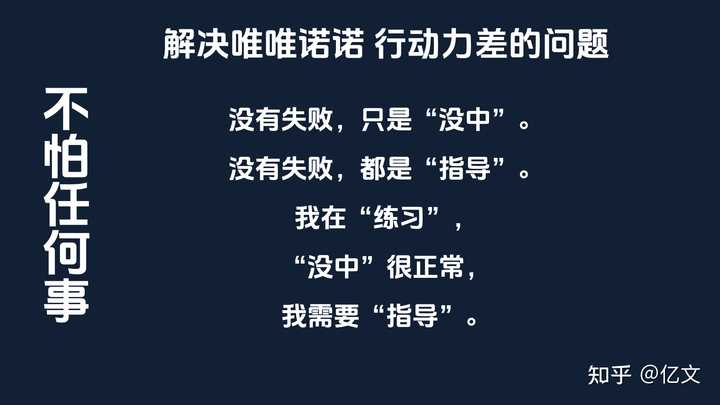

毛选中有一句话，可以让你不怕任何事。

如果你真的读懂了，就能解决唯唯诺诺、行动力差的问题。

## 心弱的人能力强

alt="Image">

很多内心脆弱的人，怕这怕那、瞻前顾后，其实不是能力问题，而是情绪问题。

大多数内心比较弱的人，其实你比自己以为的厉害的多，只不过被自己的情绪给压垮了。

所以王阳明说：破山中贼易，破心中贼难。

## 高手和普通人

真正的高手，很少会被情绪给拦住。

alt="Image">

因为他们的注意力不在情绪上面，而在事实上面。

他们可以直面事实，直接解决问题。

而心弱的人，注意力会集中在情绪上面，需要花大量的精力，先去解决情绪问题。

但是经常会在和情绪的斗争中败下阵来。

比如面对失败，失败本身有多可怕吗？好像并没有。

只要稍微注意控制风险，大多数失败都是可以接受的。

可怕的是对失败的恐惧，他会让你做不了任何事情。

## 教员说

所以教员说：

我们不要怕犯错误，错误有两重性。一方面会带来损失，另一方面也是好教员。

失败是成功之母，失败如果没有什么好处，为什么是成功之母？

错误犯得太多了，一定要反过来。“物极必反”，错误成了堆，光明就会到来。

## 失败不可怕

就是说不要把失败犯错，看成一件多可怕的事情。

alt="Image">

失败虽然会带来损失，但是也是我们进步的依据。

不经过失败，你是不知道自己哪里有问题，需要怎么样去改进的。

就像你练习投篮，没投进只是在告诉你，力道和方向应该怎么调整，才能够提高命中的概率？

如果没有这些失败，你投篮的命中率是没有办法提升的。

## 失败只是帮你练习的事实

我们前面反复讲过，成功的本质，是你的主观思想符合客观规律。

失败，只是一个事实，说明你的主观思想和客观事实并不匹配。

alt="Image">

但是很多人在这个时候，就出现情绪问题了。

因为他有一些固有的主观思想。

我做了，就一定能成。付出了，就一定得有回报。我对别人好，别人就应该对我好。

当现实情况和主观思想不一致的时候，很多人就会出现很多情绪问题。

对自己的认识和实际情况不匹配，就会感到挫败、焦虑、自我怀疑。

对外界的认识和实际情况不匹配，就会感到失望、愤怒、怨天尤人。

这些情绪问题都会导致人的思维和行动瘫痪，无法正常思考和做事。

但是这些情绪问题并不是失败本身导致的，而是你对失败的看法导致的。

很多人因为在意别人的眼光，把失败当成了一件非常可怕、可耻、可恨的事情，但其实失败就是一个事实而已。

就像你投篮没投中，一个事实而已。

## 高手怎么看待失败？

解决这种情绪问题的关键，是要调整你对失败的看法。

失败它是一个事实，是你进步的依据。

甚至我都建议，你不要用“失败”这个词。

因为这个词本身就太负面了，很容易引起人的负面情绪反应。

我们可以引入篮球的隐喻，就叫他“没中”。

alt="Image">

所有的“没中”（失败），都是现实给你的“指导”（反馈），帮助你“练习”（改进主观思想），从而提高下次“投中”（成功）的概率。

所以对于失败，我重构了一套信念系统，就三个概念、三句话。

三个概念：练习、没中、指导。

三句话：

alt="Image">

没有失败，只是“没中”。

没有失败，都是“指导”。

我在“练习”，“没中”很正常，我需要“指导”。

这套信念系统我自己实践下来效果非常好，让我的心力、行动力都有了巨大的提升。

现在我把他送给你，希望对心力比较弱的朋友有一些帮助，加油！
