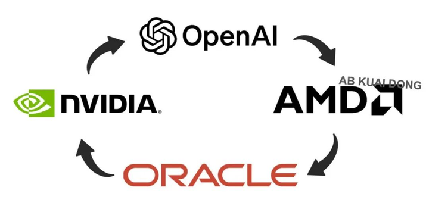

为什么这波 AI 浪潮没有带来大量的就业岗位? \- 酱紫君 的回答

__问题描述：__

算法工程师依然要211硕起步，本科生就算985也不用想。非常疑惑涌进来的钱都分到什么岗位去了？

连《资本论》都没想到，还有比被剥削更恐怖的，那就是不值得被剥削，【无产阶级】之下还有【无用阶级】。

直到现在还有很多人非常的乐观，将失业归咎于不努力、不肯学。

还在那复读上上个世纪的「汽车取代马车」的事例，一厢情愿的认为技术进步虽然会消灭旧的岗位（马车夫），但必然会创造出数量更多待遇更好的新岗位（汽车司机、汽车制造工人）。

【工具属性】与【主体属性】都分不清，好日子还在后头！

从蒸汽机、内燃机到早期的计算机系统，过去两百年的所有技术革命，其本质都是工具的进化。

工具进化延伸了人类的物理能力，但这类工具本身不具备决策能力和自主执行能力。

因此，在过往的技术更迭中，技术进步的确会通过降低操作门槛来扩大对人类劳动力的总需求。

但是 AI 这种拥有自我决策能力的主体与之前所有的技术进步都完全不同，完全不需要人类介入也能实现资本增值。

那么此时，资本的意愿就变成了如何彻底消除人类这一冗余环节。

去人化越快，资本市场反响越好：

《资本论》认为，一切财富和剩余价值的唯一源泉是人类的活劳动。

资本分为不变资本（机器、厂房、原材料）和可变资本（人类劳动力）。

不变资本只能转移自身的价值，不能创造新价值；

只有可变资本（工人在生产过程中消耗的体力和脑力）才能创造出大于其自身劳动力价值的新价值。

且这部分多出来的价值就是被资本家无偿占有的剩余价值。

总而言之，死劳动必须要通过活劳动才能创造价值。

但假如，死劳动自己就能活化呢？

全人类在过去几千年中积累的文本、图像、电影，乃至代码，这些生产资料在过去都属于死劳动。

但是用这些生产资料训练出来的大模型，自生就具有决策能力。

结果就是资本体系不再需要来自人类的活劳动注入，生产资料自己就活化了。

在工业时代和互联网早期，资本榨取剩余价值的主要手段是延长工作时间、提高劳动强度、降低劳动力再生产的成本。

这种模式受制于人类生理机能的极限，收益顶多呈线性增长，考虑沟通效率问题，一般来说是对数增长。

但是，一旦一个大模型被训练完成，此后，模型每生成一段回答、一张图像，都只需要消耗相对而言极其微量和计算资源。

边际成本趋近于零，且并发处理能力几乎没有上限。

让我 O\(k\) 打 O\(1\) ，真的假的？

《资本论》写道，无产阶级虽然苦难，但拥有改写历史的力量，整个世界的经济命脉紧紧握在他们手中。

可是，无产阶级之所以有力量发动阶级斗争，是因为资本家离不开他们。

工人通过罢工让机器停转、让利润停滞，以此作为与资本进行利益博弈的筹码。

但是，在一个不需要人类直接参与也能维持运转的 AI 自动化系统中。

你无法通过罢工来威胁系统，因为系统本就不打算分配工作给你。

那么，如果 AI 彻底消解了就业岗位，让普通人全都失去了稳定的工资收入。

此时，由 AI 创造出的海量高效的生产力，其产出的商品和服务将卖给谁？

当然是其他对等的存在。

寡头算力中心向寡头算法公司提供基础设施，寡头算法公司向寡头智能制造企业提供技术支持，寡头制造企业生产出维持庞大系统运转的高端硬件设备。

把话说明白点就是：

alt="Image">

至于其他人，其他人已经不算人了，你消不消费都无所谓，你生产和不生产也没任何区别。

反正到头来你也买不起未来的内存，未来的显卡，未来的设备，你现在买不起，未来就更买不起了。

无产阶级会跌落成无用阶级，而资产阶级则会进化成终产阶级。
