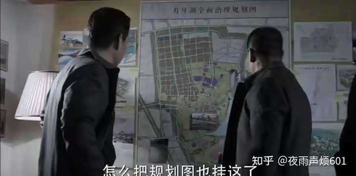
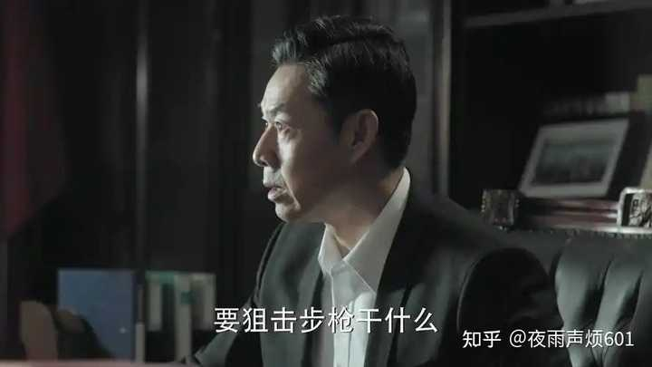
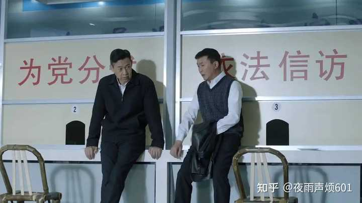
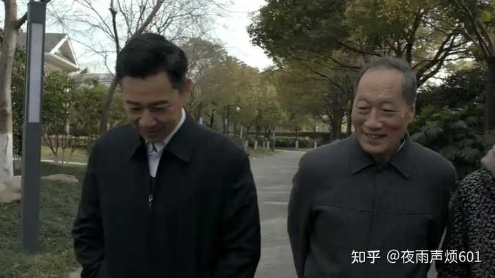

为何《人民的名义》中，沙瑞金的风评有所变化？ \- 夜雨声烦601 的回答

前几年《人民的名义》中，沙瑞金的伟光正形象，在观众的心中，近乎完美。最近一段时间，一些视频博主老师转变了他的形象，逼死缉毒英雄公安厅长，斗垮省三号人物…

__对于这个沙书记，我没有任何误解，就是个妥妥的“一霸手”，做事完全随心所欲，想一出是一出__

__比如，靠着一次家访，就“破格提拔”易学习了\.\.\.\.\.\.__

如果只是简单提拔一名处级干部，省委是有专门考察组的，沙书记只要看看考察组的材料，听听考察组的汇报就行了，甚至都不一定有面谈这个环节，组织部长去面谈也可以，更不用说实地调研，要是每名干部都花一天时间调研，哪怕仅仅是省管干部，沙书记一年到头专门做这一件事都做不过来。

但是，易学习不是普通干部，他是准备下一步破格提拔的，那就不一样了。

可别小看“破格提拔”这四个字，这在体制内极为罕见，甚至可以说是“踩红线”的操作，体制内升得快的不少，像李达康、祁同伟、刘新建、陈海，都属于“年纪轻轻”就身居高位，但不会有“破格提拔”。

在组织人事制度规范后，这种“破格提拔”，基本都是在高校科研系统的，个例在GQT系统，这位老兄前段时间也进去了，正常在体制内，已经不知道多少年没有了。

这甚至是要惊动中央的，应该慎之又慎。

在这种情况下，为了了解该名干部的实际情况，沙书记应该利用下基层调研的机会，不打招呼、直奔现场，实地查看易学习的工作成效，最重要的，是随机与基层干部群众交流，了解其口碑和群众公认度。

这种实地走访不是法定程序，但却是省委书记掌握第一手资料、避免被“材料”误导的重要方式，尤其适用于像易学习这样在一线作出突出贡献，但知名度不高的干部。

而沙书记的实地走访，却是一直在跟易学习本人谈，跟易学习老婆谈。

这能谈出什么来？

这种工作方式实在不敢苟同。

alt="Image">

__不过，公平地讲，这对沙书记来说已经很难得了，除了李达康，就没见沙书记真费心去调研过，很多连面谈都没有。__

__比如祁同伟__，按理讲，在省委常委会正式讨论推荐副省长的人选之前，沙瑞金应该跟祁同伟面谈一次，但沙书记没有，他就是听听田国富跟吴春林的汇报。

alt="Image">

__而相比祁同伟，更明显的是孙连城。__

把一名副厅级干部以“懒政”的理由降级，还是一撸到底去青少年宫带小孩看星星，像这种大事，别管孙连城实际上到底有没有“懒政”，最最最起码，应该面谈一次，核实下李达康的话到底是不是真的，听听孙连城是不是有苦衷吧？

你不能光听李达康一个人讲啊！

正所谓，兼听则明，偏信则暗，孙连城可是副厅级的省管干部啊！

但沙书记同样没有，跟李达康在信访窗口的小竹凳旁聊了几句，就决定了\.\.\.\.\.\.

alt="Image">

沙书记的操作啊，真是\.\.\.\.\.\.一言难尽，怪不得他近年来风评直线下降，反正他的操作就不能细琢磨，一琢磨全是槽点。

可以这么说，沙书记做事，就突出一个随心所欲，其实啊，有心的话，单看沙书记在常委会上给“一一六”事件定性，就能看端倪了，沙书记一上来就说里面有腐败。

那沙书记是如何了解大风厂事件的？

为什么会觉得里面有腐败？

就是跟他养父陈岩石聊了聊，然后就拿到常委会上说了\.\.\.\.\.\.

只不过，大风厂事件后面证实了，确实存在司法腐败，所以大家没什么感觉而已。

alt="Image">

__最后，但凡觉得沙书记手腕高明、英明神武的，我一律评价为：__

## 见识不够

别说联系现实了，哪怕多看几本官场小说，哪怕多看两本周梅森的其他作品，都能发现，沙瑞金有啥水平啊？就是仗着自己的背景想一出是一出，想干啥就干啥，除了贪腐，该干的，不该干的，他全干了，红线踩了个遍。

包括周梅森本人对沙书记的态度，原著里是这样写得：

郑西坡、老马和工人们乐了，七手八脚撕掉了门上的封条。
大门被省委书记的__权力强行打开__了，工人们欢呼着拥进车间。
李达康站在沙瑞金身边看着，为省委书记的大义凛然鼓掌，心里却想，其实沙瑞金应让光明区法院来撕封条，而不应该用手上的权力强撕，要依法行政嘛。可嘴上却说：沙书记，您眼里容不得沙子啊！

什么叫“权力”？

什么叫“强行”？

沙书记的任性，那是连李达康都看不下去的水平\.\.\.\.\.\.
