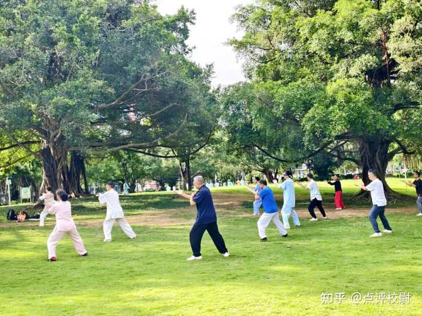
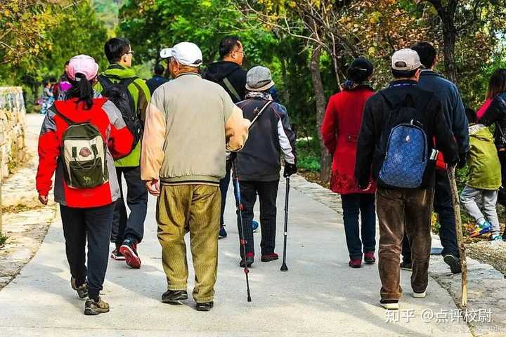

你是怎么看待年轻人活在当下不交社保的? \- 点评校尉 的回答

先说一个有意思的变化。

前些年，房子是公认的硬通货，不但增值保值，连租金也都比存款利息高。那时候谁家里有几套房，就是财富的象征，底气十足。

但现在风向变了，不是看你几套房，而是家里有几个能拿高退休金的人。

转变的原因很简单。房地产下行，不但不增值还不保值，买来就亏。

特别是人口减少、经济增速放慢的城市，房子流动性都成问题，看着值钱但没人接盘。高位买的更被动，房价跌穿首付成了负资产。

对比下来，退休金的优势就非常明显了：免税到手，抗通胀，年年上调；而且只要人在就一直能领下去。

如果家里有两位老人每月各领1万退休金，一年就是24万，按当前银行普遍不到2%的年化利率算，你至少存1200万本金，才能有可能拿到这么多的利息。

所以经常发现这样的视频，许多人很自豪地说公公或婆婆一万元的退休工资，伺候好了他们比自己外出赚钱都划算。

alt="Image">

很显然，在低利率时代，普通人很难再找到一个比养老金更稳的现金流来源了。

关键是，这笔现金流没任何成本和不用承担任何投资风险，甚至都不用打理，按时打到你卡里。可以这么说，退休金已经取代房产，成为现在最代表性的家庭核心资产了。

所以怎么看这都是好事，按说大家应该抢着参保才对。

但事实是，很多普通人的主动参保意愿并不强。

看了看数据，2011 到 2022 年，职工养老保险的持续缴费遵缴率在下降，从 85\.2% 掉到了 80\.8%；2 亿多的灵活就业群体里更夸张，参保的还不到三成。

连医保也出现下滑，一部分年轻人直接断缴；很多村镇每年征缴都要上门动员。包括正规上班的职工，也只是单位强制参保。如果让大家选择是否缴纳，那估计选择缴的可能是少数。

alt="Image">

__为什么积极性不高呢？__

多数人存在一个很现实的认知，踹在自己兜里的钱才属于自己的。

毕竟等到几十年后自己能领这笔钱时，政策变成啥样，能不能领到都无法确定，所以很多人倾向于为一个不确定的未来埋单，把自己辛苦赚来的钱“替别人养老”，还不如自己享受当下。

为啥说是“替别人养老”呢？

解释这个问题，就先了解我们的养老保险制度：基本养老保险实行社会统筹与个人账户相结合。 统筹账户实行现收现付，就是用当下在职缴纳的费用，直接支付给当下的退休人员。

个人账户名义上归个人积累，但实际运行中，因为统筹账户的资金常常不够支付当期养老金，个人账户的资金被挪用来“救急”，形成了所谓的“空账”问题。

也就是说，当前退休人员的养老金，本质上依赖于在职者源源不断的缴费流入。 缴费的人越多、缴费的基数越大，池子里的水才越深，才有钱付给退休的人。

如果人口结构是“金字塔型”，就是底部年轻人多、顶部的老年人少，现收现付制度可以运转。 但现在的人口结构正在从金字塔变成倒金字塔，缴钱的人少了，领钱的人多了。

到2025年，城镇职工基本养老保险抚养比已经降到2\.59比1，就是2\.59个在职参保人供养1个退休人员。有人预计到2060年比例会降到1比1，如果考虑到实际缴费人数少于登记参保的人数，甚至会降到0\.89比1，出现“倒挂”现象。

为了便于理解，再打个比方。

一个村子里有100个劳动力，30个老人；劳动力每人每年交1000元，这样池子里就有10万元，养30个老人绰绰有余。但如果劳动力降到50人、老人增加到50人，只能收到5万元，却要养50个老人，缺口就出现了。

很多人问不是有财政兜底吗？ 《社会保险法》确实规定：“基本养老保险基金出现支付不足时，政府给予补贴。”

但问题是，很多地方政府自己都捉襟见肘了，何况随着老龄化加速，缴钱和领钱的出现倒挂，财政兜底的压力只会越来越大。

alt="Image">

那怎么办呢？

这时候唯一的办法，就是让没交钱的人也进来交钱。

现在，你明白为啥要鼓励灵活就业人员参加基本养老保险了吧。当然，除了找人动员交社保，扩大缴费面，再就是延迟退休了。

不过，更应该搞清楚问题的症状所在。

就拿灵活就业人员来说，之所以参保意愿低，除了前面说的原因，再就是职业预期不明确、个人缴费压力大；毕竟当前生活都不稳定，哪有闲钱或者有信心把钱抠出来投到不确定的未来？

但更深层的是制度信任问题。

当一个人每月看到工资单被扣走一笔，而得知机关事业单位退休人员（2014年以前退休的人）月均待遇是自己两倍以上时，这笔投入在他心里的回报预期是打折的。

哪怕2026年，作为养老金并轨十年过渡期的收官之年，之后机关事业单位和企业职工用同一套计算公式，但实际待遇依然存在很大差距。

企业退休的平均数看着有 3640，但一半人实际到手不到 3050；机关事业单位还多一份强制的职业年金，加起来普遍五六千到八千多，两边差大约一倍。那企业职工、灵活就业者心里就不平衡了。

还没完。

如果说双轨制是历史遗留的纵向差距，城乡差异就是整个体系的横切断层。

现在城乡居民养老金中位数每年1560元，城镇职工每年39600元，后者是前者的25倍。居民基础养老金数额甚至低于国家贫困线水平\.\.\.\.\.\.\.

用个不大恰当的比喻，制度在惩罚低收入者。

所以，如果不改变制度本身的结构性缺陷，重塑信任，那动员参保的工作只会越来越难。

点到为止吧。

转自公众号《点哥看天下》。
