史湘云曾经也尽得贾母的疼爱，但后来贾母为何对她不太在意了？ \- 薇薇polly爱红楼 的回答

史湘云想要一得得贾母的疼爱，是需要她在荣国府进有有效社交的。小时候，史湘云得长辈疼爱只有会卖萌就行了。可长大后，史湘云要是还这么做，就讨人嫌了。

史湘云是小说《红楼梦》中一个很特别的女子，不知您是否注意过，作者对史湘云的描写，每一次都让她高调出场，可最后呢？只能黯然离开。

这是为什么？

其中的原因很复杂，因为荣国府这种豪门公府的复杂环境，不是史湘云这种头脑简单的姑娘能应付的。

其中的原因又很简单，因为史湘云这姑娘分不清主次，看不清亲疏，不知道如何协调亲人间的关系。

史大姑娘每一次来荣国府，本质上都是一场社交。可惜史大姑娘没有把握住这种社交机会，她做不到与人增进感情，每一次社交都是无效的。

史湘云的无效社交，是从什么时候开始的？

也许从作者第一次对这个姑娘的详写，就开始了……

一\.分不清主次的史湘云

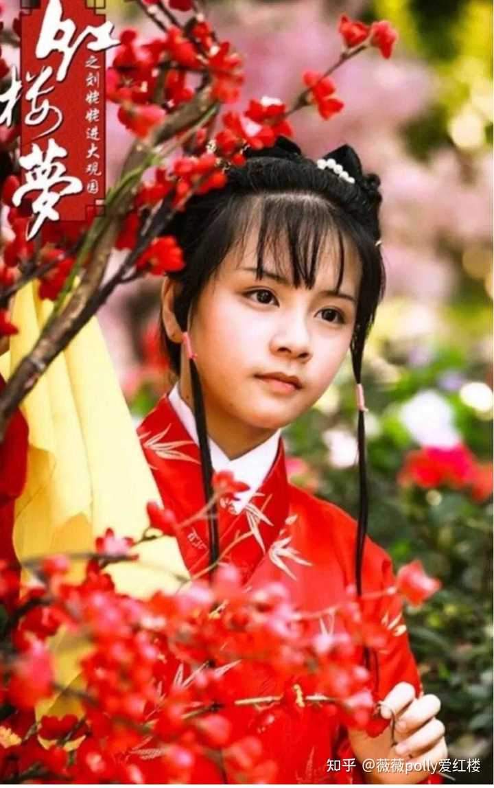

alt="Image">

史湘云这姑娘是贾母的侄孙女，史家和荣国府又都在京都，这造成了金陵十二钗中，史湘云是最早同荣国府有来往的，亲戚家的小女孩。

史湘云同荣国府姐妹的感情，本该是最深的；

史湘云同贾母的感情，更应该是亲密的。

这才是荣国府的长辈，期望看到的史湘云的样子。

曾经的史湘云或许同贾府之人亲密无间，可这种关系，从林黛玉的到来后就被打破了。

贾母房里的袭人服侍过史湘云，仅凭这一点就能看出，曾经的史湘云的荣国府做客时，必然住在贾母的房里；必然是贾母房里最珍贵的小客人。

可林黛玉进荣国府后，这种关系马上发生了转变。

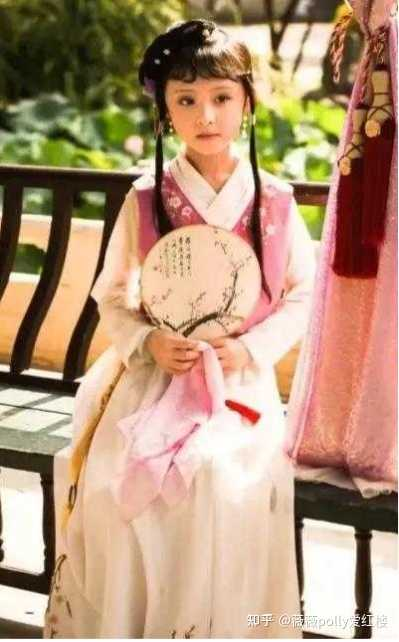

alt="Image">

林黛玉进荣国府是来常住的，她的到来，填满了贾母感情上的空白；

黛玉是贾母的亲外孙女，至亲的血缘，会让贾母对黛玉的疼爱远超过对史湘云。

这本来就是人之常情！可年幼的史湘云，恐怕不能理解。

她不会明白，为什么贾母和宝哥哥的注意点，都放到了后来的林黛玉身上。

她想要做到的事情，让所有的焦点重新回到自己的身上。

她看上去大玩大笑，表面上的活泼开朗，都只为掩盖生命中的无助与失落。

从心底里，史湘云是嫉妒林黛玉的。

这份嫉妒，只不过在薛宝钗的生日宴会上爆发了而已。

薛宝钗15岁的生日宴，其中暗藏着贾母同薛姨妈的宅斗。可这种宅斗牵扯不到小辈，尤其牵扯不到史湘云身上。

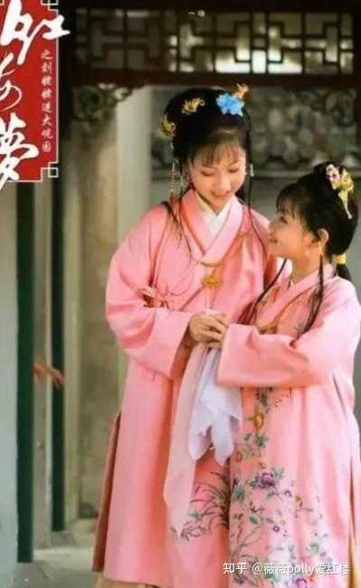

alt="Image">

贾母留下史湘云，让史湘云参加薛宝钗的生日宴，真的只是想让史湘云同自己的孙辈玩耍一天。

如果史湘云应对得宜，那一天会有着愉快的气氛，会成为小姐妹们美好的回忆。

能让众人勾起美好回忆，这才是有效社交，而史湘云把这一切都搞砸了。

薛宝钗15岁的生日宴，主角当然是宝姐姐，所有的礼物和祝福，也都会围绕着宝姐姐。

那个时候的史湘云，已经很失落了，她失落的原因很简单，因为焦点不是她。

薛宝钗15岁的生日宴，参加的人不只是贾母带着小姐妹，还有荣国府的众位长辈。那时的史湘云也要拘着规矩，丝毫不能乱说乱动。

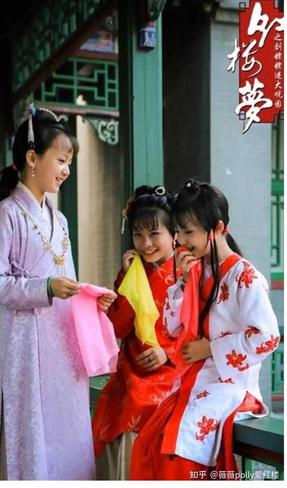

alt="Image">

当王熙凤指着一个小戏子笑道：

“这个孩子扮上活像一个人，你们再看不出来。”

那个时候的史湘云，终于有了接话的机会；

那个时候的史湘云，也终于有了表现的机会，这使得这个姑娘急忙插嘴，史湘云接着笑道：

“倒像林妹妹的模样儿。”宝玉听了，忙把湘云瞅了一眼，使个眼色。

①这是极为关键的一句话，史家有侯爵，又是真正的书香门第，这样的人家培养出来的大小姐，那会不知，把同样是世家小姐的林黛玉比喻成戏子，是极为无礼的行为！

有时候看破不说破，就是幽默，王熙凤的行为可以称得上是幽默。

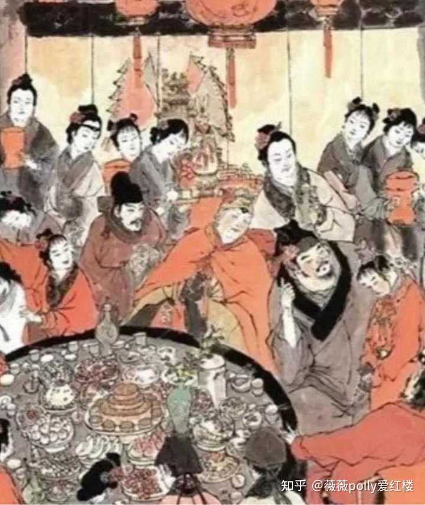

alt="Image">

而反观史湘云呢？史湘云的行为是极度无礼，有失一位大小姐的身份。这样的行为，在场的长辈根本看不下去。

只是由于史湘云是贾母的侄孙女，众人需要给贾母的面子，这件事情才在众人的大笑中，一笑了之。

②当时的贾宝玉给史湘云眼色，这位凤凰公子哥做错了吗？

这当然没有，虽然贾宝玉是一个纨绔，但在同姐妹们应酬方面，贾宝玉大多时候，是十分得体的。

贾宝玉作为史湘云的表哥，薛宝钗生日会这种公开的场合，暗示史湘云，不要弄砸了薛宝钗的生日会；

暗示史湘云，不要继续说出不得体、不合礼仪的话，这其中体现出来的，是亲人间的善意维护。

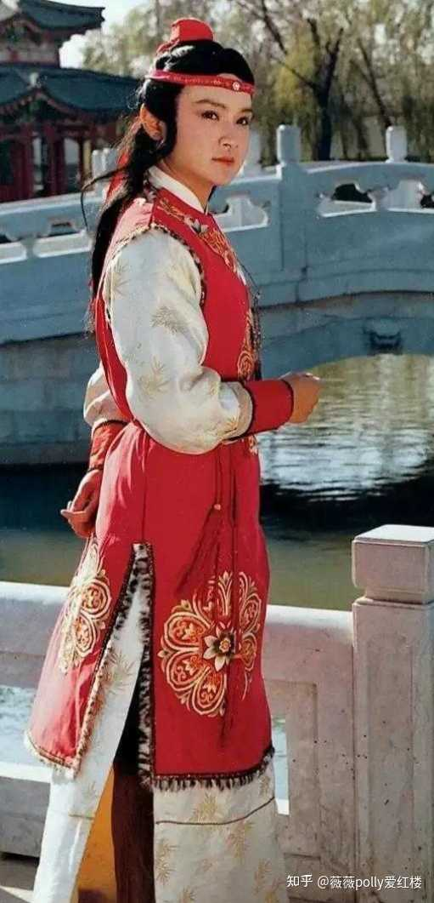

alt="Image">

而贾母这位荣国府的最高统治者，自然能看得出来。

史湘云的不得体言论，由身为同辈的贾宝玉给暗示，这种行为真算得上是得体。

本来在贾宝玉的补救下，一切应该结束，之后史湘云的不当言行，众人出于给贾母的面子，也不会再有人追究。

可史湘云呢？

史湘云真分不清主次，换成任何一个姑娘，当时有了贾宝玉的提醒，会后悔自己失言说错了话，然后呢找个别的话题，错开了这句话也就算了。

谁让史湘云，就是个拎不清的人呢。

二\.张嘴就得罪人的史湘云

本来在贾宝玉的补救下，湘云拿林黛玉比戏子这件事情，可以悄悄地过去，可这姑娘偏偏还生气了。

湘云摔手道：“你那花言巧语别哄我。我也原不如你林妹妹，别人说他，拿他取笑都使得，只我说了就有不是。我原不配说他。他是小姐主子，我是奴才丫头，得罪了他，使不得！”

看看史湘云这傻姑娘，一张嘴就得罪了一群人。

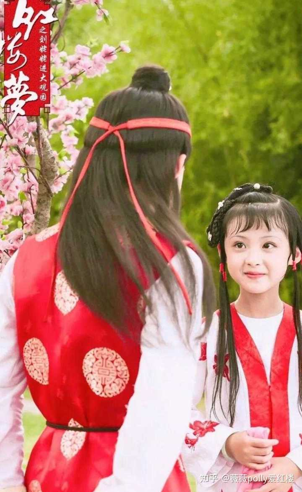

alt="Image">

①史湘云首先把林黛玉牵扯了进去，其实这件事情本来和林妹妹毫无关系。

史湘云属于借题发挥，无端地把林黛玉贬低了一顿。

在薛宝钗15岁生宴席上，林黛玉展示了一个大家小姐应有的风范。虽然史湘云开的玩笑极为过火，可林黛玉什么也没做，什么也没说。

深入人心的87版电视剧《红楼梦》，在这一段中改编的有点过火，给林黛玉也加了很多翻白眼的微表情，让林黛玉显得很小心眼儿。

其实这些微表情，在小说中完全没有！

史湘云首先得罪了林黛玉，然而事情还没有结束。

②继续分析史湘云的言论，“别人说他，拿他取笑都使得。”

这里的别人指谁？

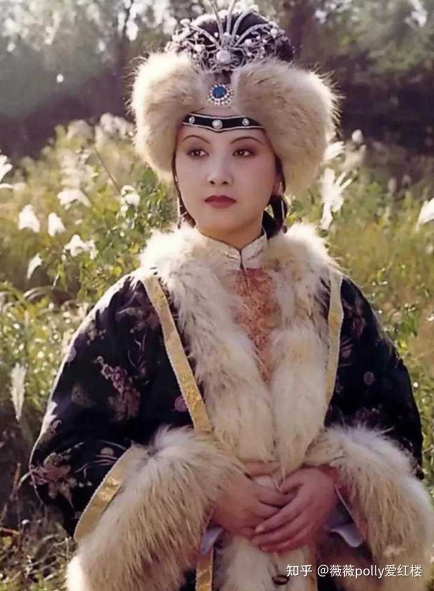

alt="Image">

没有别人，自然是指开这个玩笑的王熙凤。可史湘云真比不得王熙凤，王熙凤言论张弛有度；王熙凤是看破不说破，当众人心领神会时，这个尺度就是玩笑。

可如果真拿林黛玉比戏子，这个尺度，对于一位大小姐来说就极为过分。王熙凤把尺度拿捏得很好，愚蠢、莽撞的就是她史湘云。

此时史湘云又把王熙凤牵扯了进去，王熙凤是谁？王熙凤可是荣国府赫赫扬扬的当家少奶奶，像荣国府这种大家族，人口众多，不会有任何秘密可言。史湘云的一番言论，一定会传到王熙凤的耳朵里。

而王熙凤会怎么办？王熙凤作为嫂子，作为当家少奶奶，不可能真和一个小女孩计较。但史湘云，一定会给王熙凤留下极为不靠谱的印象。古代大家族，大嘴巴姑娘是众人敬而远之的对象。

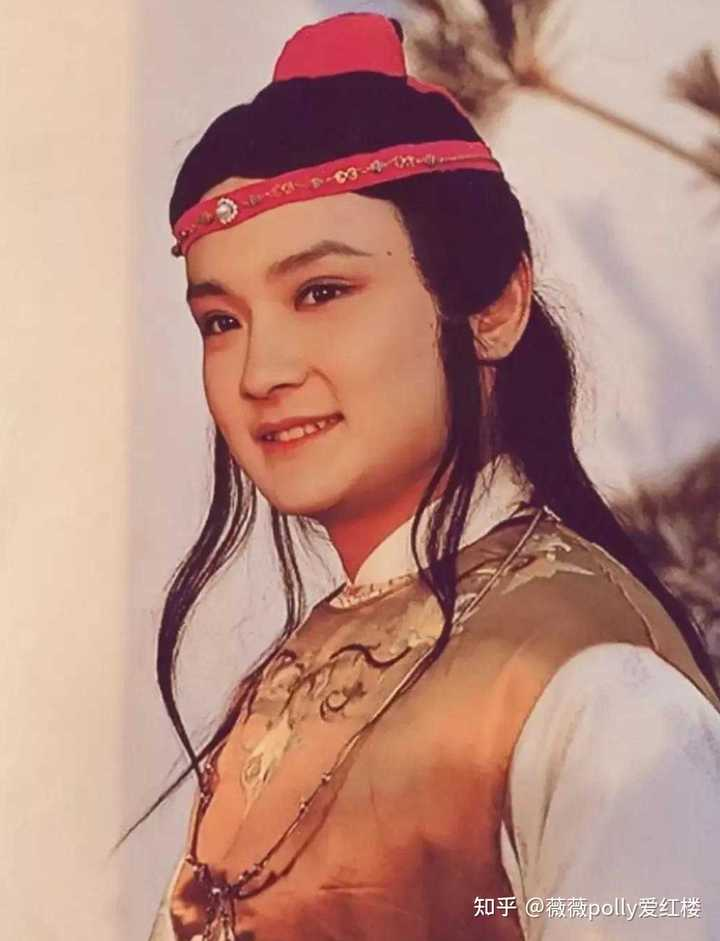

alt="Image">

③此时再来看无辜的贾宝玉，贾宝玉是像史湘云使了眼色。可贾宝玉错了吗？

如果说贾宝玉做错的事情，可真冤枉了这位凤凰公子哥。

贾宝玉是一心想让林黛玉和史湘云，这对表姐妹和睦相处。

就算贾宝玉的做法有瑕疵，但无论是荣国府的众人，还有读者，都会认为贾宝玉真是一番好意。

而贾宝玉对史湘云的一番好意，却被史湘云无情地践踏了。

这件事情，虽然贾母和王夫人身为长辈无法同一个小女孩计较，可史湘云的做法，却也真能让长辈寒心。

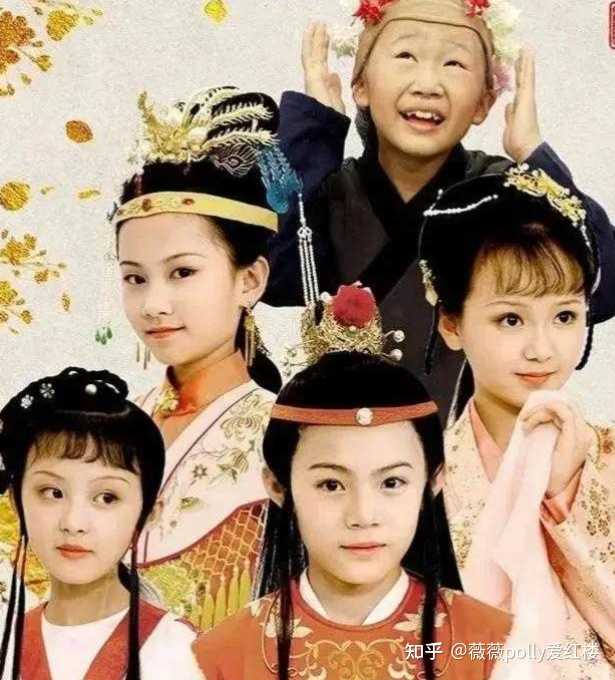

alt="Image">

这样一场风波，对于少男少女来说就是一件小事。不久后林黛玉、史湘云、贾宝玉就和好如初。

可天真莽撞的史湘云不知道，他们这些少男少女不在意的事情，长辈们真的很在意！

《红楼梦》之后的情节中，王熙凤这个凤辣子，再也没有同史湘云亲密相处的举动。

对于史湘云这张不靠谱的嘴，王熙凤是一次就害怕了！

而贾母呢？贾母的心，只怕也被看不清亲疏史湘云，狠狠地伤害过。

三\.海棠诗社，不靠谱的螃蟹宴

螃蟹宴是史湘云唯一一次做东，这是史湘云最重要的一次社交活动。

可这次社交活动，史湘云做得极为不靠谱。

大观园中的公子小姐组织诗社这种文化活动，荣国府的长辈是不会在意的。

可如果上升到家宴的高度，荣国府的长辈就一定会在意。

史湘云是史家的大小姐，是贾母的亲侄孙女，以她的这种身份，一定能请得动贾母赴家宴。

表面上螃蟹宴有多热闹，大观园中的公子小姐做了多少菊花诗，像贾母这种豪门贵妇根本不会留心。

一场螃蟹宴会花多少钱，以贾母国公夫人的身份，更是完全不会在意。

在贾母的眼里，史湘云请的家宴，就是一家子乐呵一次的娱乐活动。

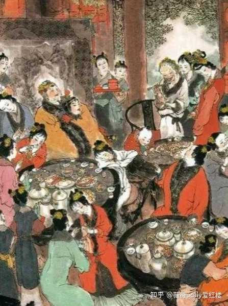

alt="Image">

贾母会在螃蟹宴开始后，才突然发现，这场名义上是湘云办的螃蟹宴，其实出钱的却是幕后的薛宝钗。

那时的贾母会怎么想？贾母一定会想，史湘云这孩子办事太不靠谱了！

遇上请家宴没有钱这种事情，史湘云应该怎么做？这姑娘第一个想到的，就应该同贾母商量。

史湘云却偏偏选择了薛宝钗，这是最令贾母不满甚至于心寒的事情。

薛宝钗是谁？薛宝钗是王夫人的外甥女，就凭这一点，贾母就绝不能接受金玉良姻的存在。

荣国府已经娶了王夫人的一个侄女，若是再娶了王夫人的外甥女，那贾府直接就被王夫人掌控了。

虽然贾母和薛姨妈表面上风平浪静，可实际上呢，高手过招，就如打太极一般，两个人看上去你来我往和和气气，却暗藏着刀光剑影。

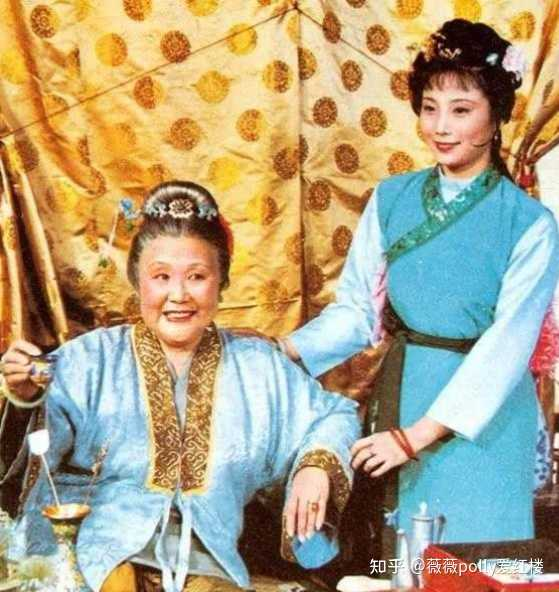

alt="Image">

以贾母地位之尊，不可能指望着史湘云为她做什么，可最起码史湘云不该给她添乱。

贾母参加螃蟹宴的时间很短，可以做强烈对比的，是第二天史太君两宴大观园。

史太君两宴大观园的时候，可是领着众人整整玩了一天。

而螃蟹宴呢？

贾母只参加了一小会儿，之后还表示：

“别让你宝哥哥林姐姐多吃了，那东西虽好吃,不是什么好的,吃多了肚子疼。”

贾母的这一番话后，已经意味着，螃蟹宴的正式散场。

至于之后的作诗，那只是小女孩们的小玩意儿了。

那时的贾母对拎不清的史湘云，心已经冷了下来。贾母的这份疏离，让心大的史湘云都看得出来。

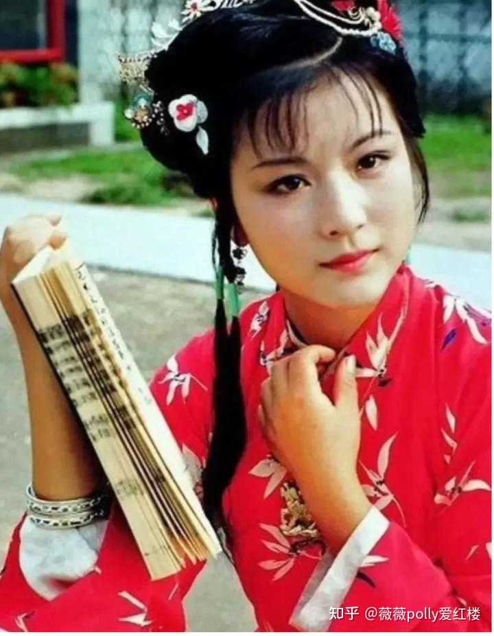

alt="Image">

__在之后的情节中，史湘云甚至同贾宝玉说过这样的话：__

__“即便老太太想不起我来，你也常提点着，打发人接我去。”__

__史湘云这姑娘，并不是什么心胸开阔之人，她是有些缺心眼儿。在荣国府中贾母是她的至亲，贾迎春、贾宝玉、贾探春、林黛玉这些人，才是同她有血缘关系的表亲。__

__可史湘云呢？偏偏把自己的社交圈子，全都砸在了薛宝钗身上。史湘云的缺心眼，和她的无效社交，让她离荣国府的中心、离贾母越来越远，她她只能高调的来，然后黯然的离场。__
