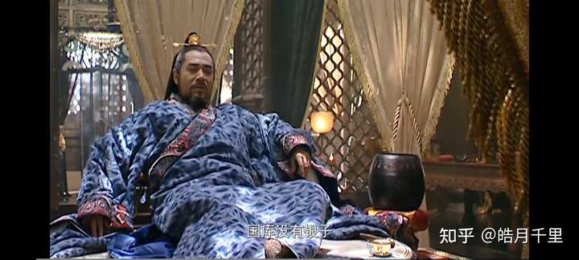
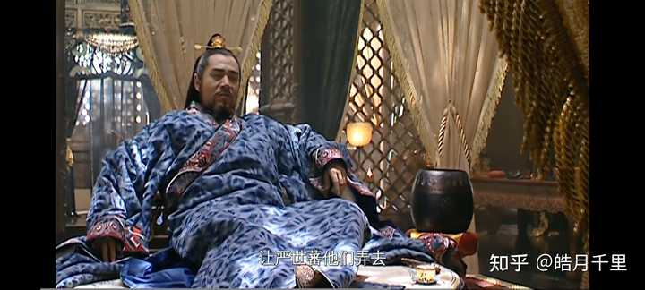
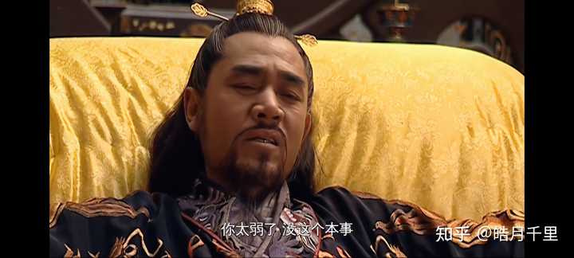

大明王朝1566严嵩为什么要让自己的蠢儿子在朝廷一错再错，最终害了自己? \- 皓月千里 的回答

__问题描述：__

严嵩发现儿子是个蠢货后怎么还放纵他，家里也不缺钱，不缺权

如果严世蕃是蠢儿子，那么大明王朝1566这部剧里的人物，除了嘉靖，都不灵光，唯一能和严世蕃掰手腕的只有嘉靖。

严嵩伺候嘉靖20年，一大半靠的是严世蕃，严世蕃能坐上吏部和工部的主管，不是他爹给的，是嘉靖给的。

严世蕃被称为“嘉靖朝第一鬼才”：

他有过目不忘的超强记忆力

他没有走科举正途入仕，却能通读各类经史典籍、官方法典，甚至连嘉靖读过的冷门孤本都能过目成诵。

有一次嘉靖随手写下一句冷门典故，满朝内阁大臣翻遍典籍都答不上来，严世蕃只扫了一眼就精准说出出处、页码和释义，核对后分毫不差，直接解了严嵩的燃眉之急。

他能精准拿捏嘉靖的“读心术”

嘉靖下旨从来不说透，经常只写几个字、丢一个模糊的典故让大臣猜圣意，满朝文武几乎没人能次次答对。

唯独严世蕃，总能一眼看穿嘉靖隐晦的真实想法，替严嵩写的票拟、青词次次都精准贴合皇帝心意，严嵩能稳坐首辅十几年，大半功劳都靠他这个“幕后大脑”。

他有随时在线的应急处理能力

他一边纵情声色宴饮，一边处理堆积如山的政务，哪怕喝得烂醉、睡得正沉，只要拿热毛巾在头上反复敷几圈，瞬间就能彻底清醒，提笔处理紧急公务，下笔就切中要害，从来不出差错。

当时京城官场直接流传“大丞相、小丞相”的说法，严嵩是台前的摆设，真正掌权的“小丞相”就是严世蕃，所以剧里他叫小阁老。

他把官场规则玩到极致的实操能力

他对全国所有官员的贫富、职位油水、人脉软肋了如指掌，索贿的数额精准到分毫不差，连边军将领打了败仗怎么瞒报、户部的账目怎么抹平，所有官场潜规则他门清，能把一堆烂摊子的政务，重新包装成嘉靖愿意接受的样子，把整个朝堂的权力交易做成了一套完整的私人体系。

他的智商、洞察力、实操能力全是顶级。

剧里所有人都在“装”，唯独他不装

清流装“清”、宦官装“忠”、严嵩装“老糊涂”，只有严世蕃把欲望、情绪、权欲全摆在明面上。

他敢直接对着徐阶甩脸子、骂高拱张居正是奸臣，把胡宗宪玩的唯唯诺诺，像个受气小媳妇。

他敢拍着桌子跟吕芳派来的人硬刚，不是蠢，是他根本不需要装——他手里握着严党整个财政盘子的运转密码，是嘉靖敛财体系里唯一不可替代的实操核心，他的“直”，恰恰是嘉靖最放心的地方。

所以剧里不止一次出现的台词是，嘉靖说，缺钱就让严世蕃去找，国库留十二他抽四，再多点也可以。

alt="Image">

alt="Image">

清流所有人加起来，都玩不过他的阳谋

改稻为桑的开局，严世蕃直接把浙江的官场、富商、织造局全部绑在一条船上，哪怕清流暗中使绊子逼他淹了田，他也能反手把毁堤淹田的锅甩给地方官，逼着胡宗宪去擦屁股，还能反过来拿“通倭”的由头卡死清流的反击路径。

如果不是嘉靖最后故意放水、把底牌漏给了徐阶，清流根本找不到能绊倒他的实锤。

他和嘉靖的权力关系，是唯一对等的“交易”

剧里其他所有人都是嘉靖的棋子：吕芳是手套、严嵩是白手套、徐阶是备胎、海瑞是刀子，唯独严世蕃，是嘉靖主动留出来的“对手”。

嘉靖需要他去啃清流不敢碰的硬骨头、去捞别人捞不来的钱、去背所有人都不敢背的骂名，甚至需要他的“鬼才”来制衡整个文官集团的抱团，两人之间根本不是主仆，是全剧唯一能在权力博弈里互相递招的搭档。

说白了，剧里把他拍得“冲动易怒”，根本不是写他蠢，是写他的身份根本不需要像其他人那样藏着掖着——他的权力合法性直接来自嘉靖的默认，他根本不需要靠“装聪明”来巩固地位，这恰恰是全剧最狠的一笔刻画。

他的死不是他蠢，是他智商惹的祸，是裕王太窝囊惹的祸，如果裕王有嘉靖聪明，严世蕃还是大明朝钱袋子。

alt="Image">

裕王玩不过他，嘉靖怕自己儿子被拿捏，最后一集嘉靖父子对话，说的极其明白，嘉靖说裕王你太弱，玩不了平衡，只能和清流混日子，当个傀儡皇帝算了。
