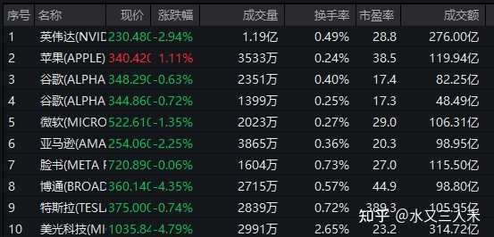
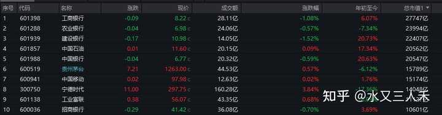
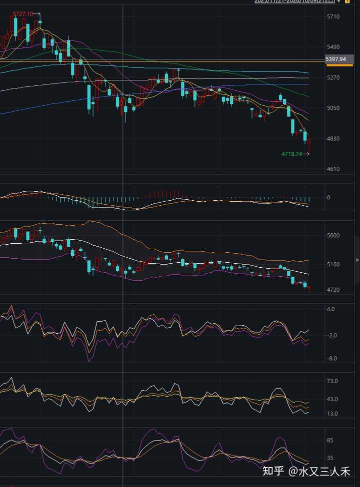

如何看待 2026 年 10 月 9 日 A 股市场行情？ \- 水又三人禾 的回答

10月9日，市场午后探底回升，三大指数集体翻红，创业板指一度跌超3%。截至收盘，沪指涨0\.05%，深成指涨0\.17%，创业板指涨0\.22%。 盘面上，…

还是重点放在前面，供大家参考：

（1）市场依然弱势，但是下周如果无利空出现，理论上止跌是存在希望的，因为技术上超卖了。

（2）外围市场是重要的观察指标，下周还要持续关注。

（3）黄金的波动不会很大，我估计下周也是张涨跌跌。

年轻的时候，看到一座沙漠，我会去想沙漠后面是什么。

但是很多年后我才知道，沙漠后面只会是更多的沙漠。

19岁的时候，我翻到一本盗版的《巴菲特教你学投资》，看着里面标普500指数横跨半个世纪延绵不断的上涨走势，明悟了长期持有就是投资的终极真理。

但是那个时候的我还并不知道：

美股是美股，A股是A股，标普，不等于上证。

不知不觉，时间已经一晃过去了很多年。

现在的我已经不想知道沙漠后面是什么了。

也不想知道券商股爆拉之后，要几天才会跌回去。

但是我还是有很多疑问，于是我去问AI：

大师，A股的摆动幅度为什么总是如此之大？

AI回答我说：A就是V，V就是A，不走过山车，又哪来的超额收益?

什么时候你手中无A，心中无V，再来谈长期投资吧。

大师，我悟了！

段子写完了，我们还是切入正题。

今天最重要的还是下午的托市动作，这个动作发生在各大指数频临破位的关口，从时机上讲，我觉得是没问题的。

我觉得10月8日市场的下跌应该是所有人都没想到的，所以10月9日迅速采取行动，真的已经很迅速了。

A股目前的交易结构是有一些问题的，很明显我们缺乏压舱石投资者，也就是基石投资者。

A股主要的机构投资者底仓，我们就拿保险公司为例，配置的还是银行股，所以银行股的抛压就很少。

但是科技股之类的，消费股之类的，在市场不好的时候就很容易持续阴跌。

说到底大家都是来赚差价的，没几个人真的想长期持有。

美股的生态就不一样了，很多人就是买了纳指七姐妹的股票等着养老。

从产业结构看，我们这边也就是缺乏持续成长的科技巨头，我们这边都是供应链上游，没几个平台型企业。

美股那边，你别管是定投纳指100，还是定投标普500，其实买的主要成份股都是那么几个。

苹果、谷歌、微软、亚马逊，脸书，就是这些。

英伟达可能周期性还强一点，上面那几个周期性就比较弱了，主要是长期成长预期好。

alt="Image">

我们这边如果定投沪深300 ，买的主要就是工商银行、农业银行、建设银行、中国银行。

宁德时代，工业富联都被当成周期股看。

贵州茅台被当成时代糟粕看。

那还剩什么？

这是不是就等于，定投A股，就是定投银行股？

这个事情，怎么想就怎么不对劲。

alt="Image">

如果A股的本质就是高股息银行股，那么我们做一个A股的投资配置计划，就应该全部买高股息，长期看这就是一个占优策略。

但是这个策略的累积收益率已经随着银行股的上涨不断收窄了。

权益类资产，如果复合回报不到5%，那是没什么太大的吸引力的。

如果不到3%，那就会完全被长期债券所代替。

在高股息里面躺平，就不应该是A股的唯一玩法，躺平那是东瀛那边的玩法。

但是波动率方面，A股的摆动幅度过大，很多人都是拿不住银行股之外的股票的。

就算是消费、公用事业股，A股这边的摆动幅度也是非常大的。

__所以A股除了高股息策略，另外一个有用的策略就是成长策略。__

__就是你不管股价怎么动，你就看企业成长，就看这个公司是不是能从10个亿的利润，增长到100亿。__

你别管他是用3年达到，还是10年达到，你只要知道他最后能达到，你就一直拿着。

这种方法在A股也是能赚到钱的。

而且他能避免很多市场波动中的踏空，割肉动作。

手中无A，心中无V，是什么意思呢？

就是你眼里只有企业。

你看的不是股价，你看的是企业的未来。

这也是100年前菲利普费雪投资摩托罗拉的经验。

我不管市场怎么走，我就当我买的股票退市了，我拿的是企业股权。

比如这几天的市场波动，我们有什么可讲的呢？

其实没什么可讲的，这些波动都不是市场的真意。

用技术分析的话讲，这些都是涟漪，不是趋势。

很多时候我都会去想这个股票背后的企业，3年后，5年后的收入规模是多大，是变强了还是变弱了，10年后呢？

这个才是长期主义者。

这些都是今天的一些感悟。

技术层面，比如我们看中证800的这个图。

其实差不多跌不动了，符合反弹条件。

RSI、BIAS、KDJ都翘起来了。

下周一开始，如果没什么利空，是可以继续反弹的。

alt="Image">

外围市场也很重要，但是这都是无法提前预测的内容了。

好，就写这么多，祝大家周末愉快！
