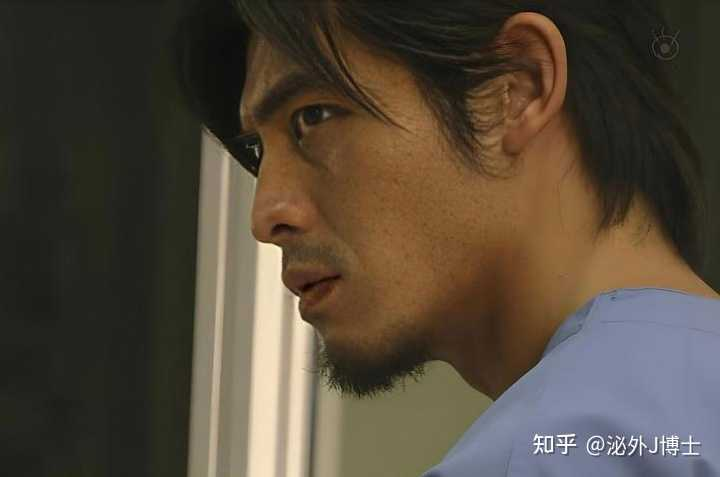
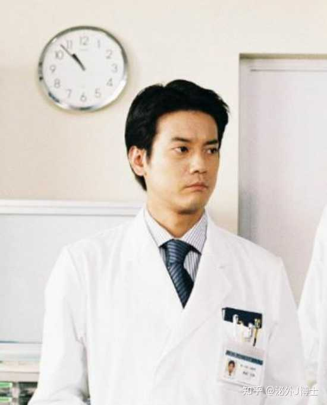
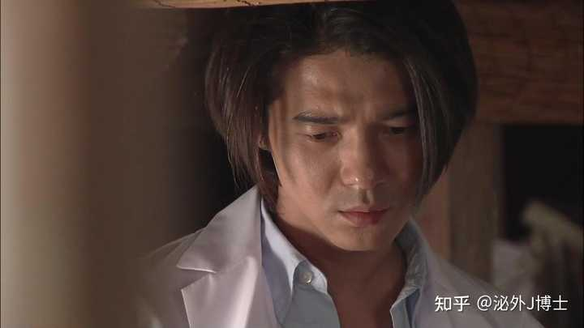
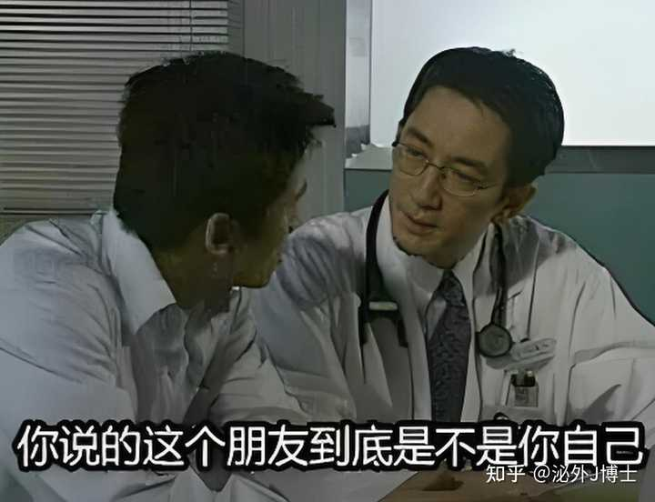

__问题描述：__

本来对令人心动的 offer 第八季很期待，想看厉害的医学生。 结果看了个片花我都懵了 1\. 带教老师问怎么诊断，回答说「我盲猜」 \[图片\] 2\. 问…

作为医学生，如果你实习过，或是读过研，一般一个队里，一个班里，总会有一个这样的队友：

一群人里，他的脸是最白的，唇是最红的，发型是最立体的，发量是最茂盛的，白大褂底下的衣服是最有质感的，手术帽是个人定制的；

他有时给人感觉手脚很麻利，比如漂亮的护士姐姐在换桶装水，他会第一个上去接手；

但科室迎检，大家整晚加班补病历时，他总是尿遁不见；

他有时给人感觉很会来事，手术台下的麻醉大哥，巡回大姐，护工大妈，他三句话自来熟；

但有病人拍桌子骂娘时，他总是尿遁不见；

他有时给人感觉很积极好学，喜欢追着上级讨论些“老师，您说打这个结要用食指去勾，那我用小拇指去勾可不可以？”之类的问题；

但主任查房时但凡问起书本上的理论知识，他基本不接茬；

他的个人简历总有些看上去很光鲜但让人摸不着头脑的履历与头衔，像什么“环太平洋青年医师（PAYP）协会秘书长”，“参与全国医学生临床技能科普传播项目获央视‘临床科普先锋’认证”，“约翰霍普金斯大学公共卫生学院全球健康科普项目‘国际志愿者’”……

但只有他舍友知道他还有三门补考没过；

他有时会在一些严肃正经场合说些无厘头的话———比如你问他术后尿外渗和乳糜漏如何鉴别，他答用舌头尝尝———虽说很傻，但配着他那张呆萌又有点帅气且一本正经的脸，让你还是忍不住笑一个配合他烘托下气氛；

他总有数不清的同性异性好友，一般下午4点准点跑路去约会，然后夜里3点在社交软件的个人主页上Po一张穿着白大褂在病床前的身影，配个文案“今夜无眠，请叫我生命的守护神！”；

……

这种队友，一般人称“戏精”，或者叫“表演型人格”，像题目里说的这个戏，虽然我没看过，但既然是演戏，自然最需要的就是这种角色。

这种戏，你没戏精特质，你就上不了。

（你看，知乎太懂我，我正准备答这个题，它就给我推了一个相似的题让我参考）

alt="Image">

当然这里说的NPD（自恋型人格障碍）并不妥当，绝大多数上综艺节目喜欢把自己暴露给观众的属于表演型人格，而非自恋型人格，更不能轻易给人下人格障碍的诊断。

你可以理解为这个戏就是找一群医学生里的戏精演给你们看的，搞些左右不分，盲猜诊断的戏码，不然哪来的戏剧性？

还是我那个“术后尿外渗和乳糜漏如何鉴别”的题，你想，搞个长得跟马科长一样的男生，穿着臃肿的白大褂，搓着手，目空前方作答，

“呃……尿外渗和乳糜瘘呢……嗯……我们，首先，第一，可以通过液体的性状……（咽口水），第二呢……啊（沉思）……我们可以通过一些、一些实验室的指标，比如看它的肌酐水平……”

真实是真实了，就问你有看下去的欲望不？

总之，演戏讲的就是个不疯魔，不成活，只要你观众知道那是戏就好。

然而这又引出一个问题，广大医学同道和病患对于这群戏精将来走上医生岗位是否会祸乱医疗环境而忧心，个人认为却也不必上纲上线。

毕竟我刚上临床实习时，片子看反是常事，老师让我开一张头颅CT的检查单，我们几个同学在底下交头接耳半天，最终在检查单上写下“透露CT”几个大字。

在这样一个流量至上的时代，每个人都渴望流量，都渴望得到关注，因而每个人身上或多或少都有些表演型人格成分。

其实据我所见，表演型人格的人大多内心脆弱，所以喜欢标新立异，渴望获得关注，但少有大奸大恶之徒，这样的学生成为医生，一般很怕事，稍有风吹草动就会摇人，就会往老板怀抱里躲，病人真要落到他手上，一般坏不了事。

但我还是要说，这部戏的妆容真的太丑了，透着一股浓浓的伪人气息，让我看了严重不适。

我们这代人的医生偶像形象，是这样

alt="Image">

alt="Image">

alt="Image">

要不这样也行

alt="Image">

能把脸涂的看不出一丝人类该有的情感和皮肤纹理，除了艺伎，这世上我想不出第二种职业。
