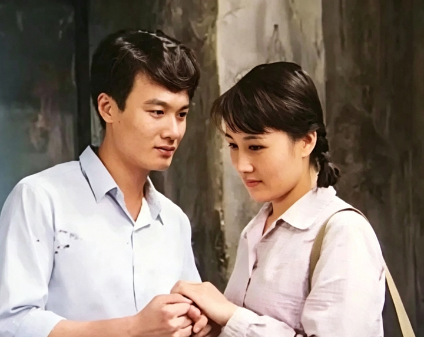
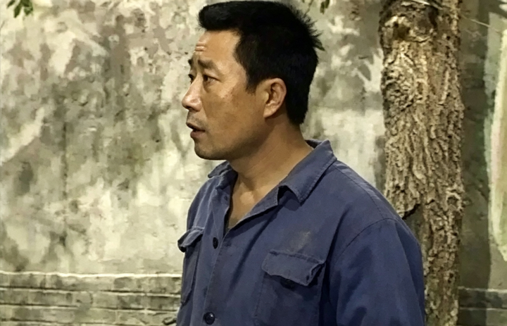
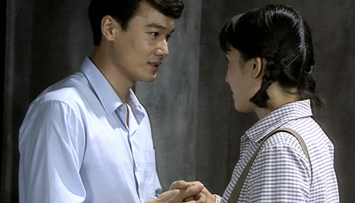
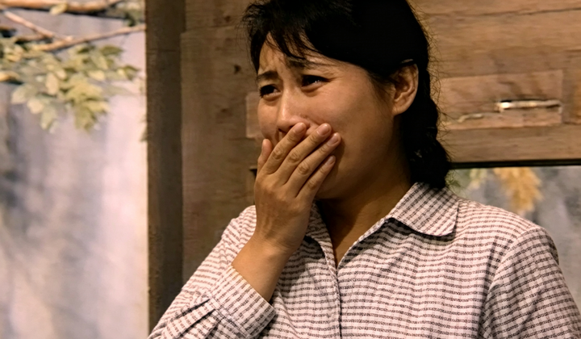
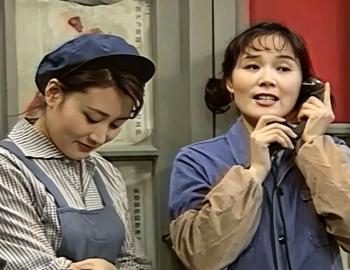
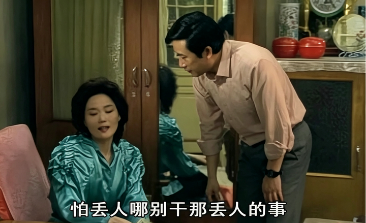
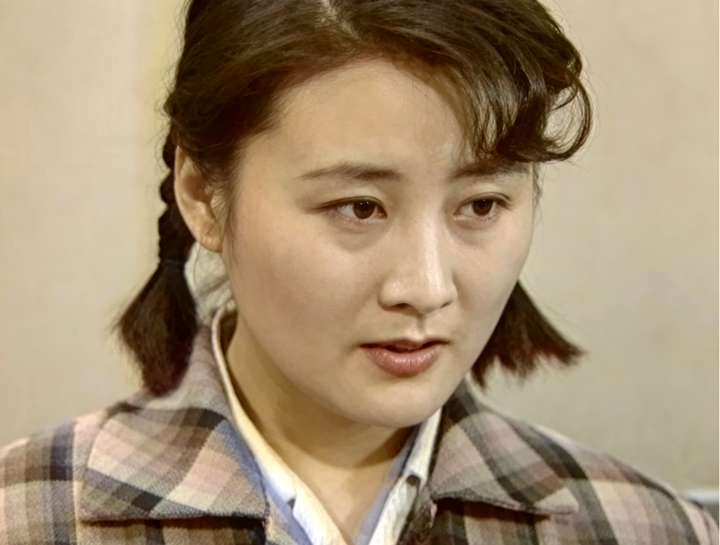
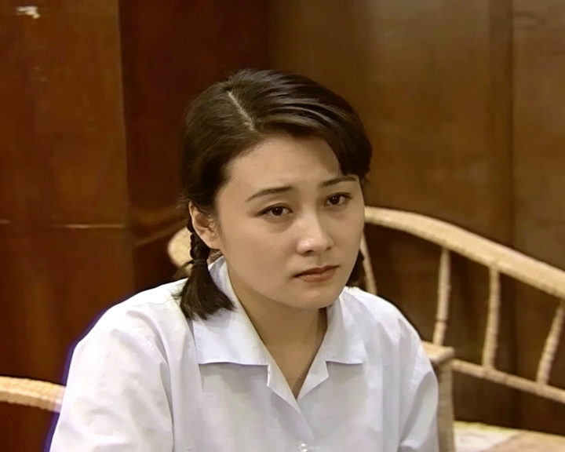

如何评价《渴望》这部剧？ \- 知乎用户 的回答

刘慧芳这个人放在七八十年代的背景下可以被理解吗？这部戏对当时的社会深层矛盾有没有批判，还是只当做背景？

所谓的“圣母型”女主，大致就是像《渴望》里的刘慧芳那样，谁对我好，我吸血谁；谁需要我，我奉献谁。

90年代初的都市情感剧，讲真，一部比一部像毒草。

前两天，我才剖析了《篱笆\.女人和狗》里的枣花，被网友建议谈谈刘慧芳，那就安排。

据说在1990年，有一部电视剧让全国人民集体破防，收视率干到了90%以上，连公安部都给它颁了奖——因为播出期间犯罪率都下降了。一到晚上八点，所有街道空荡荡，所有人都在家守着电视机，一边抹眼泪一边唏嘘刘慧芳。

为虾米？

因为她原本有个青梅竹马的宋大成。宋大成是工厂的车间主任，老实憨厚，常年帮刘慧芳家修房顶、补墙洞、送蜂窝煤……任劳任怨，深得刘大妈的欢心。搁现在的相亲市场，这叫有稳定编制、有生活技能、得丈母娘认证的五星级准女婿。

全工厂的上上下下也都觉得，刘慧芳不嫁给宋大成是天理难容。

alt="Image">

偏偏，刘慧芳不稀罕宋大成。她喜欢王沪生——一个落魄的大学生，父亲在文革期间被批斗下落不明，母亲急忧交加去世，姐姐自顾不暇，他的政治处境一塌糊涂，像条流浪狗一样蜷缩在工厂的角落里。

刘慧芳看到王沪生的第一眼，圣母心就被激活了。闺蜜排队半天买回来的四喜丸子，刘慧芳只尝了一口，剩下的全给了王沪生。刘大妈早就想安排她嫁给宋大成，她却做了一个让全国观众血压飙升的决定，她要甩了宋大成，嫁给王沪生！

你们说这女人，脑子是不是有病！

alt="Image">

而且，她甩宋大成的方式堪称教科书级别的绿茶手段。宋大成都在准备结婚家具了，刘慧芳才去找宋大成，眼含热泪地说：“我一直把你当做我的亲哥哥，我就是你的小妹妹……”；“本来我想过，像妈说的，咬咬牙，跟你好了算了，可现在，我答应了王沪生……”

好家伙。你让人家白白干了那么多年的苦力，你从来没明确拒绝宋大成的表白，甚至别人调侃的时候你还面露羞涩。现在你轻描淡写地就把人家给打发了？

宋大成当场懵圈，问这是什么时候发生的事。刘慧芳却来了句:“不弄问了。你原谅我？你愿意恨，就恨吧……”心碎的宋大成只好认命，为了成全刘慧芳，无奈娶了刘慧芳的好姐妹月娟。刘慧芳呢？心安理得地嫁进了王家。

她嫁给王沪生，图什么呢？

若论爱情，我没看出来他俩有过爱情。

alt="Image">

正常人的爱情是我喜欢你、你也喜欢我，双向奔赴。刘慧芳和王沪生的关系，更像是一个救世主看到一个需要被拯救的灵魂。他孤独，她陪他；他无助，她帮他；他娶她，她觉得是他需要她，赶紧嫁了。

这不是扶贫么，跟爱情有什么关系？

如果只是胡乱嫁人，那还只是情感盲目的问题。刘慧芳真正让人窒息的操作，是收养小芳。

妹妹燕子捡了一个弃婴回来。按理说，刘家妈妈还不算太老，完全可以把这孩子当女儿养，也就是刘慧芳的妹妹。这样一来，刘慧芳照样可以疼她、爱她、照顾她，但不用搭上自己的婚姻和人生。

刘慧芳偏不。

她非要把弃婴变成自己的养女。

为虾米？

因为她觉得孩子无父无母、身世可怜，外婆抚养终究隔了一层，唯有她亲自收养、亲自养育，才算真正的善良，才算真正的救赎。

问题是，她当时刚跟王沪生结婚，王沪生明确反对收养这个孩子。

刘慧芳不管三七二十一，坚持把孩子留在家里。于是新婚夫妻就为一个捡来的孩子天天吵架。

本来，王沪生就没爱过刘慧芳，他跟他姐姐一样，看不起只有初中文化、工人出身的刘慧芳。他娶她在很大程度上是因为在他最落魄的时候，刘慧芳的工人阶级身份能保护他，能让他留在北京，不用去大西北。

说白了，刘慧芳就是王沪生的一张北京暂住证。

后来，王沪生的父亲平反了，王家恢复了社会地位。王沪生的初恋肖竹心也回来了，他旧情复燃，对刘慧芳越来越冷淡。再后来，直接离婚。

那么，刘慧芳作何反应呢？

alt="Image">

她同意离婚，然后对小芳倾注了全部的爱，而对亲生儿子东东呢？她交给了王沪生抚养，忽略着儿子的成长。

一个母亲，为了一个没有血缘关系的养女，把自己的亲生儿子晾在一边。这不是个蛇精病这是个啥！

最奇葩的是，为了照顾小芳，刘慧芳辞了工作。那她靠啥生活？靠老母亲撑着。她还倔强地拒绝王沪生家提供的钱，打肿脸充胖子地维护自己不食嗟来之食的道德优越感。

但是，你有骨气你别啃老啊！第四十九集里刘大妈说了一句大实话：“有什么别有病，没什么别没钱”。这句话才是这个家庭的真实写照。她的母亲一大把年纪了，还得养活她和小芳。刘慧芳就差没把亲妈的骨头都榨出油了，她视而不见，甘之如饴，让全家人继续替她买单。

包括她对宋大成与徐月娟的态度，也让人恨得牙痒痒。

alt="Image">

徐月娟是刘慧芳的闺蜜，曾经试图阻挠刘慧芳和王沪生在一起，那是她是真的为了刘慧芳好，不想她错过好男人。结果呢？刘慧芳不但不领情，反而婚后继续跟宋大成黏黏糊糊。

按理说，她们各自成婚后，都是各过各的小日子。刘慧芳依然如婚前，有事就找宋大成。小到修个灯泡，大到家里出了变故，第一个电话永远打给“大成哥”。

她有没有考虑过月娟的感受？

从来没有。

那她有没有考虑宋大成的感受？

也从来没有。

可能在她意识里，宋大成帮了她那么多年，继续帮她是应该的。可是人家都结婚了，你要不要脸啊，还想把宋大成绑在自己身边。

alt="Image">

宋大成是个老实人不说啥，那徐月娟又不是个傻子，她能不介意！她当然介意。但她介意也没用。刘慧芳的字典里根本没有“界限感”这三个字。

你要独立，那你就凡事靠自己嘛！

你干嘛还啃老、干嘛使唤别人家男人当免费劳动力。

alt="Image">

So，刘慧芳的善良，本质上是一种表演型善良。她对陌生人掏心掏肺，对身边人敲骨吸髓。成天自我感动成瘾，却把日子过得乱七八糟。

包括她对王沪生姐姐王亚茹的态度。王亚茹是全剧最不待见她的人，处处刁难，各种嫌弃。刘慧芳依然笑脸相迎，以德报怨——你对我越坏，我越要证明给你看我贤良大度，我从不记恨。

尤其当她得知小芳的真实身份是罗冈和王亚茹的女儿，内心虽然不舍，还是让小芳回到了亲生父母身边。王亚茹用精湛的医术治好了小芳的腿，罗冈给了小芳更好的生活条件。

刘慧芳呢？她付出了所有，落了个瘫痪，成天瘫在床上。

这部让好人不得好报，烂人被无限包容，亲人被无限亏欠，外人被无限偏爱的电视剧，唯一一个让我长出一口气的看点就是，宋大成最终放弃了刘慧芳。

我半点都不同情刘慧芳。

alt="Image">

老天爷原本给她发了一手好牌，她可以安稳爱人、踏实生活、家庭和睦、平凡幸福。她却非要亲手撕毁剧本，非要闯泥潭、钻烂坑、渡烂人、虐自己。然后用被虐出来的惨状，向全世界宣告：看，我多善良，我多可怜，你们都欠我的！

当年观众们心思比较单纯，还真被刘慧芳唬住了。许多人不满意这个结局，写信给导演，要求刘慧芳必须从轮椅上站起来，要不然就让导演躺下。

现在想想，导演也挺冤的。刘慧芳站不起来，不是编剧狠心，是她自己把路走绝了。

她不懂真正的善良是有边界感的。是你先把自己的日子过好，然后有余力再去帮别人；是你能分清什么是自己该做的和自己不该做的；是你不把自己的道德优越感建立在别人的痛苦之上；是你有多大屁股穿多大裤衩，同理，有多大能力端多大饭碗。

刘慧芳用一生证明了一句老俗语的正确性——可怜之人，必有可恨之处。
