如何评价《红楼梦》中的贾母? \- 凭栏翠袖 的回答

年轻的时候，总觉得《红楼梦》里的贾母雍容华贵，慈祥可爱，87版里的贾母更是一种邻家老奶奶的亲切形象，引人好感。

可是读原著次数多了，开始有了进一步的思考。

太虚幻境的判词里对于贾家的衰败，指出根源是“__箕裘颓堕皆从敬，家事消亡首罪宁__”，也就是说，贾家败落是从宁国府开始的，宁国府败落的根源在于贾敬的不作为。

那么荣国府就没有任何责任吗？贾家东西二府是一体，宁国府败落的同时，荣国府也在败落，甚至速度更快。那么，__荣国府的败落又从谁开始呢？可以说，是从贾母开始。__

__中国古代虽然重男轻女、压迫女性，但也给女性指出了出路，那就是多年媳妇熬成婆__。只要你能生出儿子，并且活得比丈夫长久，你就有希望成为大家长，你的儿子儿媳以及所有晚辈，都必须听命于你。

所以我们看所有的宫斗剧，女主得宠甚至封后，都还算不得是真正的胜利，真正的胜利是成为皇太后，让皇帝“以天下养”。

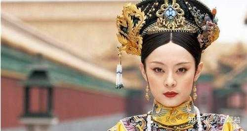

alt="Image">

贾母就是这样一个“皇太后”式的人物，作为荣宁二府的最高长辈，贾母在贾家族中拥有最高权威。她的决定必须得到贯彻执行，她疼爱的人必须得到最好的待遇。别说自己的儿子儿媳她可以训斥，就连族长贾珍若是惹她不快了，她也能叫过去骂一顿。所以，贾母在很大程度上影响着荣国府的兴衰。

这样一个人物，如果英明有远见，势必可以在家族走下坡路的情况下，及时做出适当的应对。然而贾母并没有，__她像众多普通的颐养天年的老太太一样耽于逸乐。她的阅历、性别和年纪决定了她的局限性。__

## 阅历的局限

一个人的知识、经验决定其三观和生活态度。我们有时看到，一些贫苦出身的老人在与生活小康的儿子媳妇共同生活之后，两代人会产生很多矛盾。老人坚持要吃剩菜、穿破旧衣服、把好吃的留给家里男人等等，因为老人完全在按照自己的经验和阅历指导年轻人现代的生活方式。这种情况有时会引发夫妻矛盾和婚姻破裂。可是假如倒过来，富贵出身的父母要求家境平凡的儿女按照往日生活水平来供养自己呢？恐怕这家要生生被吃穷了。

贾母出身于保龄侯史家，她的父亲曾做过尚书令，父亲和公公都是跟着太祖起兵而立功封爵的。她和丈夫贾代善，都成长于国祚初稳、圣眷正隆的时期，那也是四大家族最辉煌的时期。后来她十四五岁嫁入贾家，据说是比凤姐还要能干的管家媳妇。等到公婆去世后，丈夫代善也是非常聪明能干，颇得圣宠，临去世时，皇帝还破例多赏了一个官给他的小儿子。可以说，贾母这一生的大部分光阴，都活在四大家族最顺遂显赫的时候。

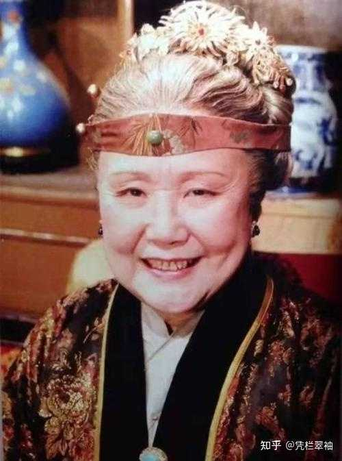

alt="Image">

有人说，贾母阅历丰富，见多识广。__要说吃喝玩乐的享受方面，那贾母肯定是比多数人更阅历丰富，但要说到政治眼光和家族前景布局，可就未必了。她一直都活在一种无忧无虑的状态下，所以并无居安思危的意识。这就是她的局限。__

按原著描写，本朝惯例都是只封袭三世，且要随代降等。比如贾演是宁国公，贾代化就是一等神威将军，贾珍就成了三品爵威烈将军。因为子孙本身没有功劳，所以他们继承的官位和薪资待遇都要随着代际而逐渐降低，除非子孙中有人才又立新功，获取了新的荣耀和封赏，才能把家业振兴起来。贾家的人口不断增加，享乐规格却从不降低，但他们的待遇和收入是在不断递减的，然而家族中都只知享受，不擅经营投资，子孙又没有政治功劳，在朝廷上的地位不断降低，所以整个家族都在走下坡路，越来越穷。

冷子兴演说荣国府时，说：“__主仆上下，安富尊荣者尽多，运筹谋划者无一，其日用排场费用，又不能将就省俭__。”这是贾府上下的通病，但是最严重的人物就是贾母，上行下效的榜样，由她开始。

__贾母成长和生活在四大家族鼎盛时期，所以她也习惯了奢靡的生活方式，加上她是两府最年长最尊贵的人，所以她更是把一切享受视为理所当然。如果说，苦难的经历也是一种宝贵的人生财富，那么贾母在这方面，堪称贫乏了。__

她吃过的好东西太多，每天简直都不知该吃什么，所以只好把天下所有的菜品用水牌写了转圈儿吃，为了养生延寿，她把未出世的小羊羔用牛乳蒸着吃（好残忍！）。刘姥姥祖孙垂涎不已的精致点心，她总是一次半个吃不完就赏人了。

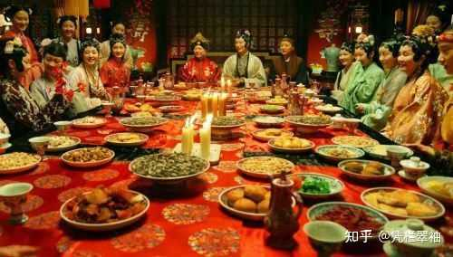

alt="Image">

她穿的衣服也讲究，有专门的裁缝绣娘给私人定制，别人送给她的衣服（自然也都是高级货色），她都没有穿过，那些软烟罗、雀金呢之类的好衣服好料子更是数不胜数，全都白白收藏着，只拿了一些送给刘姥姥和宝玉等孙子孙女。

她屋里有各种精致的古董和工艺品，比如慧纹璎珞、仇英的美人图、还有水墨字画白绫帐子和墨烟冻石鼎之类的。这些都是早年收藏的，至于平日贺吊往还三节两寿收到的那些金寿星、沉香拐、玉酒杯等更是不计其数。看都看不过来，看烦了就收起来，“改日闷了再瞧。”

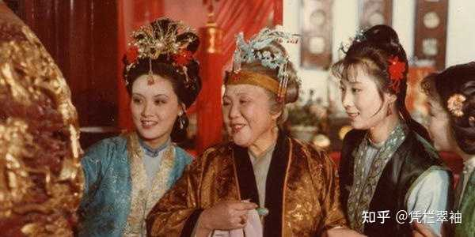

alt="Image">

凤姐说她箱子里那些金的银的圆的扁的有的是，她屋里的箱子柜子都是高大威武，存取东西时，要爬梯子上去。要说她的财富堆积如山，并不为过。

难道箱子柜子是这些宝物最好的安身之处吗？显然不是， 这些宝物最好的去处是物尽其用，或者变现成钱。凤姐血崩，家中居然拿不出整枝的人参来。

因用上等人参二两，王夫人取时，翻寻了半日，只向小匣内寻了几枝簪挺粗细的。王夫人看了嫌不好，命再找去，又找了一大包须末出来。……王夫人没法，只得亲身过来请问贾母。贾母忙命鸳鸯取出当日所余的来，竟还有一大包，皆有手指头粗细的，遂称二两与王夫人。……

一时，周瑞家的又拿了进来说：“这几包都各包好记上名字了。但这一包人参固然是上好的，如今就连三十换也不能得这样的了，但年代太陈了。这东西比别的不同，凭是怎样好的，只过一百年后，便自己就成了灰了。如今这个虽未成灰，然已成了朽糟烂木，也无性力的了。请太太收了这个，倒不拘粗细，好歹再换些新的倒好。”
王夫人听了，低头不语，半日才说：“这可没法了，只好去买二两来罢。”也无心看那些，只命：“都收了罢。”因向周瑞家的说：“你就去说给外头人们，拣好的换二两来。倘一时老太太问，你们只说用的是老太太的，不必多说。”……

宝钗笑道：“这东西虽然值钱，究竟不过是药，原该济众散人才是。咱们比不得那没见世面的人家，得了这个，就珍藏密敛的。”王夫人点头道：“这话极是。”

贾母喜欢把所有珍稀的东西都珍藏密敛，因为她所处的时代，家里现成的金银财宝都花用不完，多余的就只好做收藏品——__收藏，也是有钱人才有的爱好，贾母养成了这个爱好和习惯，直到家境败落了，也不想改变。因为旧日的生活和习惯，不仅仅是一种享受，也是一种体面，在贾母看来，体面比什么都重要。__

有人说，贾母被大家隐瞒着，并不知道家境变差的实情。真是这样吗？看看第七十五回：

贾母负手看着取乐。因见伺候添饭的人手内捧着一碗下人的米饭，尤氏吃的仍是白粳米饭，贾母问道：“你怎么昏了，盛这个饭来给你奶奶。”

那人道：“老太太的饭吃完了。今日添了一位姑娘，所以短了些。”

鸳鸯道：“如今都是可着头做帽子了，要一点儿富余也不能的。”

王夫人忙回道：“这一二年旱涝不定，田上的米都不能按数交的。这几样细米更艰难了，所以都可着吃的多少关去，生恐一时短了，买的不顺口。”

贾母笑道：“这正是‘巧媳妇做不出没米的粥’来。”众人都笑起来。

贾家的家境，已经到了连一碗多余的细米饭也拿不出来了。贾母也知道巧妇难为无米之炊，无米的背后，是家庭经济的窘迫。贾母是自幼当家的，怎会不明此理？她只是不愿细想，因为她觉得这不是她该操心的事。 这是儿子媳妇们该操心的，她年轻时用荣华富贵供养了他们，现在他们就该用同样的荣华富贵来供养她，而且不该让她操心。

还是第七十五回：

贾母歪在榻上，王夫人说甄家因何获罪，如今抄没了家产，回京治罪等语。
贾母听了正不自在，……点头叹道：“咱们别管人家的事，且商量咱们八月十五日赏月是正经。”

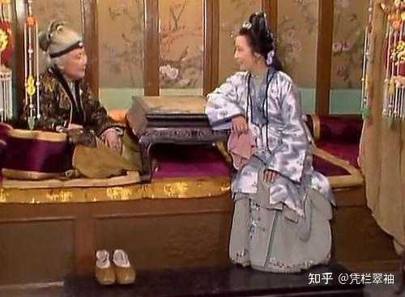

alt="Image">

金陵甄家在书里是贾府的影子对照，他们的一切都是贾府的预演，甄家也是贾家的老亲戚，也有一荣俱荣一损俱损的关联。甄家获罪抄家，早晚会牵连到贾家，这是明摆着的。但是贾母拒绝细品这些不开心的消息，她读书少，不太明白兔死狐悲、唇亡齿寒的道理，只去想让自己快乐的事，比如怎么庆祝中秋节，怎么赏月玩乐。

__因为活得太久，她印象深刻的都是几十年前的经验和局势，而意识不到世界的变化。在山雨欲来风满楼的形势下，她依然要保持着烈火烹油鲜花着锦的生活方式。说白了，贾母没有经过患难，她不知该怎么应对患难，也懒得去想，于是她选择装瞎。__

即便是家境已然败落如此，她还是不能把自己珍藏的财宝拿出来，所以凤姐贾琏不得不求了鸳鸯去偷她的宝贝出来卖一些，解燃眉之急。鸳鸯偷东西，贾母大概也知道，她也知道凤姐为难，所以默许如此，但她自己不能直接散财——她要维持体面。

## 性别的局限

贾母所在的时代是重男轻女的。张爱玲说：“女人总是眼光如豆。”

为什么女人就没有远见卓识呢？因为那个时代的女性主要任务就是相夫教子，把家里的事情照管好就足够了。多数女性是没有受过正统教育的，阿房宫都装不下的金陵史家，四辈人也就只出了史湘云这么一个才女。所以，古人反对女性掌权，除了歧视压迫女性，也是因为，客观情况就是，多数女性确实思想比较肤浅。若真有能力超群的女性偶然掌了权，赶上差时代，就成为祸国殃民的罪魁（比如慈禧），赶上好时代，也难逃祸水狐媚的骂名（比如武后）。

贾母是没有读过书的，所旅行过的地方也不多，她对文化的理解不会超出听书听戏猜谜行令的范围。她只能凭借自己的天性聪明和人生智慧去解决生活中的小问题，却不能从古圣先贤的传世文章中体悟家国兴衰和人世变迁，更不可能行万里路去见多识广。所以，__贾母不可能有大的格局和长远眼光。这一点也体现在了育儿上。__

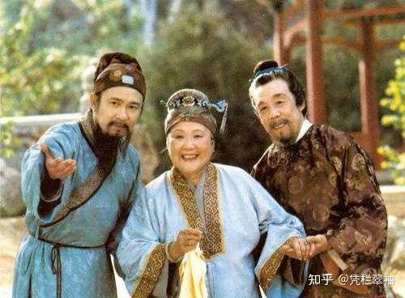

alt="Image">

民间俗语说：穷养儿子富养女。意思是养育女儿要给与足够丰富的物质和精神生活，见过世面的女性才能不轻易被坏人引诱。而对于儿子则应该严格要求，不能任其挥霍无度，要磨练其筋骨和意志，让他成长为吃苦耐劳、有担当的男子汉。

从来富贵多淑女，自古纨绔少伟男。这句话在《红楼梦》中得到了极好的应验。书中的女性多半比男子优秀，这大概也是纨绔出身的曹雪芹的人生经验。

__贾母教出来的女孩个个都很优秀，但她教的儿孙却没有一个能拿出手的。因为教养男孩比教养女孩需要更深远的智慧和眼光。__

贾母是史家的长女，她的次子所生的长子贾珠，比宝玉要年长十几岁，而保龄侯的长子也就是湘云的父亲，所生的第一个孩子就是湘云。湘云年纪比宝玉还小，这说明贾母身边没有年龄相近的兄弟，她最大的弟弟也比她要小十岁以上。所以，她对年轻男孩的成长并不了解，也没怎么参与父母对弟弟的教养。

她的父亲和公公、丈夫都是皇帝宠臣，事业顺遂的男性一般懒得跟家眷谈讲自己的工作。贾母对丈夫的主要印象也是生活和爱好方面的，比如戏子伴奏欣赏之类。她印象中，男人天生都是能干的、能撑家立业的，不需要女人来操心和教引。

代善在生活上讲究吃喝玩乐的品味，与她意气相投，她也不反对丈夫纳妾——前八十回中，代善健在的老姨娘就有六个。所以，相应的，她也不约束子孙在女色上的放纵，贾赦父子皆好色，她的态度是“小孩子们年轻，馋嘴猫似的，世人都这打么过的”。她对贾赦不满，并非因其好色，主要是觉得他不注意身体、不务正业。贾赦据赖嬷嬷说，当初是被代善天天打，可他还是那么任性荒唐，只能是被母亲惯的。

通常家中如果有三个以上的子女，最受宠的往往是长子或幼子。贾母三个儿女，最宠爱的是贾敏，但儿子中，无疑最受宠爱和重视的是贾赦。可惜贾赦后来被惯坏了，贾母忍无可忍才分房居住，但是他向母亲要鸳鸯作妾时，照样理直气壮，可见他习惯了被母亲娇纵。

贾政因为爱读书，得到了贾源的喜爱，贾母对子孙读书成绩没有太高要求，她选择与贾政同住并非因为喜欢贾政，而是因为贾赦太令她失望，两害相权取其轻，无功胜过有过。而且贾政虽然木讷不讨喜，他生的儿女都很可爱，所以贾母愿意与他们同住。

贾政虽爱读书，却并没有太高进取心，在工部干了二十多年，只升了一级。作为一名工部官员，他连大观园监工都做不了，每天只知道跟清客喝茶下棋，这种得放松就放松的人生态度，也是遗传了他的母亲。只不过，他还不算太昏聩，也知道男性的责任，但他把振兴家业的责任转嫁给了儿子。

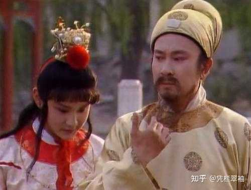

alt="Image">

贾政的大儿子贾珠是他们夫妇自己教养的，非常优秀，十四岁就进了学，但是因为被要求过于严苛而病弱早亡。次子宝玉衔玉而生，外貌酷似贾代善，于是贾母就将其抚养权收为己有。她对这个孙子更多是娇宠溺爱，她对他要求不高，主要的要求还是体面：

就是大人溺爱的，是他一则生的得人意，二则见人礼数竟比大人行出来的不错，使人见了可爱可怜，背地里所以才纵他一点子。若一味他只管没里没外，不与大人争光，凭他生的怎样，也是该打死的。

宝玉外貌好，又懂得表面礼节，能给她争光，加上衔玉神话的加持，贾母觉得这就是个完美的孩子了。她愿意放纵他不读书，他喜欢美女，她就安排众多美貌丫鬟伺候他，又允许他与姐妹们同住。

所以，宝玉读书睡觉时，身边都不能离开美女的陪伴，偶尔生个病，就可以三天两头不读书不上学，加上贾母自己也是三日一小宴五日一大宴，每次必要宝玉作陪，宝玉更不可能专心于读书和世故历练了。在这种氛围下，宝玉居然没有成长为贾赦和孙绍祖那样的人，只能说，一要感谢他自己天性善良懦弱、二要感谢他多少也读进去一些圣贤书，三要感谢他自己身体孱弱、欲求有限。但是这样的宝玉，显然是不可能像代善那样撑家立业的。

贾母在宝玉挨打时说过一段话，耐人寻味。

贾母又叫王夫人道：“你也不必哭了。如今宝玉年纪小，你疼他，他将来长大成人，为官作宰的，也未必想着你是他母亲了。你如今倒不要疼他，只怕将来还少生一口气呢。”
贾政听说，忙叩头哭道：“母亲如此说，贾政无立足之地。”
贾母冷笑道：“你分明使我无立足之地，你反说起你来！只是我们回去了，你心里干净，看有谁来许你打。”

贾母的话，说明她坚信宝玉日后是可以为官做宰的。可是像宝玉这样懦弱贪玩，将来拿什么能力去为官作宰呢？她想不到这些，在她的逻辑里，她身边的男性亲人都是能有官当的，日后的好日子自然是一代传一代，只管平安长大，享用便是。

宝玉去上学，黛玉祝他“蟾宫折桂”，袭人也说“读书是极好的事，不然就潦倒一辈子”。可是贾母只抱怨贾政逼宝玉读书逼得太紧。为了能帮助宝玉逃避读书，她不惜“辱师责子”。

赖嬷嬷的孙子作了州官，赖嬷嬷对他的教诲是：“__州县官儿虽小，事情却大，为那一州的州官，就是那一方的父母。你不安分守己，尽忠报国，孝敬主子，只怕天也不容你__。”

__赖嬷嬷虽然也是母亲和祖母，但她也是老百姓，也做过人家的奴才，知道凡人生活的艰辛，知道他们对官僚的期许，也知道孙子前程的得来不易，所以她能说出“天也不容你”这样的告诫。而贾母是说不出的，她的一切都来得太轻松容易了。这里有性别的局限，也有阶级的局限。__

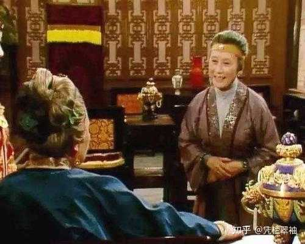

alt="Image">

宝玉跟着贾母，学会了审美品味，学会了惜老怜贫，学会了孝顺守礼……就只没学会怎样做个男人。

贾母不懂男人的世界，宝玉也不懂，他把男人简单归为“泥做的骨肉”，把读书举仕的人都贴上“禄蠹”的标签。他只想跟女孩子们在一起，过她们的生活、为她们效力，而厌恶男人的世界和责任。

## 年纪的局限

多数人都是越到老年越怕死，越是生活富裕安乐的老人越是舍不得死。贾母也不例外。她从来不去想自己身后事，只想抓住眼前的快乐。

所以，她经常不顾身体地玩乐，直到累病为止。中秋夜，多数人已散去，只有尤氏和探春陪着，她还是舍不得回去。

她也很少去想自己对别人的影响和责任。

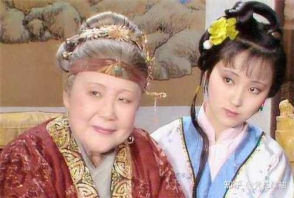

alt="Image">

她虽然很爱孤苦无依的外孙女林黛玉，却并不急着给她定亲。因为她希望黛玉能陪着她。贾家上下揣测她计划把黛玉许配宝玉，她应该也确有此想法，但并不明说。她对宝玉的亲事考虑的原则，便如她自承的那样，只要模样性情好，其他都不重要。什么门当户对，什么政治联姻，都不及宝玉本人的幸福重要。

湘云的命硬，宝钗尚俭且性情清冷，皆非最佳人选，黛玉相对胜出，却又健康欠佳，所以贾母只把她当作大备胎。在中意宝琴未遂后，紫鹃的情辞试忙玉，令贾母看出了宝玉对黛玉的心思。但她依旧不着急给他们定亲，因为一旦定亲，他俩就不能再见面，不能一起陪伴她。而宝玉又命里不宜早娶，所以贾母宁可搁置此事，她可不想要是自己去世了，黛玉可怎么办。这种拖延的办事态度与其说是贵族作派的好整以暇，不如说是老龄化的怠惰和逃避。

同理，鸳鸯是他最喜欢的丫鬟，陪伴她到了嫁龄，她也没安排她的婚事。鸳鸯这样的条件，自然不可能匹配普通的小厮，名花无主的状态引来了贾赦的觊觎。在鸳鸯拒婚后，贾母拒绝了贾赦的要求，表面看，似乎是保护了鸳鸯，然而这保护只是暂时的，她始终没有指定鸳鸯的婚事。其实，正如贾赦所说：“我要她不来，谁还敢要？”贾母对鸳鸯的终身大事不做安排，其实就是默许贾赦，等自己过世，鸳鸯就是他的。鸳鸯要想拒绝这个安排，只有殉主。从这个意义上说，贾母是残忍的。

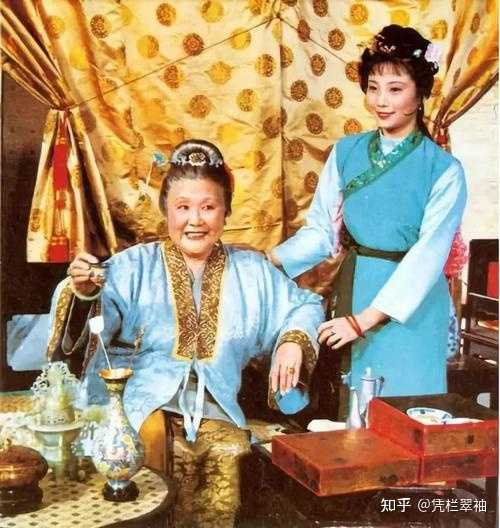

alt="Image">

黛玉和鸳鸯尚且如此，袭人晴雯更不用说了。袭人在伺候湘云之后，被贾母视为实习合格，派给宝玉，贾母很少有把丫鬟赏了人又要回来另派的情况，这说明，她确实笃定要把袭人留给宝玉，如果她知道袭人与宝玉试了云雨，一定会很赞赏：“就该如此。跟主子讲什么贞不贞的。”但是她并不急于明确袭人的身份，反而又派了更为出众的晴雯去一起伺候宝玉，而晴雯在她看来更有资格做宝玉的妾。可是这两个人的身份，她都不明说，大概是期望她们竞争上岗好好表现的意思。

结果袭人只好转投王夫人来明确自己的身份，而晴雯却在没有名分的情况下与袭人分庭抗礼、施威于下人，导致树敌过多而被谗陷。

凤姐可算是贾母最宠爱的人物之一，为了在荣国府管家，也是殚精竭虑。可是在她怀孕的时候，贾母从未减轻她的家务负担，而且纵容大家在她寿筵上灌酒，叫她陪着自己在元宵节熬夜，身心俱疲的凤姐刚忙完年事就小产了，并且此后失去了生育能力。

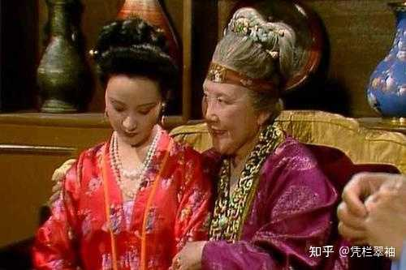

alt="Image">

可以说，有相当一部分人的悲剧，多多少少，都与贾母的自私和消极懒惰有关。

贾母虽然在家中有至高的权威，却只关注自己的生活水准保持不变，很少真正管别人的事。迎春被贾赦许配给孙绍祖，贾赦

亦曾回明贾母。贾母心中却不十分称意，想来拦阻亦恐不听，儿女之事自有天意前因，况且他是亲父主张，何必出头多事，为此只说“知道了”三字，余不多及。

如果贾母肯多问几句，迎春的命运或许还有一线转机，奈何贾母本来就不太疼爱她，又害怕得罪长子，所以也就放任不管了。

贾母喜欢美艳多识的宝琴，把珍藏的凫靥裘送给她，增添其美色，却对“__并无避雪之衣”，“拱肩缩背，好不可怜见的__”邢岫烟视若无睹。因为岫烟是她不喜欢的儿媳家的亲戚，且为人淡泊，不擅讨喜于她，所以也就毫不关心了。可见，她素日秉持的惜老怜贫理念，也并不纯粹。

当初黛玉丧母，林如海同意贾府收养黛玉的理由是：

汝多病，年又极小，上无亲母教养，下无姊妹兄弟扶持，今依傍外祖母及舅氏姊妹去，正好减我顾盼之忧。

林如海担心的是黛玉没有母亲的教养，希望外祖母能承担这部分责任。然而我们看到黛玉在荣国府被教养成了“嘴里爱刻薄人”的人——这可不是只针对宝玉，因为这个评价是小红说的。

黛玉在行酒令时说出《西厢记》的句子，在元宵夜宴上当众给宝玉喂酒，都是不符合大家闺秀身份的。

黛玉对宝钗说：

从前日你说看杂书不好，又劝我那些好话，竟大感激你。……细细算来，我母亲去世的早，又无姊妹兄弟，我长了今年十五岁，竟没一个人像你前日的话教导我。

这些闺训才是那个时代作女人的准则和存身之道，也是林如海最希望黛玉能在贾家得到的。舅妈没有血缘关系，不好多管，四个教引嬷嬷只能教表面的礼仪和规矩，这些闺训只有外祖母来教才最合适，可是贾母显然没有做到。

__触龙说赵太后时，道：父母之爱子，则为之计深远。__

__路易十五说：在我死后，哪管洪水滔天。__

__贾母更像是哪一个呢？读者可自行判断。__

贾母这种心态，最主要的继承者就是宝玉。他对黛玉说：“__凭他怎么后手不接，也短不了咱们俩的__。”

他又对探春说：“__事事我常劝你，总别听那些俗语，想那俗事，只管安富尊荣才是。比不得我们没这清福，该应浊闹的。……我能够和姊妹们过一日是一日，死了就完了。什么后事不后事__。”

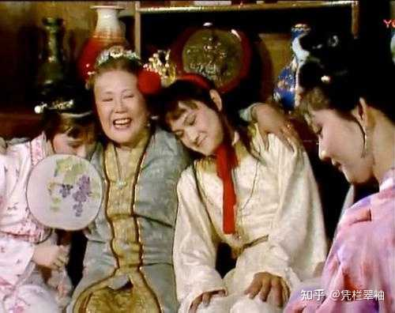

alt="Image">

__作为年过八十、一世荣华的老封君，贾母决定“过一日是一日”是自私，作为一个十几岁的贵族少爷，宝玉也这样想，则是一种可悲可怕。__

梁启超说：老年人常思既往，少年人常思将来。惟思既往也，故生留恋心；惟思将来也，故生希望心。惟思既往也，事事皆其所已经者，故惟知照例；惟思将来也，事事皆其所未经者，故常敢破格。老年人常厌事，少年人常喜事。惟厌事也，故常觉一切事无可为者；惟好事也，故常觉一切事无不可为者。

__贾母活得太久，有太多既往可思，太多旧例可循，其实她的知识和经验很多是狭隘过时的，但她又掌握了最高权威，儿孙们不得不听从她，都以她为榜样来指导自己的生活和行为。而她的儿孙们，尤其贾宝玉，更是深受其影响，把自己活成了老人的心态。__

民间传说，老人过分长寿，会折损子孙的福气。这当然是迷信传说，不可误信。但是如果老人不肯及时退出历史舞台，要持续用过时的经验来指点后代的生活和前途，确实会造成不利的影响。

## 结语

不得不承认，贾母确实是一位雍容华贵、慈悲温和的贵夫人，不能简单说她就是个为富不仁的封建统治者。但是__她的那些优势，多半是她的出身和好运带来的，换一个人在她的位置上，未必就不如她。而且作为阅历有限、年纪老朽的封建女性，她又的确有很多局限性，因她身居高位，这些局限性也给家族带来了不利的影响。__

在很多读者和专家看来，贾母具有“大母神”的形象价值，她聚拢了儿孙们，给他们保护和疼爱，令他们觉得慈祥温暖。她像一棵枝繁叶茂的大树，为鸟儿们遮风蔽雨；反过来，鸟儿们的存在也给大树带来了快慰和生机。

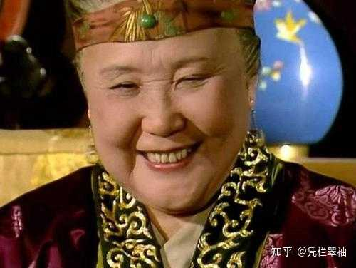

alt="Image">

可是，等到树倒猢狲散，食尽鸟投林的时候，那些习惯了大树保护下的安逸生活、未经风雨且无谋生之能的鸟儿们，又该何去何从呢？
