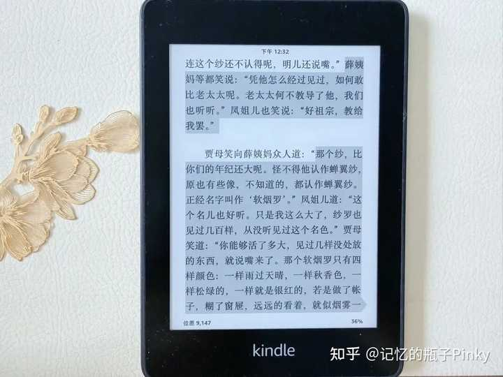
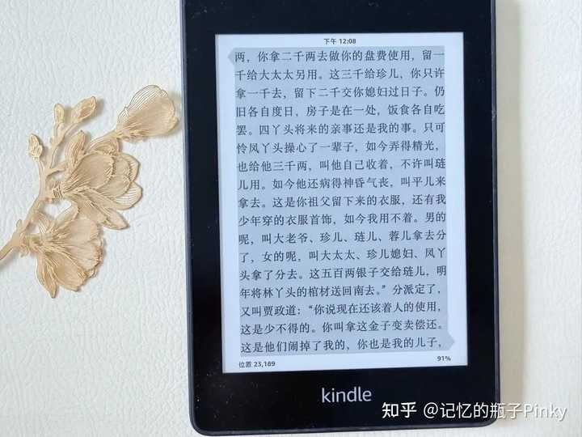
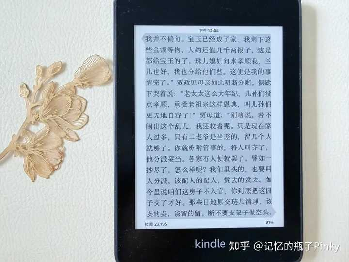
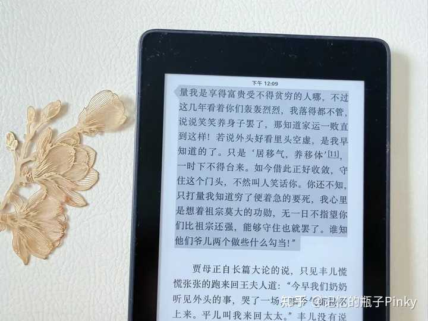

如何评价《红楼梦》中的贾母? \- 记忆的瓶子Pinky 的回答

读《红楼梦》时，看到贾母出场时，心里总是不由自主地冒出一个念头：这不就是一颗被众星捧月般围着的“老太星”吗？

凤姐变着法儿逗她开心，宝玉百般撒娇，黛玉承欢膝下，连鸳鸯等丫鬟都时刻揣摩着她的心意。这让人产生一种错觉：贾母不就是个富贵人家供着的老人家吗？

可是静下心来细读，会发现贾母并没有那么简单。

迎春的乳母参与赌钱那一回，宝钗、黛玉、探春为迎春乳母求情，贾母说：

“你们不知。大约这些奶子们，一个个仗着奶过哥儿姐儿，原比别人有些体面，他们就生事，比别人更可恶，专管调唆主子护短偏向。我都是经过的。况且要拿一个作法，恰好果然就遇见了一个。你们别管，我自有道理。”

贾母一眼就看穿了这些人倚老卖老、仗势生事的本性，因为这种事儿她年轻时见多了。

她看到的不只是眼前这个人赌钱了，更看到了背后的风气，所以才要“拿一个作法”，杀一儆百。

这一处让我觉得：贾母绝不是我原以为的“糊涂老太太”。

刘姥姥进大观园那一回，在林黛玉屋里，贾母觉得窗上纱颜色旧了说给换了，要换个跟院子里绿色竹子搭配的颜色。

凤姐说起库房里的蝉翼纱，贾母说那是软烟纱，并且介绍的一清二楚，连凤姐、薛姨妈没见过甚至都没听过。

alt="Image">（前八十回）曹雪芹著\.（后四十回）无名氏续；程伟元,高鹗整理\.《红楼梦》\.人民文学出版社\.

从这一段描写可以看出，贾母不仅见多识广，而且审美眼光极好。

刘姥姥进大观园时，刘姥姥被凤姐、鸳鸯安排着出尽洋相，满屋笑声不断，贾母也被逗得合不拢嘴时，我再度产生贾母不过是个喜欢热闹的享乐者。

可细读发现，每次笑闹稍过，贾母总是替刘姥姥喊停。她会笑骂凤姐“都是凤丫头支使的，还不给换了呢”。

她看刘姥姥吃的香甜，把自己的饭菜端给刘姥姥吃，又让老嬷嬷给板儿夹菜。

刘姥姥临走时，贾母送的东西也特别实在：药品、衣服、点心、如意荷包，既有实际所需，又有真心祝福。这让我再次觉得，贾母心里比谁都看得清。

真正让我感受到贾母治家魅力的地方，是贾府被抄之后贾府上下乱作一团，贾政等人为钱一筹莫展时，贾母做了几件把治家智慧体现的淋漓尽致的事。

一、关键时刻做贾府的“主心骨”

贾府被抄，库房银子早已虚空，甚至外头还有亏空，贾母做的第一件事，就是打开自己从媳妇起数十年积攒的“私房金库”。

贾母当场分派：给贾赦、贾珍、凤姐各三千两，给贾琏五百两，让贾政变卖金子还亏空，又给宝玉留了几千两，承诺包揽惜春的婚事（按凤姐私下盘算的口径，这笔钱可能差不多一万两，刘姥姥进大观园说20两够庄上一家人生活）

alt="Image">（前八十回）曹雪芹著\.（后四十回）无名氏续；程伟元,高鹗整理\.《红楼梦》\.人民文学出版社\.

此外还把部分财物留给李纨、贾兰，预留了自己百年后的费用，余下的则安排分给服侍她的丫鬟。

贾母分派的每一笔钱都有明确去向，还债的还债，安家的安家，救急的救急，留用的留用。

最让我震惊的是，贾母连自己百年后的费用都提前留出来了，哪怕到了最后一步，她也没打算拖累任何人，夸张到连死她都替自己安排好了。

在那个“养儿防老”的时代，她用实际行动告诉所有人：人，终究得靠自己。正因为她早就把后路安排好了，贾母才能一辈子活得那么从容自在。

对比一下，很多长辈见晚辈遇到困难，能做的不过是劝解“放宽心”。话是好话，却解决不了任何实际问题。

贾母不一样，她拿出真金白银，并告诉众人“这钱该怎么花”。在贾府衰败到谷底时，贾母用她的全部积蓄，为整个家族撑起了最后一块立足之地。

二、数十年的积蓄说拿就拿，这份底气和大气的背后，是财力和魄力

贾母分钱，让我佩服的不只是她积攒了多少钱，更是她竟然逗舍得拿出来。

这些钱可是她从做媳妇起就开始积攒的，分钱时贾母应已超80岁高龄，也就是这些是她六十余年间的一点一点积攒的，这是一笔数万两足以保她安享晚年的压箱底钱。

你我可能都对那个时代的银两没什么概念。举个例子：刘姥姥说过，二十多两银子就够庄户人家过一年了。这么看，数万两就绝对不是小数目了。

当贾府被抄，贾政、贾赦走投无路的时候，贾母把自己的钱说分就分了，分得那么清楚，甚至连自己百年之后的钱都计算在内了。

没有人提出让贾母拿出这笔钱，她自己主动、毫不迟疑的拿了。她的钱，换的是贾府的一线生机。这是大气，更是拿得起、放得下的魄力。

三、钱给谁，怎么给，都是对人性的了解

比分钱更让我震惊的，是她分钱时的内心考量。给贾珍三千两时，特意嘱咐其中两千两须交给媳妇过日子用，剩余一千两供贾珍自己零花。

她太清楚贾珍是个寻花问柳、挥霍无度的主儿了，所以她把钱的大头分给了媳妇，好过日子用。

给凤姐三千两时，她更是谨慎，根本不给贾琏经手的机会，而是指名让平儿直接拿回去，并叮嘱“叫他自己收着，不许叫琏儿用”。

贾母深知贾琏对凤姐三心二意，这笔钱如果被贾琏挪用了，凤姐日后连个退路都没有。

贾母对每个人的秉性都了如指掌。她知道谁靠得住、谁靠不住，这种对每个人秉性的了解是她几十年来一直在暗处观察、在心里盘算的结果。

四、不维持“假大空”的门面，务实地缩减人员、减少开支

贾母没有因为自己有积蓄就让全家人继续过奢靡的日子，而是立刻意识到不能继续坐吃山空，得改变贾府的奢靡风气。

她安排裁撤贾府内多余的人员以及田地：该配人的配人，该赏去的赏去，清理田地，该卖的卖，该留的留。

alt="Image">（前八十回）曹雪芹著\.（后四十回）无名氏续；程伟元,高鹗整理\.《红楼梦》\.人民文学出版社\.

贾府养不起这么多人，之前秦可卿跟凤姐提过，林之孝跟贾琏的提过，甚至林黛玉都对此一清二楚，可是没有人拍板去做这件事。

因为一旦这么做了，就意味着承认了贾府的没落。贾母做这件事却毫不犹豫。这份清醒与魄力，贾府上下，只有她做得到。

五、主动交出大观园，向朝廷表态

最显贾母魄力的一步则是主动交出大观园。大观园是省亲别院，是皇权的痕迹，让贾府更容易招人嫉恨。

留着它，就等于告诉所有人：贾府还端着从前的架子。所以贾母做决定交出大观园，让朝廷看到贾家的改过之心，向周围人承认贾府的衰败。

作为一辈子生活富足的贾母，一句话就交代了大观园的处理，更何况这里曾经充满了那么多欢声笑语，她毫不犹豫地决定舍弃大观园来保人、换贾府一时的安稳和以后的生机。

六、政治敏锐性，处理一笔“不该留”的银子

分派完自家的银两之后，贾母紧接着做了一件更深谋远虑的事，她对贾政说：

“江南甄家还有几两银子，二太太那里收着，该叫人就送去罢。倘或再有点事出来，可不是他们躲过了风暴又遇了雨了么。”

甄家早于贾府被抄，这么看来，甄家被抄前曾将一些财产转移到贾府暂存。

这笔钱放在了王夫人手里，可以说是甄家“赃银”。贾母让送回去这笔银两也许有两个考虑：

一是这是甄家的保命钱，贾府既已被抄，这里不再是安全的存放之处，继续留着既害己也误人。二是若后续被搜查出这笔账，贾府便是“代为隐匿赃物”，罪加一等，把银两送回去便是切割风险。

在贾府库银空缺且有外债时，贾母依然保持如此清醒的头脑，真的难得。

要知道，这个钱可以解决贾府的燃眉之急，可是贾母依然坚持着“不是我的不要，给我带来风险的不留”的为人做事原则。

七、精神上的疏导和震慑

贾母安排好财物之后，贾政等人跪地立志日后勤勉治家、以赎前罪、奉养贾母，当时贾母对着贾政等人，说了一段掏心窝子的肺腑之言：

“你们别打量我是享得富贵受不得贫穷的人哪，不过这几年看着你们轰轰烈烈，我落得都不管，说说笑笑养身子罢了，那知道家运一败直到这样！若说外头好看里头空虚，是我早知道的了。

只是'居移气，养移体'，一时下不得台来。如今借此正好收敛，守住这个门头，不然叫人笑话你。你还不知，只打量我知道穷了便着急的要死，我心里是想着祖宗莫大的功勋，无一日不指望你们比祖宗还强，能够守住也就罢了。谁知他们爷儿两个做些什么勾当！”

alt="Image">（前八十回）曹雪芹著\.（后四十回）无名氏续；程伟元,高鹗整理\.《红楼梦》\.人民文学出版社\.

这段话不长，却藏着好几层用意：

先说宽心话，稳住人心；再道破真相，承认自己一直都知道，只是“偷懒”并且“装糊涂”；接着给个台阶，告诉大家这是灾祸，也是改变的机会；

然后说出了期许和失望；最后撂狠话，点明谁才是这次被抄家的真正罪魁祸首。

该给的钱给了，该安排的安排了，该骂的也骂了。剩下的路，得他们自己走。这段话是贾母唯一一次彻底放下“退居幕后的享乐老太太”的表象，跟所有人摊牌。

回看贾母的一生，她把权力移交给凤姐，过着被众人“哄开心”的日子，享受着当下的热闹。但与此同时，她一直在暗处观察、盘算、做准备。

关键时刻，她有底气出钱，看得透人心，更有放下过去享乐生活的勇气。

贾母才是那个真正懂得“居安思危”的人，既享受得了眼下的热闹，也看得清暗处的危机，更舍得把攒了一辈子的底牌在关键时刻全部摊开。从头到尾，她都在用自己的方式，护着贾府上下的最后周全。

这就是贾母。
