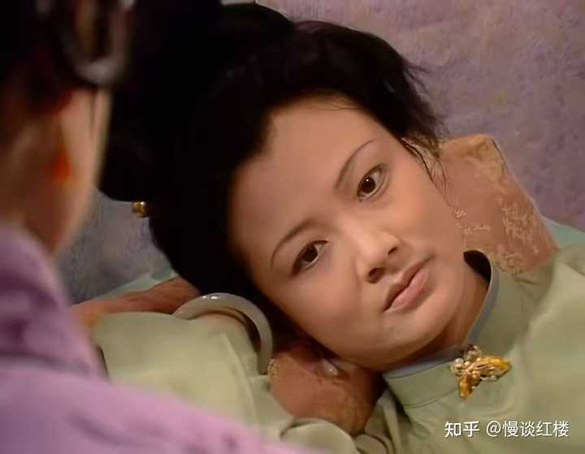
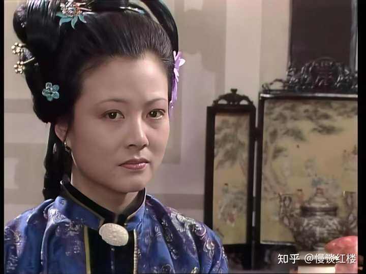
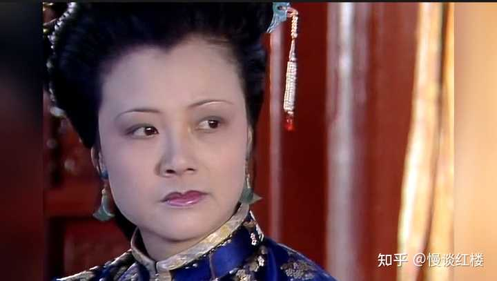
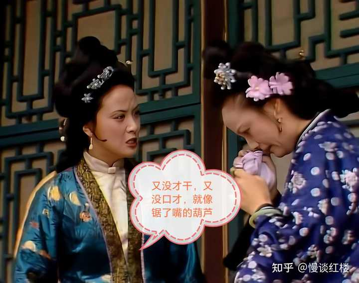

__问题描述：__

目前能想到的尤氏几处故事:先是给凤姐生日凑份子，她主事一切妥当，而且不肯拿两位姨娘的份子钱，又看出凤姐人前说了替李纨出钱后又不兑现，又还了几个大丫头的…

__从尤氏讲的笑话中能窥见其真面目：__

中秋夜宴上，尤氏给贾母讲的那个笑话，但那个笑话讲完并没有人笑，因为大家都听懂了言外之意。

从尤氏的角度说起：

尤氏，从落魄世家嫁进宁府，简直就是灰姑娘逆袭记，又是族长夫人，又是三品诰命。

这社会地位直接碾压王熙凤，够风光了吧？这门亲事，谁不说她嫁得好？

果真如此吗？咱们仔细品品：

无儿无女，被老公贾珍无视，反过来却儿媳妇秦可卿搞上了。秦氏死后刚要喘口气吧，贾珍又和她的两个妹妹拉扯不清。

每日家，不是在处理烂摊子，就是在处理烂摊子的路上。。。

小姑子惜春怼她，妯娌王熙凤当众啐她，连下人都瞧不起她……这一桩桩一件件，换个人试试？

心眼小的早疯了，脾气大的早气炸了，身子弱点的，怕是早就给气死了。

但人家尤氏，偏就硬生生地挺过来了。靠的是什么？

天空飘来一个字：忍。

忍字头上一把刀啊！不是嘴上说说就行的。那她尤氏，凭什么就能忍得下去？

alt="Image">

难道真像王熙凤说的，她孬，没本事、没口才，像个锯了嘴的葫芦？

其实不然。仔细看文本，你会发现尤氏处事说话，很有她的章法。至少有三件事，足以证明她的水平。

1\.金寡妇上门来找秦可卿晦气那次。尤氏一眼就看穿了对方的来意，在看似随意的闲谈中，轻飘飘几句话，就给了对方一个软钉子，让她灰溜溜地走了。

2\.替王熙凤张罗生日那次。她不仅把事儿办得圆满周到，还心细如发，明察秋毫，顺带又收拢了一波人心。

3\.最显本事的，是独艳理亲丧—贾敬去世，她独自操办丧事。这一回的难度，超过了王熙凤协理宁国府那次。

要知道，凤姐那时候，可是建立在银子随便花、全家上下鼎力支持的前提下，是顺风局。

尤氏独自处理贾敬的丧礼时，贾府已是日薄西山，捉襟见肘，巧妇难为无米之炊。

用孔明先生的话来说：__受任于败军之际，奉命于危难之间！__

当时，贾府男主子都不在家，她里里外外一把抓，事事办得有条不紊，连贾珍都不得不竖起大拇指，连连称赞。

其他小事也有，在这里就不再赘述了。

alt="Image">

有时想想，尤氏也真够可怜的。从小亲娘就死了，没了最疼自己的人，什么事都得自己琢磨，看人脸色过日子，慢慢的，性格就变得小心翼翼了。

不久，尤父续娶了尤老娘，光来个后妈不算，人家还带来了两个拖油瓶妹妹。

在这样的家庭里，尤氏的地位得多尴尬？

尤父的心思肯定偏向新老婆和两个继女，尤氏就成了被边缘化的小女孩。

在这么复杂的关系里，她要是任性、发脾气，谁买她的账呢？

最终，逼着自己练出一身忍功和装糊涂的本事罢了。

后来嫁入宁国府，她把这套生存法则，照搬过来：

1\. 能忍：贾珍胡作非为，跟儿媳妇不清不楚，她假装看不见。因为在娘家时，她就明白，没靠山的人，闹起来最先倒霉的就是自己。

2\. 不敢得罪人：她管理宁国府，基本是个“和事佬”。因为她从小就知道，硬刚没用，维持表面和平最要紧。

凡事都有个极限。一个人总忍着，也会有爆发的时候。

中秋夜宴上的尤氏，再也不想忍了。于是，她讲了一个笑话。

说实话，这笑话一点都不好笑，很多读者看完，可能觉得尤氏这人真无趣。

错了。

alt="Image">

那个中秋，全府都笼罩在悲凉的气氛里，强颜欢笑有什么意思？

都说笑比哭好，可没笑硬挤的样子，才最是难看。来看看尤氏说的那个笑话：

__尤氏乃说道:“一家子养了四个儿子:大儿子只一个眼睛，二儿子只一个耳朵，三儿子只一个鼻子眼，四儿子倒都齐全，偏又是个哑叭。__

这看似无趣的笑话，里面却大有深意：

大儿子一只眼➥暗指邢夫人。她目光短浅，身为长房主母却毫无格局，为人吝啬刻薄，就知道攒养老金，对家族事务漠不关心。

邢夫人正像➥只有一只眼的大儿子，看不远。

二儿子一只耳➥暗指王夫人。她偏听偏信，表面吃斋念佛，耳根子软，缺乏明辨是非的能力。

听风就是雨，听信谗言抄检大观园，听信小报告驱逐丫鬟，因偏听偏信变得昏聩冷酷。

王夫人正像➥只有一只耳朵的二儿子

三儿子一个鼻子眼➥暗指王熙凤。她必须依附权势才能呼吸。凤姐虽精明强干，但她的权力依附贾母和王夫人。

谁说了算就和谁一个鼻子眼出气，前期哄着贾母开心，后期听命王夫人，典型的随风倒。

当然王熙凤的位置不这么做也不行，但事实确是如此。不就是只有一个鼻子眼儿么？

王熙凤像➥只会一个鼻子眼出气的三儿子

alt="Image">

四儿子呢？样样齐全，却是个哑巴➥这说的就是尤氏自己啊，有口难言。

她处事比邢、王二夫人更周全，也看得清府内所有污糟烂事，但是，没有强大娘家做靠山，在贾珍面前也没话语权。

即便是眼明心亮，也只能当个哑巴➥有口难言。

尤氏说的哪是什么笑话啊，分明是对贾府高层管理者的，精准病理分析。

笑话本身不可笑，可笑的是，这个笑话根本没人听，贾母已昏昏欲睡……说了个寂寞。

__原来，最大的寂寞，不是没人懂你，而是你洞若观火，却必须沉默。__
