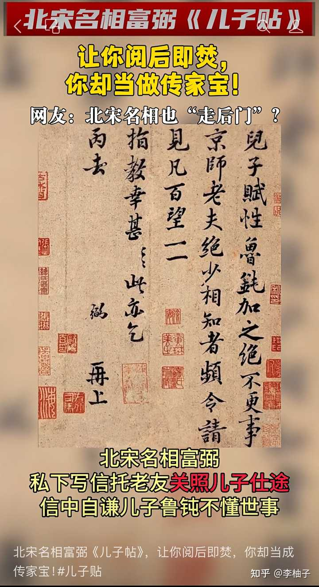
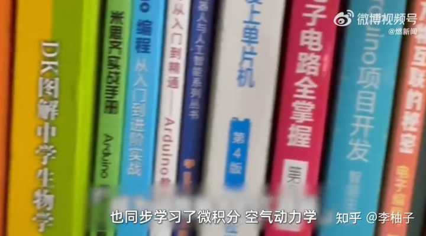
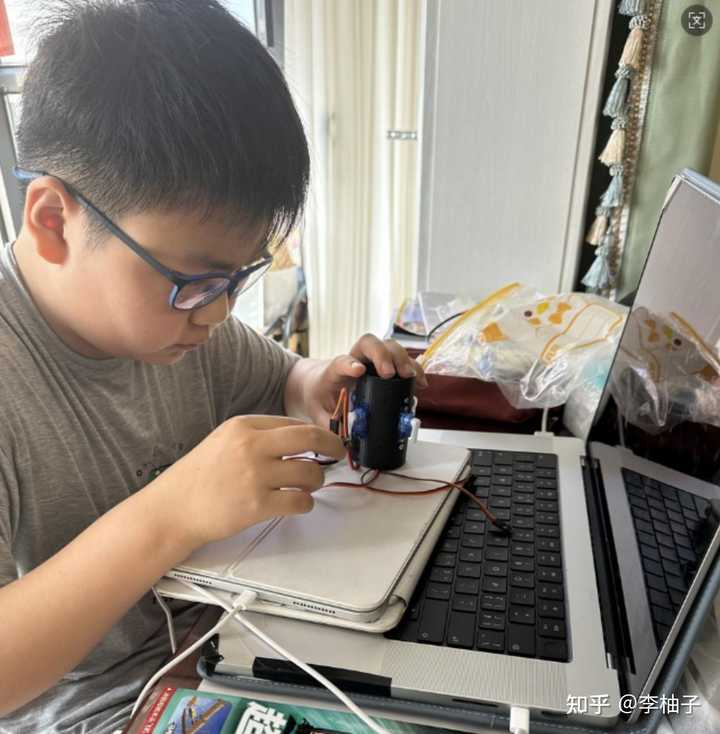
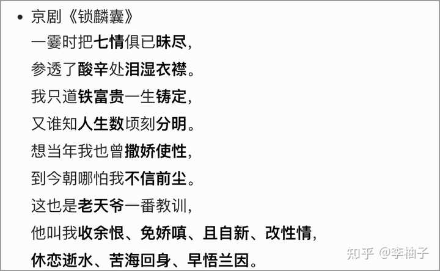
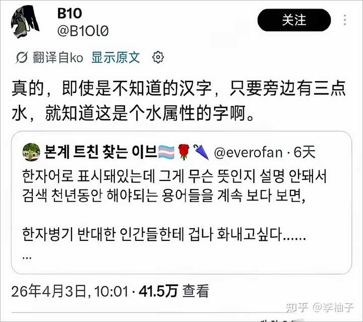
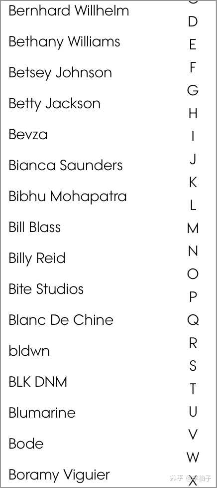

事实上，中国人，上到初中，就可以丝滑学所有专业了。上到小学5、6年级也行。地球表面，只有中国人可以。

因为，其他文字都是“表音文字”，只有汉语是“表意文字”，同时汉字有拼音了，又是“表音文字”。拼音还有音调标注，很强了。

bro确实很强，在家你可以喊我狗剩，但是出门，你必须叫我彪哥。你对哥的实力一无所知。

张雪，初中辍学，他的妻子说，是他自己花钱买资料，学的修车，学了1年就跟表弟开了一个修车店；

张雪的师傅牙哥，初中学历，手搓直升飞机；牙哥手下的小弟，大学生，跨行业学的机械。

吴谢宇上小学，去他爸的厂子看机械书。放在其他语言上，jio往后稍稍。

__如果，他们出生在欧美，自学，直接tm不识字，翻书不识字，跨专业不识字。跨专业就是一门新语言，造机车，打底得学4门专业。__

__放英语上，就要先学4门专业语言。会学出幻觉。__

叠buff，表音语言，文字本身不传达信息，文章信息密度低，不精准，还不能跳行读，不能扫着读，不能2倍速听，同时每年新造几千几万个字，没自净能力，活屎山，学习周期会更长。

__上面一段我打出拼音，感受一下，表意文字造成的阅读障碍。__

die buff de shi，biaoyin yuyan，wenzhang xinxi midu hen di，hai buneng tiaoxing du，buneng saozhe du，buneng 2beisu ting，tongshi meinian xinzao jiqian jiwan ge zi，meiyou zijing nengli，huo shishan，xuexi zhouqi hui geng chang。

看超过三分钟都得打胰岛素，唐份超标，微醺。

J\.K\.罗琳的《哈利·波特》，7本书，她造了大概750个单词，比如Acromantula，Occlumency。汉字是用已经有的字，去组词，表达新概念，八眼巨蛛，大脑封闭术。

我也拍脑袋造一个，buttoned ，我不说什么意思，别人永远不知道，嘿嘿。解释权在我。优势在我。

小说是要卖钱的，罗琳的造词量，算少的，甚至还给欧美扫盲带来了巨大贡献。行业大佬造单词，那才叫看不见车尾灯，想制造阶级壁垒，非常简单。

__一个冷知识，卖衣服、化妆、盖房子、卖炒面、摇奶茶、写代码、做机车\.\.\.__

__任何行业尤其是重资产行业，都不能只靠灵感，必须要有好几门专业知识的规训，要去看相关的专业书。__

几个大佬就可以定义一个专业，一个行业的经典书，也就是那几个人写的，小作坊下猛料，随手就可以把车门焊死。

神学、法律、医学，都是研究怎么控制老百姓的，有钱人才能学才能识字，可以随手定普通人的生死。搜刮老百姓，又来了一个搞税务的。

所以他们，真的很爱用名字命名，阿尔茨海默病（Alzheimer's Disease），就是叫阿尔茨海默的人发现的，Alzheimer's ，怎么可能看出来它到底是什么？

中国现在直接老年痴呆症，走你。我管你这个那个的。

__中国造新字，是需要国务院批准的，原则上不让搞，也就是你别搞。70多年了，日常通用新造字：几乎为 0。__

__也就是，国人这辈子只认识1000\-3000个字，就足够直接学所有的专业。看宋朝或者之前的书，文字也没更新，我们也识字。__

所以，中国人是地球街溜子，博学，儒雅随和，上知天文下知地理。喷人搞抽象玩梗暴典，也是地表最强的。

中文互联网非常好玩，视频，文字，都好玩，比其他语言有意思多了。而且还可以很浪漫。

__见字如见面，跨越几千年的交流，有没有很浪漫～__

alt="Image">

__同时，3000个汉字，可以无限组词，丝滑适应信息大爆炸时代，确实上分，繁荣昌盛。__

比如无人机、民用助力外骨骼、东北雨姐真带派、大胃袋这一块、鸡你太美。买了十斤牛肉，拿回家一看， 9\.5斤都是牛逼。

__所以，国人上到初一初二，甚至小学，任何设置培训班/专业的学科，打开专业书，就能直接学，都识字。__

__识字，识字，识字，不懂“对齐颗粒度”是什么意思，但是识字。Acromantula，Occlumency，Alzheimer's，这叫不识字。__

## 我写这类文，也是想鼓励和引导大家，有喜欢的东西学就好，不要怕，跟学历无关，这是老祖宗跨越千年的祝福和期望。老祖宗帮你到这了，我们跟张雪的区别是，学习的主动性，得自己去学。神仙来了，也要自己学进脑子里，当个事办

汉语的信息密度高，又精准，又简练，有一定的自净能力（垃圾词组和网络梗，会慢慢没人用），从什么都不懂的初级阶段，学到中级阶段，高强度学6个月就可以。再难一些的，学1\-2年就可以。除了学表音语言，得终身学。

所以，中国要定期搞民科大摸底，群众不好管啊～小学生都能自学，整出来炸药，把阳台炸飞了，可还行。

举栗子，小县城菜市场=985一条街，小升初学历，自学成才的牙医、中医、国学算命大师、修车师傅、推拿师、草药种植专家、自研老鼠药老鼠不死我死的药学家、点痣的美容师…

每条街都是这样，人杰地灵这一块。

往大爷堆凑凑，美以谈判专家、政治家、战略家、历史学家、东方莎士比亚、围棋大师、线下键盘侠…回家还是美食家、书法家、音乐家、养殖者专业户，儒雅随和。

贴吧，各大app，还有最接近神神的一群人，我常年潜水蛇吧，有人拍照问是什么蛇，单眼皮还是双眼皮，电话座机级别的像素，再冷门的蛇蛇，马上有大神秒答。

__国外不可能。包的。信我，我是个好人。__

热知识，韩国法律界和医学界，汉字是必学和必考科目，在韩国已经是阶级壁垒了。

韩国为了装逼，废了汉字，一片混乱后，为了恢复汉字使用，闹上法庭，但是律师就是不让，还闹过几次游行。

## 这就是文字垄断上的阶级壁垒

跨行业就是一门新语言，能随便收拾老百姓，法律医学金融，私立学校\+高学费\+推荐信\+文字语言隔离，上层人才能学，能掌握的。

不好意思，中国人有小学or初中学历，就能直接读法律了，很多提桶跑路的通缉犯，自学法律给自己量刑，被抓到后能跟法官辩好几个回合。老外是哭着求律师不要离开。

学历叫“敲门砖”，是筛选简历用的，不是不让我们学习的。

面条厂老板手搓直升飞机，中国14 岁初中生自学微积分半年手搓航空发动机，一点毛病没有。好舞不挑曲。

alt="Image">

看这14岁的小孩哥，还在学校门口吃火鸡面，喝旺仔牛奶，用小天才手表的年纪。

alt="Image">

评论区也是人才辈出，其实这是中国独有的。

alt="Image">

张雪这种，初中辍学，穷少年但是有志向的剧本，在中国的部队里有很多，叫兵王。

死命钻研业务能力，特种技能，枪械，装备，狙击，维修、驾驶、通信、雷达、导弹、炊事、卫生，立功受奖、转士官、上军校，可以看一下央7出的军人比赛。

老美呢，飞的飞机不同，专业用语不同，彼此之间就听不懂了，炸了飞机可还行。

## 地球表面，只有汉语是“表意文字”，其他文字都是“表音文字”，坐小孩那桌。欧美是发展太早，不是因为语言优秀

本来是“表意文字”的日本和韩国，去汉字化，去学“表音文字”，把自己的人民搞的不识字。

比如韩文，同音歧义极多（比如 “피고”= 被告 / 被害，写法一样、意思完全相反），必须靠汉字标注才能精准理解，让人咯噔。

__英语也是这个鸟样子，有种晕碳的美感。同时，英语适应不了新概念，每年造一两万个新单词，网红都能造，我san值狂掉。__

汉语，建筑行业造了1个新字，还是70多年前造的。化学领域发现新东西，也造过几个。

Ps：除非你能用语言赚钱，不然慎重下手，别爱我没结果。“表音文字”瞎鸡儿造词，越学越好勾八难学，一段时间没学就水灵灵忘了。如果没有钱挣，多看一眼都是浪费时间，我上去就是一个滑铲，辣鸡语言。

这个时间，你放在任何领域都可以学好了。英语专业的学生，考到8级10级，翻开任何一门专业行业的书，100%一脸懵逼，不识字，包的。打开儿童读物，都有不认识的单词。

想好了怎么拿语言赚钱再学，买定离手，垃圾语言也给你立了一个高门槛，别人学也费劲，你弯道超车，学日常英语\+商务英语\+你的行业英语，不要跨专业学。

## 我们跟张雪其实不是学历上的差别，是“人”的差别，必须国家出手管到成年

有的人，一出生，哭的那一声，他们在“人”的完成度上，已经是一个很完整的人，纯粹，专注，品质好。但是大部分人不是。

吴谢宇上大学把母亲刀了，诈骗一百多万，提桶跑路期间在酒吧当模子哥，又赌又搞黄色。这种人，初中给他放出去，很雷霆。

__张雪可以初中辍学混社会，大部分人就是不行，说直白点，大部人天生就带着性格缺陷来的，没有国家机器的镇压，出手管着，管到成年，不然街上一堆精神小妹，鬼火少年。__

__欧美快乐教育下，臭名昭著的teenagers，十几岁刀人也不犯法，金身buff，很潦草的。__

同时，还有我这种人，没大的性格缺陷，但是，人普通，性格普通，运气普通，天分普通，我甚至连最喜欢的东西都没有，有时候想吃点喜欢的，拔剑四顾心茫然…

叠buff，我爱好广泛\+三分钟热度，觉得好吃的东西，我会连吃3天，直接吃成不喜欢的，这蛇皮走位，可还行。

上个大学拿学历，也算是给了一碗饭吃吃的，学个手艺，有个专业，有一段真心快乐的大学时光，给人生保个底子。高考随便写写，也有个学可以上的。

还有，我同学在美国读研究生，一年学费60多万人民币，另一个同学是100多万。我们本科学费一年5000块钱，九年义务教育更便宜，这个价格给管管孩子，还要什么自行车。

__想搞出事业，可以去发掘自己喜欢\+有天赋的，保持专注度就可以。跟学历没关系的。__

## 汉字是老祖宗给我们的财富，穿越千年的美好祝福，就是让我们喜欢什么就去学什么的

__学工科，汉语很精简准确，2倍速去听视频，也能听清楚。学文科，汉语又很浪漫优美。__

京剧《锁麟囊》。仔细读哦，感受中文的美感\+精准\+精炼。这信息密度，颤抖吧地球人。

alt="Image">

英语。瞬间拉完了。

![Peking Opera: The Jewelry Purse In an instant, all my emotions are dimmed and gone, I've tasted bitterness to the full, my tears soaking my gown. I once thought wealth and rank were fixed for life by fate, Who knew life's fortunes shift so suddenly, so clear and straight? In my younger days I was willful, spoiled and proud, Now I can hardly believe those past days, gone without a sound. This is a lesson Heaven sends to me in earnest, Bidding me let go of grudges, cast away my petulance, to mend my ways and change my nature, Linger not on bygone waters, turn back from this bitter sea, and early understand the cause of all destiny.](attachments/c9e96b377cede385.jpg)

alt="Image">

## 下面是举例子，真把英语当语言去学的朋友们，会懂我在说什么。不会说的朋友萌，先不要0帧起手搞win学，可以先去认真6个月再来

__林黛玉去贾府前，严格按 “拜师上学”，也就跟贾雨村学了1年，已经文采斐然这一块。几百年来国人上私塾，也就上个几年。__

__清朝把国人搞的不识字，全国文盲率80%\+，新中国成立后，办夜校、冬学、识字班，用10年完成扫完主要文盲。__

只有汉语，没有“功能性文盲”这个概念。什么是功能型文盲？就是生活中识字有障碍， 跨行业不识字。我只会说英语\+本行业的英语，其他行业不会。cup脑容量有限。

__【功能型文盲】__

我去上海自然博物馆，有个蝴蝶展，秒变绝望的24k文盲。蝴蝶的名字都不认识，还想学机械学修理？往后稍稍。

1\.Old World Swallowtail（金凤蝶）

2\.Golden Birdwing（金裳凤蝶）

3\.Monarch Butterfly（帝王蝶 / 君主斑蝶）

4\.Silver\-washed Fritillary（银纹豹蛱蝶）

5\.Painted Lady（小红蛱蝶）

6\.Red Admiral（大红蛱蝶）

7\.Swallowtail Butterfly（玉带凤蝶）

8\.Purple Emperor（紫闪蛱蝶）

9\.Glasswing Butterfly（透翅蝶）

10\.oliath Birdwing（歌利亚鸟翼凤蝶）

11\.Menelaus Blue Morpho（蓝闪蝶）

12\.Rajah Brooke's Birdwing（布鲁克氏裳凤蝶）

而且，不只是蝴蝶，鸡鸭鱼鹅牛猪…不同部位，不同生长阶段，野外的家养的森林里的，都是完全没有联系的。

1\.chicken\(鸡\)

2\.hen\(母鸡\)

3\.cock\(公鸡\)

4\.pheasant\(野鸡）

我直接一个mmp。

Old World Swallowtail，跟金凤蝶，有什么关系？就是一个六亲不认。

Old（老的 / 旧的），world（世界；地球；领域；世人；生活圈子），swallowtail（燕尾蝶；凤蝶，燕尾服；尾翼状部件）

Old World Swallowtail，我翻译成“老地球的燕尾服”，一点毛病没有，格局一下就打开了。

奶龙“让美国再次伟大 = Make America Great Again”， Great当形容词，伟大的，重要的，巨大的。

我要是翻译者，我就给它翻译个“让美国再次巨大”，也一点毛病没有。掌声。

汉字，伟大就是伟大，巨大就是巨大。3000字但是极度精准，秦始皇摸电门，赢麻了。

## 识字识字识字，汉语，3000字就够你翻开所有书，都识字，你不能直接懂意思，但是你识字，还能通过偏旁部首，去理解什么意思

虫子旁是蝶、蝉、蝇、蚊、蛇、蛙、虾、蚌，三点水是江、湖、海、溪、池、潭、湾、港、浪，这叫“表意”文字。

同时还会加一个定字，癌症，老年痴呆症，抑郁症，躁郁症，让你知道它的归类。

懂一点点汉语的外国人，在油管上说，看见汉字，河、湖、海、江 → 看见「氵」就知道和水有关，松、柳、桃、林 → 看见「木」就知道和植物有关，这就是“表意文字”，可以直接传达信息。

alt="Image">

所以天然的优势是，你只要识字，哪怕法律、医学、机械、生物…这些在国外跟神一样的学科，你没有识字障碍，可以直接学。

__“表音文字”是读的出来，但传递不了信息，直接原地不识字，或者你认识，但是一次多义，让你死活翻译不准。认识字也tm=不识字。__

我从自然博物馆出来，拐弯去买甜甜圈，甜甜圈上面放的小装饰，名词我拿不准几个。是我一个土狗能吃的吗。

1\.marshmallow （棉花糖）

2\.sprinkles（彩糖）

3\.maple （枫糖）

4\.glaze （透明糖衣）

5\.icing （糖霜）

6\.frosting（ 厚糖霜）

7\.syrup（糖浆）

8\.drizzle （细线淋酱）

9\.caramel （焦糖）

10\.molasses（ 糖蜜）

11\.gummy （软糖）

12\.jimmies （糖屑）

再去逛商场，商场里的英语单词的品牌，一个不认识，我热泪盈眶。

截图VOGUE杂志上的品牌，可以读出来但就是死活不认识，认识了也翻译不准，这就叫“表音文字”。

我同学在美国上研究生，白人教授做ppt，把英语强行往“表意”文字上扯，给我看乐了。

alt="Image">

这还只是日常生活中的障碍，张雪做机车，需要学车辆工程、机械设计制造及其自动化、电气工程及其自动化、能源与动力工程…

作为一个被英语创飞，学出幻觉的人，我直接tm的原地暴风托马斯回旋，扭头去k药，信上帝这样子。

__【接着，感受一下跨行业，一词多义，行业壁垒的魅力】__

举一个最基础的单词，fine，日常、法律、金融、工程、艺术、机械，意思全都不一样。

1\.最日常意思：好的

2\.法律 / 行政:罚款；罚金

3\.金融 / 会计:微小差异；细微差额

4\.机械 / 工程 / 制造:精密的；精细的；微调

5\. 化工 / 材料 / 物理:细小的；微粒的

6\.艺术 / 美术 / 设计:美术；纯艺术

7\.餐饮 / 品酒 / 咖啡: 优质的；上等的

7\.合同： 细则

好家伙，搁这养蛊呢。这种单词好几百万个，一lemon逼，book思议，伤害了world 还excel而过。同时，表音文字适应不了信息大爆炸，每年都在创新词中。

你怎么学？所以国外的法律、医学、机械\.\.\.跟神一样，专业领域都自学不了，语言上就给你卡住了，直接tm不识字。亿点小震撼。

__【新造单词这种事，也很头疼】__

中国的“无人机”，是几千年前就有的字，组词。含义很清楚，就是无人机，不管什么行业都用这个词，但是，英语，不同的领域，语言不是一套的，大家各说各的。

奶龙特朗普爱用drone，放在不同的领域意思不同，即使你认识这个单词，就是猜不出来：

无人机（特朗普口语只认这个）、雄蜂（不采蜜、只配种的公蜜蜂）、懒人\+游手好闲的人（书面旧用法）、低沉嗡嗡声（机器和乐器持续低音）。

奶龙就只说一个单词drone，我怎么知道他指什么，救命！

无人机，加上缩写，有7个表达（英语是很臃肿很长的英语，老美喜欢用缩写）。

1\.Drone：最通用、最口语化，日常 / 新闻 / 口语高频使用

2\.Unmanned Aerial Vehicle \(UAV\)：正式 / 技术 / 军方标准说法

3\.Unmanned Aircraft System \(UAS\)：更完整的系统级术语

4\.Surveillance drone：侦察无人机

5\.Combat drone：察打一体无人机

__【你很会学是吧，那就先从学费上卡住】__

老美培养一个律师，医生，学费已经上百万、千万了。我这么用力了你怎么还活着。

同时还需要大佬推荐信，再卡一道，《肖申克的救赎》，黑人写信要书要不来，那安迪就能要来，用词上一看就是自己人。

总统演讲，用词很简单，是因为讲复杂了，老百姓听不懂啊，语言系统不是一套的。

但是中国的农村老大爷，去听戏曲，比较复杂的京剧《霸王别姬・看大王在帐中》，听懂没问题：

看大王在帐中合衣睡稳，我这里出帐外且散愁情。轻移步走向荒郊站立，一阵阵朔风透骨酸寒。

《清明上河图》，集市上，有针灸的、说书的、美容的、搞甜品的、做手工艺的、唱戏的、写书法的…国外的画在干嘛呢，一堆人围着一个神棍，听神棍讲经书，这叫释经权，说啥是啥。

罗翔，口头禅“法律神圣不可侵犯”，这句话跟“法律”俩字绑定在一起，有迷惑性。

看罗翔多一点的朋友们都知道，他想要的是国外上层阶级的“释经权”，上层人有钱，掌握着对医学、法律、经济等的权利，跨行业就是新语言，账单都不给你看懂的。

但是在中国，抱歉办不到，很多小升初学历，踩缝纫机的人，在监狱看法律书，给自己量刑给狱友量刑，手拿把掐，判下来跟他们自己估计的也差不多。

放在欧美，律师就随便摆弄你，罗翔总是一副郁郁不得志的样子，恨这个恨那个，根子在这里。

__最后__

汉字是老祖宗给我们的财富，穿越千年的美好祝福，就是让我们喜欢什么就去学什么的。学工科，汉语很精简准确，学文科，汉语又很浪漫优美。

甚至你想骂人，它都可以给你地球表面最莎士比亚的词汇，地表最强的语言，没有之一。格局打开，文化自信起来好吗。

我们有热爱的领域，有天赋的领域，不要害怕，就像张雪一样，坚持学就好了。也可以引导一下孩子，让孩子研究专业书就行。当个事办，我是个好人。

[如何看待美国识字率只有79％？](https://www.zhihu.com/question/665901276/answer/2000719694106230958)
