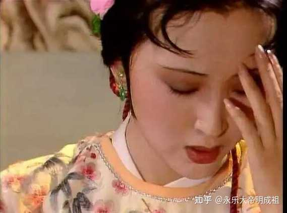
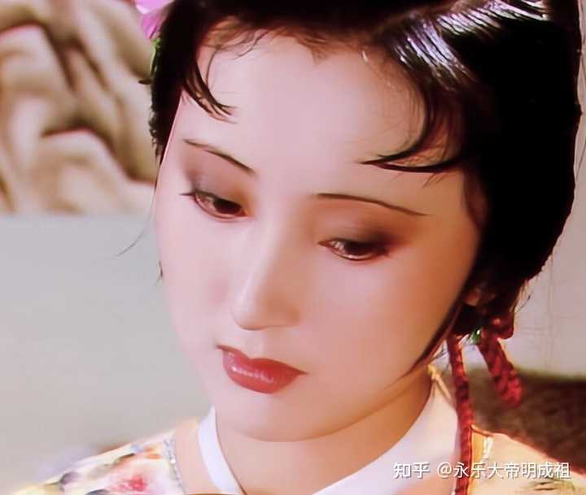

如何评价红楼梦里的林黛玉？ \- 永乐大帝明成祖 的回答

姑苏林黛玉，是中国文人能对女性寄托的最美好的形象。

她是林氏四世列候之家出身，父亲是探花郎，母亲是保龄候之女与二代荣国公的嫡女。家族人丁寥落，一脉单传，少年丧母，远赴京都，寄居于外祖母之家。

高贵的出身，出众的诗文天赋，书香门第之下，两榜进士担任家庭教师熏陶出来的言行举止。

而这些背景，多数为作者简短带过，并不冗长。

自入府之刻开始，作者用一笔笔细节，让我们了解到，她是骄傲的，心思细腻的，带着一缕挥散不去的乡愁，这样便已经使人觉得我见犹怜了。

不过，到了这里，仍然只是林黛玉这个人物整体魅力的繁花一瞥。

作者从来没有直接描写过黛玉是怎样去思念父母的，林如海病重，来信让黛玉回家探望，贾母差遣了贾琏护送，全程照管。

出发之前作者没有写林黛玉对父亲的担忧，归来之时，林大人已经安葬完毕，黛玉和贾宝玉再见面时作者不去细写她的悲哀伤痛，只说和宝玉见面二人悲喜交加一阵，之后就是打理房屋，分配礼物给各位姐妹和表哥。期间还捎带手嫌弃了一把宝玉转赠的皇室礼品鹡鸰香珠。

要知道，林家人丁单薄，几房旁支偏房的血缘和林如海都隔了远了。林黛玉此番归来，已经是真正的无依孤女，父母双亡。从此是真正长久在贾府寄人篱下了。

然而下笔神鬼莫测的作者却几乎不愿花费半分半毫的笔墨去阐述林黛玉自葬父到归来以后的伤心难过。

之后林黛玉在书中两次登场，先是前面提过的伶俐的打理房屋，安排礼物。

而再下一幕登场却是在宝玉大观园展现诗才，长了脸，他的小厮们趁他高兴，讨了他身上一大堆饰品器物当赏赐去了。

回到房里时，丫鬟们发现了宝玉身上饰品大都不见了，叨咕了一下。林黛玉误以为自己亲手为贾宝玉制作的香囊也被贾宝玉随手送给了小厮，顿时赌气起来，立刻就进房里去要把自己正在为他制作的另一个香囊给剪掉。

谁知宝玉却将她的香囊单独珍藏在内衬里，叫她又愧又气。宝玉蹬鼻子上脸，怒摔香囊到黛玉怀中，黛玉立刻就留着眼泪要把那个好的也剪掉。

之后贾宝玉赔不是，苦苦哀求，二人和好，宝玉仍拿那荷包带上，黛玉破涕为笑，对着宝玉娇嗔玩笑了一阵。

这一段，87版红楼梦电视剧演的极好。我实在不知道为什么网上会有那么人流传着87林黛玉被演绎的小气爱哭了这么个说法。

87版的导演显然完全理解作者这奇妙的下笔思路。

这次回来贾府，林黛玉的处境远比上次父亲还在时来的要凄凉。可作者偏不再写她为思念父母而哭，反而写得她利落的带着丫鬟整理住处，分配礼物，鄙弃王爷礼物，赌气铰烂香囊，很快解气之后，又和贾宝玉玩笑起来。

作者为何这么下笔，难道林黛玉是个毫无孝心之人，对父母离世毫不在意吗？这次真正无依无靠了，要长久的寄人篱下，依托外祖母教养了。她不是心较比干多一窍吗？

多愁善感去哪里了？梦忆天伦去哪里了？

乍一想，好像确实有点不合适。然而这一回叫做林黛玉误剪香囊袋，贾元春归省庆元宵。看到这一回后半部分，直教人恍然大悟，对作者佩服得五体投地也！

因为这一回，作者要开始向我们展示林黛玉这个人物另一半极富魅力的地方，她的聪慧灵秀。

元妃省亲，命众人题一匾一咏，黛玉有心当夜大展奇才，要压倒众人。可惜元妃只让诸女一人一首，林黛玉也只得应付一手五言律。好在贾宝玉奉喻写四首，一时半会儿憋不出来，林黛玉助他作弊，不过略一沉吟，便已经有了一首。

就是著名的《杏帘在望》。宝玉看了顿时觉得比自己前三首加起来十倍还强。看得元妃也是喜出望外，认为弟弟进益了。

这一夜，先是黛玉宝钗二人的诗作被认为明显强于贾府姐妹，又是黛玉做抢手的一首《杏帘在望》技压全场。

可见林黛玉才华横溢，且有争强好胜之心。

此时回过头来看前面她从苏州回来之后作者着墨之处，方知何谓神来之笔矣！

这样一个才气纵横之人，突出一个慧字儿，是个女知识分子。

正是因为慧，所以透。

到了真正父母双亡，彻底寄人篱下时，反而不必着墨写她如何悲伤自怜了。倒是写了她伶俐办事，赌气娇嗔，才高自诩的几场戏份。

林黛玉是个住处像男儿书房的女子，醉情诗书，聪慧高才，这样的人真到了极伤悲时，反而不显。因慧而透，悲伤自隐蕴内中，不必泪于人前。这样更显她高傲出尘，自有一己之宇宙方圆。这正是有独立而高洁精神世界的知识分子的特征。

作者这样处理，真是万分恰当。

这样的妙笔，在前八十回数不胜数。

背景，容貌，聪慧高才之后，作者又给我们看她至情至性的一面。

她孤高自许，目下无尘，说话有时不太在意他人所处场合感受的周全。与宝钗的随分从时，滴水不漏形成鲜明对比。

但这种目下无尘，不是嫌贫爱富，攀龙附凤的模式，她嫌弃过皇家手串，也看不上刘姥姥的粗俗作风，只是因为他们不合自己的气意，而非黛玉对他们有什么恶意。

这一面，最易受人误解的，是林黛玉与贾宝玉相处时，多次出现的争吵，使性子，垂泪，吃醋等场面。

许多不读红楼，或者对红楼不愿深入了解之人，自然而然的将林黛玉视作了哭哭啼啼的无聊小性子女人。

这当然是一个巨大的误解。

林黛玉和贾宝玉之间的相处，是不能脱离时代来看的。

作者借贾府中秋夜宴贾母之口，对前代诸项才子佳人小说话本进行了批判。说他们写的东西，不过是意料之中，情理之外。大户人家的千金小姐，永远只带一个丫鬟，见了男人立刻情定终生。与现实中大户人家的奶妈丫鬟随从层层包围，断无空隙的情况不符合。更兼那大小姐知书识礼，若是只凭一面之缘，就想与那男人厮守，又如何称得上才子佳人了？

而贾宝玉和林黛玉，正是中国古典小说中，开天辟地头一遭描写男女之间如何渐生情愫，可知其由何而起，一往而深。

但是他们仍然是那个时代的人，必然是符合作者强调的合乎情境的状况下的。

现代人已经看惯了古装偶像剧里，男女主角毫无顾忌的互诉衷肠，搂搂抱抱，卿卿我我，私定终身的画面。

全然不知道横亘在林黛玉和贾宝玉之间的巨大的礼教铁幕。林黛玉和贾宝玉之间存在着科幻小说《三体》里提到的那种猜疑链。

两人是不能够对彼此之间的爱情透露半个直接的字眼儿的，只能想方设法，从旁试探。

话到唇边，柔肠百转，终是不能启齿。

尤其对于林黛玉来说，这真可谓如履薄冰，咫尺沉渊。贾宝玉好歹是个爷们儿，林黛玉可是待字闺中的官宦人家孤女，名节一事上，分毫不能出错。

哪怕她自己至情至性，孤标傲世，不在意凡俗偏见，她毕竟还背负着父母的身后名，外祖母教养的清誉呢？她母亲可是金尊玉贵的贾敏，父亲是祖上四世封侯的探花郎，林黛玉不顾自己还能不顾父母吗？

还有一层是林黛玉是个极骄傲的人，她断然是不能接受万一贾宝玉只把自己当做个玩物来对待的。这也是为什么有好几次贾宝玉只是亲昵的开了些玩笑，她却勃然大怒起来。

现在的人已经习惯了古偶里痞子样男主和女主打黄色擦边球笑话，油腔滑调的做派。

林黛玉是不可能接受贾宝玉这样的，更不可能来个袒露心迹，倒追一把，不成就拉倒？

这样就脱离了合情合景的时代实际了。

因此，林黛玉和贾宝玉相处的前期，出现的那些吃醋，耍小性子，发脾气等等行为，是她在发乎情，止乎礼，战战兢兢，如履薄冰的境况下，背负着父母和外祖母清誉的压力下，所能做到的极限了。

纵使肝肠寸断，也不过说一句“我为的是我的心”罢了，难道还能来句I love you？

彼此不能透露底牌，不能明了心事，互相试探的情况下，怎能叫她不气急落泪？

但是，一旦那日无意间听见贾宝玉与史湘云之间的对话之后，林黛玉便已经知道双方互为知己。从此再无猜忌了。

那日黛玉听罢，心中又惊又喜，又悲又叹。

可以说二人情意在三十二回之后便已相通了。

哪有天天耍小性子哭哭啼啼了？说这话的分明没好好看书，纵是87红楼，过了这一段，又哪里还有林黛玉吃醋多少的戏份了？

在这之后，甚至是有关贾宝玉婚姻的流言，也不见林黛玉再做顾影自怜之举了。那天误会贾宝玉关门绝客，只接待宝钗，不过那宝玉解释一句，立马散去怒气，巧笑嫣然的开着玩笑。自此之后只见她越发娇俏风趣，妙语连珠，恣意挥洒才华性情。

这样的女子，才是真正天上仙品。

其实，在这之后，林黛玉偶尔出现的忧愁哀思，我认为并非是拘泥于宝玉黛玉婚姻大事的着落，那样太俗套了。

那是林黛玉寄人篱下之时，午夜梦回之中，姑苏城下，小桥流水的涓涓乡愁。又是一个聪慧有识之士，感叹朱楼渐颓，韶华易逝，如秋临花落，幻梦醒散的悲叹。

高鹗续本以及诸多将目光着眼于区区宝黛婚姻之中的红楼续书作者，在这一点上未免格局浅薄了些。也怪不得有这么多人会认为癸酉本吴氏石头记结构上更暗合前八十回，最大的问题就是出在黛玉身上。

黛玉是红楼梦的女一号，在千红一哭，万艳同悲的大劫难中，她绝无可能为了区区婚姻之事就魂归离恨天。

绛珠仙子下凡，是来血泪报恩的，她与神瑛侍者的情缘，在前三十多回就已经灵魂相通，了无遗憾了。

作为慧透情根的女主，她本应在全书的后半段再迎来一次升华。在贾家的败亡过程中，竭尽全力，淌尽血泪，求仁得仁的为神瑛侍者报恩还情。

无论是林黛玉自己的葬花词，贾宝玉的姽婳词，还是芙蓉女儿诔，均暗示出林黛玉将有一段勇烈奋力之事。

葬花词节选：

尔今死去侬收葬，未卜侬身何日丧？

侬今葬花人笑痴，他年葬侬知是谁？

芙蓉女儿诔节选：

高标见嫉，闺帏恨比长沙；直烈遭危，巾帼惨于羽野。

姽婳词就更不必说了，姽婳将军林四娘更是巾帼英雄。

只可惜红楼作者笔落惊三界，文成泣神佛，终究后半部过于逆天，不得现世。

林黛玉也因此缺了最后一次升华，有才有貌，至情至性，可惜不能得仁得勇。

饶是如此，残卷红楼之姑苏林黛玉，仍是目前旷古绝今的女性艺术形象。当得起贾雨村口中的，天地间钟灵秀气所生人物之造化。

只恨红楼残卷，不得见绛珠仙子全貌，所谓最高不过离恨天，最苦不过长牵念，正是此意。倘若他日得偿所愿，便到那灌愁海倾倒十年阳寿还愿又有何难？

alt="Image">

alt="Image">
