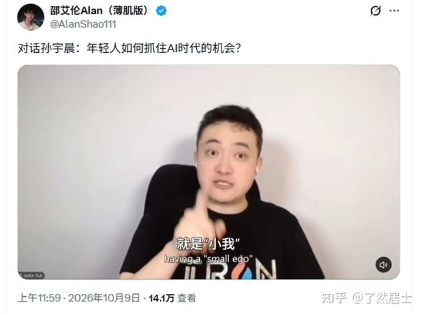
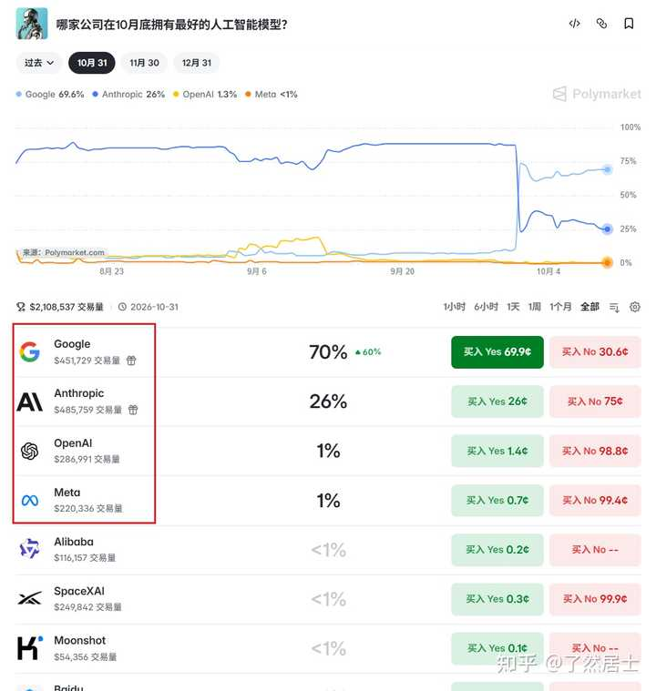
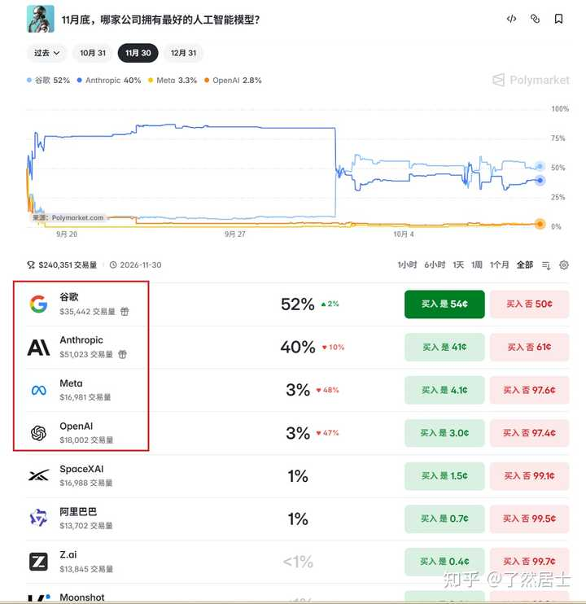
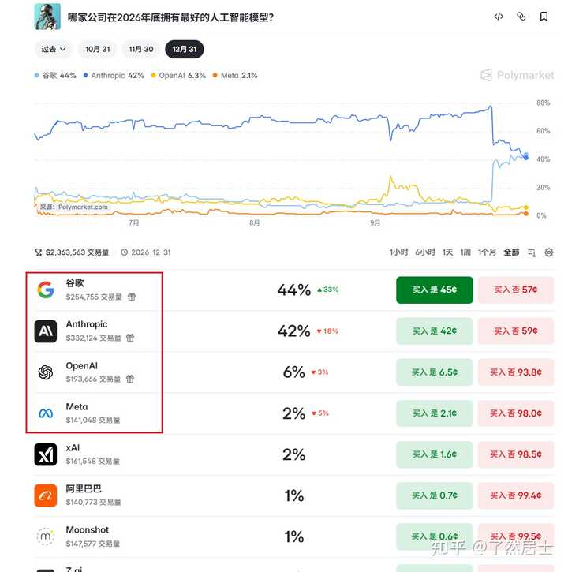
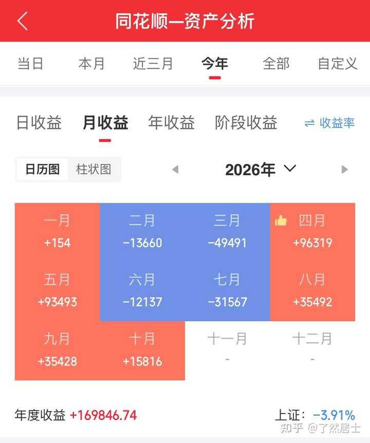

如何评价邵艾伦对话孙宇晨4\.5小时？ \- 了然居士 的回答

__孙割和邵艾伦最新访谈解读：__

alt="Image">

\*\*视频《对话孙宇晨：年轻人如何抓住AI时代的机会？》\*\* 是邵艾伦（Alan Shao）与波场TRON创始人孙宇晨的超长访谈，时长约4小时22分钟。坊间有言，__孙割的产品你别买，孙割的话你要听__。整场访谈聊得很杂，从早期的《财富自由革命之路》回顾，到AI、健身、加密与人生体验，梳理一下：

### 1\. 身体是第一底层资产：“肌肉也是资产储备”

在这场访谈里，他提到了一个很有意思的视角：__把健康和肌肉当成长期资产负债表来管理。__

以前大家总觉得脑力劳动和体力劳动是对立的，甚至很多创业者以“熬夜、透支健康换财富”为荣。但他转变观念，让AI接管自己一天的饮食、训练计划和睡眠监测，配合系统性的体检，把健康当成最高优先级的战略来做。

资本市场里我们常讲“本金安全”，在人生这场长跑里，身体和代谢机能就是唯一的本金。钱没了可以再赚，身体的负债一旦爆仓，没有任何外部救市基金能把你拉回来。把肌肉和精力当成资产去积累，而不是当成消耗品去挥霍。

### 2\. 年轻人重回20岁：做决策前先“探图”

有人问他：如果重回20岁，没钱、没人脉、没资源，该如何重新起步？

他的答案是：__利用AI消除信息差，先“探图”，再开打。__

就像玩开放世界游戏一样，很多人的问题在于刚出新手村就急着做决定——盲目买房、草率选专业、跟风创业，全凭有限的身边圈子和道听途说。而在AI时代，工具已经抹平了极高门槛的专业壁垒：

__用AI寻找方向__：去算不同行业的ROI，去对比全球市场的商机（比如API套利、跨境出海）；

__寻找信息差__：做重大决策前，让AI帮你把所有底层变量推演一遍，看清全貌再落子；

__看好的方向__：他依然极度看好科研、生物、健康与AI深度结合的硬核赛道，那里才是未来产生巨大效率红利的地方。

学习本身不值钱，学习之后能够落地转化为行动，利用信息差形成降维打击，才是普通人破局的抓手。

### 3\. 30岁后的战略：把世界看成“版本更新”

人过了30岁，最容易陷入的陷阱就是“经验主义”，误以为过去让自己赚到钱的路径可以通向未来。

在这场对谈里，他把现实社会比作一款大型游戏——__世界每天都在“版本更新”，规则在变，环境在变，你必须保持流动性与选择权。__

保持资产的流动性，保持心态的开放性，不把自己锁死在单一的旧跑道上，是30岁后对抗中年危机最好的解法。

### 4\. 财富自由之后：先自由，再谈财富

十年前他写过《财富自由革命之路》，十年后再谈这个词，定义已经完全变了。

很多人以为财富自由就是银行卡里有一串冰冷的数字，然后彻底躺平不用上班。但他反复强调：__真正的顺序往往是“先自由，后财富”。__

自由是选择权：财富买不来真正的感情，也解不开所有生活的死结，金钱有它极其明确的边界；

为什么自由了还想上班？ 人生并不是为了消费而存在的。纯粹的消费只会带来钝化，真正的多巴胺来自创造、来自探索商业和技术的边界；

玩家心态看“地球Online”：人生没有标准答案，先上路、先体验（比如去太空），再回过头来赋予它意义。多创造、少消耗，在产出与休息中找到自己的节奏。

\-\-\-\-\-\-\-\-\-\-\-\-\-\-\-\-\-\-\-\-\-\-\-\-\-\-\-\-\-\-\-\-\-\-\-\-\-\-\-\-\-\-\-\-\-\-\-\-\-\-\-\-\-\-\-\-\-\-\-\-\-\-\-\-\-\-\-\-\-\-\-\-\-\-\-\-\-\-\-\-\-\-\-\-\-\-\-\-\-\-\-\-\-\-\-\-\-\-\-\-\-\-\-\-\-\-\-\-\-\-\-\-

其中有很多令我深思的地方，十年码农生涯、四年大厂沉浮，拿健康换数字，直到身体接连亮起黄灯，才舍得停下来自省。好在眼下我已找到人生的主旋律，及时醒悟：__富在术数，不在劳身__。保持良好的心态和健康的身体才是人生的主线任务，每年赚个二三十万足矣，克制贪念，慢慢变富，竹杖芒鞋轻胜马。

昨夜美股大跌，OpenAI年化营收远低于市场此前流传的数字，引发AI概念股大规模抛售，纳斯达克指数当日收跌逾1%，10月8日英国《金融时报》报道，OpenAI在最新投资者文件中显示，__截至9月底的年化收入"接近500亿美元"，远低于上月末市场广泛引用的700亿美元预期__。针对该报道披露的年化收入数据，CNBC 随后也向相关方求证并证实了该数据的准确性。

要我说都是鬼故事罢了，OpenAI还没上市呢，OpenAI自己也说了没义务对外披露__详细的财务报告__。就是涨多了回调，投机客们看到鬼故事恐慌跑路。而且跌这么点，连大额加仓的水准都没到，今天白天24h夜盘里面就涨回来了，A股里的纳指ETF今天收盘甚至还是涨的，再说了AI也还没完全定型，OpenAI就能定义AI的最终形态了吗？以后在不在桌上还不知道，起码目前没有显露出优势，你要说Claude收入炸了，那我确实会担忧一下，但要知道目前Claude还在批量封禁越北用户账户中，传闻多至上千万户。

alt="Image">

alt="Image">

alt="Image">

前四AI很稳定，谷歌、Anthropic、OpenAI、Meta，最有希望年底夺筹的是谷歌，我也是Gemini的资深付费用户了，期待一下新产品发布。 目前海外AI我主要用Gemini和Claude，Claude免费版也很不错了。

今年收益基本上没什么波动，持仓体验良好，只有纳指相关ETF。

alt="Image">
