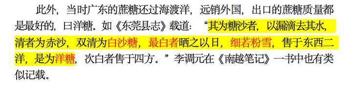
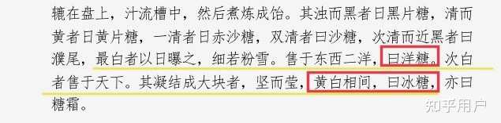
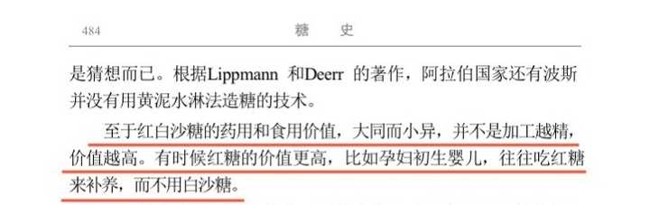
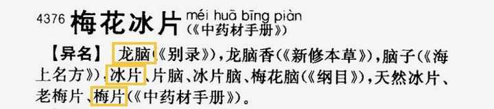
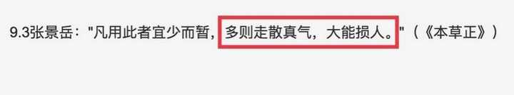
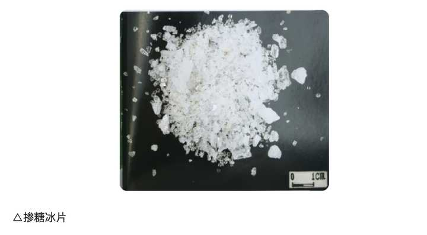
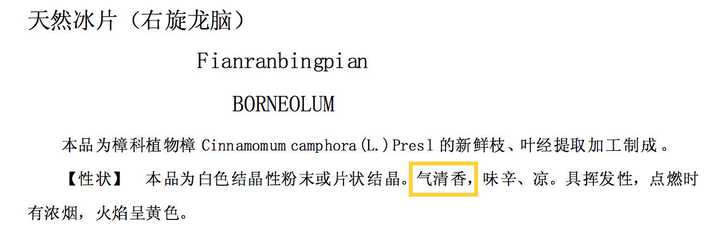
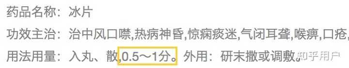
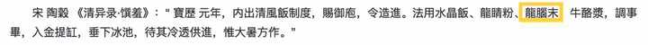
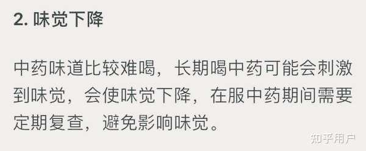

“燕窝有毒”曾经是我觉得最荒谬的说法之一，但随着对红楼梦阅读的深入，我遗憾地发现这很可能是真的，原文有很多线索在提示这一点。

不过“毒”不在燕窝上，而在糖上。

薛宝钗送来的糖叫“洁粉梅片雪花洋糖”，关于洋糖是不是冰糖，梅片是不是冰片历来有争议，我会先从梅片和洋糖入手，把梅片、洋糖解释清楚了，再来谈原文中的线索。

申明：__洋糖有毒是一项严肃的指控，我会用详实的证据来为我的分析负责。__

## 一、关于洋糖

### 1、洋糖是白砂糖，不是冰糖

（1）根据季羡林在《糖史》中的考证，在机器制糖发明出来之前，中国明清时代的洋糖特指白砂糖：

alt="Image">《糖史》

（2）洋糖和冰糖明确不是一种东西，首先他们制作的方法不同，洋糖是甘蔗榨出的原糖直接脱色后的结晶，冰糖是洋糖煎化之后再冷却凝结而来：

![造 白 糖 凡 闽 广 南 方 终 冬 老 蔗 ， 用 车 同 前 法 。 榨 汁 入 缸 ， 看 水 花 为 火 色 。 其 花 煎 至 细 嫩 ， 如 煮 羹 沸 ， 以 手 捻 试 ， 粘 手 则 信 来 矣 。 此 时 尚 黄 黑 色 ， 将 桶 盛 贮 ， 凝 成 黑 沙 。 然 后 以 瓦 溜 教 陶 家 烧 造 置 缸 上 · 其 溜 上 宽 下 尖 ， 底 有 一 小 孔 ， 将 草 塞 住 ， 倾 桶 中 黑 沙 于 内 。 待 黑 沙 结 定 ， 然 后 去 孔 中 塞 草 ， 用 黄 泥 水 淋 下 。 其 中 黑 滓 入 缸 内 ， 溜 内 尽 成 白 霜 。 最 上 一 层 厚 五 寸 许 ， 洁 白 异 常 ， 名 曰 西 洋 糖 。 西 羊 色 白 美 ， 故 名 。 ． 一 造 冰 糖 者 将 洋 糖 煎 化 ， 蛋 青 澄 去 浮 滓 ， 候 视 火 色 。 将 新 青 竹 破 成 篾 片 ， 寸 斩 撒 入 其 中 。 经 过 一 宵 ， 即 成 天 然 冰 块 。 造 狮 、 象 、 人 物 等 ， 质 料 精 粗 由 人 。 凡 白 糖 有 五 品 ， “ 石 山 " 为 上 ， “ 团 枝 " 次 之 “ 瓮 鉴 ” 次 之 ， 颗 ' 又 次 ， “ 沙 ， 为 下 。](attachments/3cd10096cdd1e95f.jpg)

alt="Image">《糖史》

（3）他们的颜色形状也不同，洋糖是极白的白色，冰糖是黄白相间，洋糖细若粉雪，冰糖凝结成块：

alt="Image">《糖史》

### 2、洋糖和冰糖的药用和食用价值不同

（1）糖不是越白价值越高

alt="Image">《糖史》

糖越白说明加工得越精，也就是经过了越多的脱色提纯处理，这样制作出来的糖，营养流失的也越多，比如今天我们就把特别白的机制白糖叫做垃圾食品。

所以在用来补身的时候，白糖不一定是最合适的，特别是对本就虚弱、需要特别营养物质的病人来说。

（2）冰糖比洋糖更适合用来搭配燕窝

《中药大辞典》上记载冰糖的功用是“补中和胃，润肺止咳”，特别提到可和燕窝搭配：

![1950 ） # 唐 目 》 ）
〖 基 原 ] 为 禾 本 科 甘 蔗 属 植 物 甘 蔗 S “ c 靛 “
Roxb. 茎 中 的 液 汁 ， 制 成 白 砂 糖 后 再 煎 炼 而 成 的 冰 块 状
结 晶 。
〖 原 植 物 〗 参 见 “ 甘 蔗 ” 条 。
〖 药 性 〗 《 本 草 再 新 》 ： “ 味 甘 ， 性 平 ， 无 毒 。 人 脾 、 肺 二 经 。 ”
〖 功 用 主 治 〗 补 中 和 胃 ， 润 肺 止 咳 。 主 治 脾 胃 气 虚 ， 肺 埤 ]
咳 嗽 ， 或 痰 中 带 血
1. 《 纲 目 》 ： “ 润 心 肺 燥 热 ， 治 嗽 消 痰 ， 解 酒 和 中 ， 助 脾 气 ，
缓 肝 气 。 ”
2 ． 《 本 草 逄 原 》 ； “ （ 治 ） 口 疳 ， 平 补 肺 胃
3 ． 《 本 草 再 新 》 ： “ 补 中 益 气 》 和 胃 润 肺 ， 止 咳 嗽 ， 化 痰 涎 。
4 、 《 随 息 居 饮 食 谱 》 ： “ （ 治 ） 小 儿 未 能 谷 食 ， 久 疟 不 瘳 ， 噤
口 痢 。 ”
〖 用 法 用 0 〗 内 服 ： 人 汤 ， 10 一 15 或 含 化 ； 或 人 丸 、
膏 剂 。
〖 选 方 〗 1. 治 噤 口 痢 冰 糖 五 钱 ， 乌 梅 一 个 。 煎 浓 频 呷 。
2 ． 治 小 儿 未 能 谷 食 ， 久 疟 不 瘳 浓 煎 冰 糖 汤 服 。 （ 1 、 2
方 出 自 《 随 息 居 饮 食 谱 》 ）
〖 各 家 论 述 〗 《 本 经 逢 原 》 ： “ 世 言 糖 性 湿 热 ， 多 食 令 人 齿
蜃 生 疳 。 近 见 患 口 疳 者 ， 细 嚼 冰 糖 辄 愈 ， 取 其 达 疳 以 磨 湿 热
凝 滞 也 。 又 暴 得 咳 嗽 ， 吐 血 乍 止 ， 以 冰 糖 与 燕 窝 同 煮 连
服 ， 取 其 平 补 肺 胃 ， 而 无 止 截 之 患 也 。 惟 胃 中 有 痰 湿 者 ， 令
人 欲 呕 ， 以 其 甜 腻 恋 膈 故 也 。 ” ](attachments/010cf10b467e34c0.jpg)

alt="Image">《中药大辞典》

洋糖（白砂糖）的功用是“和中缓急，生津润燥”，没有突出“和胃”的功效，也没有和燕窝搭配的例子：

![båi 0 tong
1465 白 砂 糖
（ 《 纲 目 》 ）
[ 异 名 〗 石 蜜 〔 《 新 修 本 草 》 ） ， 白 糖 （ 《 子 母 秘 录 》 ） ， 糖 霜
（ 《 日 用 本 草 》 ） ， 白 霜 糖 （ 《 本 草 备 要 》 ） 。
[ 基 原 ） 为 禾 本 科 甘 蔗 属 植 物 甘 蔗 & “ 炻 “ ” “ 嫲
Roxb. 的 茎 中 液 汁 ， 经 精 制 而 成 的 乳 白 色 结 晶 体 ·
〖 原 植 物 〕 参 见 “ 甘 蔗 ” 条 。
{ 药 性 ] 甘 ， 平 。 归 脾 、 肺 经 。
1. 《 新 修 本 草 》 ： “ 石 蜜 ， 味 甘 ， 寒 ， 无 毒 。 性 冷 利 。 ”
2 ， 《 本 草 衍 义 补 遗 》 ： “ 人 脾 。
3 ． 《 本 草 从 新 》 ： “ 甘 ， 温 。 ”
4 ． 《 随 息 居 饮 食 谱 》 ： “ 甘 ， 平 。 "
t 功 用 主 治 ] 和 中 缳 铷 ． 生 津 润 燥 ． 一 主 治 中 虚 腹 ； 0 扌 ]
》 渴 ， 肺 燥 咳 嗽 ．
1. 《 新 修 本 草 》 ： “ 主 心 腹 热 胀 ， 口 干 渴 。
2 ． 《 食 疗 本 草 》 ： “ 治 目 中 热 膜 ， 明 目 。 ，
3 ， 《 日 华 子 》 ： “ 润 心 肺 ， 杀 虫 ， 解 酒 毒 。 ”
4 ． 《 纲 目 》 ： “ 治 嗽 消 痰 ， 解 酒 和 中 ， 和 中 助 脾 ， 缓 肝 气 。 ”
5 ， 《 息 居 饮 食 谱 》 严 润 肺 ， 和 中 ， 缓 肝 、 生 液 ， 化 痰 止 嗽 ，
解 渴 析 酲 ， 杀 鱼 蟹 腥 ， 制 猪 肉 毒 ， 辟 韭 蒜 臭 ， 降 浊 怡 神 。 "
〖 用 法 用 量 ] 内 服 ： 人 汤 和 化 ， 10 一 15g 。 外 用 ： 调 敷 。
〖 宜 忌 〕 《 本 草 从 新 》 ： “ 中 满 者 勿 服 ， 多 食 助 热 ， 损 齿
生 虫 。 ” ](attachments/573154bd19010efd.jpg)

alt="Image">《中药大辞典》

冰糖和胃、润肺的功效都更突出，搭配燕窝有1\+1>2的效果，所以燕窝通常搭配冰糖而不是洋糖。

薛宝钗建议林黛玉吃冰糖的最主要的原因是想帮她__平肝健胃__：

宝钗点头道：“可正是这话。__古人说‘食谷者生’，你素日吃的竟不能添养精神气血，也不是好事。__”黛玉叹道：“‘死生有命，富贵在天’，也不是人力可强的。今年比往年反觉又重了些似的。”说话之间，已咳嗽了两三次。宝钗道：“昨儿我看你那药方上，人参、肉桂觉得太多了。虽说益气补神，也不宜太热。__依我说，先以平肝健胃为要，肝火一平，不能克土，胃气无病，饮食就可以养人了。__每日早起，拿上等燕窝一两，冰糖五钱，用银铫子熬出粥来，若吃惯了，比药还强，最是滋阴补气的。”

冰糖比洋糖健胃，也比洋糖更能止咳，从林黛玉的症状出发，也是冰糖比洋糖更合适。

那问题来了，薛宝钗为什么要送洋糖？

是她不懂燕窝要搭配冰糖吗？

不是。

薛宝钗在提出送燕窝的时候明确说过要用冰糖炖煮，她并不是不懂：

“每日早起，拿上等燕窝一两，__冰糖五钱__，用银铫子熬出粥来，若吃惯了，比药还强，最是滋阴补气的。”

是她时间紧迫，不得已拿洋糖凑合吗？

不是。

薛宝钗来看林黛玉的时候是大白天，送燕窝的时候是林黛玉临睡前，中间有很长的准备时间：

黛玉道：“__晚上再来__，和我说句话儿。”宝钗答应着便去了，不在话下……
这里黛玉喝了两口稀粥，仍歪在床上，不想__日未落时__天就变了，淅淅沥沥下起雨来……
知宝钗不能来，便在灯下随便拿了一本书，却是《乐府杂稿》……黛玉不觉心有所感，亦不禁发于章句……吟罢搁笔，__方要安寝__……

清代制糖业发达，冰糖对普通人家不是什么稀罕物，更别说对薛家这种富商。厨房里找一找怕是就能找到，实在找不到，随便哪个商行、药铺子里跑一趟就行，何至于只能拿洋糖对付？

薛宝钗送洋糖的时候，也没有告诉林黛玉洋糖是暂时应急的，反而让林黛玉直接吃，吃完了她还送：

就有蘅芜苑的一个婆子……说：“这比买的强。姑娘说了：‘姑娘先吃着，完了再送来。’”

不是不懂炖燕窝要搭配冰糖，不是没有时间准备，不是不可以和林黛玉说一下洋糖和冰糖的不同，在没有任何不可抗力的情况下，薛宝钗仍旧拿了洋糖给林黛玉，还嘱咐林黛玉一直吃，吃完她再送，很难不让人怀疑她是故意的。

或者故意敷衍，或者别有居心。

揣测一下她的动机：冰片是雪白色粉状的，冰糖是黄色块状的，冰片掺进冰糖里容易被发现，权衡之下只能用了白色的洋糖。

喜欢薛宝钗的人可能无论如何都不相信薛宝钗会放冰片，__可即便薛宝钗没放冰片，她把冰糖换成洋糖也是对林黛玉的身体不负责任的表现，这碗燕窝就算称不上鸩毒，也绝对算不上深情厚谊。__

## 二、关于梅片

现代编撰的《中药大辞典》里把冰片直接称作“梅花冰片”，梅花冰片的别称里标明了有“冰片”和“梅片”，在有这么明显的关联的前提下，如何能毫不思考就直接把梅片是冰片的可能性排除？

alt="Image">《中药大辞典》

冰片性凉，有开窍醒神、清热止痛、生津止渴等功效，不能过量或长期使用，会引发失眠、心悸、食欲不振等问题，大大损伤身体。

普通人可以适当用一些冰片，但对林黛玉这种先天体弱的人，冰片对她来说就是一味毒药。

alt="Image">《本草正》

薛宝钗有没有在洋糖里放冰片暂且不谈，先从冰片的各种性状出发，谈谈冰片能不能掺进洋糖里不被发现。

\*从《红楼梦》成书年代和书中薛宝钗家庭背景推断，洋糖里若有冰片应是上等天然冰片，所以本文所述冰片特指上等天然冰片，与现代人工合成冰片有所不同。

\*古籍中也将冰片称为龙脑，本文出现的龙脑均指代冰片。

### 1、从冰片的外观来看

（1）颜色

冰片是从树脂中提炼出的结晶，如下图文中所述，天然冰片在树上的时候“__喷香若霏雪__”，采下来干透后“__状类云母，莹若冰霜__”，经过提炼之后“__轻盈洁白，香馥百倍__”。

总之都强调一个“白”字。

![《 本 草 乘 雅 半 偈 》 ： 龙 脑 香 （ 别 录 上 品 ）
〖 气 昧 ] 苦 ， 微 寒 ， 无 毒 。
[ 主 治 ] 主 妇 人 产 难 ， 研 末 少 许 ， 新 汲 水 服 立 下 。
〖 核 ] 曰 ： 龙 脏 香 ， 取 俗 称 冰 片 、 梅 花 脑 。 出 婆 律 、 抹 罗 叱 诸 国 ， 南 海 深 山 穷 谷 有 之 。 树
名 波 律 ， 又 名 固 不 婆 律 。 高 七 八 丈 ， 大 六 七 围 ， 如 积 年 杉 木 状 ， 但 旁 挺 劲 枝 ， 叶 正 圆 ， 面 青
背 白 ， 作 花 结 实 ， 外 皮 甲 错 ． 仁 粒 如 缩 砂 者 其 木 肥 。 肥 者 生 脂 为 婆 律 膏 ， 断 其 树 ， 脂 流 根
下 ， 截 其 上 ， 脂 溢 木 端 ， 其 枝 干 未 经 损 动 则 有 ， 否 则 气 泄 无 之 矣 。 无 花 实 者 其 木 瘦 ， 瘦 者 生
香 为 龙 脑 香 · 历 年 岁 者 ， 风 清 月 朗 0 或 喷 香 若 霏 雪 《 缤 纷 木 上 ， 先 其 时 ， 布 帛 树 底 ， 惊 之
令 堕 ， 形 如 蜂 蝶 ， 此 属 无 上 乘 。 顷 则 仍 吸 香 入 木 理 ， 不 易 得 也 。 断 其 树 ， 湿 时 无 香 ， 干 之 循
理 而 析 ， 状 类 云 母 ， 莹 若 冰 霜 《 或 解 木 作 板 ， 香 溢 缝 间 。 舅 而 取 之 ， 大 者 成 片 如 花 瓣 ， 小 者
成 粒 ， 为 米 脑 ， 为 速 脑 ， 为 瑞 脑 ， 为 金 脚 脑 ， 为 苍 龙 脑 。 因 其 形 色 以 名 ， 总 不 及 成 片 者 气 全
力 备 也 。 湿 者 为 脑 油 ， 清 者 为 脑 浆 。 南 唐 保 大 中 ， 贡 龙 脑 浆 ， 贮 之 缣 囊 ， 悬 琉 璃 陋 内 ， 少 顷
滴 沥 成 水 ， 香 气 馥 烈 ， 大 有 益 也 。 近 时 多 用 火 成 片 ， 更 以 樟 脑 、 升 打 乱 之 ， 不 可 不 辨 。 收
贮 ， 烧 杉 木 炭 合 养 之 ， 或 糯 米 炭 、 相 思 子 ， 并 贮 之 则 不 耗 。 修 事 ， 入 旧 瓷 钵 ， 轻 展 徐 研 ， 务
令 尘 细 。 展 急 则 捶 生 热 ， 便 随 香 窜 耗 ， 欲 藉 透 肌 走 窍 ， 用 平 底 小 ， 以 青 布 剪 如 底 式 ，
面 喷 润 净 水 ， 拈 贴 铛 底 ， 置 龙 脑 于 布 上 ， 覆 以 碗 》 碗 沿 外 余 布 数 分 ， 水 搅 麦 面 ， 固 济 碗 布 周
沿 ， 毋 使 气 泄 ， 隔 底 寸 许 ， 燃 烧 文 火 ． 候 麦 面 色 熟 ， 峪 觉 焦 黄 ， 即 便 住 火 ， 候 冷 开 视 。 火
法 合 宜 ， 龙 脑 尽 升 碗 上 ， 轻 盈 洁 釓 香 馥 百 倍 于 昔 。 ](attachments/f21e30ef11ce0bba.jpg)

alt="Image">《本草乘雅半偈》

《本草述校注》说冰片以白得像冰一样的为最好：

alt="Image">《本草述校注》

（2）质地

冰片和洋糖一样都是半透明结晶体，冰片更松脆一些，容易捻碎。

alt="Image">《中药大辞典》

现今有不良商人会在冰片里面掺白糖以次充好，足可见冰片和白糖在外形上多么相似：

alt="Image">掺糖造假冰片示例图

“洁粉梅片”的“洁粉”两个字是用来形容冰片的质地的，表示这种冰片是白色的粉末状，而洋糖也是白色的粉末状，两中粉末掺在一起更加让人难以分辨了。

结论：从外观来看，洋糖里面掺冰片完全可以不让人起疑。

### 2、从冰片的气味来看

（1）天然冰片由于产地不同，品质不同，气味也不尽相同。共同点是闻起来清香，有类似薄荷的凉感。不同点是有些冰片香气重一些，有些冰片凉感重一些，有些冰片香气凉感都不重，香味还很好闻，是淡淡的脂粉气。

现代人对冰片的气味多有误解是因为现在市面上的冰片几乎都是人工合成的，或者虽然天然品质却不好，上等天然冰片已经非常稀少，拿高价都不一定买得到真的。低品质的和人工合成的闻起来都有些冲或辣，和天然的区别很大。

alt="Image">《药典》

所以不要纠结冰片的气味重不重了，古人用的都是天然冰片，天然冰片的种类不止一种，其中也有气味恬淡的，人们总能根据需要挑到适合自己的那一款。

（2）现代规定冰片一天服用不超过0\.3克，说明洋糖里只要放少量的冰片就能起效。

alt="Image">冰片使用说明书，中医里的1分等于0\.3克

薛宝钗让林黛玉每次用“五钱冰糖”熬燕窝，清代五钱换算到现在约等于20克左右，20克洋糖里面放0\.3克的冰片，一斤洋糖里面总共就是7\.5克，量并不多。

结合①②点来看，如果选用的冰片本身气味淡，量又用得少，掺进洋糖里稀释之后几乎不会有什么明显的味道，就算有味道也是淡淡的令人舒心的幽香，不会让人联想到坏的地方去，再加上薛宝钗强调过她送的糖比外面买的好，使用的人又对薛宝钗比较信任，更加不会往坏的方面去想，所以洋糖里放冰片是完全可行的。

### 3、从冰片的口感来看

首先冰片是能直接吃的，《中药大辞典》说冰片“__嚼之则慢慢溶化__”：

alt="Image">《中药大辞典》

嚼了能溶化说明冰片不但能吃，还能溶于水，只是溶解度比较小。冰片的溶解度是1\.2克/100毫升，也就是100毫升水里最多可溶解1\.2克的冰片，1\.2克虽不多，但也大大超过0\.3克了。

冰片吃起来有凉感和微微的苦味。很多人因此觉得洋糖里不可能掺冰片，有苦味林黛玉会吃出来。

但是前文说过有些天然冰片本身气味并不重，再加上一天最多只要0\.3克就能起效，0\.3克加入一两燕窝再加几百毫升水稀释，冰片的苦味怕是微乎其微。

《清异录·馔羞》上记载，古人还把冰片粉混进牛奶里拌米饭，做成一种叫“清风饭”的冷食：

alt="Image">

如果冰片真那么苦，古人又如何能够下咽？

退一步说，即便有一些苦味，林黛玉大概也是尝不出来的，长期喝苦药的人，味觉早就退化了。

做这个判断有两个原因：

（1）味蕾长期受刺激会导致味觉下降是人类正常生理反应。

我外婆那边的亲戚世代做中医，我从他们那里学到一个经验，就是喝完中药要及时漱口，不然味觉会下降，吃东西没味儿。

alt="Image">

没喝过中药的话，可以想想吃甜食的经验，刚吃完很甜的甜食再去吃一个不那么甜的水果，会觉得水果味道变淡，原因就是味蕾受到强烈刺激后短时间内感受阈值升高，变得对弱刺激不敏感。

普通人味觉阈值升高后，只要停止接触重口味食物一段时间就会慢慢恢复。

林黛玉却不行，她是拿苦药当饭吃的人，她的味蕾长年累月受刺激，味觉下降怕是已经不可逆了。

这个观点可能乍听有点唬人，营销号如果抄去说不定会加上“惊，仙女下凡的林妹妹竟然没有味觉！”之类的标题，好像这是什么匪夷所思的事，但其实只是普通的生活经验而已，现代人不太喝中药才会觉得惊奇。

说到底是时代造成的隔阂。

（2）文里有林黛玉味觉下降的暗示。

一个是凤姐给宝黛都送了暹罗国的茶，贾宝玉说茶不太好，林黛玉却说好。这个情节一方面体现了林黛玉心思细腻能够顾及凤姐的面子，一方面也是在暗示林黛玉不太能分辨出茶味。

另一个是栊翠庵品茶，贾宝玉能喝出茶味轻浮无比，林黛玉却喝不出来，还问妙玉是不是用的旧年的雨水。这个情节被讨论过很多，我认为这里可以解读成作者在暗示林黛玉的味觉不灵敏。

这两个情节里，薛宝钗都在场，她从两次喝茶判断出林黛玉味觉有问题是非常有可能的。

到这里，冰片的外观、气味、口感都分析完了，不管从哪方面看，只要有心的话，在洋糖里掺冰片都可以做到不被人发现。

明确这一点虽不足以支撑我们做出“薛宝钗一定放了冰片”的结论，但支撑我们做一个“薛宝钗可能放了冰片”的假设还是足够的。

## 三、林黛玉吃了薛宝钗送来的洋糖之后产生了不良反应

如果洋糖里真有冰片，林黛玉吃了之后身体状况的改变理应做为证据链的一环。

我将文中林黛玉服用燕窝前后的身体状况的描写罗列出来，做一个初步分析。

### 1、林黛玉服用洋糖燕窝前的身体状况

第二十九回（夏）：

黛玉不过前日中了些暑溽之气，__本无甚大病__……

第三十五回（夏）：

紫鹃笑道：“__咳嗽__得才好了些，又不吃药了。如今虽然是五月里，天气热，到底也还该小心些……”

第三十五回（夏）：

林黛玉自不消说，平素__十顿饭只好吃五顿__，众人也不着意了。

第四十五回（秋）：

黛玉__每岁至春分、秋分之后，必犯嗽疾__；今岁又遇贾母高兴，多游玩了两次，未免过劳了神，近日又复嗽起来，觉得比往常又重，所以总不出门，只在自己房中将养。

这一回里，薛宝钗对林黛玉症状的描述是：

“每年间闹一春一夏，__又不老，又不小__，成什么……”

总的来看，林黛玉没有什么大病，她主要的问题是先天体弱、食欲不振，一着凉或一到春秋天就咳嗽，咳嗽不轻但也不重。

薛宝钗说的“一春一夏”和作者旁白说的“每岁至春分、秋分之后，必犯嗽疾”相矛盾，考虑到人物叙述带有主观性，以旁白为准。

### 2、林黛玉服用洋糖燕窝后的身体状况

第四十九回（冬）：

宝玉忙劝道：“这又自寻烦恼了。你瞧瞧，__今年比旧年越发瘦了__，你还不保养……”

第五十二回（冬）：

（贾宝玉）一面下了阶矶，低头正欲迈步，复又忙回身问道：“如今的夜越发长了，你一夜咳嗽几遍？醒几次？”黛玉道：“__昨儿夜里好了，只嗽了两遍，却只睡了四更一个更次，就再不能睡了。__”

第五十五回（春）：

时届孟春，黛玉又犯了__嗽疾__。

林黛玉在上一年秋天开始吃薛宝钗的燕窝，到第五十五回是第二年的春天，吃了大概半年左右，身体发生的变化有：

（1）咳嗽好多了

（2）越来越瘦

（3）晚上睡不着

薛宝钗送燕窝本是为了帮林黛玉平肝健胃的，也就是想让林黛玉食欲好点，如果燕窝没问题，林黛玉吃了应该胖一些才对，越来越瘦是不合理的。

但如果燕窝里有冰片，这些症状就合理了。

燕窝滋阴润肺，冰片止咳消炎，林黛玉如果吃了冰片燕窝 ，咳嗽肯定会好一些，但冰片久服会导致失眠且影响消化系统令人不思饮食。失眠又吃不下饭，人肯定会消瘦。

### 3、林黛玉换了燕窝之后的身体状况

五十七回（春），紫鹃提到贾母已派人送来燕窝：

紫鹃道：“原来是你说了，这又多谢你费心。我们正疑惑，老太太怎么忽然想起来叫人每一日送一两燕窝来呢？这就是了。”

同时也提到林黛玉夜里咳嗽好了一些：

正值黛玉才歇午觉，宝玉不敢惊动，因紫鹃正在回廊上，手里做针黹，便来问她：“__昨日夜里咳嗽可好了？__”紫鹃道：“__好些了__。”宝玉笑道：“阿弥陀佛！宁可好了罢。”

第五十八回（春）：

宝玉听了，心下纳闷，只得踱到潇湘馆，瞧黛玉__越发瘦得可怜__，问起来，比往日已算大愈了。

第五十九回（春）：

一日清晓，宝钗__春__困已醒……黛玉又说道：“__我好了__，今日要出去逛逛……”

第六十二回（夏）：

因天气和暖，__黛玉之疾渐愈__，故也来了。

第七十六回（秋）：

黛玉叹道：“我这睡不着，也并非今日了，__大约一年之中，通共也只好睡十夜满足的__。”

文中只说了换燕窝，没说洋糖有没有换。

林黛玉开始吃贾母的燕窝后，到春天咳嗽的状况比以往好了些，但还是瘦，并且瘦得越发可怜，更严重的是一年里只能好好睡十天。

从林黛玉的身体状况推测，洋糖很可能没有换。

除了林黛玉身体的变化，文里还有其他证据。

## 四、作者对薛宝钗在洋糖里放冰片的暗示

《栊翠庵茶品梅花雪》是一个充满了各种暗示的情节。

妙玉给薛宝钗（分瓜）瓟斝，暗示薛宝钗是个虚伪的假面人，给林黛玉点犀䀉暗示林黛玉要像燃犀温峤一样明辨奸邪，给贾宝玉绿玉斗暗示他选择木石姻缘。

不仅如此，我在寻找冰片的线索的时候发现，妙玉还暗示了薛宝钗会使用冰片。

（妙玉的三个杯子的喻义不影响对冰片的分析，所以不再解释，如果对这些观点有疑问，请看这篇回答 [妙玉给林黛玉薛宝钗贾宝玉三人分配不同的茶具有什么深意?](https://www.zhihu.com/question/548101335/answer/15924857000)）

妙玉在林黛玉问是不是旧年的雨水后说了这么一番话：

妙玉冷笑道：“你这么个人，竟是大俗人，连水也尝不出来。这是五年前我在玄墓__蟠香寺__住着，收的__梅花上的雪__，共得了那一鬼脸青的花瓮一瓮，总舍不得吃，埋在地下，今年夏天才开了，我只吃过一回，这是第二回了。你怎么尝不出来？隔年蠲的雨水那有这样轻浮，如何吃得。”黛玉知她天性怪僻，不好多话，亦不好多坐，吃完茶便约着宝钗走了出来。

妙玉的话听上去有些傲慢无礼，但从隐喻的角度看，她可能是在用她的方式向林黛玉发出警告。

妙玉的话里有很多信息都在隐射薛宝钗。

五年前对应薛宝钗此时寄居贾府正好五年。

蟠香寺的蟠对应薛蟠。

“梅花雪”隐射了两个东西，一个是冷香，冷香是薛宝钗的意向。

一个是冰片，冰片和梅花雪非常相似。

1、冰片的样子本身就像雪。

2、冰片又叫梅片，因完整的冰片结晶形似梅花瓣的形状而得名。

3、冰片散发着冷冷的幽香，梅花雪也是又香又冷。

孤证不立，如果我对妙玉的分析是正确的，那么在妙玉的话里面，应该能找到更多和“冰片”相对应的信息。

这些信息就在妙玉接下来的两句话里。

第一句：

“__今年夏天才开了，我只吃过一回__，这是第二回了。”

如果梅花雪是暗指冰片，那这句话就是作者在提示读者，冰片这个东西在那年的夏天出现过一次。

我把书往前翻了翻，确实在那年夏天找到了冰片的影子，就是“香雪润津丹”。

香雪润津丹是伴随着金钏被赶走的情节出现的。

在这个情节的开头作者就提示了此时是“盛暑之时”：

谁知__目今盛暑之时__，又当早饭已过，各处主仆人等多半都因日长神倦，宝玉背着手，到一处，一处鸦雀无闻。从贾母这里出来，往西走过了穿堂，便是凤姐儿的院落。到她院门前，只见院门掩着。知道凤姐儿素日的规矩，每到天热，午间要歇一个时辰的，进去不便，遂进角门，来到王夫人上房内。只见几个丫头子手里拿着针线，都打盹儿呢。王夫人在里间凉榻上睡着，__金钏儿坐在旁边捶腿，也乜斜着眼乱恍。__

贾宝玉看到金钏儿在打瞌睡，拿出了香雪润津丹：

宝玉轻轻的走到跟前，把她耳上戴的坠子一摘，金钏儿睁开眼见是宝玉。宝玉悄悄的笑道：“__就困得这么着？__”金钏儿抿嘴一笑，摆手令他出去，仍合上眼。宝玉见了她，就有些恋恋不舍的，悄悄的探头瞧瞧王夫人合着眼，__便自己向身边荷包里带的香雪润津丹掏了出来__，便向金钏儿口里一送。金钏儿并不睁眼，只管噙了。

这个情节暗示香雪润津丹有提神的功效。

前面介绍冰片时说过，冰片一个非常大的特性就是提神。

“润津”也对应了冰片生津润喉的功效，再加上香雪这么明显的提示，“香雪润津丹”无疑就是主材料为冰片的某种提神润喉的丹药。

第二句：

“隔年蠲的雨水那有这样__轻浮__，如何吃得。”

妙玉对梅花雪泡的茶的形容是“轻浮”，贾宝玉也这样说：

妙玉执壶，只向海内斟了约有一杯。宝玉细细吃了，__果觉轻浮无比__，赏赞不绝。

很多红学家都分析过“轻浮”这个词用在形容茶上面合不合适，毕竟轻浮常用作贬义，哪怕在红楼梦里用关键字搜“轻浮”，除了喝茶这一回，其他时候也都是贬义。

![轻 浮 单 电 子 书 CANCEL （ 6 ） 第 二 十 一 回 贤 袭 人 娇 嗔 箴 宝 玉 俏 平 丿 L 软 语 救 贾 琏 第 211 页 一 无 不 羡 爱 。 他 生 性 ， 一 最 喜 拈 花 惹 草 ， 多 浑 虫 又 不 理 论 ， 只 是 有 酒 有 肉 有 钱 ， 便 诸 事 不 管 了 ， 所 以 荣 宁 二 府 之 人 都 得 入 手 。 因 这 个 媳 妇 美 貌 异 常 ， 轻 浮 无 比 “ 第 211 页 一 因 这 个 媳 妇 美 貌 异 常 ， 无 比 ， 众 人 都 呼 他 作 “ 多 姑 娘 丿 L ” 。 如 今 贾 琏 在 外 熬 煎 ， 往 日 也 曾 见 过 这 媳 妇 ， 失 过 魂 魄 ， 只 是 内 惧 娇 妻 ， 外 惧 娈 宠 ， 不 曾 下 得 手 一 第 二 十 三 回 西 厢 记 妙 词 通 戏 语 牡 丹 亭 艳 曲 警 芳 心 第 231 页 ． ． 出 来 各 处 称 颂 ； 再 有 一 等 轻 淫 子 弟 ， 爱 上 那 风 骚 妖 艳 之 句 ， 也 写 在 扇 头 壁 上 ， 不 时 吟 哦 赏 赞 。 因 此 竟 有 人 来 寻 诗 觅 字 ， 倩 画 求 题 的 。 宝 玉 发 得 了 意 ， 镇 日 家 ． ． 第 四 十 一 回 栊 翠 庵 茶 品 梅 花 雪 怡 红 院 劫 遇 母 蝗 虫 第 421 页 ． ． 细 细 吃 了 ， 果 觉 无 比 ， 赏 赞 不 绝 。 妙 玉 正 色 道 “ 你 这 遭 吃 的 茶 是 托 他 两 个 福 ， 独 你 来 了 ， 我 是 不 给 你 吃 的 。 ” 宝 玉 笑 道 ： “ 我 深 知 道 的 ， 我 也 不 领 你 的 情 一 第 421 页 一 蠲 的 雨 水 那 有 这 样 ， 一 如 何 吃 得 。 ” 黛 玉 知 他 天 性 怪 僻 ， 不 好 多 话 ， 亦 不 好 多 坐 ， 吃 完 茶 ， 便 约 着 宝 钗 走 了 出 来 。 宝 玉 和 妙 玉 陪 笑 道 ： “ 那 茶 杯 虽 然 脏 了 ， 第 八 十 回 美 香 菱 屈 受 贪 夫 棒 王 道 士 胡 诌 妒 妇 方 第 859 页 一 蟾 有 三 分 姿 色 ， 举 止 可 爱 ， 便 时 常 要 茶 要 水 的 故 意 撩 逗 他 。 宝 蟾 虽 亦 解 事 ， 只 是 怕 着 金 桂 ， 不 敢 造 次 ， 且 看 金 桂 的 眼 色 。 金 桂 亦 颇 觉 察 其 意 ， 想 着 正 要 摆 ．](attachments/833a098569a62831.jpg)

alt="Image">

有专家说他特意查了古籍，始终没找到有用“轻浮”来形容茶的，有专家说用“轻浮”来形容茶是曹雪芹发明的特殊用法，有专家说“轻浮”是抄书的抄错了，有一个抄本的红楼梦甚至直接把“轻浮”改成了“轻淳”，这个版本的改动虽然没有得到广泛承认，但也从侧面说明了“轻浮”这个词确实用得别扭。

但是，把梅花雪往影射冰片那个方向去想，“轻浮”这个词就不别扭了。

中医用“升降浮沉”来形容一味药的特性，所以“轻浮”实际上是一个中医用语，既用来形容药物的外观，也用来形容药物的药性。

![匚 ． “ “ 、 、 “ 是 元 时 期 又 一 个 重 要 的 理 论 总 结 · 升 降 浮 流 指 药 物 作 虍 起 向 性 · 与 葯 物 的 四 气 五 球 、 配 伍 、 炮 制 、 质 地 密 切 哐 关 。 龙 葩 香 哧 辛 ， 具 有 发 散 之 力 ． 廾 《 种 著 作 中 均 认 龙 脑 香 性 廾 溥 。 丰 草 衍 义 》 记 载 龙 脑 香 有 “ 大 通 利 " 之 功 ． 开 窮 发 散 之 力 ， 朱 巛 亨 《 本 草 衍 义 补 逵 》 ： “ 世 知 具 塞 而 通 义 { 利 》 ， 然 耒 达 真 瑗 i 亠 指 出 龙 脑 香 0 缪 希 雍 本 草 经 》 ： “ 升 也 也 · 性 善 走 窜 开 窍 ． 无 往 不 达 。 ． 指 出 龙 牖 杳 主 升 ， 善 走 ． 刈 龙 香 糴 ， 升 浮 之 性 《 中 医 家 基 本 达 成 共 识 ， 这 一 点 也 可 能 受 乎 用 尸 到 阿 拉 伯 医 学 强 调 龙 脑 香 渗 透 性 的 影 晌 “ 露 此 之 外 于 龙 香 毒 性 的 认 识 绝 六 多 认 为 无 毒 ·](attachments/32dac4c440dd74a0.jpg)

alt="Image">《中华医史杂志》2020年第6期

![9 ． 论 冰 片 应 用 之 宜 忌 及 用 法 9 ． 1 李 东 垣 ： “ 龙 脑 入 骨 ， 风 病 在 骨 髓 者 宜 用 之 ， 若 风 在 血 脉 肌 肉 ， 辄 用 脑 、 麝 ， 反 引 风 入 骨 髓 ， 如 油 入 面 ， 莫 之 能 出 也 · “ 吲 自 《 纲 目 》 9 ． 2 倪 朱 谟 ： " 然 非 常 服 之 药 ， 如 大 人 小 几 风 涎 闭 塞 ， 及 暴 得 惊 热 者 可 用 ， 如 久 病 元 虚 ， 而 成 中 风 风 痹 之 证 ， 吐 泻 后 成 慢 惊 者 ， 不 可 用 也 ； 眼 目 系 暴 热 成 障 者 可 用 ， 如 肝 肾 精 血 不 足 ， 成 昏 暗 者 ， 不 可 用 也 ； 风 痛 在 骨 髓 者 可 用 ， 在 血 脉 肌 肉 者 ， 不 可 用 也 ． 世 但 知 其 凉 而 通 利 ， 禾 达 其 热 而 浮 飞 越 《 喜 其 香 而 贵 0 ， 动 辄 与 麝 香 同 为 桂 附 之 助 ， 然 人 身 之 阳 易 动 ， 阴 易 亏 ， 不 可 不 慎 也 。 " （ 《 本 草 汇 言 》 ） 刂 手 用 尸](attachments/dc3b8d17199f8986.jpg)

alt="Image">《本草汇言》

alt="Image">《本草述校注》

除了“轻浮”，医书上也多用“升”“升浮”“升散”来形容冰片，意思大抵相类。

把梅花雪看成对冰片的隐喻，妙玉对黛玉说的那句：

“你这么个人，竟是个大俗人，连水也尝不出来。”

就很像是在提醒林黛玉要注意自己喝的水有没有问题。

怎么那么巧，谜语人妙玉说的那些难理解的话，只要和冰片联系起来，就全都可以解释，还全都跟前文对照得上，如果真只是巧合，这巧合未免也太多了。

## 五、作者对薛宝钗在洋糖里放冰片的明示

用“明示”是不想把话说太满，这一条在我心里是实锤。

直接上证据。

第八十回的回目有一句：王道士胡诌妒妇方。

读者如果不了解中医，也不深想文里的关窍，看到“妒妇方”自然就理解为是治疗妇人妒病的方子，但从中医方剂命名规则的角度，这么理解是错的。

__中医给方剂命名有一套固定的规则，跟观点无关的就不说了，只说最关键的一条：方剂以“人\+方”的形式命名的时候，它的意思是这个方子是由这个人所发明的。__

比如仲景方、华佗方、孙真人（孙思邈）方等等，它们指的是这张方子是由张仲景、华佗、孙真人发明的，不是说这个方子是用来治疗张仲景、华佗、孙真人的。

所以在中医的命名规则下，“妒妇方”应理解为：__这是由一位妒妇所发明的方子__。

如果一张方子是用来治疗妇人的妒病的，那正确的命名应该是：妇妒方。

比如，中医里有一类治疗妇女的淋病的方子，简称为“妇淋方”，而不称为“淋妇方”，因为叫淋妇方的话，你不知道这个方子是“一位得淋病的妇女发明的方子”，还是“一位名字叫淋的妇女发明的方子”，这么写容易有歧义，不能一目了然地知道这方子到底是用来干什么的。

（如果不信我说的，可以去各大论文网站试着搜一下“妇淋”和“淋妇”，或者类似的方剂名，看用哪个名字能搜出来，就知道哪个才是正确叫法了。）

可能从中医命名规则的角度来解释有点抽象，没关系，作者还给我们留了一个特别直观特别好理解的角度。

第八十回完整的回目叫：美香菱屈受贪夫棒，王道士胡诌妒妇方。

红楼梦回目上的两句话都是对仗的，这一回也不例外。

“美香菱”对仗“王道士”。

“屈受”对仗“胡诌”。

“贪夫棒”对仗“妒妇方”。

原文有具体情节解释“贪夫棒”的意思：

__薛蟠更被这一席话激怒，顺手抓起一根门闩来__，一径抢步找着香菱，不容分说便劈头劈面打起来，一口咬定是香菱所施。

贪夫指的是薛蟠，贪夫棒的意思就是“薛蟠所使用的棒子”。

妒妇方和贪夫棒对仗，那妒妇方的意思就是“妒妇所使用的方子”。

薛蟠用棒子是为了打人，那妒妇用方子呢？自然是为了害人了，不然也不叫妒妇了。

《红楼梦》正文里有哪位妒妇，或者哪位女性给人开过方子？

只有薛宝钗。

这已经是非常直白的揭露了。

不仅如此，作者还借王道士之口进一步揭露了妒妇方的秘密。

回到《王道士胡诌妒妇方》这个情节，贾宝玉问王道士有没有治疗妇人妒病的方子，王道士胡诌了个“疗妒汤”。文里写疗妒汤，回目上却变成妒妇方，这疗妒汤和妒妇方是不是有什么联系？

把薛宝钗开的方子和王道士开的方子对比一下就知道了。

王道士说“疗妒汤”有三味药：秋梨、冰糖、陈皮。

__薛宝钗的方子里也有三味药：燕窝、洋糖、冰片。__

王道士说：梨煮熟了，每天早上吃一个。

__薛宝钗说：每日早起，拿上等燕窝一两，冰糖五钱，用银铫子熬出粥来。__

王道士说：一剂不效，吃十剂；今日不效，明日再吃；今年不效，吃到明年。

__薛宝钗说：若吃惯了，比药还强，最是滋阴补气的。__

王道士说：横竖这三味药都是润肺开胃、不伤人的，甜丝丝的，又止咳嗽，又好吃。

__薛宝钗的三味药明面上也是润肺开胃、不伤人的，甜丝丝的，又止咳嗽，又好吃。__

王道士说：吃过一百岁，人横竖是要死的，死了还妒什么！那时就见效了。

__薛宝钗的三味药也是会把人吃死的，只是死得快一点，不用一百年，三二年就差不多了。妒妇克制不了自己的嫉妒，就让引起她嫉妒的人去死，人死了，她还妒什么？__

这么对比着看，“疗妒汤”服用的时间、功效、吃起来的味道、需要久服的特点都和那个名义上的“洋糖燕窝”一模一样，只要把“秋梨、冰糖、陈皮”换成“洋糖、冰片、燕窝”，这就成了薛宝钗的方子了。

王道士胡诌什么方子不好，为什么偏偏胡诌了一个和薛宝钗的方子那么相像的止咳润肺开胃汤呢。

我想，“疗妒汤”就是“妒妇方”的镜像，作者这是把风月宝鉴的正面放在正文里，把背面放在了回目上。

如果这个推论是真的，那么王道士本来只是想胡诌个“疗妒汤”，没想到无意中把“妒妇方”的秘密诌了出来，可真是讽刺。

更讽刺的是，“疗妒汤”才是能够治疗林黛玉的方子，冰糖雪梨对症止咳，冰糖陈皮对症开胃，效果不但比燕窝好，还没有燕窝不易消化且容易致敏的缺点，价钱还比燕窝便宜得多，有时候真不是贵就等于好。

害人的“妒妇方”被当成治病良药，对症又无害的“疗妒汤”却被说成是一个用来逗闷子的笑话，真应了那句假作真时真亦假，甚荒唐啊甚荒唐。

## 六、结语

关于薛宝钗是否使用了冰片的分析就到这里，有耐心看到这里的朋友应该心中自有评判了。

我个人是倾向于薛宝钗在糖里放了冰片。

文里其实还有一些微妙的线索，比如黛玉湘云中秋夜联诗里有一句“药经灵兔捣，人向广寒奔”，比如脂砚斋说《离魂》伏黛玉之死，而杜丽娘离魂前消瘦、咳嗽、昏迷，这些都和服用了冰片的黛玉临终前会有的症状非常相似。

因为这些线索没有“妒妇方”那么直观，就不具体写了。

至于薛宝钗下毒为什么不怕被人发现，我想只要对中国历史上的各种斗争有些了解都不会问这种傻问题。对野心家来说，在巨大的利益面前冒一点风险又算什么。

原本我只是抱着试试看的心态去文里找冰片的线索，没想到真找到几个，一开始还挺兴奋，但随着找到的线索越来越多，心情也越来越沉重，这个回答写得并不开心。

这么看的话，“还泪”的设定可能只是个障眼法，真相太过丑陋，作者怕是也难以接受。

可是又能怎么办呢，只能编个神话安慰自己，那个寂寞的女孩，终是回到天上去了。

补充

有答案说薛宝钗不可能“实名制下毒”，这个观点极大地误解了原文。

原文里，“洁粉梅片雪花洋糖”只在旁白中交代过，蘅芜苑婆子完全没有对林黛玉提过糖的名字。

__就有蘅芜苑的一个婆子，也打着伞，提着灯，送了一大包上等燕窝来，还有一包子洁粉梅片雪花洋糖。__说：“这比买的强。姑娘说了：‘姑娘先吃着，完了再送来。’”黛玉回说：“费心”命他外头坐了吃茶。婆子笑道：“不吃茶了，我还有事呢。”黛玉笑道：“我也知道你们忙。如今天又凉，夜又长，越发该会个夜局，痛赌两场了。”婆子笑道：“不瞒姑娘说，今年我大沾光儿了。横竖每夜各处有几个上夜的人，误了更，也不好，不如会个夜局，又坐了更，又解了闷。今儿又是我的头家，如今园门关了，就该上场了。”黛玉听说，笑道：“难为你。误了你发财，冒雨送来。”命人给他几百钱，打些酒吃，避避雨气。那婆子笑道：“又破费姑娘赏酒吃。”说着，磕了一个头，外面接了钱，打伞去了。紫鹃收起燕窝，然后移灯下帘，伏侍黛玉睡下。

蘅芜苑婆子送燕窝这一段，作者把婆子如何来的，说了什么，如何去的，讲得清清楚楚。婆子一个字都没有提到糖，更没有提到梅片什么事，这包糖在送燕窝的过程中是没有任何存在感的。

可能除了薛宝钗和一起参与谋划此事的人，红楼梦里根本没有人知道那包糖真正的名字是“洁粉梅片雪花洋糖”。

婆子走后，紫鹃就把燕窝和糖收了起来，林黛玉连打开都没打开看过，可能到死她都没见过那包糖的样子。

一包作为配料的糖而已，谁会特意去关注？谁又能想到糖里有冰片？

再者，薛宝钗选用冰片也是经过考量的。

冰片致死是一个慢性的、长期的过程。

贾宝玉给林黛玉换燕窝的时候曾说：

“这要天天吃惯了，吃上三二年就好了。”

这句话其实是一句谶语。从林黛玉开始吃燕窝到过世，确实就是三二年的时间。

这么长的时间跨度，再加上林黛玉天生有不足之症，林黛玉身体不好了，大家只会觉得是她先天弱的自然结果，谁会怀疑到那包不知道放在潇湘馆哪个角落里的糖？

使用冰片这件事，薛宝钗做得非常隐蔽，根本不存在什么“实名制”下毒的问题。
