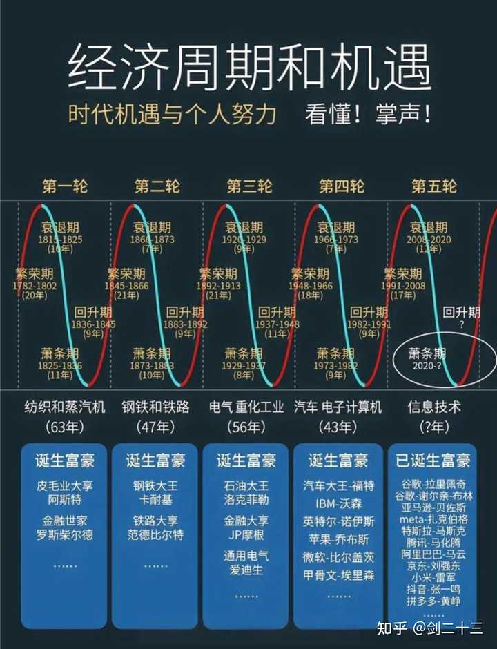
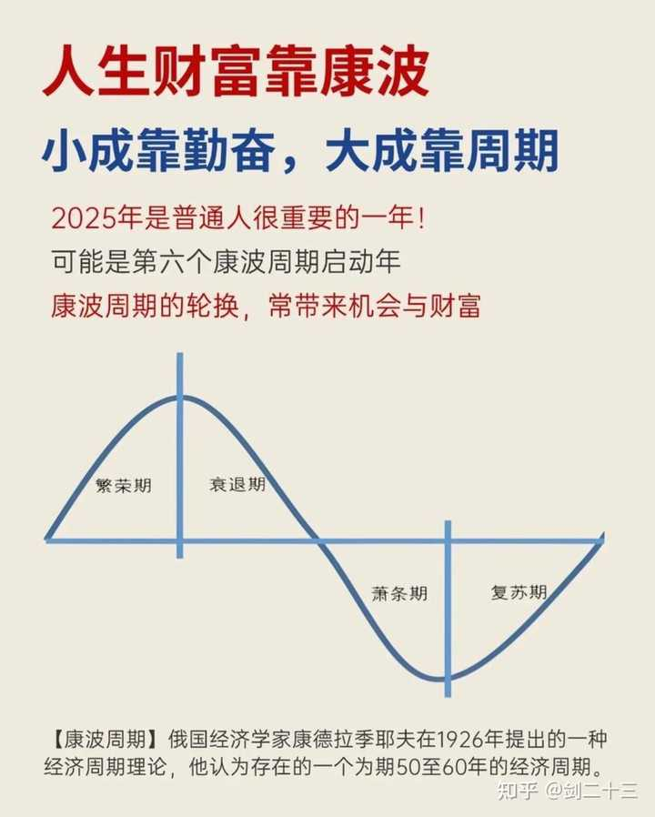

富人的秘密是什么？ \- 剑二十三 的回答

__穷人总爱研究技术，而富人研究规律和经济周期。__

__研究经济周期，才能享受到时代的红利。__

穷人永远在准备，富人永远在实践。

穷人永远在拼命干活，富人永远在深度思考。

穷人永远想靠自己，富人永远在借势借力。

靠自己的双腿爬楼梯，又慢又累，而一旦坐上时代的电梯，你都不用怎么动，一路到顶层。

富人发家各有其秘密，各有其渠道和模式，但有一个最关键的共性，就是他们都读懂了经济周期，掌握了经济规律！

__真正的财富积累，并不是你这个人有本事，而是享受到了经济周期运动带来的红利。__

alt="Image">

在经济学上，把它叫做康波周期，全称康德拉季耶夫周期，是前苏联经济学家在20世纪20年代提出来的一套经典理论。

他发现，资本主义经济存在着大约50到60年一次的长期波动。

这个周期分为回升期、繁荣期、衰退期和萧条期四个阶段。

一轮康波周期约60年，正好覆盖一个人的自然寿命。

我们讲60年一甲子，循环一次约等于就是一个康波周期。

人称“周期天王”的中信建投首席经济学家周金涛，他有一句名言：

__“人生发财靠康波”。__

过去20年的煤老板、炒房客，不是他们比你聪明，只是他们刚好踩到了老天爷赏饭吃的经济周期电梯上。

alt="Image">

__⭕普通人的一生，只有三次真正致富的机会。__

按照康波周期的理论，一个人60年的生命周期里，真正参与经济周期的时间大约30年。

在这30年里，康波周期给你的财富机会，理论上只有三次，而且，它不以人的主观意志为转移。

如果每个机会你都没抓到，一生的财富就没了。

如果抓住了其中一个机会，至少可以成为中产阶级，如果能抓住两个，你就能成为真正的富人。

## 普通人该怎么发现机会呢？

侧重看以下三个重要的信号。

__第一个，新闻大部分是坏消息__

股市连续熔断、油价跌成负数、你身边最保守的人都在问要不要割肉。

恐慌情绪达到极致时，恰恰是机会的起点。

正如巴菲特那句经典名言：

__“在别人贪婪的时候我恐惧，在别人恐惧的时候我贪婪。”__

__第二个，政策突然“大放水”__

央行紧急降息、国家发钱补贴、利率降到历史最低，这是官方在“喊你上车了”。

比如2020年3月，美联储联合全球主要央行紧急注入流动性，一度计划每天为市场投放1万亿美元，这就是典型的信号。

__第三个，资产价格跌到你不敢相信__

好公司的股票市盈率跌到个位数，好地段的房子直接打七折。

在这危机低谷时买入的优质资产几乎都会翻倍。

## 而抄底有三个大前提：

__1\.你拥有至少5年的闲钱。__

如果你急着用钱，大概率就会被迫割肉在最低点。

__2\.你的收入不依赖市场的波动与热度。__

如果你做的是体制内、刚需行业、有稳定现金流的生意，那可以试试。

否则，你该做的是先好好工作，而不是考虑抄底。

__3\.你长期研究过要买的东西。__

别临时看了新闻就冲进去，你至少得知道：

什么资产跌到了历史低位？那些好公司会不会破产？好地段的房子会不会变鬼城?

没有闲钱、没有稳定收入、没有提前研究，危机对你来说就是灾难，而不是机会了。

alt="Image">

## 普通人该如何利用康波周期呢？

__第一，要放弃“一夜暴富”的幻想。__

康波周期的本质是顺势而为，不是让你去投机和赌博，短线不可取。

__第二，用5到10年的视角来看问题。__

与其每天盯着K线焦虑，不如把精力放在提升自己的赚钱能力和研究水平上。

__第三，保持现金流的储备。__

繁荣期要坐得住，要持续储备现金流，要静静等待，所谓潜龙勿用，等到萧条期，看准了再抄底。

__洛克菲勒家族能跨越5次康波周期，根本原因就是：持有充足的现金流。__

__拥有足够的现金流，先立于不败之地，远比投资更重要。__

__第四，允许自己错过前两次的致富机会。__

但不能在第三次时，仍把积蓄放在现金或银行存款被动缩水，更不要玩什么高息理财。

最重要的是，要提前学习资产方面的知识，尽全力提升财商和投资的眼光，盯住一个你懂的资产，等机会来临时，哪怕多数人陷入慌乱，你也能精准买入。

__人生80%的时间，需要用于保持阅读，思考，实践，等待，准备，机会来临时，你才能抓得住。__

__正如价值投资的真正理念：低频\+长期\+绩优股。__

我们每个人都活在一个巨大的经济周期里，顺势而为，远比盲目努力重要得多。

一旦你攒足了现金流，等到了下一轮红利，就已经跑赢大部分人了。

[@剑二十三](https://www.zhihu.com/people/a8c148f22c0bb8ac16b3dbd3ad5c020c)

[@知乎直答](https://www.zhihu.com/people/f3bce7aa022240e25f12aec9a9b70363)
