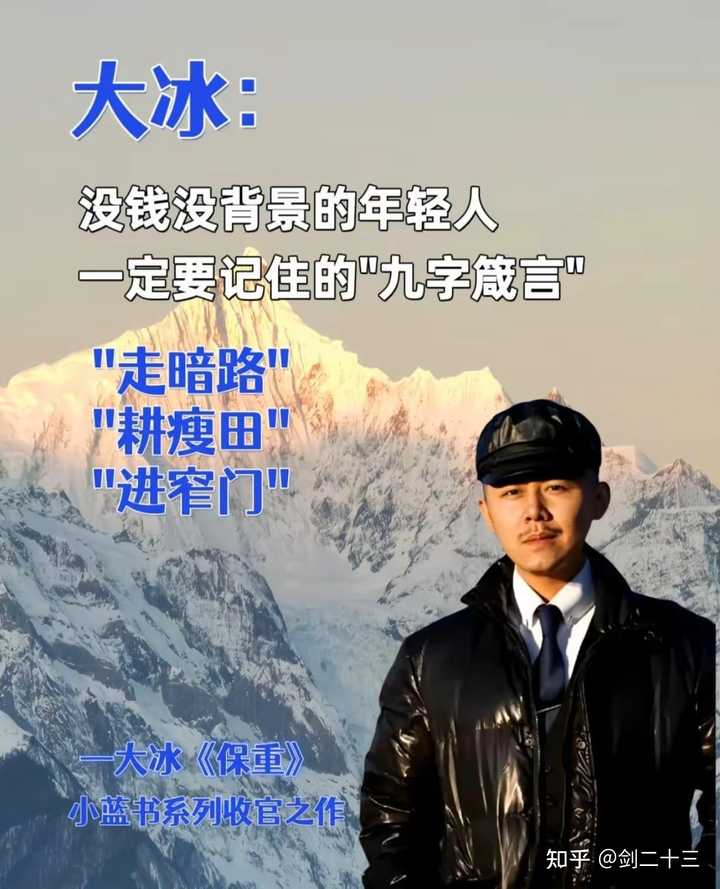
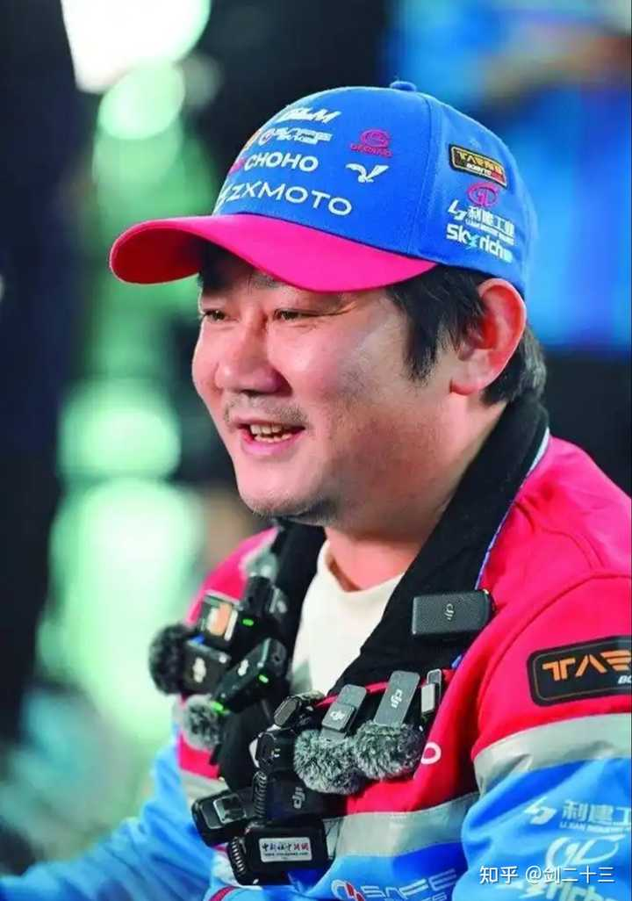
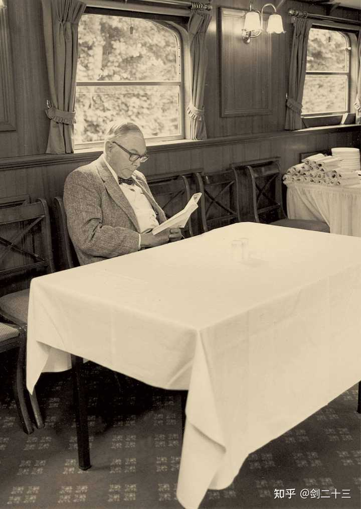
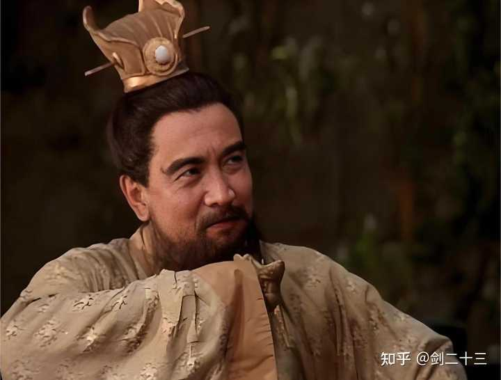

__45岁之前一定要稳住！__

大冰在直播里说的“进窄门，走暗路，耕瘦田”是普通人翻身唯一的机会，但是很多人没听懂。

## 什么叫进窄门呢？

你好好想想，现在的生活有多少是你自己选的？

读大学，选专业，找一份稳定的工作，攒钱，买车，买房，结婚，生子等等。

这些路，有哪些是你自己规划的吗？

还是它本来就在那里，或者说被安排好的，只是等着你走进去？

其实大部分人的人生剧本，早早就已经被写好了。

父母写的，学校写的，老师写的，社会写的，邻居家那个考上公务员的孩子写的。

__社会的规训，就是一张网，但这张网的存在，不是为了帮你翻身，而是为了稳定整个系统。__

让你安分地在这个系统里扮演好自己的角色，螺丝钉是不需要翻身的，它只需要好好待在它该在的位置。

父母替你做的一系列不明智的决定，并不是不爱你，而是大多数人的父母，眼界有限，他们已经用尽毕生之力，给你做了他们认为最好的那个选择。

问题是，他们能看到的那个最好的答案，只是他们那个时代、那个圈层的天花板，甚至都不是天花板。

__而你首先要做的，就是打破既有的观念束缚！__

__窄门的第一层意思：__

__“不要听那些普世的观念，社会既有的规训。”__

这不是让你去走邪路，刑法里写的那些不要碰。

而是让你停下来，想清楚一件事：

“窄门，窄在哪里？ ”

窄在它难。

打工简单，但是创业难，所以绝大多数人选了打工，穷得很稳定。

窄门，就是大多数人看了一眼，就觉得难的，然后退开了，留给你的那扇门。

越难的门，走进去之后越窄。但这不是让你无脑创业，那是另一回事了。

身边有大把的人，听了几堂课，脑子一热就裸辞，然后用自己攒了三五年的钱，去踩坑，代价往往是一无所有。

## 进窄门的路径有三步:

__1\. 先养成创业者思维__
__2\. 再一步一步集齐创业的条件__
__3\. 最后用最低的成本不断试错，持续迭代__

或许你现在还在打工做牛马，但是没关系。

打工的时候，也可以有创业者思维，你看那些真正有本事的人，他们往往把打工视为经验积累和人生试炼，打工只是人生的一个阶段。

__什么是创业者思维？__

是你做任何一件事，不只是想着完成任务，而是想透这件事背后的逻辑，想着怎么把它做成一个可以复利的东西。

同样是做自媒体，有人发完一条视频就坐着等平台推流，而有人发完后，会积极去研究数据，研究哪一句话留住了用户，哪一个文案让人划走了。

同样是跑销售，有人挂电话之后继续下一通，有人挂完电话记录客户的抗拒点，慢慢摸出一套话术系统。

前者是在打工，而后者，是在用打工的成本，给自己做实验，不断试错，积累经验。

你还没有创业条件，也没关系。

先把创业者思维装进去，让它改变你做每件事的方式，所谓的创业条件，会在某一天，慢慢凑齐的。

alt="Image">

## 什么是走暗路呢？

是你选择了一道窄门后，前行过程中，那段几乎没有任何反馈的日子，就是暗路。

这段路，是高手和普通人的分界线。

暗路就是你发了一个月的视频，播放量加起来还不到2万。

暗路就是你发了50篇文章后，流量没有任何明显的增加。

暗路就是你做销售，打了99个电话，都被拒绝了。

你不知道自己做的事情对不对，不知道它还值不值得继续做下去，你甚至不知道明天有没有意义。

这段路，就叫暗路。

路上没有灯，没有路标，没有人给你鼓掌，没有任何反馈，甚至没有任何人看见你。

但这段路，你必须要走，没有捷径。

大家现在应该都听过张雪机车了吧？

但在他出名以前的那段时间呢？

他被凯越机车清理出来创业之后那段路呢？

他十几岁为了被湖南电视台报道，在雨中追着电视台跑的那段路呢？

没有观众，没有舞台，没有任何证明自己的机会，周围的人，大概率都会觉得他是在做一件没有意义的事。

但这段暗路，他走过来了！

alt="Image">

很多创业者，都会走一段暗路。

前期没有反馈，是正常的。

__很多人在暗路上崩掉了，不是因为坚持不去，而是因为，他们以为没有反馈就意味着方向是错的。__

__可现实往往不是的！__

没有反馈，在绝大多数情况下，只是意味着还没到时候呢，火候还不到。

如果你知道自己的方向是对的，那就继续做下去，会迎来曙光的。

__当一个人明确知道自己在做什么，知道方向是对的，那剩下的只是时间问题。__

__这段暗路时间，你得咬牙熬过去。__

但绝大部分人，只能做有极高确定性的事，比如摇奶茶，做煎饼，调咖啡，坐办公室，而这种极高的确定性，指向的往往就是平庸。

每个人都有自己的选择，如果你享受平庸，就想在岗位上好好工作，那也很好。

## 什么又叫耕瘦田呢？

__耕，是一个持续性动作，它不是做一下，不是浅尝辄止，而是一直做。__

__所有的大佬都是长期主义者，没有例外。__

查理芒格几十年如一日都在投资领域深耕，哪怕是在去世的前一年，还破例买入煤炭股，到年底账面获利超5000万美元，同时还在和年轻邻居合伙买下近万套公寓，而直到临终前，他还在参与谈判。

持续性重复一个动作，是成为高手的最大基础。

查理芒格把复利称为世界第八大奇迹。

为什么呢？

因为复利极其反人性，因为复利的前半段，它会让人绝望。

你今天付出100%的努力，得到的反馈却是1分的回报，你明天保持100分的努力，可能还是1分的回报。

这样过了一个月，三个月，六个月，你仍然还在原地。

从感受上，你付出了一切，但什么都没得到，没有正反馈，绝大部分人，在这个阶段就会放弃了。

__因为人性是喜欢即时反馈的，而复利需要的是延迟满足，人性喜欢确定性，而复利常常是在不确定性中坚持走下去。__

alt="Image">

__耕瘦田这三个字里，最重要的不是耕，而是「瘦田」__

__什么是瘦田？__

__是那块没人耕，但你一旦耕好了，就能源源不断结出果实的地。__

肥田早就被人占完了，所以要耕瘦田，而且是深耕。

你去做爆款赛道的内容，去卷流量最大的平台，去做红海的生意，面对的是什么？

是已经在那里耕了三五年，甚至七八年的人，是已经建好护城河的那批人。

新手如何能卷得过？你用什么跟他们比呢？

普通人翻身，不是靠正面硬刚，而是要智取，是要找到别人没注意到的那块地。

## 瘦田的标准有三个

__1\. 一定是自己感兴趣的事。__

不是说喜欢就能赚钱，但如果你做一件自己完全没有兴趣，没有热情的事，你大概率是熬不过暗路那一段的。

喜欢，不是充分条件，但它是你走的更远的动力之一。

__2\. 有市场需求，有市场价值。__

若只是你喜欢，但没有人愿意为它买单，那就不是瘦田，而是荒蛮之地。

瘦田的意思是，它有产出的可能，有产出的空间，只是现在还没多少人在精耕细作。

__3\. 有较高门槛，且需要长期投入的。__

这是最最关键的一条。

没有门槛的事情，不是瘦田，因为你今天去做了，明天就有人可以大量复制。

所以，它短期就会变成肥田，就会变成红海。

你得找那种，需要时间、需要专业度、需要持续积累才能做好的事情。

因为这种事情，大多数人看了觉得麻烦，不愿意进来，就算进来，也需要学个七八年才能建立他的专业度，而这七八年，你已经甩他十万八千里了。

所以，一旦耕好自己的瘦田，坚持下去，它就是你的护城河。

## 普通人具体该怎么做呢？

你需要细分，细分，不断细分，一定要细分到最小单位。

越具体，越窄，竞争就越少，目标人群也越精准，你的内容就越容易被需要它的人找到。

瘦田的关键，就在这里。

你别三天两头就换，今天觉得这块田好，明天看别人那块田结了果，又跑去耕它，你那不叫耕瘦田，纯叫打野，而打野是绝对翻不了身的！

进窄门，走暗路，耕瘦田，分别讲的是三件事。

进窄门，说的是选择。

不跟大多数人挤，去找那扇难的门，窄的门，别人不想走的门。

走暗路，说的是心态。

在前期没有反馈的这段日子，才是真正的分水岭，你只要熬过去，你就不是普通人了。

耕瘦田，说的是方法。

找对那块属于你的地，然后保持深耕，直到复利的飞轮转起来。

__这三件事，缺一不可。__

进了窄门后，中途心态崩了，就走不完暗路，就会废掉。

而你挺过了暗路，但没找准瘦田，乱耕一气，也同样会废掉。

但只要这三件事都做对了，大概率是可以翻身的。

而此刻，你先不要急，先慢下来，静下来，把思路理清楚。

从今天开始，早睡早起，保持大脑清晰，内心有序，这才是普通人翻身的第一步。

alt="Image">

[@剑二十三](https://www.zhihu.com/people/a8c148f22c0bb8ac16b3dbd3ad5c020c)

[@知乎直答](https://www.zhihu.com/people/f3bce7aa022240e25f12aec9a9b70363)
