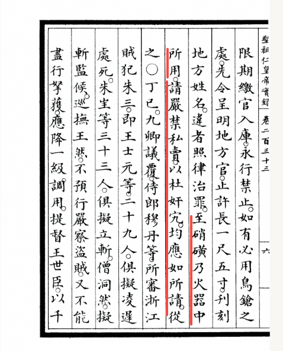
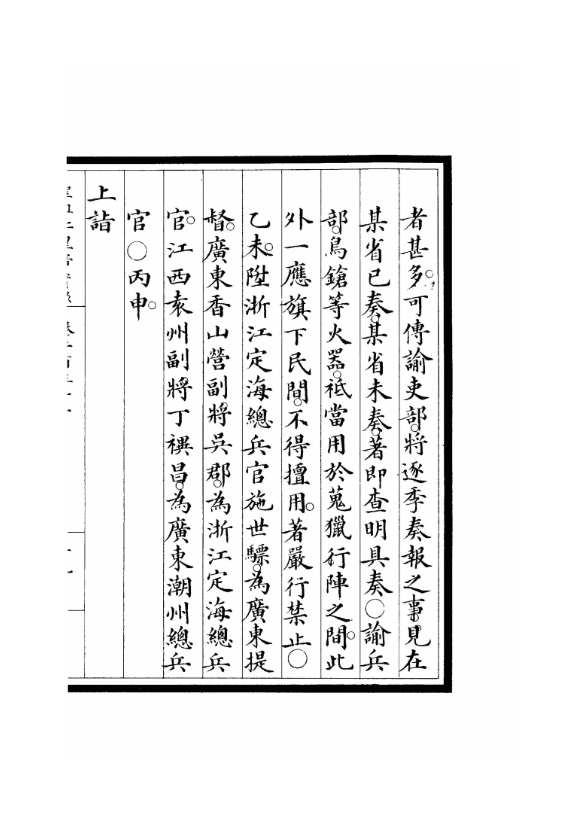
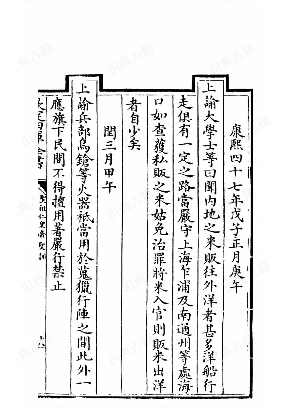

__肯定被低估了，就下面这些事，都是康熙做的！__

## 从老百姓视角，千古一帝实至名归:

### 陈四流民案：

山西百姓陈四因为当地连年歉收，带着全家和同乡130多人逃荒、卖艺，被地方官诬陷成强盗。__地方初审认定无罪，但康熙因为陈四说的饥荒实情，和地方上报的“盛世丰收”不一样，强令重审，最后判陈四斩立决__，他的家人几十口都被发配到黑龙江给披甲人为奴，这也__导致后来地方官都不敢报灾__，参考《清圣祖实录》《康熙朝汉文朱批奏折汇编》《清史稿・圣祖本纪》。

### 迁界诱杀令：

强迫山东到广东的沿海居民内迁30到50里，筑墙不准越界，限期3天，逾期处死；拆房子、烧田地、砸船只、平盐场，越界就斩，__沿海变成千里无人区__。仅广东一省就死了几十万人，很多人流离失所、卖妻鬻子，海洋贸易和渔业被彻底摧毁，无数家庭就此灭绝；__还以"许复业"为诱饵，诱杀香山县黄梁都躲避迁徙的百姓__。参考《清圣祖实录》《广东新语》《榕城纪闻》《莆变纪事》。

### 大规模屠戮治下百姓：

清军在四川、福建、湖南、云南平叛，实行“民贼相混，玉石难分”的策略，屠城烧屋；__四川战后人口只剩约9万，不及其他省份一个县__，千里荒芜；福建、湖南也有大量平民伤亡，后来只能靠“湖广填四川”移民，参考《清圣祖实录》《广阳杂记》《四川通志》《浏阳县志》《蜀乱》。

## 开启不平等条约先河:

__《尼布楚条约》将苏武牧羊的北海以东约十万平方公里划给沙俄；__

__注:明代在贝加尔湖周边有过两个卫所__
__斡难河卫：设于今鄂嫩河流域（涅尔琴斯克西南），贝加尔湖南缘，是明朝最西端的卫所之一 。__
__乞塔河卫：位于今俄罗斯赤塔河流域（贝加尔湖以东），永乐六年置。__

当地酋长持明朝的印信传承:[如何看待明朝的口碑在逐渐变好了？](https://www.zhihu.com/question/1932401978195042789/answer/2014293542407808124?share_code=IqNcV8AU2jh1&utm_psn=2030359282923877450)

__《清荷协约》与荷兰东印度公司约定共同对付民族英雄朱成功；并组建清荷联军，在金、厦击败郑军，协约里约定击败明郑夺得宝岛后将岛和岛上一切交付荷兰人，也在后来确实在占领基隆后让荷人入驻:__

![卷 三 政 事 志 外 第 一 章 早 期 臺 之 渉 外 事 件 一 課 梅 魯 曼 ( M 目 も 轉 交 荷 方 , 並 附 二 人 函 件 。 南 王 函 中 載 云 : 非 我 局 専 , 常 代 荷 人 疏 請 。 永 十 七 年 「 一 一 十 月 二 十 七 日 耿 繊 茂 、 李 率 泰 簽 字 後 , 北 書 由 通 end Quemuy ( 2 will Sell 目 h g b 歟 ョ you ミ , 一 一 being 「 「 一 y per ョ 」 t 一 日 2 愛 0 「 : ー : Ships ョ u 第 一 一 aga 一 コ 舞 the E コ 当 Y. お 一 = ま better that 0 g 名 andizes you he 希 aboa 「 d 【 丁 【 を で which 一 一 一 : ま = 0k を ら 一 But Since チ の 呂 畠 we 訊 当 the V 。 日 0 「 the H 。 一 一 当 争 「 5 Fu ュ h ョ 。 ou may Sellthose Merch— sub 可 and I 日 を 「 三 M と 巴 一 ow 一 & ge 午 e 一 「 守 一 一 3 n and g 「 目 一 berep 05 & inHoks 一 2. and 子 の Sale 子 0 「 eo 一 de 「 「 ミ 一 三 we Shall ha Conquer'd Eymuy 2 日 ~ ま 「 20 ま 容 - which 1 and Li を ユ ( 李 率 泰 ) 0 ヨ 一 お ミ 享 3 = 8 & 5 習 023 when 十 一 、 此 約 得 清 廷 之 批 准 , 並 將 共 批 准 書 交 荷 人 。 十 、 淸 方 督 懸 提 供 一 優 秀 船 隻 , 以 便 荷 人 使 至 巴 達 維 亜 報 告 。 九 、 克 服 金 廈 兩 島 後 ・ 聯 車 應 駛 往 臺 。 攻 取 此 島 後 , 淸 軍 將 該 島 以 及 一 切 城 堡 物 件 立 與 荷 乎 と the Conquering of EY 日 を . Hollanders 3 = を Ou 「 E 日 2 当 「 第 & ま 住 : 上 0 粤 を 「 . P 124 ー 124. 0 を 一 b A ニ ま Chinensis. V. 2. P. P23 ー - ・ P24 對 此 協 約 , 李 率 泰 等 僘 保 留 第 七 、 八 兩 項 , 第 九 項 並 不 反 對 , 恤 言 明 進 兵 大 事 出 在 朝 延 , 人 , 以 供 荷 人 居 住 。 攻 撃 。](attachments/ce13118bf2c0819f.jpg)

alt="Image">

### 康熙朝文字狱：

黄培诗案中，黄培等14人被斩首，牵连顾炎武等300多名名士，顾炎武被关了快7个月，很多文人的藏书被烧。《南山集》案中，戴名世斩立决，已经死的人，被开棺戮尸，家族连坐，作序、刊刻、藏书的人都被牵连，株连甚广。朱方旦案中，朱方旦斩立决，弟子被牵连，著作被烧。__康熙算是开启了清代大规模文字狱的先河__，以文字论罪，还大规模禁毁民间科技、手工业、思想类书籍（《明史案》是鳌拜主政时的，不算康熙时期），参考《清圣祖实录》《清代文字狱档》《清史稿・圣祖本纪》《南山集偶钞》《清代禁书总目》。

## 朱三太子案：滥杀无辜，连老人孩童都不放过：

康熙一生都在严防明朝宗室后裔，多次以“朱三太子”为名大肆株连：康熙抓获 75 岁的王士元（自称崇祯第四子朱慈炤），此人一生务农，从未谋反；康熙下令：父子祖孙全部处斩，家人连坐；__民间但凡有人被诬告 “朱三太子”，不问真假，一律处死，牵连者无数__。

### 康熙六次南巡相关：

你没看错，不是乾隆，是康熙先后六次南巡，每次随行几千人，包括后宫、大臣、侍卫等；沿途强征民夫、建几十座行宫，地方官为讨好皇帝大肆搜刮百姓，甚至用绸缎铺街道、强占民房（但总的来说确实比乾隆南巡规模小很多），参考《清圣祖实录》《康熙朝汉文朱批奏折汇编》《清代档案史料丛编・南巡案卷》。

### 虽然康熙娶了很多汉八旗女人，但禁止汉与蒙古等民族互相通婚：

传教士马国贤在回忆录里说，__康熙在避暑山庄养了不少小脚妃嫔__，还用假蛇、蛤蟆吓唬她们取乐，看她们摔倒就哈哈大笑。

![女 才 会 有 婚 姻 。 清 朝 法 律 明 确 規 定 ： “ 嫁 皆 由 祖 父 母 、 父 母 主 婚 ； 相 父 母 父 母 俱 无 者 ． 从 余 亲 主 婚 。 其 夫 亡 携 女 适 人 者 ． 其 女 从 母 主 婚 " 《 ～ ” [ 收 隔 a 期 《 湖 0 ． 伽 凵 2 母 孝 仪 后 毳 佳 氏 ． 都 是 汉 八 旗 人 ； 另 一 方 面 又 严 禁 止 汉 满 蔟 等 民 蔟 之 间 的 通 婚 ， 满 、 汉 、 蒙 八 旗 官 民 之 间 的 通 婚 也 不 例 外 到 如 康 熙 二 十 二 年 03 年 ） 就 发 布 了 “ 凡 内 地 民 人 出 [ 基 金 项 § 」 家 会 稃 金 重 点 研 究 课 的 （ 田 AZ 耵 ). 区 家 人 文 社 会 科 学 重 点 研 究 基 地 重 大 研 究 項 刂 “ 中 华 民 道 德 生 活 史 以 （ 為 m 湫 的 。 〔 作 者 筐 介 」 怩 定 壳 湖 ， 南 双 峰 人 育 部 人 文 社 会 科 学 点 研 究 荃 地 湖 南 师 范 大 学 道 的 文 化 研 究 中 心 教 授 ， 博 上 生 导 口 ， 于 蒙 古 地 方 贸 易 、 耕 种 ． 不 得 娶 蒙 古 妇 女 为 妻 ． 的 鼙 令 《 为 了 确 保 这 种 禁 令 的 权 威 性 和 有 效 性 ． 清 朝 政 府 对 违 令 私 嫁 的 行 为 进 行 严 厉 制 裁 。 如 对 违 背 蒙 汉 通 婚 禁 令 而 称 自 嫁 者 ， 一 经 查 出 ． 将 所 嫁 之 妇 离 异 ． 蛤 还 其 母 家 ， 将 私 娶 的 民 人 治 罪 · 对 知 情 的 主 婚 人 及 说 合 的 蒙 古 人 等 都 了 以 处 罚 。 这 种 禁 止 民 蔟 之 间 通 婚 的 政 策 同 样 是 清 朝 维 持 其 统 治 的 政 治 手 段 。 其 原 因 主 要 在 于 ； 首 先 ． 清 朝 统 治 者 担 忧 满 族 因 为 联 樵 而 在 以 儒 家 思 想 为 主 导 的 文 化 环 境 屮 失 却 自 己 的 “ 国 语 骑 射 ” 的 民 蔟 特 性 和 民 蔟 意 识 ； 次 是 不 同 民 蔟 有 着 不 同 的 思 想 观 念 和 风 俗 习 与 外 境 之 人 通 议 娶 民 闻 孀 如 ， 或 招 夫 入 室 ． 或 改 的 与 人 生 亦 止 许 与 本 处 人 成 婚 ， 不 许 棍 簧 诱 嫁 与 境 外 。 至 于 有 夫 之 妇 ， 其 平 日 不 相 和 渚 者 。 或 离 或 合 ， 许 其 依 律 告 官 的 断 。 如 有 本 夫 私 鬻 ， 或 奸 捷 用 计 买 休 ， 图 奸 图 利 ， 嫁 卖 出 境 者 ． 本 夫 、 挑 犯 各 遵 律 例 尽 法 重 处 ： 绅 十 大 户 所 蓄 蜱 女 ， 非 镓 为 农 妇 ， 即 配 与 仆 人 ， 亦 不 i 午 潜 卖 出 境 ， 其 买 去 之 人 ． 如 系 本 省 “ 卑 职 径 行 关 究 ， 不 敢 频 渎 宪 案 。 如 系 隔 省 ， 许 卑 职 请 咨 提 拿 ， 本 妇 仍 行 追 回 ． 身 价 例 不 断 给 ， 仍 治 以 知 悄 之 。 副 弭 薦 喂 于 弓 」 令 。 庶 知 敛 迹 一 妇 ． ． 女 尽 配 褒 民 ． 将 见 地 方 之 生 聚 ． 从 此 日](attachments/980f8a5c220a6f68.jpg)

alt="Image">

### 投充法、逃人法、圈地令延续：

延续顺治朝的圈地政策，圈占京城周边百姓的田地分给八旗，造成大量流民；投充流民依附八期为奴，加强逃人法预防农奴逃亡，参考《八旗通志初集》《顺天府志》《东华录》。

### 禁矿令：

禁止民间开矿，怕聚集亡命之徒闹事，阻碍了手工业，限制了矿产开发和技术进步，参考《清圣祖实录》《大清会典事例》《矿政档》。

### 对技术发展的毁灭性打压，造成落后西方的起点：

__康熙在宫里向传教士张诚、白晋、南怀仁等系统学习过西方数学、天文、历法，但只限于宫内，禁止外传民间让老百姓学到：__

民间不许私习天文、私测历法，违者绞刑；私藏历忌者，流三千里《大清律例》《康熙起居注》；

《数理精蕴》仅限八旗子弟和官员学习，民间暂不刊印；禁止传教士向非官方人员传授西方算法《律历渊源・凡例》《康熙朝实录》；

__水利专家陈潢，最杰出的水利专家之一，主持治理黄河、淮河、运河长达 17 年，创立 "束水攻沙" 理论，使黄河安稳十余年，被康熙下令逮捕羁押，最终在牢笼中含冤病逝。《清史稿》__

__火器专家戴梓，精通火器制造，被康熙身边的洋人传教士嫉妒，将他流放客死他乡。《清史稿》。__

康熙颁布“火器禁令”；

康熙四十七年，谕兵部：鸟𬬰等火器，祗当用于搜猎行阵之间，此外一应旗下、民间不得擅用。著严行禁止。 至硝磺乃火器中所用，请严禁私卖，以杜奸宄。均应如所请。从之。

alt="Image">清圣祖实录 卷二百三十三

alt="Image">清圣祖实录

颁布南洋__“禁航令”__，禁止中国商船去吕宋、噶喇吧（今印尼雅加达）等南洋地区贸易，参考《清圣祖实录》《东华录》等结合多方史料。

alt="Image">圣祖仁皇帝圣训

alt="Image">东华录 康熙

### 黄河治理与灾荒应对，纵容贪腐，国库亏空，人吃人的盛世：

康熙虽然说治河是第一要务，但任用的河道官员大多贪污治河经费，在实际执行中存在诸多问题；康熙三十七年陕西大旱，__出现人吃人的惨剧__，虽然他建立了相对完善的赈灾制度，但在实际执行中效果有限，康熙只象征性减免部分赋税，__仅康熙二十九到三十年这时间段，全省死了超百万人__。康熙皇帝的态度是矛盾的。一方面，他对贪腐行为表示痛恨，多次强调要严查河工贪腐；另一方面，在实际处理时又往往从轻发落。王新命案就是典型例子，查实贪腐后仅革职了事 这种态度在一定程度上纵容了贪腐行为。__康熙朝山陕地区多次发生人吃人__，时间主要集中在康熙二十九至三十年和康熙三十七年。参考__《中国三千年旱灾实录》中的清代旱荒实录，__《清史稿・灾异志》、《清圣祖实录》、《扶风县志》等。

### 康熙在位61年间，共发生饥荒230次，其中59年有饥荒记录，平均每年发生饥荒约3\.8次。

通过对《清史稿・灾异志》、《清圣祖实录》、各地方志及奏折档案的系统梳理，__康熙四十年至康熙四十三年，是饥荒最严重的时期__，连续4年发生大饥荒，其中3年出现人相食，史称__"山左奇荒"__。

### 对农民经济剥削压迫：

除了正税，地方官还能收__“火耗”“羡余”__等附加税，__火耗常常是正税的一半以上__，有的地方甚至是几倍；两江总督噶礼贪污超百万两，被弹劾后只被革职，没受重罚；康熙四十五年户部亏空250万两，康熙只让官员分年偿还，没追究刑事责任。另外，八旗贵族、官僚大规模兼并土地，京城周边七成以上的民田被圈占，很多农民失去土地，地租普遍超过五成，百姓困苦，卖妻鬻子很常见。

### 对牧民剥削压迫：

清军向已经归附的蒙古部落强征粮草、牲畜、车辆，交不出来的就被劫掠；对已归附的蒙古实行严苛的盟旗制度，限制游牧范围，禁止部落间往来，拆分部族，导致蒙古草原经济衰退、人口减少。
