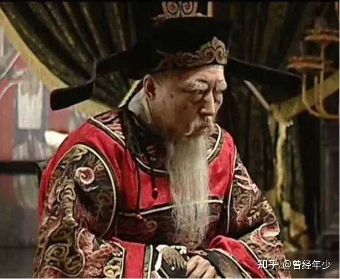
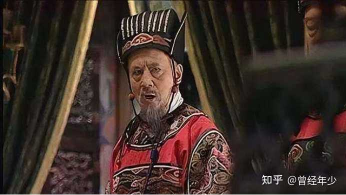
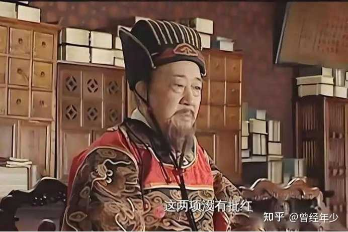
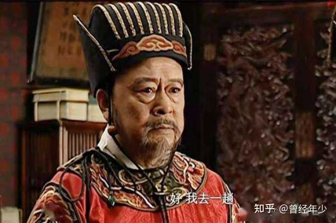
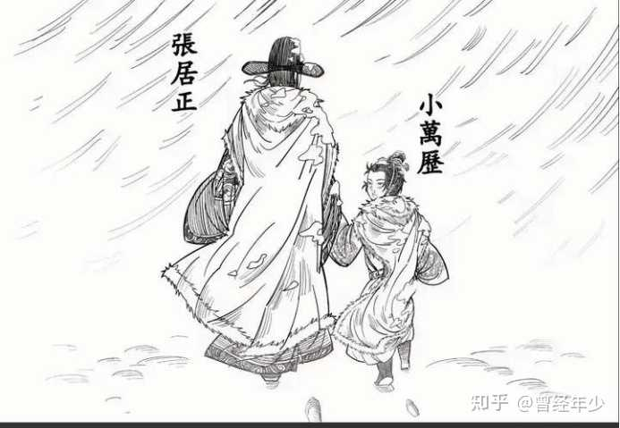
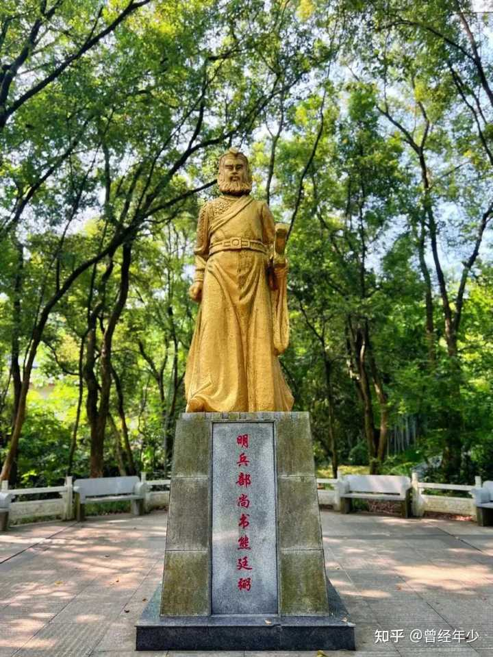
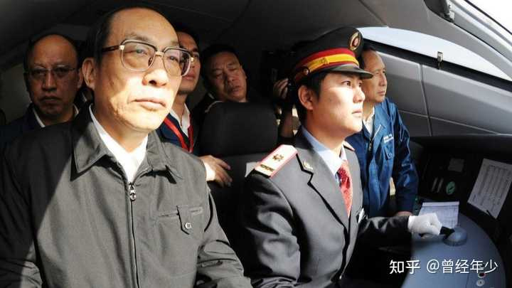

张居正知道改革的道路艰难，会被很多人反对，执行的过程也实为不易，为何还要改革？真的如当年明月所说的看到无数饥民嗷嗷待哺，心中有了理想之后励精图治吗？还…

来看一下当时大明首辅的下场，你就明白张居正有多么可贵。

一，严嵩：25岁中进士，全国第五名，64岁当首辅，82岁罢相，85岁抄家回籍，87岁老死家乡。

很多人说严嵩下场惨的，你看看这个年龄。

alt="Image">

二，徐阶：21岁中探花，全国第三名，59岁任首辅，65岁罢相，15年之后，以80岁高龄在老家病死，追赠太师，谥号“文贞”。

徐阶是张居正的老师，可张居正死了，他还没死。

alt="Image">

三，李春芳，37岁中状元，全国第一名，57岁出任首辅，61岁致仕归养，73岁在老家病死，获赠太师，谥号“文定”。

论人生之圆满，人臣之中，没有人比李春芳更圆满。

alt="Image">

4，高拱，28岁中进士，全国第十五名，58岁接任首辅，60岁罢相，67岁在老家病死。

病死第二年，高拱被赠复原官。

死后二十多年，万历亲自下旨，高拱获赠太师，谥号“文襄”。

alt="Image">

5，张居正，23岁中进士，全国第十二名，48岁出任首辅，58岁病死任上。

两年之后，万历皇帝下旨，剥夺张居正一切荣誉称号。荆州张家饿死17口，张居正本人差点被开棺戮尸。

终万历一朝，无一人敢给张居正平反。

直到张居正死后40年，天启二年，公元1622年，大明王朝已病入膏骨，感念忠贞，天启皇帝这才下旨为张居正平反，恢复名誉。

崇祯十三年，公元1640年，大明王朝最后覆灭的前四年，为激励人心，崇祯皇帝下旨恢复张居正家族的全部荣誉。

然而，大厦将倾，为时已晚，世间再无张居正。

alt="Image">

6，申时行。

张居正死后，继任首辅的是申时行。

27岁中状元，全国第一名，49岁出任首辅，58岁罢官回家，80岁终老家乡，赠太师，谥“文定”。

此后的王家屏、王锡爵、赵志皋、沈一贯、朱赓、李廷机、叶向高和方从哲等首辅。不管他们的政治倾向如何，不管他们有多触犯万历，最后的结局都是善终，而且很多都是高寿。

从这些履历来看，大明朝的首辅，就没有考试成绩差的，就没有脑袋瓜子笨的。

你懂的人生道理，他们都懂；你知道的历史教训，他们都知道。

他们就是那个时代的掌舵人，以聪慧之姿、首辅之尊，将大明这艘破船开往何方，全在他们的一念之间。

对他们来说，只把自己的日子过好，那实在太容易了。

明朝首辅退休，都是有规定待遇的，像夏言那种任上被杀的，是极少数中的极少数。

对于这些首辅，万历并没有刻薄寡恩，该给的待遇，他都给了。甚至连高拱，万历最后也原谅了。

唯有张居正，启蒙受教的授业恩师，陪着自己长大的授业恩师，万历至死都没有原谅。

如果张居正也能像其他首辅那样，安安稳稳做官，平平淡淡告老，荣誉是一定会有的，名声也是一定会有的。

可张居正偏就走了和其他首辅完全不一样的路。

alt="Image">

张居正是一个毫无疑问的改革者。

任何一位改革者，其政策必然会有争议，必然不可能事事周全。

主要原因有两个：

1，改革者本人的能力所限。

所谓改革，就是打破旧有的瓶瓶罐罐，将前人较少用过的政策付诸实施。

因为改革措施接受实践检验比较少，在实际推行过程中，特别是在改革初开始时，必然会出现理论与现实不符的情况，必然会出现政策引发的混乱。

没有任何一位改革者，是在事先将所有后果全都算无遗策的，绝对都是走一步看一步，绝对都是根据实际情况不停地调整政策。

所谓“摸着石头过河”，就是这个道理。

2，反对者的意见过于激烈。

任何一次真正的改革，必然是打破旧有利益格局，伤害既得利益群体的实际利益。

这些人可不是泥菩萨，他们一定会竭尽全力向改革措施、向改革者本人发起反攻。

为了对付这些反对者，改革者的政策必须过激，矫枉必须过正。

你拿出100分的改革措施，经过层层阻拦，最后实行下去的可能只有60分，

但如果你拿出的本来就只有60分，经过层层阻拦，最后实行下去的可能就只有10分。

所谓“求上得中，求中得下”就是这个道理。

你把这套理论往张居正头上套，就会发现他所有行为，全都是在这套理论的指导下进行的。

如果还不能理解，那就看看明末的熊廷弼，那就看看当代的刘志军，他们都是张居正一类的人物，都是“功我罪我，其惟春秋”。

alt="Image">

alt="Image">

因此，我是非常反感现在很多人打着“为历史正名”的旗号，对张居正改革吹毛求疵的。

这不仅仅只是张居正个人评价的小问题，而是我们民族该怎样看待改革者的大问题。

很多人都说，中华文明源远流长，将人类政治的那点事儿全都记在史书上了。

遍观史书，历史留给我们的一点重要经验就是：

__改革者从来都不完美，可如果因为不完美，就迫不及待地对改革者搞反攻倒算，那最后的结局，一定是将整个国家更快地带入深渊。__

对改革者的宽容，对改革者给予极高评价，这是我们这个民族的美德，不能丢弃。
