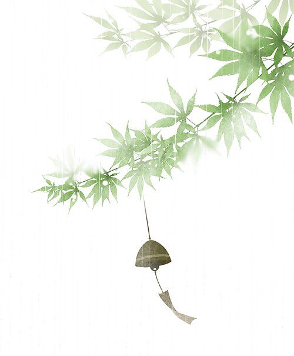
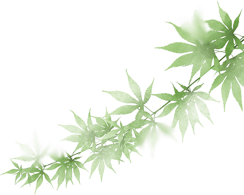
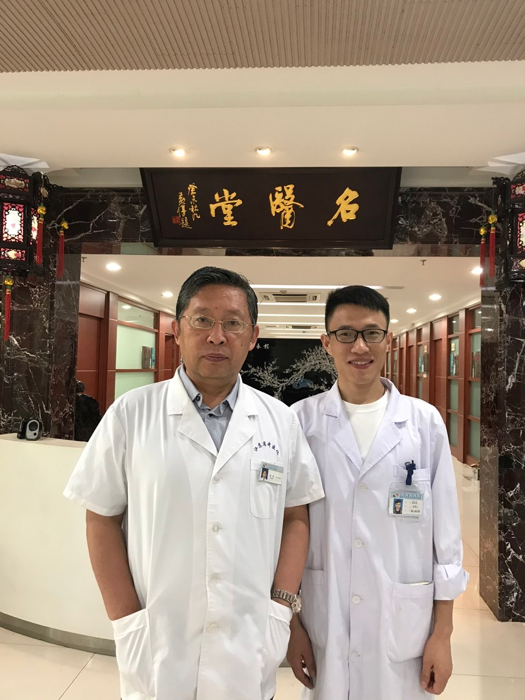

公众号名称：经方医学工作室

作者名称：吴山永

发布时间：2026\-10\-2811:37

吴山永

嘉兴市第二医院中医科

第一

百

四

十

四期

__我__

__的__

__经__

__方__

__之__

__路__

## 一、曲折之路

道路是曲折的，方向是明确的。我的经方之路并非平坦，也许正是这崎岖的道路让我更加坚信了经方之路的方向。我本科阶段的专业是卫生法学，其间学习了中医学、西医学、法学等相关内容，毕业之前，备考法学研究生近8个月，但半年的检察院实习生活之后，让我改变考法学硕士的念头，于是改变方向考中医学的硕士，这一转变让我犹豫不决，毕竟准备了8个月的备考，最后还是决然地选择了中医。于是寒窗苦读，最后功夫不负有心人，进入了福建中医药大学，当时的心情还是挺自豪的。本以为进入研究中医之路，可是面临着研究生的学习更是压力重重，事与愿违。半年学校的学习之后（基本以西医为主），就进入了临床的角色，承担着一线值班的压力，不得不把西医的内容又系统地自学起来，什么西医诊断学、西医内科学、急诊医学、病理学、生理学、心电图等等。三年的研究生之后，我成为临床内科医生的高手，但是中医影子已经离我越来越远了。毕业之后的7年在中医院工作一直从事以西医为主的临床工作，早已把中医学束之高阁了。但是这7年让我深刻地体会到了现代医学的缺陷和短板，面对百姓的疾苦，感觉非常迷茫，于是重启中医学习。之后的一个多汗案唤起了我寻觅中医之路。这是一个31岁的女性患者，冬季手汗淋漓，十分痛苦，影响工作，于是就抱着试试看的心态，用了桂枝加附子汤7天后明显改善，真正地体会到了祖国医学的神奇魅力。

## 二、启蒙之路

经书易得，名师难求。行千里路，不如名师指路。中医书籍，汗牛充栋，当时阅览了诸多医家的书籍，但未能得到学习经典之真谛，于是四处寻找名师，得知黄煌老师在国内外传播经方，得到国内同行的认可，当时非常希望能够跟随黄煌老师学习经方。于2018年向医院提交了去江苏省中医院进修的申请报告，非常感谢医院的支持，于2018年3月开始踏上随黄煌老师学习之路。首先从“方－病－人”思维模式开始，而非“病机”。传统中医从“病机”（如“脾虚湿盛”）入手，而黄煌老师则直接从“方证相应”切入，即当出现一组特定的症状、体征（证）时，就直接对应某个方子。这个“证”，不仅仅是症状，更包括患者的体型、面色、舌脉、行为神态等整体特征。之后泛读了黄煌老师的《中医十大类方》。不是死记硬背，而是像看“人物画像”一样去阅读。比如，看到“桂枝体质”，就去想象一个“皮肤白皙、细腻、易出汗、心悸腹痛、对寒冷敏感、情绪温和”的文人形象。最后精读了“黄氏三书”，《中医十大类方》《张仲景50味药证》《黄煌经方使用手册》，《中医十大类方》可以称之为“经方地图”，将众多方剂按核心药分为十类（如桂枝类、麻黄类、黄芪类等），初步建立了思维框架，《张仲景50味药证》帮助深入理解每味药的个性与使用场景。《黄煌经方使用手册》可以作为“实战口袋书”，临床随查随用，方证要点一目了然。通过半年的跟师学习，熟悉了黄老师的“方－病－人”思维模式，并发表论文《浅析黄煌体质学理论构建思想》，为今后中医经方的学习开启大门。

## 三、成长之路

回归经典，探寻理路。带着跟师学习后丰富的临床体会，重读《伤寒论》《金匮要略》。你会发现，原文不再是枯燥的文字，而是一幅幅生动的临床画面。你会恍然大悟：“原来仲景早已说清此方的应用边界！”。在熟练运用经典方证的基础上，开始安全、有序地探索合方应用，比如八味解郁汤（四逆散\+半夏厚朴汤）就是经典的合方思路，药证加减，根据患者突出的“药证”，在经典方基础上做一两味药的加减。经过努力理论学习与临证实践，于2019年在医院的精心培养下，我入选为全国中医药创新骨干人才培训，3年培养期间，我有幸得到我的恩师朱爱松教授的悉心指导，熟悉了中医气化思维、精准刺络针法等，懂得了作为一名中医师，不仅在于医术精湛，更在于有其高尚的品德——仁心仁术，以德为先。2020年在嘉兴市中医药人才四大经典考试中，我入选嘉兴市中青年名中医，其间继续研读中医经典书籍，中医基础理论得到进一步提升。2022年我获得嘉兴市“最美医师”——杏林薪火奖。目前本人任嘉兴市第二医院中医科主任，在黄老师的影响下，一直坚守中医经方之路，传承黄老师的学术思想：以“方证相应”为核心理念，以“方－病－人”思维模式为临床路径，以“药证”为分析工具。一直秉承“发大愿，勤修心，读经典，做临床”的信念，坚持“真信、真学、真用，真效”的理念。怀着极大的情怀、兢兢业业地奋斗在中医临床一线，服务于百姓。

### 医案分享

__医案1__

陈某，女性，43岁，身高160cm，体重61kg。

### 初诊：2024\-08\-15

__主诉：__咽喉异物感1月余。

__现病史：__1月余前患者出现咽喉异物感，晨起明显，时有黏痰，伴有口苦，口干，家人诉其有口臭。平时多思多虑，大便偏干，怕热，时有呃逆，偶有饭后腹胀，活动后容易出汗，无明显头痛。睡眠浅，容易疲劳，饮水偏凉，小便尚可。

__既往史：__鼻炎、脚气病史。

__体征：__患者体型中等，面色微暗黄，腹诊稍有抵抗感，舌红，苔黄，稍腻，半夏线明显，边有齿痕，脉弦数，关部明显。

__处 方__

__半夏厚朴汤合小柴胡汤方药：__姜半夏10g，厚朴15g，紫苏子10g，茯苓15g，柴胡18g，黄芩10g，太子参10g，炙甘草6g，天花粉20g，陈皮10g，生姜5片，大枣5枚。

7付，5\-2服法，饭后半小时服用，忌辛辣刺激性食物、肥甘厚腻少吃。

__二诊：__患者咽喉异物感明显好转，口臭、口干、口苦减轻，大便、腹胀改善，睡眠仍然较浅。原方去陈皮，加用龙骨15g（先煎），牡蛎30g（先煎）。

__三诊：__患者咽喉异物感消失，睡眠明显改善，时有口干、口苦，无口臭。原方加天花粉至30g，巩固一周，一周后随访，身体已无异常。

### 按 语

《金匮要略》：“妇人咽中如有炙脔，半夏厚朴汤主之”。本方多用于体型中等，毛发浓密，表情丰富，焦虑貌，主诉较多，躯体感觉异常，舌苔黏腻满布，半夏线，齿痕舌，舌尖红点，女性多见。“少阳之为病，口干、咽干、目眩也”，乃小柴胡汤的提纲证。又《伤寒论》第九十六条：伤寒五六日，中风，往来寒热，胸胁苦满，默默不欲饮食，心烦喜呕，或胸中烦而不呕，或渴，或腹中痛，或胁下痞硬，或心下悸，小便不利，或不渴，身有微热，或咳者，小柴胡汤主之。结合“有柴胡证，但见一证便是，不必悉具。”，故案例给予半夏厚朴汤与小柴胡汤合用。针对大便干、怕热、睡眠欠佳，考虑有阳明证的表现。《伤寒论》第二百三十条：阳明病，胁下鞭满，不大便而呕，舌上白苔者，可与小柴胡汤。上焦得通，津液得下，胃气因和，身濈然汗出而解。通过和解少阳法，加用龙骨、牡蛎，有柴胡加龙骨牡蛎汤之意。

### 医案分享

__医案2__

女性，57岁，身高158cm，体重50kg。

### 初诊：2024\-09\-11

__主诉：__失眠3月。

__现病史：__患者3月前出现失眠，入睡困难，1小时左右尚可入睡，01:00 至03:00容易醒，醒后难以入睡，夜尿2—3次，伴有多梦，口苦，口干，心烦容易发火，时有胸闷，无明显出汗，无明显头痛，小便尚可，胃口欠佳，时有腹胀，大便偏干，黏马桶。

__体征：__体型中等偏瘦，疲倦貌，面色微暗黄，容易紧张，皮肤比较干燥，用力按压胁下腹肌有抵抗感，舌红，舌黄腻，脉弦细。

__处 方__

__柴胡加龙骨牡蛎汤合半夏秫米汤、栀子豉汤方药：__柴胡24g，黄芩10g，太子参12g，桂枝9g，茯苓15g，姜半夏10g，秫米30g， 大黄6g（后下），龙骨15g（先煎），牡蛎20g（先煎），山萸肉24g，大枣5枚，生姜3片。

7付，5\-2服法，中午、晚上饭后半小时服用，忌辛辣刺激性食物、肥甘厚腻少吃。

__二诊：__患者入睡困难较前好转，03:00之后容易醒，夜尿较前好转，口干、口苦改善，大便通畅，仍有心烦、胸闷、胃口欠佳，原方加用焦栀子10g，淡豆豉10g，生鸡内金30g。

__三诊：__患者入睡较前明显改善，半小时即可入睡，夜间醒的次数较前减少，多梦好转，心烦、胸闷偶尔发生，胃口较前改善。在二诊的基础上加五味子15g。两周后随访，患者睡眠基本正常。

### 按 语

《伤寒论》第一百零七条：“伤寒八九日，下之，胸满烦惊，小便不利，谵语，一身尽重，不可转侧者，柴胡加龙骨牡蛎汤主之。”，此方多适用于自觉症状较多的患者，大多伴有睡眠障碍，梦多、易醒、易心慌，还易胸闷、食欲缺乏，大便或便秘或腹泻，或有肌肉酸楚、关节疼痛，一身尽重不可转侧等症状。本案例患者入睡困难，阳不能入阴，郁热在里，热扰心神所致。口干、口苦，乃是少阳证的提纲证。夜尿多、心烦、胸闷，正是“胸满烦惊，小便不利”的体现。经过治疗一周患者胸闷、心烦仍不改善，考虑热郁胸膈所致的不寐，《伤寒论》中说：“虚烦不得眠，若剧者，必反复颠倒，心中懊懊憹，栀子豉汤主之”，故加用焦栀子、淡豆豉，一周后患者睡眠明显改善。患者夜间容易醒，长时间也不能寐，导致肝血不足，魂不能摄，故加用山萸肉、五味子，经治疗后患者身体不适明显改善。

### 免责声明

•本公众号所载医案，均为个人经验总结或文献摘录，旨在交流学习，分享中医知识，传播健康理念。不能替代执业医师的当面诊断和治疗建议。请勿将内容作为自行诊断或用药的依据。

•请读者知晓并同意，如有任何健康问题，应及时前往正规医疗机构就诊，咨询专业医师意见，切勿依照本文自行诊断耽误病情。

•本公众号及运营者不对任何个人或团体因依赖本文内容而遭受的损失承担责任。

黄煌经方医学工作室

地址：南京市鼓楼区凤凰西街208号

电话：025\-86538120

