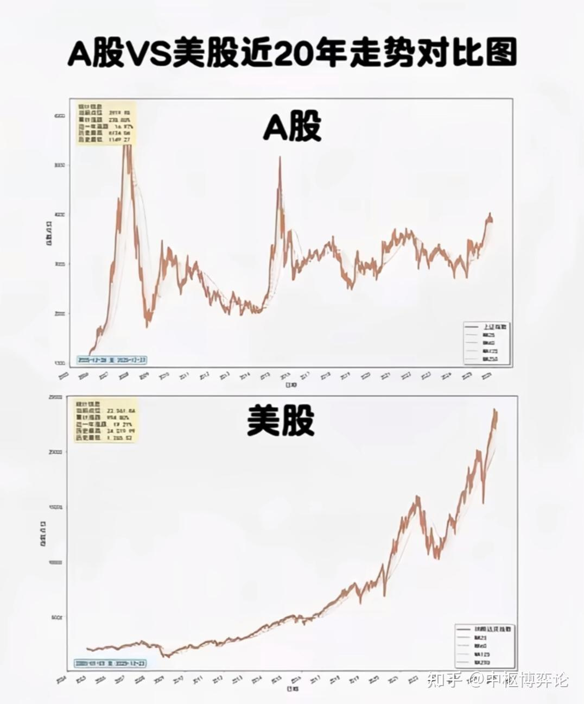

最近看到两张图。第一张，是A股30年来的走势。第二张是美股的走势。很多人看到这种差距，第一反应是：

中国经济是不是不行？

中国企业是不是不行？

A股股民是不是太喜欢炒作？

其实都不是最根本的问题。

甚至恰恰相反。中国过去二十多年经历了非常快速的经济增长，制造业、出口、基础设施、互联网、新能源、高端制造都出现过非常大的产业进步。问题是：

__为什么这么大的经济增长，没有充分转化成普通投资者的股票收益？__

这才是A股真正值得研究的问题。当然，先把两张图的一个技术问题说清楚。不同市场的指数编制方式不同，有的是价格指数，有的是全收益指数；不同指数的行业权重差异也非常大。比如纳斯达克100本身就是科技巨头高度集中的指数，而上证指数长期受到金融、传统工业等大权重行业影响。再加上人民币、美元汇率因素，简单比较“十年涨了多少”并不能完全代表两个国家资本市场的真实回报。

但即便把这些因素全部考虑进去，一个事实仍然很难回避：

__A股长期回报明显弱于美国头部股市。__

所以问题来了。

到底是什么造成了这种差距？

中国经济高速增长，所以A股就应该上涨。这句话听起来合理，实际上并不成立。因为经济增长和股票上涨，中间隔着一整个资本市场。一家企业产值增加，不代表股东收益一定增加。企业利润增长，也不代表每股收益一定增长。企业规模扩大，更不代表原来的股东一定能够分享对应的财富增长。举个简单的例子。一家公司原来赚10亿元，100万股，每股赚1000元。后来公司扩大融资、增发股票、不断引入资本，利润变成20亿元，但股票数量也增加到400万股。企业利润翻倍了。但每股收益从1000元下降到了500元。企业当然发展壮大了。但老股东并没有按照“利润翻倍”获得同样的收益。这就是很多人容易忽略的一件事：

__宏观经济看的是整个蛋糕变大了多少，股票市场看的是你手里的那一小块蛋糕变大了多少。__

中国GDP增长得很快，不等于上市公司每股盈利增长得一样快。更不等于二级市场投资者获得了同样的回报。

## 二、A股长期以来最大的结构性问题，是“融资功能”比“投资功能”更强

股票市场本质上是一个双向系统。企业从投资者这里获得资金。投资者则通过持有企业股权，分享企业未来的利润。正常情况下，应该形成一个循环：

__居民的钱 → 企业融资 → 企业投资 → 企业盈利 → 分红和股价上涨 → 居民财富增加 → 居民继续投资。__

这是一个财富循环。但A股过去很长时间存在一种比较明显的倾向：

__市场非常重视“企业如何融资”，却没有同等重视“投资者如何获得回报”。__

上市，是一个成功事件。再融资，也可以成为一个成功事件。企业规模扩大，是成功。地方拥有更多上市公司，也是成绩。但是，对于股票市场最核心的问题：

__这个企业有没有真正给股东创造持续回报？__

过去的重视程度并没有那么高。于是就形成了一种奇怪的利益关系。企业需要钱。企业成功上市。投资者把钱交给企业。但之后投资者能不能赚钱，却不再是企业上市逻辑里最核心的问题。这就像银行把钱借给企业以后，只关心企业有没有拿到贷款，却不太关心最终收益率够不够。这显然是不完整的。

## 三、A股真正缺的不是钱，而是“让钱长期留下来的理由”

很多人喜欢说：“只要大力推动居民资金进入股市，A股就起来了。”我觉得这是把因果关系弄反了。居民为什么不愿意长期持有股票？不是因为他们不知道股票能赚钱。恰恰是因为过去多年太多人亲身体验过：

__股票可以赚钱，但未必轮得到自己赚钱。__

如果一个市场长期存在以下现象：好公司与差公司估值差距不够大；企业利润与股东回报联系不够紧密；分红长期不足，再融资不断，退市不够顺畅，财务造假违法成本不足，大股东与中小股东利益不完全一致，那么普通人最终会形成一种非常现实的心理：

__这个市场不是不能赚，而是我赚不到钱。__

于是长期投资就很容易变成短线博弈。大家不再研究企业未来十年的现金流。大家研究的是：政策要炒什么？

哪条赛道要炒？哪个题材有消息？哪个概念可能停牌重组？哪只股票有资金进入？最后，整个市场从“企业价值发现机器”，慢慢变成了“预期差博弈机器”。一个市场越缺乏长期确定性，资金就越倾向于短期化。而越短期化，就越难形成真正的价值投资文化。这才是一个非常重要的恶性循环。

## 四、A股还有一个经常被忽略的问题：指数本身就没有那么“值钱”

这其实是很多讨论中容易被忽略的一层。大家经常拿上证指数去和标普500、纳斯达克比较。但这并不是完全公平的比赛。为什么？因为指数其实就是整个市场的一张“成绩单”。而成绩单里装的是什么学生，非常重要。美国过去十几年最强的企业，恰恰是全球最赚钱的一批科技平台。微软、苹果、英伟达、亚马逊、谷歌、Meta等企业不断提升利润和现金流。这些公司在美国主要指数中的权重越来越高。换句话说：

__美国指数在过去十几年，实际上不断把全世界最成功的一批企业装进了自己的成绩单。__

A股则不同。A股很多大权重企业来自银行、保险、能源、传统制造等行业。这些企业当然重要。甚至可以说它们是中国经济的地基。但是地基和发动机的估值逻辑，本来就不一样。银行可以贡献稳定利润，但很难像一家全球科技平台那样，把利润连续十年以极高速度扩张。所以A股指数长期表现差，有一部分也是因为：

__我们拿一个“旧经济权重较高的综合指数”，去和一个“科技巨头集中度极高的成长指数”比较。__

这不是全部原因，却绝对是原因之一。

## 五、真正值得警惕的，是A股没有形成足够强的“股东文化”

我一直觉得，这是A股最深的一层问题之一。资本市场最终不是企业家的市场，也不是管理层的市场。它应该是股东的市场。企业拿了股东的钱，就应该对股东负责。问题是，很多时候中国企业的思维仍然比较接近：“公司是我的。”但上市以后，公司实际上已经不是某一个人的私产，而是一家公众公司。你的股份多，你是大股东。别人股份少，他是小股东。但大家都是股东。如果大股东认为：上市以后只是多了一个融资渠道，却没有真正形成“股东利益优先”的意识，那么中小投资者当然很难产生长期信任。为什么美国市场很多人敢持有十年、二十年？因为他相信：只要企业持续创造利润，股东最终大概率能够分享到这些利润。而A股投资者过去经常需要额外考虑一层：

__企业赚了钱，老板到底愿不愿意让我一起赚？__

一旦这个问题长期存在，估值自然会打折。这就是所谓的“治理折价”。

## 六、A股的“政策属性”太强

这也是很多投资者痛苦的地方。A股从来不是完全意义上的市场。它和宏观政策、产业政策、监管政策、货币政策联系得非常紧。这本身不一定是坏事。问题在于：

__当政策的重要性超过企业价值本身时，投资者就会逐渐学会一件事：研究政策，比研究企业更重要。__

于是市场行为发生变化。大家不再问：“这家公司十年以后值多少钱？”而是问：“这周政策准备支持什么？”这个变化非常关键。因为企业价值是慢变量。政策是快变量。慢变量决定长期财富。快变量决定短期价格。一个市场如果长期让投资者相信：__政策变化比企业经营更重要，__那么资金自然会越来越短。而资金越短，市场波动越大。波动越大，长期资金越不愿意进。长期资金越少，市场越依赖短期资金。最后形成一个非常讽刺的循环：__因为没有长期资金，所以大家都短线；因为大家都短线，所以市场更没有长期资金。__

## 七、房地产曾经替A股承担了“居民财富蓄水池”的功能

过去二十多年，中国居民积累财富的主要方式，并不是股票。而是房子。这意味着什么？意味着中国居民原本就没有形成非常成熟的股票投资传统。家庭资产大部分集中在房地产。当房地产上涨的时候，居民即使不买股票，也能感受到财富增长。现在房地产进入调整，居民财富逻辑发生变化。大家开始更加重视现金流，更加重视就业，更加重视养老，更加重视孩子教育，更加重视负债。这时候，居民不会因为股票跌得多，就自然把钱投进股票。因为：

__未来收入预期下降的时候，风险偏好也会下降。__

所以真正决定居民是否愿意把长期资金投向股市的，从来不只是股市本身。还取决于整个社会的收入预期。这也是为什么，单纯喊“长期资金入市”，效果往往有限。你首先得让老百姓敢把未来十年的钱交给资本市场。而敢投资的前提，不仅是看到了上涨机会。更是觉得：

__我的工作稳定，我的收入稳定，我的养老有保障，我不会因为一次失业就需要把股票全部卖掉。__这其实已经不是股市问题了。这是整个居民部门资产负债表的问题。

## 八、A股为什么特别容易“牛短熊长”？

看到这里，其实答案已经慢慢出来了。A股的问题，不完全是没有好公司，也不是没有资金。而是市场里存在一个结构性矛盾：__企业需要长期资金，投资者却缺少长期持有的信心。__于是市场很容易发生一种现象：经济好一点。利润改善。政策刺激。资金入场。股票上涨。情绪开始疯狂。估值快速扩张。新投资者涌入。然后经济预期一旦变化，或者流动性收紧，或者政策转向。市场开始下跌。很多人发现：原来自己买的并不是企业。买的是情绪。于是开始恐慌。资金撤出。估值收缩。市场长期低迷。下一轮政策刺激之后，又重新开始。这就是为什么A股非常容易出现：

__三个月涨很多，三年原地踏步。__

真正健康的资本市场，不应该主要依靠一轮又一轮的情绪牛市来创造财富。它应该依靠企业利润增长，一点一点把指数推高。

## 九、A股真正的问题，不是“没有牛市”，而是“牛市的财富传导机制不够完整”。

这个区别非常重要。中国当然可以出现牛市。只要流动性充裕、经济预期改善、政策转暖、资本市场风险偏好上升，股市完全可以大涨。但问题是：

__牛市之后，普通投资者最后到底留下了多少？__

如果牛市只是：估值膨胀 → 新资金进场 → 老资金兑现 → 高位套牢 → 下一轮熊市，那么牛市其实没有真正完成财富创造。它只完成了财富转移。真正健康的牛市应该是：

__企业利润增长 → 企业估值提升 → 股价上涨 → 分红增加 → 居民财富增长 → 居民长期资金增加 → 企业获得更多长期资本 → 企业继续增长。__

这才叫资本市场创造财富。否则，只不过是大家轮流坐庄。

## 十、所以，真正决定A股未来的，不是“能不能把指数拉上去”

这一点我反而比较乐观。A股并不是没有潜力。中国庞大的制造业基础、完整产业链、科技产业、新能源、高端装备、人工智能、先进制造，这些东西都是真实存在的。真正的问题是：

__这些产业创造出来的利润，能不能稳定地变成股东回报？__

如果答案越来越接近“能”，那么A股真正的大牛市反而可能不是依赖某一次政策刺激，而是来自资本市场生态本身的变化。当投资者发现：好企业真的可以持续分红。差企业真的会被淘汰。造假真的会付出巨大代价。融资不再只是企业拿钱，而是企业必须对股东负责。大股东和中小股东不再是天然的对立面。优秀企业能够获得更高估值。长期资金能够得到合理回报。那么一个非常重要的变化就会发生：

__中国人终于开始愿意把股票当成资产，而不是彩票。__

而这一天，可能比某一个指数涨到多少点更加重要。
