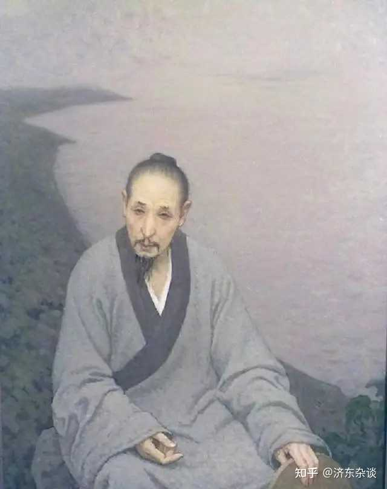
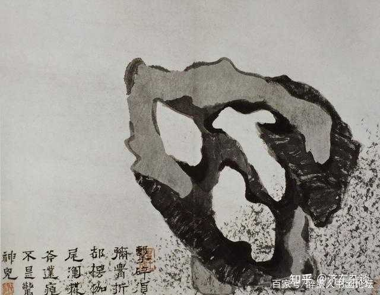
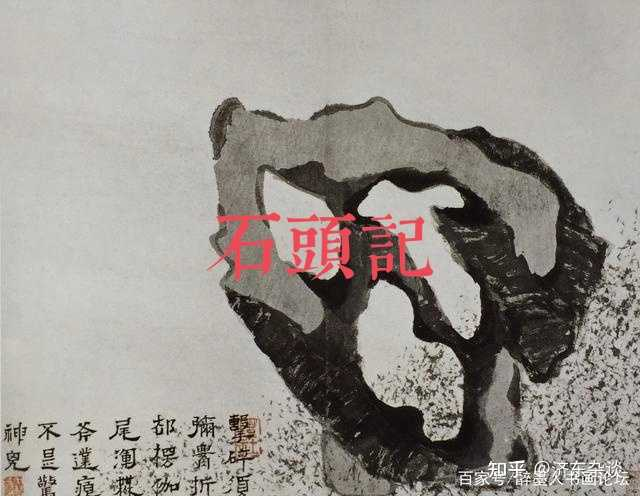
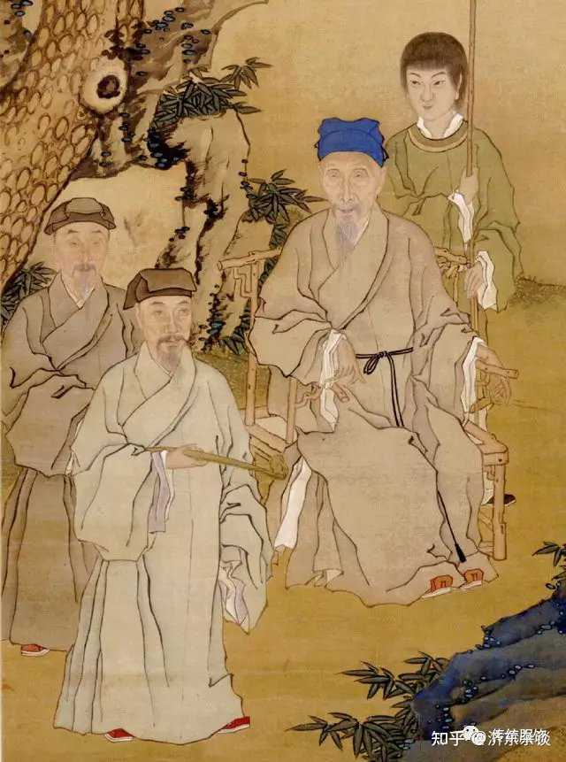

《红楼梦》第一回就明写了：红楼梦最早的时候是《石头记》，由__空空道人__所写；空空道人__出了家，__于是改名__《情僧录》__。

后来又分别经过孔梅溪\(笔名\)改为《风月宝鉴》；曹雪芹\(笔名\)修改，最终成书《金陵十二钗》。

__红楼初代作者，一定是个与石有缘的出家人。__

（注：以下内容__纯属猜测__，和胡适猜曹家人没有区别。）

话说在明末清初的时候，有一个和尚，本姓朱氏，是大明__宗室__。十九岁见山河破碎，于是__出家__，自号为八大山人。

石头记作者空空道人的空，指的是“四大皆空”；空空，就是四大皆空x2，可不就是“八大”？

山人合起来就是个“仙”字，寻仙者不就是“道”人吗？

__所以空空道人，换个叫法，可不就叫做“八大山人”？__

从这个名号你也能看出来，八大山人是属于__半僧半道__。（四大皆空为佛语，山人为道语。）这不也契合空空道人由道入僧吗？

更神奇的是，山人还有个__弟弟__，跟他哥相反，属于是__由僧入道__，最终道号望云子，化名牛石慧。

- 牛石慧的牛\+八大山人的八=朱；
- 石慧：石头开了智慧；

__红楼梦的故事，开始于补天石游历人间，开篇于一僧一道接走甄士隐。__

山人兄弟俩，不就是一僧一道？

alt="Image">

八大山人的绘画作品里，有大量的画怪石之作。山人平生__酷爱怪石__，能从石头中得到灵感，写出《石头记》，不也合情合理？

比如下面这副八大山人的石作，你看看有没有感觉？

alt="Image">

__我在上面加三个字，你再看看有没有感觉__？

alt="Image">

更绝的是，八大山人的绘画作品提诗，全都是藏伏了__大量隐射__，跟红楼梦的诗作隐射的风格很相似。

清末文学家，老残游记作者刘鹗曾写道：

《离骚》为屈大夫之哭泣，《庄子》为蒙叟之哭泣，《史记》为太史公之哭泣，《草堂诗集》为杜工部之哭泣；李后主以词哭，__八大山人以画哭__；王实甫寄哭泣于《西厢》，__曹雪芹寄哭泣于《红楼梦》__。

八大山人的画与诗，表达的都是__亡国亡天下__的悲恸。（与红楼梦的内核是一致的。）

《常州先哲遗书》里，有先哲们记录八大山人的八大山人传。其中有一句是：

予见山人题画及他题跋，皆古雅。__间杂以幽涩语，不尽可解__。

山人题作__爱藏内容，__几乎已经__成了习惯__。和他交往的文人们，都很难解出他藏在字画中的__谜题__。

__习惯的养成，是需要旷日持久的。__

你猜猜山人为什么这么爱设谜？

alt="Image">

最绝的是《常州先哲遗书》里还记载了__八大山人有个秘密__，在他的背篼里：

澹公语予，山人__有诗数卷，藏箧中，秘不令人见。__

作者听另一位叫澹公的说，__八大山人的背篼里背了好几卷书，从来不给别人看__。

澹公说可能是诗集，但万一呢，同志们，万一这背篼里藏的就是《石头记》呢？

如果仅仅只是诗集，山人为什么秘不示人？很可能是因为石头记初稿过于露骨，所以山人从不对外透露。最后才将文稿托付给了朋友“孔梅溪”。

八大山人曾经在一副画里题诗曰：

__分付梅花吴道人__，幽幽翟翟莫相亲。
南山之南北山北，老得__焚鱼扫虏__尘

这里梅花吴道人，原指元代儒释道三合一的奇才，梅花道人吴镇。但也有可能，就是山人朋友的一个__代号__。

如果山人就是空空道人/情僧，那么他的朋友__梅花吴道人__，会不会就是那位红楼第二作者“__孔梅溪__”？

alt="Image">

__当然，以上推断，纯属猜测。__

但其合理程度，是不是比拿着“曹雪芹”的笔名，就去找曹家包衣的说法合理可靠多了？

__曹雪芹这个笔名的由来其实也可以猜。__

因为八大山人也曾自号“__雪个__”。“个”在篆书里其实形似竹叶，而雪在红楼梦里代表了好大雪的“薛家”，也就是清廷。

所以八大山人的“雪个”指的是不向大雪低头的竹子。

附朱元璋诗\-咏竹：
雪压枝头低，虽低不着泥。
一朝红日出，依旧与天齐。

而“__雪芹__”这个词，是跟山人取了款式一样的雪字号，以表示__继承山人之志__。

__南宋辛弃疾曾上书《美芹十论》，是指导朝廷练兵改革的军事论述。__

为什么叫“__美芹__”，是因为辛弃疾把自己的文章比喻为__有营养好吃容易消化__的__水芹菜__。

雪芹这个词也是一个意思。他把晦涩难懂的《石头记》转化成了__有营养容易消化的的通俗作品__，和辛弃疾是一个道理。

曹则指的是同类，比如“尔曹”，就是“你辈”。表明和空空道人、孔梅溪都是同类遗民；又或者表示的是一群人。

所以曹雪芹是伟大的，没有他的__通俗化__，这部石头记可能很难传到今天了。（毕竟山人谜语人体质，同时代文人都读不懂他的隐射。）

但此曹雪芹非彼曹雪芹，绝不是某个虚构出来的包衣曹雪芹。

最后，

山人的诗真的很难懂吗？也不尽然，更有可能是山人的朋友们，都在__装聋作哑__给山人打掩护。

文人屈膝，气节犹存。

那最后就以山人的诗句作结尾吧，你读你也能看出来：

墨点不多__泪点多，__山河仍是__旧山河__；
横流乱石桠杈树，留得__文林细揣摩__。

若干年后：

郑板桥\-题八大山人山水
国破家亡鬓总皤，一囊诗画作头陀。
横涂竖抹千千幅，墨点无多__泪点多__！

满纸荒唐言，一把辛酸__泪__。

最后在补上知友的佐证：

八大山人《题自画石诗》

爱此一拳石，玲珑出自然。__蒴源应太古，坠世__又何年，有志__归完璞__，__无才去补天__。不求邀众赏，消酒做顽仙。

而红楼梦第一回，讲的内容就是一块补天石，__因为无才补天__，于是最终去凡尘经历了一番。

最后石头见证了红楼梦的悲欢离合。

《红楼梦》谁知此石自经煅炼之后，灵性已通，因见众石俱得补天，独自己无材不堪入选……
……
空空道人乃从头一看，原来就是__无材补天，幻形入世__，蒙茫茫大士渺渺真人携入红尘，历尽离合悲欢炎凉世态的一段故事。

诗的坠世，对应“幻形入世”；无材补天对应无材补天；历经悲欢离合，又修回本源模样，也就是“归完璞”；

所以八大山人这首诗直接嵌入红楼第一回一点也不突兀，可以说非常丝滑。
