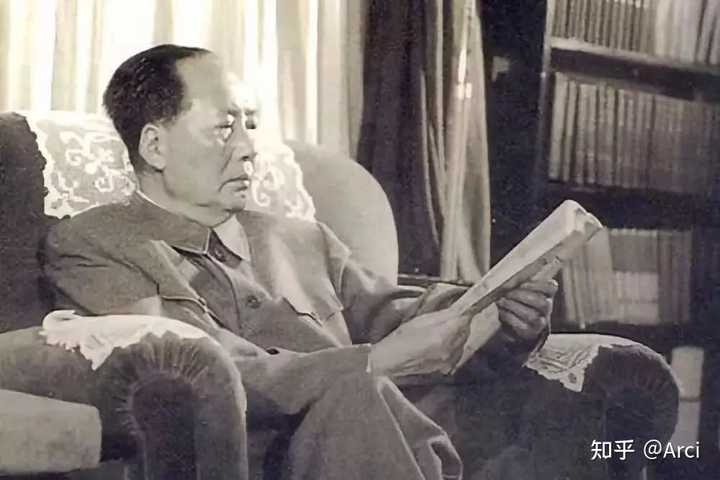
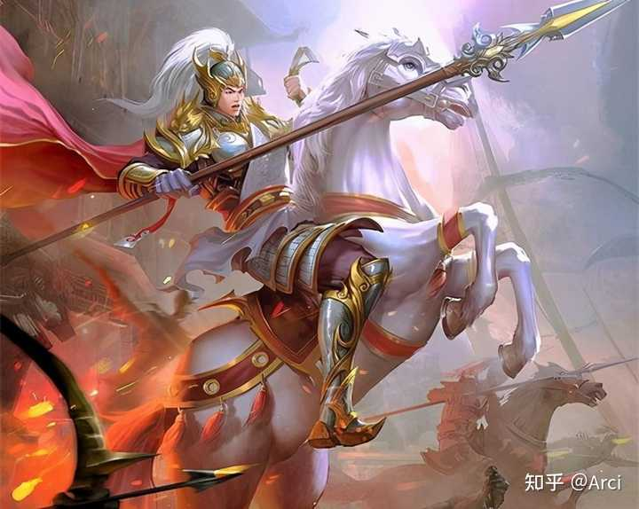
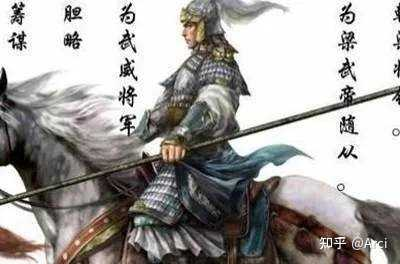
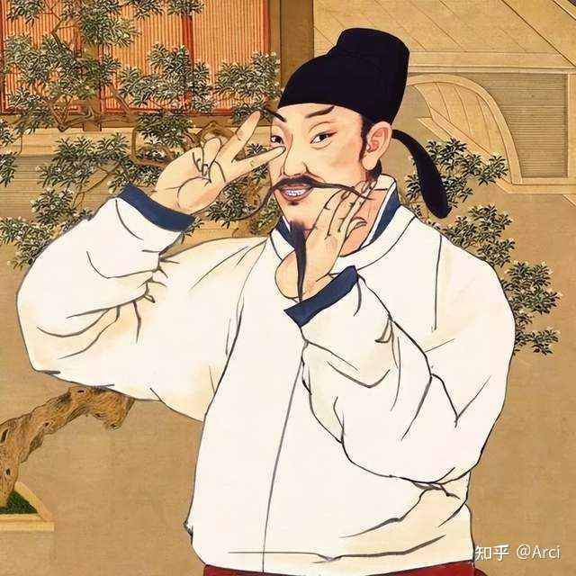
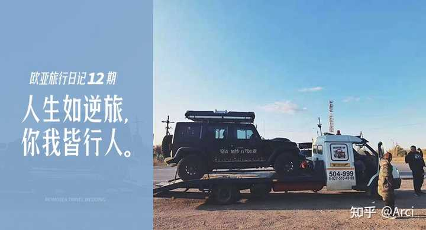

李白都已经那么接近皇帝了，为什么不找个机会跟皇帝深谈能否被重用啊？ \- Arci 的回答

是他沟通表达能力太差，还是皇帝真的不给他机会？

__讲个有点残忍的故事，慎入！__

教员晚年读史，很激动的写过这样一条批注：__“再读此传，为之神往。”__

__让教员为之神往的传记主角，是《梁书》中“名师大将莫自牢，千兵万马避白袍。”的白跑将军陈庆之。__

alt="Image">

《梁书·陈庆之传》是这样记载的：

大通初，魏北海王元颢以本朝大乱，自拔来降，求立为魏主。
高祖纳之，以庆之为假节、飈勇将军，送元颢还北。

__颢于涣水即魏帝号，授庆之前军大都督，发自铚县，进拔荥城，遂至睢阳。__
__魏将丘大千有众七万__，分筑九城以相拒。__庆之攻之__，自旦至申，陷其三垒，__大千乃降__。
时魏征东将军__济阴王元晖业率羽林庶子二万人来救梁、__宋，进屯考城，城四面萦水，守备严固。__庆之命浮水筑垒，攻陷其城，生擒晖业__，__获租车七千八百辆。__仍趋大梁，望旗归款。
颢进庆之卫将军、徐州刺史、武都公。仍率众而西。

__魏左仆射杨昱__率御仗羽林__宗子庶子众凡七万__，据荥阳拒颢。兵既精强，城又险固，庆之攻未能拔。
魏将__元天穆__大军复将至，先遣其骠骑将军__尔朱吐没儿__领胡骑五千，援杨昱；又遣右仆射__尔朱世隆__骑一万，据虎牢。天穆、吐没儿前后继至，旗鼓相望。

__时荥阳未拔，士众皆恐，庆之乃解鞍秣马，宣喻众曰__：“吾以此以来，屠城略地，实为不少；君等杀人父兄，略人子女，又为非算。天穆之众，并是仇雠。__我等才有七千，虏众三十余__万，今日之事，义不图存。吾以虏骑不可争力平原，及未尽至前，须平其城垒，诸君无假狐疑，自贻屠脍。”
一鼓悉使登城，壮士逾堞而入，遂克之。
俄而魏阵外合，庆之率骑三千背城逆战，大破之，__鲁安于阵乞降，元天穆单骑获免__。
收荥阳储实，牛马谷帛不可胜计。__进赴虎牢，尔朱世隆弃城走__。

__魏主元子攸惧，奔并州。其临淮王元彧、安丰王元延明率百僚，封府库，备法驾，奉迎颢入洛阳宫__。
庆之麾下悉著白袍，所向披靡。
先是洛中谣曰：“名师大将莫自牢，千兵万马避白袍。”
自发铚县至于洛阳十四旬，平三十二城，四十七战，所向无前。

alt="Image">我怀疑后世三国中，对赵云、马超的形象塑造，可能参考了陈庆之。

自冠军候后，这样荡气回肠的战斗太罕见了，连教员读了都觉得神往。

__但这耀古烁今的战绩之前，陈庆之熬了二十多年的暗夜，很少人关注陈庆之的青年时光：__

陈庆之少年时被选入当时还是郡王的萧衍府中做随从。
萧衍是出了名的棋痴，常常通宵手谈，左右侍从熬不住倒下，唯独陈庆之不睡。一闻传唤即刻赶到，陪这位未来梁武帝下到天亮。

日子久了，萧衍信他忠谨可靠，登基后留他在身边掌管宫廷文书。
从弱冠入府，到年过四十才首度领兵，__陈庆之陪梁武帝下了整整二十余年围棋__。

少年变中年，青丝添白发，一肚子韬略无处施展，只能在棋盘上排兵布阵当作过干瘾。
与梁武帝朝夕相处二十多年，陈庆之也不躁进，只是安静等，等一个也许永远不会来的机会。

四十出头被派去接应降梁的北魏刺史，初临战阵小胜一场，算是叩开边门。真正的转折在那之后：

北魏宗室因内乱南奔，请梁出兵助其称帝。
梁武帝对本事并无诚意，__随手拨给陈庆之七千人马，基本是敷衍试探：成固好，败了也不过送颗弃子__。
满朝上下都没有当回事。
陈庆之叩谢受命，毫无愠色。

__他知道稍纵即逝的机会来了，抓不住就是一辈子庸碌。__
__于是有了前面那段史书明文记载的白袍北伐。__

__隐忍二十载，等一个被上位者视为儿戏的机会，然后把它打成名垂史册的传奇，这才是陈庆之最震撼人心之处。__

alt="Image">

很多人疑惑，一个李白的问题，讲了那么多陈庆之做什么？__是不是写错了，跑题了？__

我们对比一下陈庆之和李白的人生境遇，读者就会明白了：

__1、入宫方式与亲信程度不同。 __陈庆之少年被萧衍亲自选中带入府中，从最低微随从一点点长成梁武帝最亲近的旧部，是亲信中的亲信。李白四十二岁才因贺知章夸他诗名、唐玄宗好奇想见识其人而下诏召入，本质上更像被皇帝叫来“看看稀罕物”的外来宾客。

__2、相处时长与信任基础不同。 __陈庆之伴在梁武帝身边二十余年，朝夕相处，皇帝对其性情、能力、底线摸得清清楚楚，才谈得上“知才而不敢轻用”。李白前后待了不到两年，“赐金放还”，连陈庆之陪伴时长的零头都不到，玄宗对他的了解仅限于“诗写得漂亮”。

__3、所长是否匹配君主核心偏好。 __梁武帝平生最痴迷下棋，陈庆之恰恰陪他下了二十年棋。这是皇帝最私人、最放松也最在意的精神角落，由此建立的默契远超一般君臣。李白擅长写诗，给杨贵妃写了《清平调》，可唐玄宗本人对诗歌并无特殊执念，那几首诗更多是哄爱妃开心的消遣——在玄宗眼里，李白充其量是“能写几句好诗的弄臣”，远谈不上不可或缺。

__4、为人处世的做派不同。 __陈庆之在武帝面前内敛沉稳，二十年小心侍奉，从不张扬，不得罪任何人，悄悄攒实力等机会。李白入宫后“令高力士脱靴”、醉卧殿上、恃才放旷。看似潇洒，实则在等级森严的盛唐宫廷把皇帝身边最核心的宦官权贵全得罪遍了。玄宗初见便在心里定了调：此人“非廊庙器”，只可作盛世点缀，不可与闻政事。

__5、晚年对机会的把握，照出政治眼光的高下。 __陈庆之抓住梁武帝那个“敷衍试探”的机会，打出七千白袍北伐、名震天下的战绩，晚年成国之柱石。李白在安史之乱中看不清肃宗已即位、永王李璘拥兵江南是皇权大忌，__贸然投入永王幕府写《永王东巡歌》，以附逆之罪流放夜郎。__这不是怀才不遇，这是政治判断力严重缺失的确证。

__连陈庆之这种，教员都赞叹不已、名震南北朝的白袍战神。生在用人之际的乱世，青年即为帝王心腹，伴驾二十载小心隐忍，擅君主之所好，低调蓄势，才勉强等到一个被视作儿戏的七千人次机会，且晚年仍能审时度势不犯大错；__

__李白这种中年才被好奇心召见，匆匆两年，恃才傲物得罪权贵，所长非君主所重，盛世本无出头缝隙，后期还犯低级政治错误，凭什么觉得就该获得皇帝的信重和重用？__

alt="Image">

__说一个可能让很多人难以接受的结论：历史对李白最大的仁慈，就是没让他做成官。 __

否则大唐多一个泯然众人的平庸官僚，少了一个“笔落惊风雨”的诗仙。

__陈庆之：活在南北朝大争乱世，天下分崩、连年大战，各方势力最缺的就是能打仗出奇制胜的人，即便如此，他仍熬了二十年才换来一次试探性机会； 李白：赶上的是开元天宝盛世，海内承平，官僚机器按部就班运转，大多数人本就是帝国螺丝钉，乱世才有的“一步登天”缝隙，在盛世几乎不存在。 __

__连乱世拼命隐忍二十载才出头，盛世哪有那么容易？__

类似于李白这样的例子还有很多，历史对他们最大的温柔，就是没让他们担任重要领导岗位。历史对他们最大的残忍，就是把他们放在了重要岗位。

- 南唐后主李煜，词中帝王，一首“春花秋月何时了”千古绝唱，可当皇帝呢？亡国之君。
- 苏轼，宋词之冠，“大江东去”无人能及，可让他做官呢？一辈子颠沛流离，新党嫌他旧、旧党嫌他新，两头不讨好。
- 宋徽宗赵佶，书画双绝，瘦金体独步天下，可当皇帝呢？靖康之耻，北宋亡在他手上。

__文学艺术的天才，未必是治国理政的材料__。硬把他们塞进不合适的位子，对国家和对他们自己，都是一场灾难。

__陈庆之的故事告诉我们：才华是必要条件而非充分条件。它需要合适的时代土壤、隐忍、时机、上位者愿意松一松门锁，以及最基本的政治判断力__。

缺任何一环，史书就不会记下这个名字。

而李白未受重用从来都不是冤案，只是一个很多人不愿意面对的残酷现实。

__连最耀眼的例外都要付出如此代价，平凡人的怀才不遇，才是历史的常态。__

__如果你觉得自己怀才不遇，或者处于人生低谷，希望苏子的那句诗：人生如逆旅，你我皆行人，可以慰籍此刻的你！__

__共勉之！ __[@知乎直答](https://www.zhihu.com/people/f3bce7aa022240e25f12aec9a9b70363)__ __

alt="Image">
