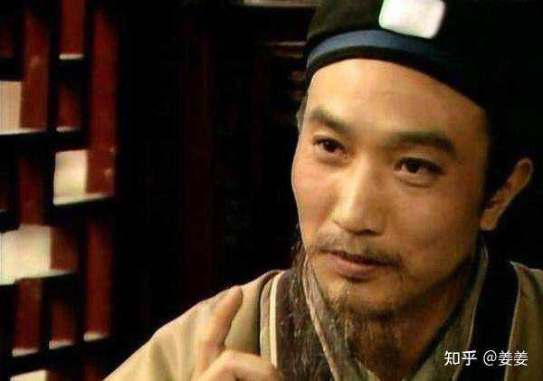
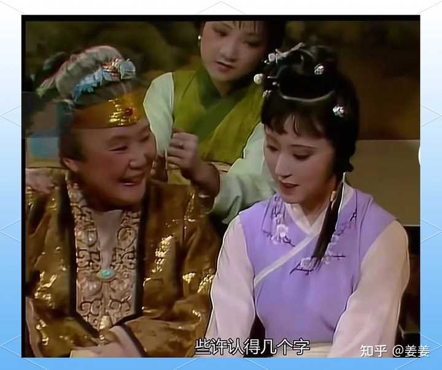
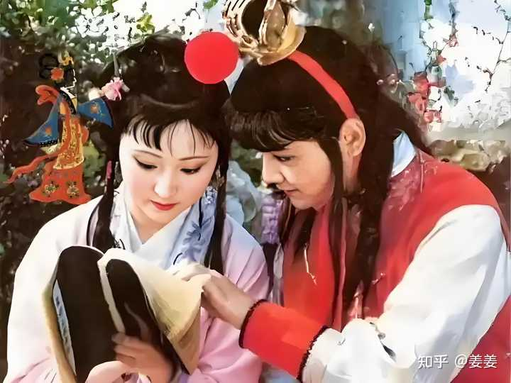
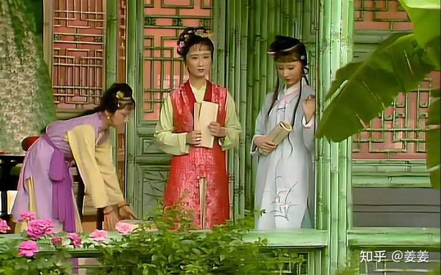

我认为黛玉的学问来路清晰，大致经历了三个阶段：__幼年家学的严格启蒙，入贾府后的持续自修，以及在宝玉影响下对“闲书”的广泛涉猎。__

__一、家学启蒙，假充养子，早聘名师。__

黛玉的学问根基，首先来自林家。

林如海是前科探花，出身“虽系世禄之家，却是书香之族”。

探花之名，意味着他在科举考试中名列一甲，经史文章自不必说，诗词功底更是当时士人中的佼佼者。

__这样的父亲，本身就构成了一座丰厚的家学资源。__

alt="Image">

书中写黛玉五岁时，“夫妻爱之如掌上明珠。见他生得聪明俊秀，也欲使他识几个字，不过假充养子之意，聊解膝下荒凉之叹”。

“假充养子”四字值得留意。林如海膝下无子，唯一的幼子又早夭，于是将女儿当作儿子来教养。

__这一决定，使黛玉从一开始接受的就是男子式的正统教育，而非一般闺秀“识几个字”的敷衍。__

明清时期，女子读书多限于《女诫》《内训》之类，目的是“认得两个字，不是睁眼的瞎子”，而黛玉所受的教育起点，显然远高于此。

启蒙之后，林如海又专门聘请贾雨村为家庭教师。

贾雨村是进士出身，学问扎实，在教黛玉期间，黛玉仅用一年时间便读完了《四书》。这个进度放在当时是相当快的。

黛玉进贾府时，贾母问她念何书，她答道：“只刚念了《四书》。”__这个回答看似谦逊，实则透露了她在家中所受教育的系统与扎实。__

《四书》是科举的基本教材，也是传统士人知识体系的根基，黛玉年方数岁便已通读，其家学之严谨可见一斑。

__二、贾府续学，闺中自修，博览群书。__

__黛玉入贾府之后，学业并未中断，反而在一个更适合她性情发展的环境中继续深入。__

黛玉初到贾府那天，贾母命人“请姑娘们来。今日远客才来，可以不必上学去了”，说明贾府的姑娘们平时是有固定上学安排的，学的应是专门的闺学。

贾母后来又说姐妹们“读的是什么书，不过是认得两个字”，这固然是世家老太太惯有的谦辞，但从中也可看出，贾府对女孩读书是默许甚至鼓励的，黛玉融入其中，自然得以继续求学。

alt="Image">

真正能说明黛玉读书之勤、藏书之富的，是刘姥姥二进荣国府时的一段描写。众人来到潇湘馆，刘姥姥“因见窗下案上设着笔砚，又见书架上磊着满满的书”，脱口说道：“这必定是那位哥儿的书房了。”贾母笑指黛玉道：“这是我这外孙女儿的屋子。”刘姥姥留神打量了黛玉一番，方笑道：“这那象个小姐的绣房，竟比那上等的书房还好。”

一个闺中少女的房间，被乡下老妪误认作公子书房，被贾母认可为“比上等的书房还好”，这两句侧写，胜过任何正面的夸赞。

__书架“磊着满满的书”，不是摆设，而是黛玉日常阅读的真实状态。__

__从林如海去世后黛玉带回家中的，恰恰不是金银细软，而是父亲留下的书籍。书，是林家留给黛玉最珍贵的遗产。__

alt="Image">

__黛玉读什么书？从书中多处细节可以推断，除了《四书》等正经书之外，她涉猎极广。__

第二十三回，宝玉在沁芳闸桥边读《会真记》，被黛玉撞见，黛玉“接书来瞧，从头看去，越看越爱看，不到一顿饭工夫，将十六出俱已看完，自觉词藻警人，馀香满口。

alt="Image">

虽看完了书，却只管出神，心内还默默记诵”。此后她又听到梨香院传来《牡丹亭》的曲词，“不觉心动神摇”，“如醉如痴”，并将戏文中的句子与古人诗词在心中互相印证，“凑聚在一处”。

__值得注意的是，黛玉读这些书并非泛泛消遣。她看完《会真记》后“心内还默默记诵”，听《牡丹亭》时能迅速联想到“水流花谢两无情”“流水落花春去也”等前人诗句，说明她读书时有极强的记忆力和联想力。__

__宝玉将闲书引入她的视野，她则以自己深厚的阅读功底将这些“闲书”转化为滋养文学感受力的养分。__

__三、学养外显，教香菱学诗，见真功夫。__

黛玉读书究竟到了什么程度，最能说明问题的是她教香菱学诗一段。

一个人的学问深浅，不在于自己能读多少，而在于能否讲出所以然。

__香菱向她求教作诗，黛玉并未含糊其辞，而是给出了一条清晰的学诗路径。__

她让香菱先读《王摩诘全集》的五言律一百首，“细心揣摩透熟了”，然后再读杜甫的七言律一二百首，再读李白的七言绝句一二百首，有了这三个人做底子之后，再去看陶渊明、应玚、谢灵运、阮籍、庾信、鲍照等人的作品。

这套由王维、杜甫、李白入手，再由专而博的读诗方法，至今仍被不少古典文学爱好者视为入门正途。

更见功力的是，黛玉将自己的书借给香菱时，书上带有她的批注。那些批注是黛玉平日读书时随手所记的心得体会，是她与古人对话的痕迹。

香菱读完之后跟黛玉谈感受，说出“诗的好处，有口里说不出来的意思，想去却是逼真的；又似乎无理的，想去竟是有理有情的”这样一番话，黛玉听了点头认可。__这说明黛玉的批注不仅帮助了自己理解诗歌，还通过借阅的方式启发了香菱的诗学悟性。__

alt="Image">

黛玉对历代诗人的熟悉程度也是惊人的。她评王维、杜甫、李白时从容自然，信手拈来，毫无思索的滞碍。

__这种“如数家珍”的从容，不是临时翻书能装出来的，而是长期沉浸于诗词阅读之后形成的一种本能。__

她在诗社中作诗，咏海棠、咏菊花，屡屡夺魁，风格或风流别致，或含蓄浑厚，皆能根据题旨自由转换，__这背后是大量阅读与反复揣摩积淀而成的功底。__

__黛玉的学问，有一个从“被动接受”到“主动求知”的清晰轨迹。__

幼年时，林如海以探花之才为她奠基，贾雨村以进士之学为她启蒙，课程虽以《四书》为正，却因“假充养子”的特殊教养方式，给予了她远超一般闺秀的知识起点。

进入贾府后，她在姐妹共学的环境中保持了读书的习惯，又在宝玉的引导下打开了更为广阔的阅读视野，正经书与闲书兼收，典雅与灵动并蓄。

__最终，这一切汇聚成一种真正属于自己的文学判断力，她不仅能读懂前人的诗，还能说出好在何处，并且把这种判断力传递给他人。__

__从这个意义上说，黛玉的学问，一半来自家学，一半来自她自己。__

alt="Image">
