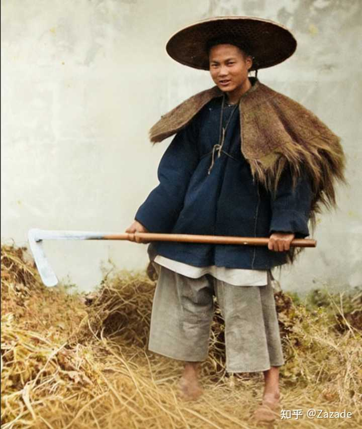
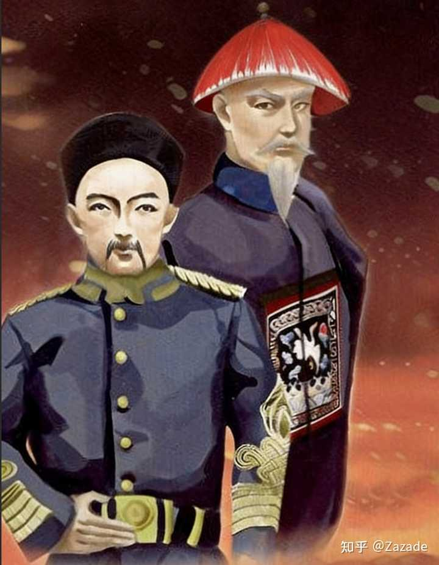
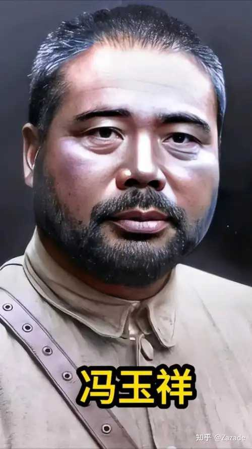

主要是士兵不好骗了。

曾国藩招兵的时候，特意强调不要老兵油子和城市兵，他偏爱“朴实有农夫气质为上”的农村兵，这样的人眼神是清澈的，好忽悠。

alt="Image">

曾剃头忽悠他们，口号主要有两个：

1\.长毛都是坏人，我们要保家卫国。

2\.我作为湖南人，要给家乡子弟谋个上进之路。

结果湘军跟太平军一交火才发现上当了。

太平军和他们一样，都是朴实的农民，根本不祸害老百姓，针对的都是为富不仁的土豪劣绅，湘军保的是土豪劣绅的家，卫的是满洲贵族的国。

至于说上进之路，更是扯蛋，到战争中后期，湘军内部也发生营官扣一个月甚至三个月工资的现象，曾剃头甘心给满清当狗，他一个侯爵，怎么兑现封县长、市长的委任状？

甲午战争后，光绪皇帝痛定思痛，总结战败经验时说：

嗣后我君臣上下，惟期坚苦一心，痛除积弊，于练兵筹饷两大端实力研求。《光绪东华录》

话说的好听，可事难做。

给日本的赔款是2\.3亿白银，赔完钱还要练兵，光绪手中无权，练兵成果可想而知。

alt="Image">

庚子国乱后，慈禧太后出面举行新政，袁世凯、张之洞主持南北洋的练兵。

袁世凯的招兵条件如下：

1\.中国国籍，年龄20\-25岁，

2\.身体无残疾，能在200步外分清五指。

3\.身高1\.6米以上，能抬起一百斤重物

4\.保甲出具保证书，有犯罪记录、吸食鸦片者不收

张之洞在这个基础上加了一条：有童生以上学历者优先。

__日后的武昌起义就是因为新军有文化，不是清政府说什么他们就信什么。__

当然老袁连个秀才出身都没有，对文化水平没怎么额外要求，但他有另一个buff：淮军的诅咒。

北洋是李鸿章创办的政军工一体的组织，李鸿章作为淮军首领，其门生故吏遍布北洋，别的不说，老袁就是淮军子弟。

北洋六镇的士兵、中下级军官很多都是淮军子弟出身，比如冯玉祥的父亲冯有茂就是毅军老士官，曾参加平定捻军、左宗棠收复新疆战役。

按理说这样出身的老士官，应该在晚年得到良好的安置。

可甲午战败后，光绪帝大笔一挥，裁撤绿营旧军。

时代的灰尘压在普通人身上就是一座大山，冯有茂这样的老士官被直接开除，退伍费、安置费分币没有。

一身伤病的冯有茂为了减轻儿子的负担，卖了房子，孤身一人回到安徽老家，可就是这样，冯有茂也是一句怨言没有，因为他儿子还在清军服役。

alt="Image">

1906年，冯玉祥升任队官，冯有茂很高兴，坚持要来北京看儿子。冯有茂年老体弱，一路颠簸加重了他的肺炎，到京后不久去世。

__有冯有茂这样的人做例，北洋新军的中下级军官又对大清有什么忠诚可言呢，你能保证皇帝哪天不再下一道圣旨，把他们轰回家吗？__

3\.30回应评论区，我看到有八旗子弟在评论区说这两个问题：

1\.曾国藩并没有食言，他给湘军子弟谋了上进之道。这话你要是跑到150年前的湖南说，当地人能活撕了你。

湘军将领，很多人都拿到了曾国藩对他们战功的奖励，县市级官员的委任状。但太平天国失败后，满清给曾国藩，李鸿章的奖励很丰厚，毕竟他们本来就是大清官员，但给曾国藩的部下安排很差。

县市级干部，满清政府内部人员还安排不过来，根本轮不上湘军将领。

士兵方面，恭亲王给的安置是转变成每月1两银子的绿营兵，这个钱根本养不了家。

曾国藩明白，自己要出事。

1855年正月，曾国藩用计脱身，他跟希望回家的湘军将领说：朝廷命我北上剿匪，谁愿意跟我去啊。

结果自然是没人跟随。

四月，湘军一流将领鲍超部发生哗变，前去安抚的副市长直接打死，被残酷镇压。

此后被分到各地的湘军旧部，都因为退伍安置跟曾国藩说的不一样，陆续起义，甚至有人打出太平天国的旗号。

曾国藩不得不出面，拿一些小钱安抚一下，然后说：这个事我还在跟朝廷沟通，别急。

1857年，湘军旧部活不下去了，在湖南起义，曾国藩这回不敢回湖南，而是给身在第一线的湖南巡抚、湖广总督写信：

所谓外宽者，凡控告会匪者皆不批准，凡供扳会匪者皆不捕拿，苟无他罪，囹回无专收入会之囚，苟无他犯，差役无专拘入会之票。所谓内严者，确访要紧头目，立拿解省,不__在湘乡审讯，而听省城核断__《曾文正公书札》

就是一句话，头目给我送过来，协从你们看着办。

送过来的头目都是他的旧部，曾国藩先安抚，然后拿出钱来打发，湘军旧部被分化了，上头自私自利，下头糊里糊涂。

__曾国藩头上的红顶子，那是太平天国和湘军的血一起染红的。__

这也是我为什么说，士兵不好骗了的关键原因。

湖广一带，有许多被曾国藩害惨了的湘军家庭，这些退伍军人非伤即残，晚景凄凉。

请问谁还对清政府的政府信用有信心呢，对于一个政府来说：盼你倒霉，跟盼着你死，这是俩概念。

八国联军后，汉人们认为满清应该醒悟了，该干点正事了，因此愿意加入新军，毕竟洋人更可恶一点。

可载沣上台后又是老一套，汉人们就盼着你死了。

2\.太平天国不祸害老百姓，只针对土豪劣绅。

这里我只说一点，太平军曾经北伐至天津、静海，我想问问这两个居住地的读者。你们听说过太平军在天津、静海有过什么屠城、骚扰地方的战争罪行吗？

太平天国在南方确实也屠城，不过屠的是满城里的满人，还有就是跟满人沆瀣一气的汉奸败类。

底层老百姓都是太平天国的兵源和群众基础，洪秀全杀他们干什么？

到底是谁把满清和湘军淮军干的混蛋事往太平天国脑袋上扣？
