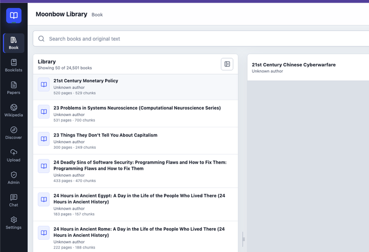
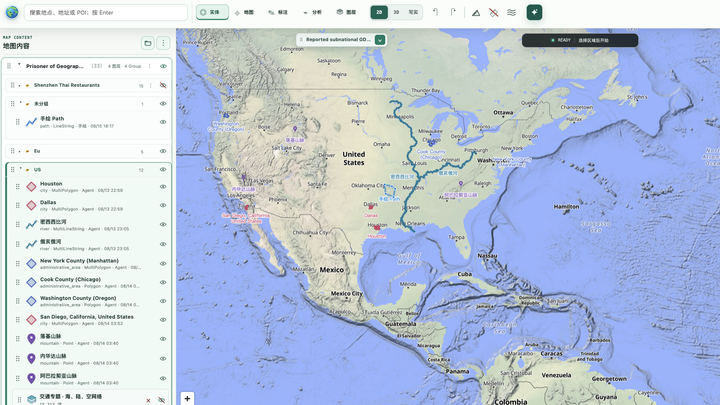
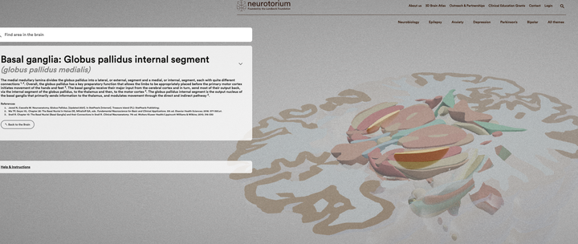

真正爱读书的人是怎么看书的？ \- 知乎用户 的回答

书不可不读，但现在大 AI 时代的阅读的方法论发生了非常根本性的转变。现在读书更像是一个查找文档的过程，讲究即用即查，而不是像以前一样先去通读一遍，然后获得一个比较细致的心智索引（Mental Index），后面根据自己的记忆去大概定位到比较精准的章节和小节（Section）。

很多书的目录写得并不好，不足以支持查找，比如说一些具体的概念、具体的案例等等。但在现在的 AI 时代，事情发生了非常根本的转变。

尤其是各种教科书、工具书、概念性、理论性的书，现在基本上都可以这样读了。甚至可以说，不这样读反而是浪费时间。

如果技术能力好一点的朋友，甚至可以去收集几百本、几千本，甚至几万本，几十万本自己会读的书，然后把它们都切块、切分成 Chunk，再分别去做嵌入（Embedding），然后随便去接一个大模型服务的 API，就可以做 RAG（Retrieval\-Augmented Generation，检索增强生成）了。当然了，想把这样规模的图书馆搭起来，各种去重、各种 OCR 扫描、各种资源查找、书单制定，就变成了大问题，以及运维也会变得非常困难。

alt="Image">

不过搭出一个这样子的平台以后，你甚至愿意的话，可以自己去做一个小“微信读书”：把这些笔记、相关的讨论和标注都做成插件的形式，然后让有 access（有权限进入访问你的图书馆）的朋友一起，大家一起标注一起读。

于是在这样子的读法下，基本上在毫秒级就可以查到对应的事实、对应的概念和对应的案例，非常方便。现在基本上已经到了“用时再查”的境界，很多时候阅读方法真的变了。

然后各种书单的功能也会非常方便，可以直接在这个书单里面做窄范围查询，这样查询效果会精准很多。把下边这个回答里说的 cheatsheet 放进个人图书馆里也是大有裨益可以提高复读效率。

以及把这一套 API 封装一下，封装成一个现在很流行的 CLI（也就是命令行直接可以访问的）Agent 工具，就像最近知乎出的 CLI 工具是一样的一个道理。

只要自己脑子里面留一个很宏观的框架，一个很宏观的思维模型（mental model），剩下的比较细节、具体、精准，特别 specific 的这些内容和信息，基本上都可以现用现查。

甚至你自己的 CLI 工具写得好的话，或者说你的图书馆 Harness 搭得足够好的话，你甚至可以做到把许多本书的因果内容都连起来（参见一些因果关系知识图谱的实现），以及你可以很轻易地把很多本同一个内容、同一个话题的不同书籍，肩并肩地都做到对比阅读。

甚至更好的，比如说如果想要读一些《资治通鉴》、《国家为什么会失败》、《枪炮、病菌与钢铁》、《地理的囚徒》、《大国博弈》、《耶路撒冷三千年》这类地理性质很强的书，如果图书馆工具做得足够好，你甚至可以做一个 GIS 系统。

在这个系统里，有一个可以自己标注、可以自己去 interact（互动）的地图（括号，这里就要套娃了，因为这个地图也可以嵌入一个 GIS 管理 Agent，参见最近的 Google Earth 大升级）。

你甚至可以做到：点一下书里的地名（先把它们都识别出来），然后立刻跳转到对应的地图上；或者反过来，点一个地图上的地方，把这一系列书里对应的内容全都高亮出来。参见我自己做的小 Google Earth / 小 ArcGIS。

alt="Image">

甚至更好的是，市面上有非常多公开的数据集，包括各种 GDP、自然灾害、政治政策、就业、商业店铺变化、政治事件以及新闻等等。

这些丰富的数据集都可以直接拿下来画在地图上，并与书里的内容联系起来，从而产生很好的协同效应（synergy effect）。读书是真的会事半功倍。

遇到读各种物理、化学、数学，反正就是 general 的、比较普遍的 STEM 这种比较硬科技的话题，也可以联动起来，去找到外部的 3D 模型、辅助可视化资源和教学模型。比如说，之前有很多开源的人体器官模型，或者很多大脑的解剖模型。

alt="Image">

其实也可以给这些 3D assets 配对应的 agent，结果也是非常好的。

你甚至都可以做到，比如说把对应的视频下载下来，把它们的时间轴（\.srt file）也都下载下来，然后把对应的这个时间点——比如说把教材和对应 lecture 的时间点，都非常严密地 align 到一起。

总之，现在学习是一个跟以前截然不同的时代了。

确实还有一种类型的书是值得去挨页去翻读的，就是“体验型阅读”。

比如说读各种小说类、文学类，以及非常讲究叙事前因后果和连贯性的叙事类书籍。这类书本身的目的就是让人去享受、去沉浸于一种体验，这个时候就非常不适用于上述的读书方法论了。

关于如何找书看什么参看这些回答：
