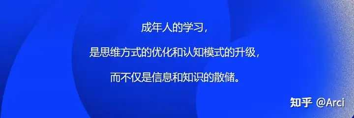
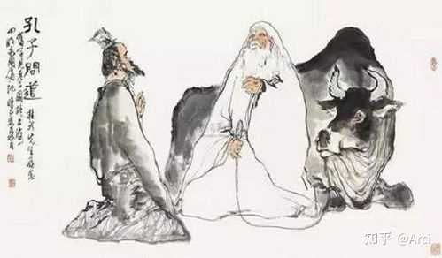
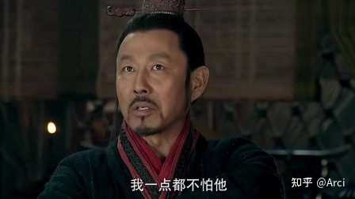
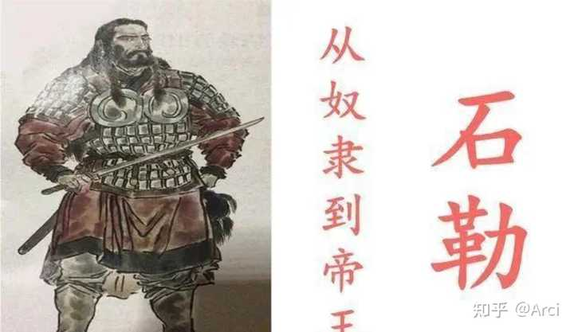
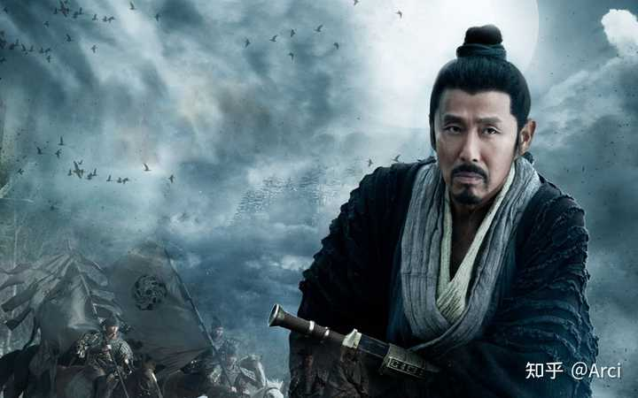
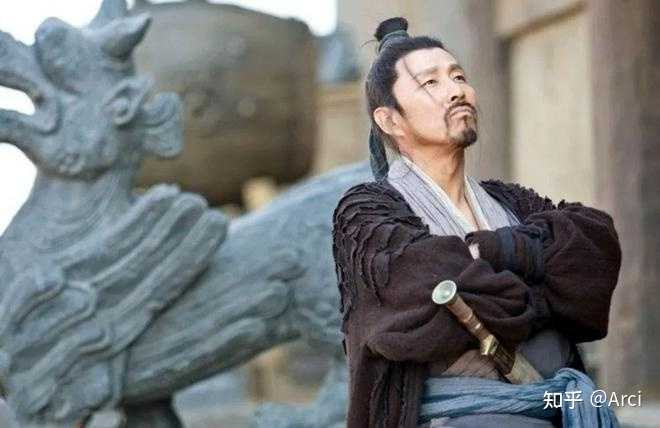
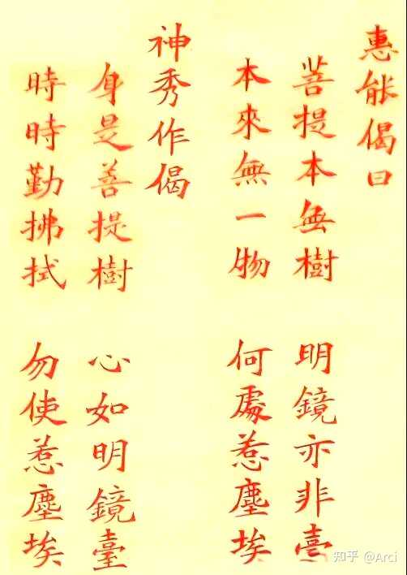

石勒为什么认为刘邦比刘秀强? \- Arci 的回答

石勒作为一个从奴隶到皇帝的胡人，眼光、手腕绝对是顶级的。

石勒说过一句很狂的话——遇刘邦，我老老实实给他打工；遇刘秀，咱俩掰掰手腕，谁赢不好说。

一个奴隶出身的胡人皇帝，凭什么敢点评两汉开国者？这话流传了一千七百年，多数人把它当一句酒后豪言听过去了。但石勒不是在吹牛。他是真读出了点东西。

__要理解石勒这句话的分量，得先看另一场更著名的对话。__

alt="Image">

马援替隗嚣去见刘秀，回来以后隗嚣问他，你觉得刘秀这个人怎么样？马援说了一大堆好话——才明勇略非人敌，开心见诚无所隐伏，阔达多大节——基本把能夸的都夸了。

__隗嚣接着问了一句：那跟刘邦比呢？__

__马援脱口而出两个字："不如。"__

__理由就五个字——"无可无不可"。__

__这五个字什么分量？__你得知道，马援不是一般人，他后来伏波将军、马革裹尸，一辈子阅人无数。

他把刘秀夸到天上去了，才明勇略非人敌——才能谋略不是一般人能比的。__但一到刘邦，只剩五个字，连夸都夸不清楚了。__

__这不是贬低。这是中国评价体系里最高级别的赞美——我描述不了他。__

__五百年前有个一模一样的场面。__

alt="Image">

孔子去见老子，回来跟弟子说：鸟，我知道它能飞，用箭能射下来；鱼，我知道它能游，用丝线能钓上来；兽，我知道它能跑，用网能捕住。__至于龙呢？乘风云而上天，我不知道该怎么对付它。我今天见了老子，他就像龙一样。__

孔子说了一长串——鸟可矰、鱼可纶、兽可网——__能被定义的，就能被对付。唯独龙，"吾不能知"。__

__他不是说龙厉害，他是说龙超出他的认知框架了，他连描述的抓手都没有。__

alt="Image">

__马援说了同样的话。只不过他用的是另一种表达——"无可无不可"。__

这话字面意思很奇怪。没有什么是可以的，也没有什么是不可以的？这到底是夸人还是骂人？

__其实翻译过来就一句：他没有固定模式。__

你说他宽厚吧，他有时候狠得让人后脊发凉；
你说他狡诈吧，他有时候坦荡到不像个政治家；
你说他粗鄙吧，他能写出大风歌；
你说他文明吧，他往儒生帽子里撒过尿。

__你拿任何一把尺子去量他，都量不准。不是尺子有问题，是他这东西不是尺子能量出来的。__

__孔子的"其犹龙耶"，马援的"无可无不可"，在中国几千年的评价体系里，是同一句话说了两遍——我看不懂他。__

__而看不懂，恰恰是最顶级评价。因为能被看懂的人，就能被针对；能被定义的人，就能被击败。__

alt="Image">

石勒读到了同一层。

__你看他原话——"朕若逢高皇，当北面而事之"。__

__这话没有半点犹豫，没有"也许""可能"，上来就是"北面而事之"，面向北方称臣，态度端正得很。__

__后面那半句更有意思，"与韩彭竞鞭而争先耳"。我给他当韩信彭越，争个先锋。__

__他把自己放在了韩信的位置上。韩信什么人？兵仙。石勒觉得在刘邦手下，自己顶多跟韩信抢抢功，当不了老大。__

__到了刘秀，语气全变了。"当并驱于中原，未知鹿死谁手。"。掰掰手腕，谁赢不好说。__

__石勒对刘秀的判断是清晰的：__有章法，有节度，可分析，可应对。

__他对刘邦的判断恰恰是不清晰的__——说不清楚他厉害在哪，所以我根本不知道如何对付，算了，服了，跪了。

alt="Image">

__刘邦的"无可无不可"，不是没原则，是原则因人因时在变，而且每次变都对。__

你去看他一生中那些关键场合，面对不同的人，他的反应完全不同，但你事后一看，每一个反应都是当时那个局面下的最优解。

1. 儒生郦食其来投奔他，他正叉着腿让两个女人洗脚，张嘴就骂。郦食其不卑不亢说了两句，他立马把脚收了，请上座，道歉，采纳建议。__从破口大骂到请上座道歉，中间没有心理建设的过程，没有"让我想想"的过渡，一秒切换。__
2. 韩信在齐国派人来说要当假齐王，刘邦当场大怒——我这边被项羽围得死死的，你趁火打劫？张良在桌子底下踩了他一脚，他瞬间改口：大丈夫当什么假王，要当就当真王。__注意这个切换速度，从大怒到封王，一副表情两声怒骂，表情还在怒，嘴里已经在封了。这种反应速度不是演的，是真的一瞬间就能判断出什么更重要。__
3. 雍齿这个人，背叛过他，他恨得牙痒痒。但该用的时候照用，后来封侯第一波里就有雍齿。为什么？因为手下一堆功臣等着封赏，人心惶惶，连最恨的人都封了，其他人还慌什么？__他恨雍齿是感情，封雍齿是算计，两件事同时成立，互不干扰。__
4. 项羽要煮他爹，他说分我一杯羹。这话听起来混账透顶，但在那个节骨眼上，任何示弱、任何亲情流露都会被项羽拿捏。你不在乎，对方反而没了筹码。他不是不孝，他是那个瞬间判断出来：哭爹喊娘救不了他爹，__嬉皮笑脸反而让项羽找不到着力点。__
5. 入咸阳的时候，约法三章，秋毫无犯。__一个从乡下来的亭长，进了花花世界，居然忍住了。__换成他平时那副德性？但那个局面下他比谁都清楚——秦地百姓恨透了秦法，你要再搞一套严的，关中就不是你的了。

__你每一次以为看透了他，他都在别的地方打了你的脸。__

__他每一次反应都因人而异、因时而变，但每一次都恰好踩在那个局面的最优解上。__

__这不是刻意为之，这是某种近乎本能的顶级判断力、应变力、决策力、理解力。__

alt="Image">

__你问他原则是什么？他没有固定原则。__

__他的原则就是，此时此刻，这个局面，该怎么着就怎么着。__

这就是"无可无不可"。不是摇摆，不是反复，__是一个人对局势的感知力强到了不需要预设框架的程度。__

所以回到石勒那句话，他不是在说刘邦比刘秀强——那只是表面结论。

__他真正在说的是：刘秀的厉害我说得清楚，刘邦的厉害我说不清楚。__

__说得清楚的人，你就有机会去破解。说不清楚的人，你连入手的地方都没有。__

__你说呢？__

[@知乎人文](https://www.zhihu.com/people/0eebc9b425a88e87408729eec9f09be4)

alt="Image">

PS：分享一段额外话题

__一段著名的禅宗公案：__

五祖弘忍要传衣钵，让徒弟们各写一首偈子。

大弟子神秀写的是：__"身是菩提树，心如明镜台，时时勤拂拭，莫使染尘埃。"__

众人叫好__。有迹可循，有法可修，只要勤拂拭，心就不会脏。多踏实，多努力。__

结果厨房里一个不识字的舂米小和尚，让人代写了一首："__菩提本无树，明镜亦非台，本来无一物，何处染尘埃。"__

五祖半夜把衣钵传给了他。他叫慧能。

alt="Image">

__神秀的境界是有形的__——有菩提树可依，有明镜台可擦，有尘埃可防。你可以分析他，拆解他，知道他在哪里下功夫，知道怎么对付他。

__慧能的境界是无形的__——没有树，没有台，连尘埃落的地方都没有。你怎么拂？拂什么？你连入手的地方都找不到。

__刘秀是神秀__。勤勉、自律、有章法，"动如节度"——每一步都踩在格子里。你看得懂他怎么赢的，你也学得会。

__刘邦是慧能__。本来无一物，何处染尘埃——他压根没有固定模式让你去抓，没有固定套路让你去破。你说他懒，他三个月灭秦；你说他粗，他写出大风歌；你说他没规矩，他约法三章秋毫无犯。__你每一次以为看透了他，他都在别的地方打了你的脸。__

__"无可无不可"——本来无一物。__

__这五个字，和那首偈子，隔了一千一百年，说的是同一件事。__

alt="Image">
