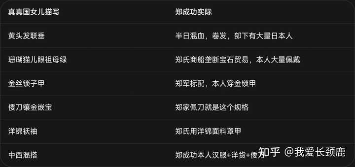

__问题描述：__

第五十二回 宝琴笑道 我八岁时节，跟我父亲到西海沿子上买洋货，谁知有个真真国的女孩子，才十五岁，那脸面就和那西洋画上的美人一样， 这里的真真国有何特殊…

记住读红楼梦一定要联系其历史背景，更重要的是各种典故。

国朝，一朝天子一朝臣，真真者，重真也。

即崇祯朝也，红楼梦里可是出现过不止一个国，即不止一个朝廷。

所以把红楼梦对应了明末历史看很容易得出答案。记住，历史派将红楼梦里就是风月宝鉴，男女性别颠倒！

薛宝琴说：“我八岁时节，跟我父亲到西海沿子上买洋货，谁知有个真真国的女孩子，才十五岁……通中国的诗书，会讲五经，能作诗填词，因此我父亲央烦了一位通事官，烦他写了一张字，就写的是他作的诗。”

然后说：“记得是首五言律，外国的女子也就难为她了。”便念出上面八句。

宝玉要瞧字，宝琴说“在南京收着呢”；黛玉笑她扯谎，宝琴红了脸低头笑；宝钗解围。众人听完只说：“难为他，竟比我们中国人还强。”

昨夜朱楼梦，今宵水国吟。
岛云蒸大海，岚气接丛林。
月本无今古，情缘自浅深。
汉南春历历，焉得不关心。

以下为解析；

一，关于薛宝琴的身份，原文；薛姨妈度其意思，大约是要与宝玉求配。薛姨妈心中固也遂意，只是已许过梅家了，因贾母尚未明说，自己也不好拟定，遂半吐半露告诉贾母道：
“可惜这孩子没福，前年他父亲就没了。他从小儿见的世面倒多，跟他父母四山五岳都走遍了。他父亲是好乐的，各处因有买卖，带着家眷，这一省逛一年，明年又往那一省逛半年，所以天下十停走了有五六停了。那年在这里，把他许了梅翰林的儿子，偏第二年他父亲就辞世了，他母亲又是痰症。”
凤姐也不等说完，便嗐声跺脚的说道：“偏不巧，我正要作个媒呢，又已经许了人家。”贾母笑道：“你要给谁说媒？”凤姐儿说道：“老祖宗别管，我心里看准了他们两个是一对。如今已许了人，说也无益，不如不说罢了。”贾母也知凤姐儿之意，听见已有了人家，也就不提了。

宝琴八岁随父母出海采买洋货 → 到西海沿子 → 遇到真真国十五岁女儿 。
按照咱们对于红楼梦历史考据派的理解来看，薛宝琴对应为郑森即朱成功。

同时，薛宝琴就是真真国女儿！二者为同一人！

郑森生于日本，乳名福松；7岁回安平，仍用乳名；

（八年后，15岁，补南安县学生员，正式改名__郑森__，字明俨；）

宝琴八岁出海采买洋货 → 到西海沿子 → 遇到真真国十五岁女儿 。这段可以解析成，郑森随父海归，回到东海之滨。八年后，补南安学弟子员，用名郑森，十五岁的郑森成为崇祯朝的一名生员！

真真国女儿诗本质就是借薛宝琴之口讲自己来历，同样是隐喻了郑森的前程往事。

红楼书里写真真国女儿外形：也披着黄头发，打着联垂，满头带的都是珊瑚、猫儿眼、祖母绿这些宝石；身上穿着金丝织的锁子甲洋锦袄袖；带着倭刀，也是镶金嵌宝的，实在画儿上的也没他好看。

alt="Image">

再看，原文中，薛宝琴随父母那年在这里，把他许了梅翰林的儿子，偏第二年他父亲就辞世了，他母亲又是痰症。

这段内容有几个历史背景。

1645年隆武即位时，郑芝龙带15岁的郑森（朱成功）入觐。

隆武抚背说"恨朕无女妻卿"，赐国姓、赐名成功，封忠孝伯，郑森从此叫"国姓爷"。

隆武元年（1645）赐郑森国姓朱、名成功；隆武二年（1646）清军入闽，郑芝龙降，隆武帝汀州被俘死，南明隆武政权亡。不是退位，是亡国被杀。

1646年隆武死，朱成功才正式起兵抗清——所以他的"忠明"旗帜，核心就是报隆武知遇之恩。

明末 1644 开始，遗民咏梅、露根梅、无土梅，集中出现在（1650s–1680s）。

八大《古梅图》1682，是最典型的标本。

所以遗民语境里“梅代朱明”的用法起点：甲申国变后，尤其1670–1680年代最密，目的是避“朱”“明”“胡虏”等敏感字。

所以此处梅翰林指代的就是隆武，朱聿键。被追谥思文皇帝，史谓“雅好图书，喜翰墨，有河间献王风”；

偏第二年他父亲就辞世了，此处暗指郑芝琳降清，明指朱成功母亲田川氏受辱而死。

他母亲又是痰症。关于痰症，它是明代中后期最畅销的综合性医书之一

龚廷贤的《万病回春》和《寿世保元》在万历晚期到崇祯，翻刻次数极多。所以严格说，它是万历晚期成书，天启–崇祯年间达到最流行，而是明末已经是一本老牌畅销书了。

龚廷贤《寿世保元》卷三“痰饮”原文是：

痰者，病名也，生于脾胃……或食后因之气恼劳碌惊恐风邪，致饮食之精华不能传化，而成痰饮矣。有流于经络皮肤者，有郁于脏腑支节者，游溢遍身，无所不至。痰气既盛，客必胜主……

此处用了他母亲又是痰症，痰气既盛，客必胜主，一语双关指的是朱成功父亲郑芝龙降清一事。

本来脾胃是主，痰是客；痰盛了，客人反客为主，身体正常秩序被夺。

这已经接近“内部势力坐大、叛主”的意思，但仍是病机，不是人事。

刘基《《郁离子》·去蠹》：郁离子病，气菀痰结，想吐痰。人或曰：“痰，荣也，养人也。”

郁离子驳：今化为痰，是荣贼也，非养人者也。……不去除，是殖贼以待戕也。

还拿舜禹汤文诛四凶、剿昆吾、放桀伐崇作比：容之无益，以戕人也。

这里把“痰”彻底拟成：本来是养料（荣、津），变了质，成“贼”、成“蠹”、成“四凶”

不除等于养奸，等它叛主杀人，所以“患痰＝家里出了内奸/叛臣”。

以上解释了，为何薛宝琴指代的为朱成功。

到了这里再看《真真国女儿诗》：

首联：昨夜朱楼梦，今宵水国吟

昨夜朱楼梦：崇祯北京大明覆灭：朱为明朝国姓，朱楼即朱明紫禁城、大明朝堂；昨夜繁华帝都、大明江山沦为一场幻梦，对应1644崇祯自缢煤山、北京沦陷，明朝中枢崩塌。

今宵水国吟：满清入主中原：传统五行明属火德、清取水德，水国代指满清；江山易主，遗民身在清廷疆域，只能悲歌泣吟亡国之痛。

二、颔联：岛云蒸大海，岚气接丛林

岛云蒸大海，岚气接丛林：山野瘴雾、蛮荒密林，明郑退守台湾岛，开荒，营建抗清的根据地，复国大势如火如荼，海上义军如云蒸腾；终究大势难挽，反清复明的宏图如云气蒸腾入海。

三、颈联：月本无今古，情缘自浅深

__李白《把酒问月》__：

今人不见古时月，今月曾经照古人。古人今人若流水，共看明月皆如此。

月本无今古：皓月亘古不变，山河天地不曾改换年月，暗喻华夏故土江山依旧。

\- 情缘自浅深：山河未变，世人对朱明故国的眷恋、汉家故土的情缘却刻骨铭心、厚薄长存；朝代更迭是世事，家国遗恨是人情。（月亦暗扣“明”字，日为君、月为故乡大明）

四、尾联：汉南春历历，焉得不关心（核心化用《枯树赋》\+杜甫典故）

出自庾信《枯树赋》：昔年种柳，依依汉南；今看摇落，凄怆江潭；树犹如此，人何以堪：桓温北征见少时栽柳参天，感伤岁月、故国飘零；庾信羁留北朝借柳伤故国覆灭，成为后世怀故国、悼亡国固定典故。

杜甫《历历》：历历开元事，分明在眼前：历历=往事清晰如在眼前，追忆盛世旧事、故国风光。

汉南：汉家江南故土（南明所辖江淮、湖广、两广）；春历历＝大明往日江山风物、南明诸政权旧事清清楚楚浮现眼前，弘光、隆武、永历旧事历历在目。

焉得不关心：故国沦丧、汉土残破，遗民如何能放下牵挂、不痛心惋惜，全诗落点落在遗民的故国之思，完美扣合《枯树赋》物是人非、亡国伤怀的内核。

最后，如今这个时代查典故太方便了，也就能帮助我们重复经典，不被那些为遗毒收买翻案的学阀蒙蔽心智！
