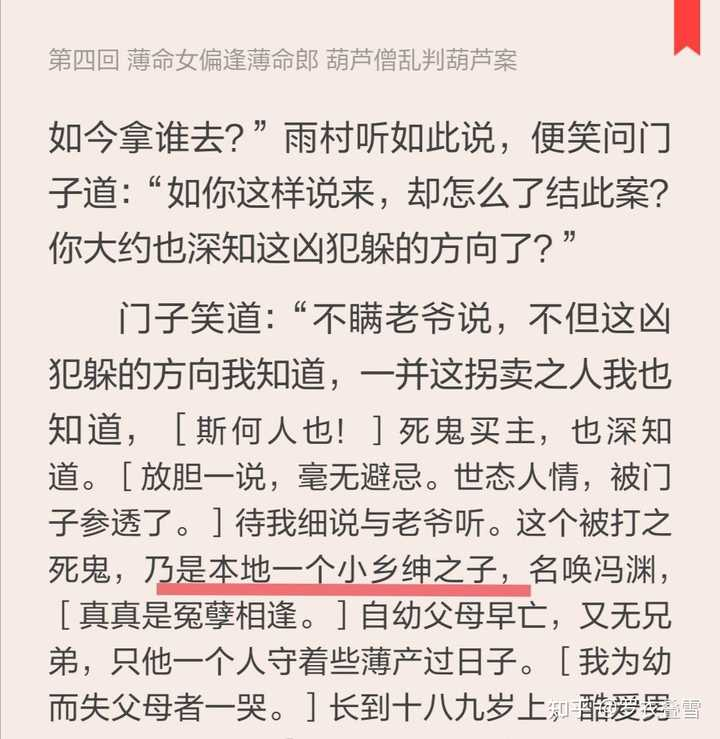
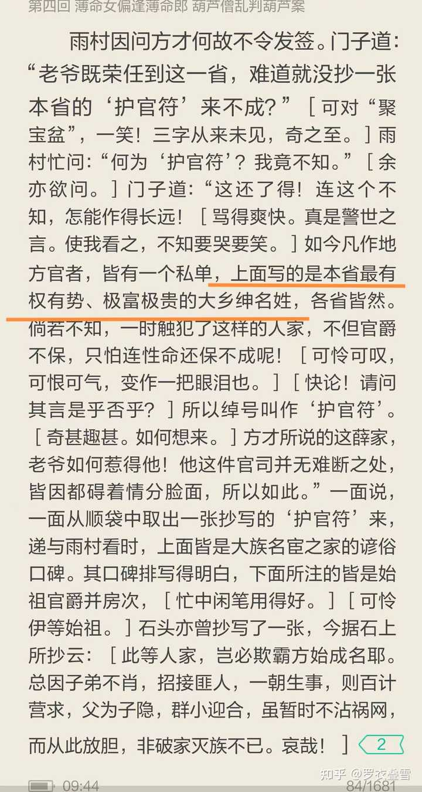
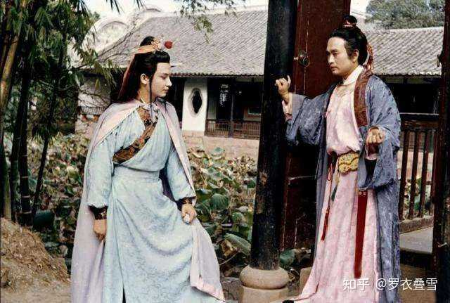
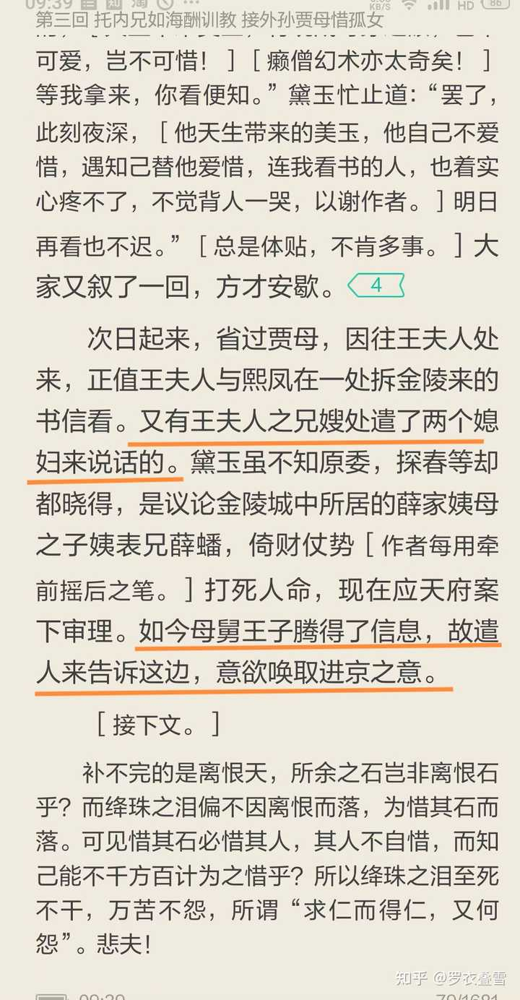
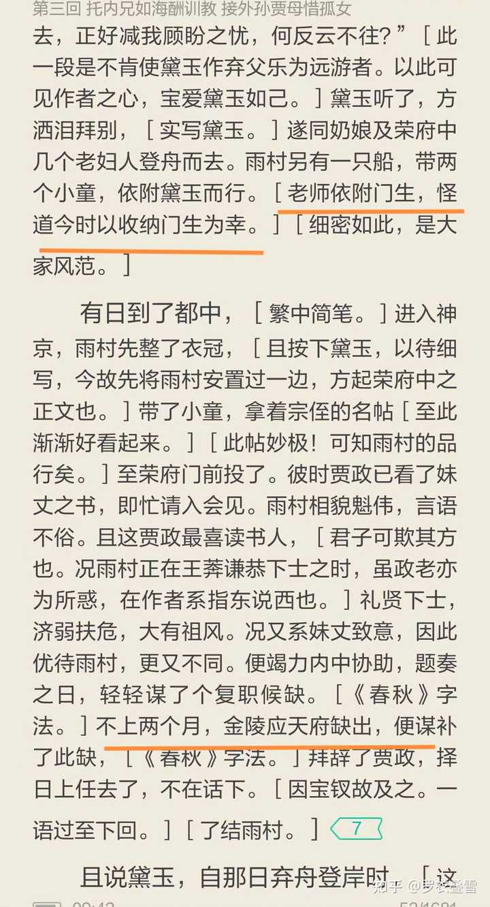
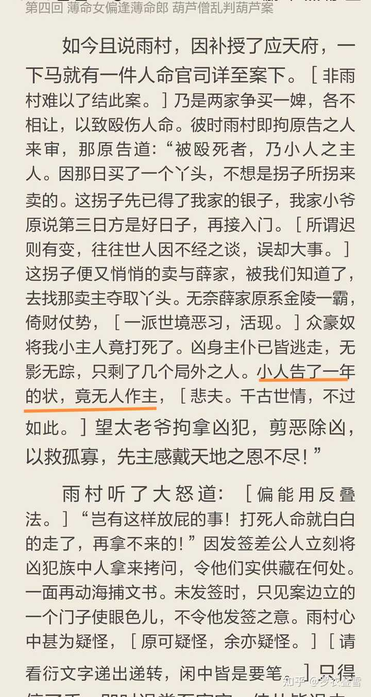
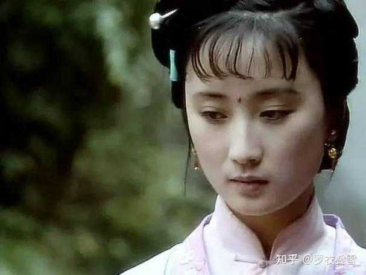

红楼梦开头，贾雨村为什么以薛蟠销户结案？这不是给薛家添麻烦吗？找个别人顶罪不是更好吗？ \- 罗衣叠雪 的回答

除去作者作为小说家，为了后文埋伏笔的因素，到底为什么贾雨村要这样断案呢？这个事情有历史原型吗？

首先冯渊身份并不低，第二薛家应该没传说中的那么有钱（百万之富）。

冯渊不是普通的民，而是乡绅之子，否则他也不敢带人上薛家要香菱了。其实门子肯定是受了贿赂的，故意把冯渊家说的很没用，好诱导贾雨村帮助薛家。

alt="Image">

其实薛家也是乡绅，是大乡绅。冯渊虽不如薛蟠有钱，但大家阶级圈层是接近的。是大乡绅把小乡绅打死了，这事很严重。

alt="Image">

否则这事怎么会惊动贾政和王子腾和林如海联手办理？

一个大家族分很多房，做官的是官，其他没做官的就是乡绅。其实作者提供了另一个例子，柳湘莲其实也是乡绅的身份，你看他平时交往的有多少体质內的哥们朋友，所以他敢痛打薛蟠，果然没人把他怎么样吧？

alt="Image">

alt="Image">

薛家在金陵也有不少亲友，要能自己搞定，就不用给贾府和王子腾写信了。显然那四大家族留在金陵的几房都搞不定。

看作者写黛玉是刚来的，不知原委，但探春等都知道是薛蟠打死人命。说明贾府上下早就知道了，所以王子腾也不是才知道的，只不过一直缺个能办这事的应天府尹。没道理王子腾比探春知道的还晚。

派家里的女人来內宅传信，是告诉她们差不多能搞定了，准备接待薛家。贾政那边在外书房是另外派人联络的。

黛玉此时还不知，自己的老师贾雨村就是王子腾、贾政寻得的好人选。

我一直认为所谓贾雨村和冷子兴的偶遇，根本是故意为之，都是安排好的。冷子兴是王夫人的陪房周瑞的女婿，是个古董商，他大老远的出现在林如海家附近，是为了去闲逛？见到一个故旧就把贾府上下全介绍一遍？两人认识那么久了，以前怎么提都不提？尤其故意说你们都姓贾，都是一家的，连贾府几位小姐的闺名都告知。就是引他做自己人，等雨村回去，就发现林如海介绍信都提前帮他写好了。

这不是一个局吗？

冷子兴应该就是跟贾府接林黛玉的人一起来的，早见过林如海。顺手帮着接受林家的古董等物。所以人家回去有排面，后文故意交待周瑞的女儿说丈夫冷子兴吃了官司，王夫人就帮搞定了。所以脂批也明写，贾雨村是依附学生。后来贾雨村自己认作贾政的侄儿……跟黛玉平辈了。

alt="Image">

冯渊的事难搞，在于乡绅的身份高于民，是由有功名而未做官的人，地方上有钱有名望，或者退休的官员这个群体组成的。是介于民和官之间的阶层。所以这个群体里会形成一个圈子互相维护，大家不会愿意看到这个圈子里的人为点小事就被打死。

兔死狐悲，物伤其类嘛。这个圈子里的人，很容易见到官员，甚至里面的人，不知哪天就变成官了。

大家看“杨乃武与小白菜”那个案子就知道了。这个案子能翻过来，很大程度就是因为杨乃武是乡绅，他有举人的功名。因为这个，他姐姐一个女子就可以拿着杨乃武写的东西进京告状，几乎访遍了在京的浙江籍官员，浙籍官员很多人是支持杨乃武的，一则是同乡，二则他有身份。最后此案惊动了慈禧太后，重查此案，罢免了此案中互相维护的100多官员。

大家仔细看，会发现门子八成有说谎，他说薛家早走了，但王子腾却说意欲唤取上京。

薛家本来是打算进京的送宝钗待选，但是路上走了一年？其实不知去哪里是避风头去了。但此举应该已经耽误了薛宝钗选秀。一年了，选秀都结束了。

从金陵（南京）无论是到长安还是北京，都跟林黛玉从扬州到京城距离差不多。这期间不但林黛玉早就到了，贾雨村还在京城等了两个月，才等到应天府的职位，估计是王子腾和贾政想办法把应天府尹换了，才让贾雨村上任。于是雨村又从京城到了金陵，判了案子，再让人送书信给王子腾等人，薛家才真正进京。

看时间线，贾雨村接案子时，冯渊的家人说他已经告了一年的状。

alt="Image">

只能说明贾雨村的前任一直拖着这个案子，薛家肯定也是花了钱的，但是没花到位。

薛家身份对于冯渊没有压倒优势，就只能花钱了。我认为薛家没那么有钱。

冯渊家要的烧埋费，薛家肯定出的起，几百两嘛。但难的是，你拿什么买通官员，不用薛蟠抵命，也不用坐牢？

这要花多少？你给人家几百一千两的，人家肯定嫌少不理你，金陵又不是穷地方。净虚求凤姐办事，退个亲就给了3000两。

你这是乡绅的人命，10000两都不嫌多。但是薛家拿上万两估计是为难的，所以僵持不下。

前任官员要么不想要这个钱，怕惹麻烦，要么钱没给到心理价位。

__所谓百万之富，可能是薛蟠爷爷，或者父亲在时的旧名儿，內囊早就渐渐消耗了。__

书里明写他家那些掌柜活计难免坑蒙拐骗，所以薛家生意日渐消耗。

《红楼梦》喜欢把一些大事，做轻描淡写状，免费影响花团锦簇的表面繁荣。

而且按作者写的貌似皇商都爱吹牛，动不动就非常富贵，夏金桂家也是，说她家那么富，陪嫁丫鬟好像也不多。吃的东西也比贾府档次低多了，完全称不上精细，还不如薛家。贾府吃松瓤鹅油卷，胭脂鹅脯。薛姨妈家吃糟的鸭掌信，夏金桂吃鸡鸭（骨头）。人家用特级厨师，一级厨师，夏家用三等厨师吧。

冯渊能跟薛蟠争香菱，岂是贩夫走卒之辈？那拐子养了香菱好几年，总不是为了卖几十两银子吧。以香菱的品貌，贾琏都夸的，价格大约不会低于贾赦花800两买的嫣红。

alt="Image">

香菱看样子差不多按扬州瘦马养的。明代的《续金瓶梅》里写头等扬州瘦马可以卖到1500两。

看《红楼梦》里也差不多，贾府买小戏子办戏班，花了三万两银子，平均每个小戏子身价应该都是上千两。所以她们也是自视甚高的。

冯渊身家几千两估计是有的。而纵观全书，薛家有巨富的名儿，但你看不到他家大手笔花钱，以送东西为主，估计是家里以前的积累。最大手笔就是送给宁国府的樯木，那是薛父留下的，这东西并不好出售。

王熙凤，在宝钗15岁生日时就打趣了一回，后来薛姨妈说下雪请客又打趣一回。

凤姐的玩笑不是随便开的，宝钗生日凤姐的意思就是贾母起头出20两，这够酒的？够戏的？不然还让我给你贴钱？凤姐意思，剩下的薛姨妈应该出钱补足，但薛姨妈没吭气……作者就安排凤姐专门为此事问了贾琏。因为这个是额外支出，薛家不是贾府的人。

下雪请客那次她干脆提出让薛姨妈拿50两出来。这跟她打趣李纨不肯拿钱办诗社差不多意思的，就半真半假。薛姨妈又没吭声。

薛家如果真那么有钱，除了在贾府吃住自理，肯定还应该请客送礼，若送礼到位了，凤姐就不会那么对薛家。看贾芸送了礼，凤姐态度就挺好。邢岫烟住在迎春处，也是要打点仆人的。

很奇怪凤姐每次提薛家，就没一次说他家有钱的。她还讲了一个薛蟠白问她要珍珠的故事，我当时看了就纳闷。薛家找不出戴过的珍珠吗？薛蟠不会去买些戴过的珍珠嘛，或者买新的，让香菱戴一阵再拿去用。凤姐明明都说没有了，他还硬磨，弄的人家当面拆珠花，他也好意思。这跟凤姐当小太监面去当金项圈有啥区别呢？

他还问凤姐要了块大红纱……

而且宝钗收到礼物周转的太快了，按理说为了表示尊重送礼的人，是不兴马上转手别人送的东西，湘云送的戒指，宝琴送的裙子，马上就转手送人，不太合规矩。

薛家如果真的巨富，我觉得王子腾也不是那个态度了，他是怕薛蟠的事累及自己声誉才管的，但他这个舅舅从来不请薛家母子去家里住。作者还故意写李纨的亲戚李婶人家还不怎么愿意住贾府呢，多次被她弟弟接回家住。这写的分明是对照组。

所以把薛蟠判定为死了，已经是几家共同努力的结果，薛家由此再受重创，进一步滑落，薛蝌进京，其实就是薛家自己抱团取暖，薛蝌替薛蟠去接皇商的生意。

在来贾府做客的姑娘里，薛姨妈只能选邢岫烟，因为李绮、李纹估计是看不上薛家的。很明显，凤姐还怕邢夫人不愿意呢，就先找了贾母，什么硬做保山。

实际上薛家没有更好的选择。
