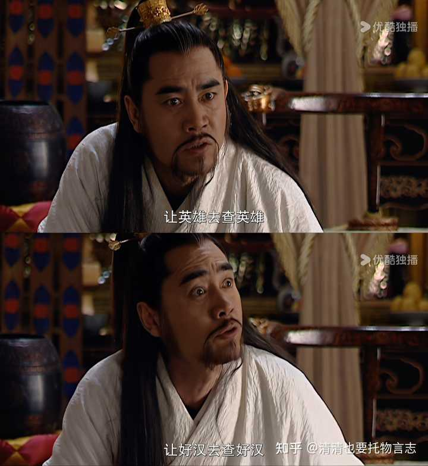

红楼梦里的探春真的有评论家说的那么优秀吗？ \- 清清也要托物言志 的回答

以前读红楼梦的时候很喜欢探春，因为探春识大体，护着自己手下人，遇事有主见不盲从。可是再读红楼梦，我竟然不喜欢探春了。不因为她是庶出，只因为他竟然连自己…

薛宝钗爱搞意见霸凌，探春有一次应对得非常漂亮。

故事发生在第六十二回。探春听说宝玉、宝琴、平儿、邢岫烟的生日都在同一天，特地张罗，在红香圃摆了隆重的四人寿宴。

在座没有长辈，相对放松。贾宝玉提议，咱们行个令玩吧！

大伙都赞成，但是意见很不一致，有的说行这个令好，有的说行那个令好。

黛玉就建议说，要不这样，我们把各种令写在纸上，大家分别抓阄，抓出来哪个就玩哪个。

众人欣然同意，于是叫人拿来笔砚和花笺。

香菱正学写字呢，一看就手痒痒，自告奋勇要写。她根据大家提的令，写了十来个，搓成阄儿写好了，放在花瓶里。

平儿负责拈阄，拈出来的阄写着：射覆。

射覆的基本玩法是，在瓯、盂等器具下覆盖某种物件，让人猜里面是什么东西。

玩的时候，覆者（也就是出题人）先暗自定好一个谜底字（覆），再抛出一两个前置的字搭配，作为线索；射者（也就是猜题人）不直接说那个谜底字，而是说一个能与谜底关联的字，通过诗词典故都可以。

比如，薛宝钗覆了一个“宝”字，贾宝玉知道她是指自己所佩通灵玉，谜底字是“玉”，于是就射了一个钗字，所借用的诗词为“敲断玉钗红烛冷”。

宝玉道：“他说‘宝’，底下自然是‘玉’了。我射‘钗’字，旧诗曾有‘敲断玉钗红烛冷’，岂不射着了。”

李商隐有一首《无题》写到射覆：“隔座送钩春酒暖，分曹射覆蜡灯红。”记载长安一处权贵府邸的夜间宴饮。

射覆是中国古代文人雅会的常见游戏，并非小众。

可是这个时候，喜欢当意见领袖的薛宝钗又开启了表演。

宝钗笑道：“把个令祖宗拈出来了。射覆从古有的，如今失了传，这是后纂的，比一切的令都难。这里头倒有一半是不会的，不如毁了，另拈一个雅俗共赏的。”

这段话里槽点多得数不清。

1\.掉书袋就不说了，射覆难吗？并不难，后文我们可以发现，除了刚刚才开始学习诗词的香菱，诗社成员都会，连宝琴这种跟着父亲走南闯北的女孩、邢岫烟这样家贫无钱读书的女孩也玩得娴熟。这说明射覆早已经演变为一种普适性极强的文字游戏了。

2\.就算有人不会，那也可以让会的人教她啊，什么新游戏不是在玩耍中学会的？

3\.会的人才称得上雅，不会的人都俗不可耐是吗，一棍子打死一大片啊…

4\.既然有人提议了射覆，说明射覆是有受众的，毁掉阄弃之不用，相当于让喜爱射覆的人迁就那些不喜欢它的人，这很容易滋生不满，埋下内部争端的种子好吧。

5\.更何况，游戏规则是大家刚刚公认了的，薛宝钗张口就是破坏规则，要人人都这么干，肯定玩不下去了…

alt="Image">

探春拒绝的很妙，她提了一个折衷方案。

探春笑道：“既拈了出来，如何再毁？如今再拈一个。若是雅俗共赏的，便叫他们行去，咱们行这一个。”

首先，射覆的阄儿不能毁，我们继续玩；其次，如果有人不喜欢，再抓一个阄给她们玩。

探春真是一位好领队，简简单单一句话，既坚持了原则，维持了秩序；又照顾到了可能存在不同意见的人，保护了团结。

然鹅……又出现了一点小状况。

薛宝钗的一号小迷妹憨湘云跳了出来，攻击射覆，帮忙搅局。

（探春）又叫袭人拈了一个，却是拇战。史湘云笑着说：“这个简断爽利，合了我的脾气。我不行这个射覆，没的垂头丧气闷人，我只猜拳去了。”

史湘云是在给她的宝姐姐摇唇鼓舌，因为她很快就展示了她的双标。

她说射覆太复杂是吧，行，看看她自己猜拳赢了贾宝玉后，给人家出的什么令。

湘云便说：“酒面要一句古文，一句旧诗，一句骨牌名，一句曲牌名，还要一句时宪书上有的话，共总成一句话，酒底要关人事的果菜名。”

难不难？可比射覆难多了啊，贾宝玉根本答不上来，还是黛玉帮他说的。

其他人也都说湘云的酒令太复杂了。

众人听了，都说：“惟有他的令比人唠叨，倒也有些意思。”
说的众人都笑了，说：“好个诌断了肠子的。怪道他出这个令，故意惹人笑。”

所以到底什么才叫“简断爽利”呢？很简单，在湘云的心里，标准只有一个：宝姐姐说好的，我都双手赞成，宝姐姐说不好的，我都全盘否定！

探春一眼看穿湘云的心思，她根本不和这个小憨妞废话，直接关门放薛宝钗。

探春道：“惟有他乱令，宝姐姐快罚他一钟。”

探春真是吃透了史湘云的特性，要是让宝玉黛玉罚湘云喝酒，湘云怕不是要当场炸了。

（说到这里我忽然想起一副画面）

alt="Image">

你不是无条件支持你的女神吗，看看你的女神是不是无条件支持你吧。

所以薛宝钗无条件支持湘云了吗？当然……没有。

宝钗不容分说，便灌了湘云一杯。

撑钗未捷被钗罚的史湘云：……

alt="Image">

接下来就顺多了，探春重申规则，中心思想一句话：射覆，我分派。

探春道：“我吃一杯，我是令官，也不用宣，只听我分派。取了令骰令盆来，从琴妹妹掷起，挨着掷下去，对了点的二人射覆。”

就是每人掷骰子，点数一样的两个人玩射覆。

玩法基本沿着探春圈定的轨道走，射覆的先后顺序是宝琴vs香菱，宝钗vs探春，李纨vs岫烟，宝玉vs宝钗。

后面史湘云又擅自跑去玩猜拳，不过她是自己走开的，没有像薛宝钗那样非要拽着整个团队来改弦更张。

大面儿上的秩序终于稳下来了，这是探春的功劳。

红香圃宴会，她就是那定海神针。
