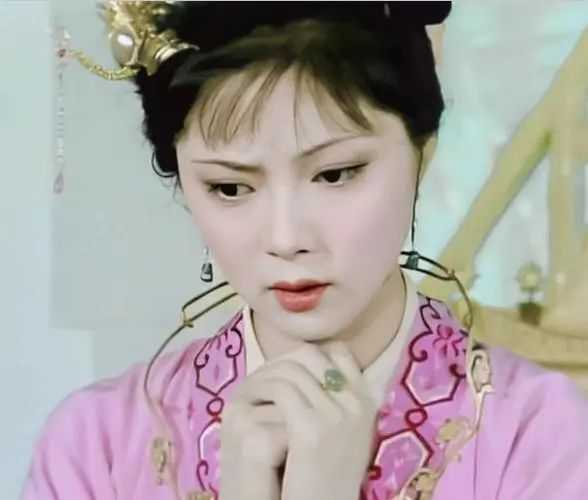
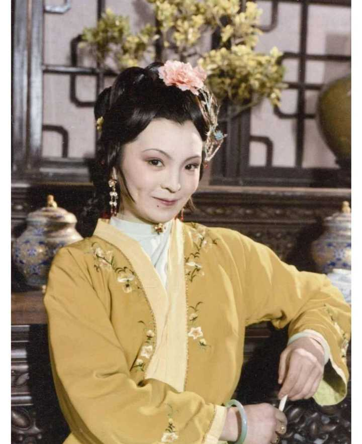
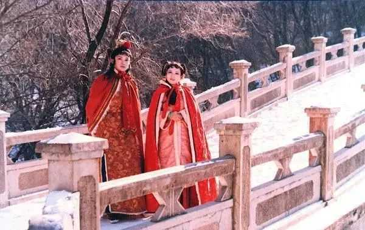

薛宝钗家世真的很低吗？ \- 古月记 的回答

士农工商说可以解释薛宝钗的出身吗？红楼梦里写的护官符上皆是大官名仕之后，最有权有势家族，小官不敢得罪，得罪了小命不保，按照士农工商说，和“士”有“生殖…

薛宝钗就是温柔版的夏金桂，也是低配版的薛宝琴。

夏金桂什么家世？

皇商之女，而且还是独女，这意味着她的嫁妆是整个夏家，所以严格意义上讲，她在婚配市场上的地位比薛宝钗更高。

然而夏金桂嫁给了呆霸王薛蟠，并且双边家长都认为门当户对。

封建时代，婚配就是家世的最好体现。

贾敏嫁的是侯门探花林如海；史湘云嫁的是才貌仙郎；王熙凤嫁的是荣国府贾琏……

所以，薛宝钗的家世在四大家族里面绝对是最低的。

宝钗的家世短板，不仅仅在于商贾出身，还在于她有个混账哥哥和蠢蛋妈妈。

谁娶了她，谁就多个又蠢又坏的大舅子，而且搞不好哪天捅出篓子需要擦屁股。

谁娶了她，谁就多个拎不清的丈母娘，搞不好敲诈一大笔彩礼给儿子补窟窿，然后说女儿不爱富丽闲妆，陪嫁就只给几床被子。

没错，宝钗优点很多，长得漂亮、脑子聪明、情绪稳定……，但这些在家世面前都不值一提。

正常婚配的话，她最多嫁个和亲哥差不多的富家废物，富而不贵的商贾之家。

如果想嫁官宦人家，也只能找个寒门做题家，或者武将，侯门公府是绝对进不去的。

另一个参照物是薛宝琴，宝琴生父是薛家二房，理论上继承的家业比长房少，但她哥哥不拖后腿，姑且算是家世和宝钗齐平吧。

然而，宝琴家明明和梅翰林家有了婚约，结果进京了梅家一次招待都没有，发嫁的时候梅家外任了。

我就奇怪了，婚嫁这么大的事，兄妹进京之前不和梅家打个招呼吗？进京后梅家不招待一下薛蝌这个大舅子吗？外任之前不能先把订婚手续办了吗？

只能说明薛家急着嫁，但梅家不想娶。

因为薛父兄弟二人一走，薛家就迅速败落了。

宝钗的处境不会比宝琴好。

所以，你会发现薛宝钗天天在贾府打卡上班特别辛苦，白天四处应承，晚上还得熬夜做针线。

给长辈请安、陪同辈作诗、还得留心丫鬟婆子的动态，不就是为了立个好人设奔个好前程吗？

林黛玉、史湘云、贾府三春，有谁像她这样一个人打几份工的？

其实宝钗本可不必如此辛苦，如果她父亲还在的话。

薛父也是商贾，但娶到了王家的女儿，商贾娶官宦，妥妥的高娶了。

说明薛父时代的薛家，不仅有钱，而且办事能力很强，大概率是王家这种侯门公府的白手套。

官宦人家嘛，吃相不能太难看，很多钱不能亲手捞，交给外人又不放心，那就只能把外人变成自己人，最佳方式就是官商联姻。

王夫人和薛姨妈是亲姊妹，一个嫁荣国府，一个嫁皇商，不奇怪吗？

只能说明那时候的薛家对王家的战略意义不比贾家差多少。

薛父时代的薛家，虽然处于“士农工商”的最低一层，但兄弟二人必定是才干过人的，成功攀上了最高层（宝钗父亲联姻攀上了贾王两家，宝琴父亲算是半只脚攀上了梅家），所以薛家才能凭商贾之身跻身四大家族。

这时候，宝钗家世是优于夏金桂的。

但薛父一走，薛蟠光速败家，薛姨妈又支棱不起来，宝钗独木难支。

而夏金桂虽然也是父亲早亡，但她没有败家的哥哥，还有个能守住家业的母亲。

薛家沦落到和夏家同一层次，甚至可能在夏金桂嫁进薛家之后，发现薛家还不如自己娘家。

别看宝钗在大观园天天和千金小姐们同进同出，实际上她们根本不在同一阶层。

看一个人的家世，不能看TA的朋友是谁，要看TA们家娶了谁、嫁给了谁。

alt="Image">

alt="Image">

alt="Image">
