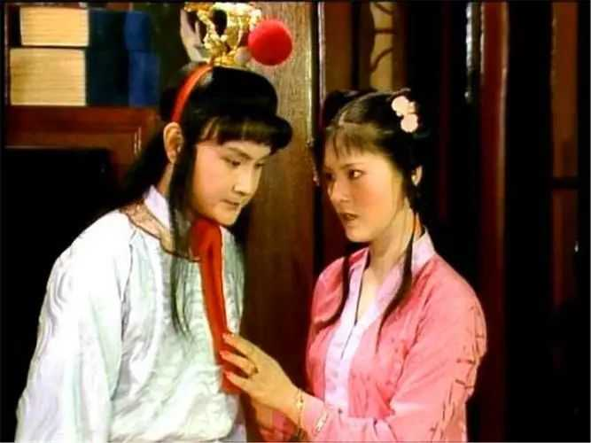
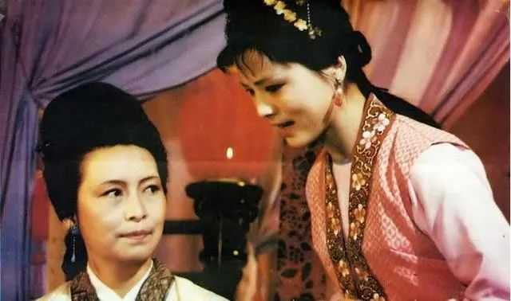

__很多答案只看到了袭人身体的创伤，没看到心理创伤其实更要命。__

话说袭人见了自己吐的鲜血在地，也就冷了半截，想着往日常听人说：“少年吐血，年月不保，纵然命长，终是废人了。”想起此言，不觉将素日想着后来争荣夸耀之心尽皆灰了，眼中不觉滴下泪来。

身体创伤让袭人预感自己不行了，奋斗也没意义了，这是浅层原因。

__深层原因在于宝玉那一脚，彻底踢碎了袭人的梦。__

袭人的梦想是成为宝玉姨娘，这对于小民出身的她而言已经是人生天花板了，也足够她回娘家时荣耀加身了，这就是她的争荣夸耀之心。

所以她才冒着被王夫人赶出家门的风险去和宝玉偷试，这让宝玉待她与别个不同，而她待宝玉也更尽心尽力。

她希望通过献出全部身心，来换取宝玉的些许情分，日后宝玉娶了妻，她就做个仅次于正妻的姨娘，只要宝玉的情分不断，她的日子就不会差。

alt="Image">

不管宝玉那一脚是有意还是无心，在袭人视角，就是宝玉当着所有人的面踢了她，宝玉能随便踢自己，又有什么情分可言？然而自己已经献出身体，没有退路了，顺利的话做个没有存在感的姨娘，不顺的话被王夫人发现，当成狐狸精赶出去，失去清白的她有什么好归宿呢？

宝玉那一脚等于告诉所有人：袭人不过是个无足轻重的丫头！这让已经居怡红院丫鬟之首的袭人情何以堪？她在怡红院的地位还保得住吗？

她那丫鬟之首的地位，本来就以宝玉待她与别个不同为基础，如今这个基础没了。

__袭人感到自己的人生陷入灰暗，她的心态从这里发生转折，以前是争荣夸耀，往后是只求自保。__

在此之前，她对自己是有信心的，所以敢装睡骗宝玉，敢谎称自己要回家逼宝玉改掉坏毛病，敢夜间和宝玉狎昵，根本不像丫鬟，倒像个小媳妇。

而这一切，怡红院的丫鬟也都看在眼里，她们该听谁的，该向谁学，都心照不宣，袭人已经成为怡红院的隐形女主人，来日加封姨娘指日可待。

alt="Image">

所以，即使她都预感自己被踢出绝症了，却不敢明着寻医问药，只敢让宝玉偷偷问太医，这可不是她低调会做人，而是替自己遮丑。

你这一闹不打紧，闹起多少人来，倒抱怨我轻狂。分明人不知道，倒闹得人知道了，你也不好，我也不好。

袭人不想让别人注意到自己被宝玉踢出了绝症，就是想装作那一脚踢得不重，自己与宝玉情分依旧，这样才不会没脸，才不会失去在丫鬟中的威信。

__但她自己很清楚，不论那一脚是轻是重，自己的身心都终究是错付了。__

从那以后，她再也不和宝玉亲近了，也没有小媳妇的娇羞俏皮样了，彻底变成一个贤良老实的本分丫鬟。

袭人被踢后不久就发生了金钏儿之死，这让她认识到自己偷试之事一定不能泄露半分。

偷试本就是高风险高收益的投机行为，收益是成为姨娘，风险是被王夫人发现，然后落得金钏儿和晴雯的下场，袭人从前只看到收益，如今看到的全是风险。

所以，她的工作重心也从伺候宝玉变成了投靠王夫人，因为她认识到宝玉是靠不住的，王夫人才能决定她的命运。

alt="Image">

但怡红院的丫鬟们都知道此事，怎么保密呢？很简单，把可能泄密的人全部清除掉。

麝月和碧痕都是偷试过的，很安全；

秋纹是否偷试过尚不清楚，但她显然也和袭人一样走王夫人路线，算是队友；

四儿和芳官是没和她一起干过“坏事”的，芳官脾气大不好管，是个隐患；

晴雯不仅没干过“坏事”，还公然说出自己偷试之事，这个人简直是个定时炸弹！

根据后文抄检大观园的情节来看，王夫人知晓怡红院丫鬟们的玩笑话，显然是袭人告的密。至于晴雯，原文没交待袭人是否告过密，但我推测袭人是说过晴雯坏话的，毕竟晴雯对袭人的威胁，远大于四儿和芳官。

__争荣夸耀之心死了，取而代之的是奋力求生之心。__

## 已写15万字红楼笔记，正在慢慢整理发出

## 挑几篇自认为还行的给大家看看：

[红楼梦中“衔玉而诞”是什么寓意？](https://www.zhihu.com/question/640812128/answer/3376621200)

[为什么王熙凤觉得贾瑞爱上她是一种污辱？](https://www.zhihu.com/question/378083967/answer/3355271097)

[曹雪芹写的和高鹗续写的《红楼梦》差距真的很大吗？](https://www.zhihu.com/question/21210923/answer/3328612443)
