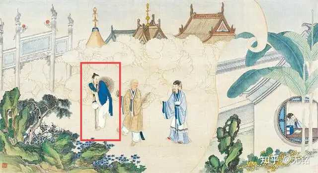
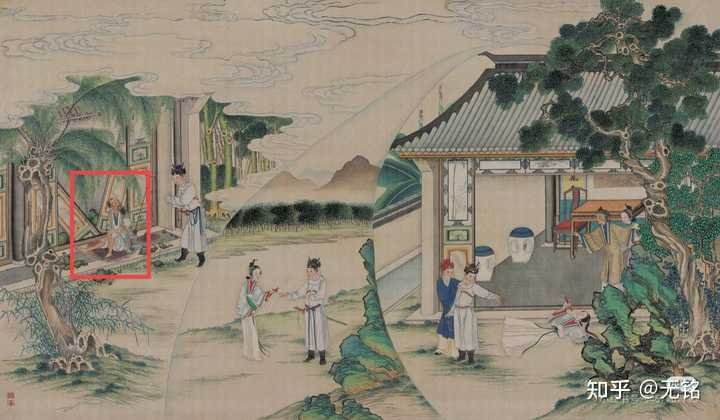

说说癸酉本红楼梦中有哪些让你觉得精彩甚至震撼的地方？

__平安州的故事线。__

红楼梦前八十回有一条与平安州有关的暗线，癸酉本将其发展成了一条更完整且宏大的剧情脉络：

第一回的姑苏，出现了“水旱不收”的情况，这种极端气候随着时间的推进在不断北上，到了后面，能明显看出来极端气候已经影响到了贾府所在的京城及周边地区。

五十三回：

乌进孝道：“__回爷的话，今年雪大，外头都是四五尺深的雪，前日忽然一暖一化，__路上竟难走的很，耽搁了几日。……__今年年成实在不好。从三月下雨起，接接连连直到八月，竟没有一连晴过五日。九月里一场碗大的雹子，方近一千三百里地，__连人带房并牲口粮食，打伤了上千上万的。”贾珍皱眉道：“我算定了你至少也有五千两银子来，这够作什么的！如今你们一共只剩了八九个庄子，__今年倒有两处报了旱涝，__你们又打擂台，真真是又教别过年了。”乌进孝道：“爷的这地方还算好呢！我__兄弟离我那里只一百多里，谁知竟大差了。__他现管着那府里八处庄地，比爷这边多着几倍，今年也只这些东西，__不过多二三千两银子，也是有饥荒打呢。__”

六十一回：

柳家的道：“就是这样尊贵。不知怎的，__今年这鸡蛋短的很，十个钱一个还找不出来。昨儿上头给亲戚家送粥米去，四五个买办出去，好容易才凑了二千个来。__……你们深宅大院，水来伸手，饭来张口，只知鸡蛋是平常对象，那里知道外头买卖的行市呢。__别说这个，有一年连草根子还没了的日子还有呢。__”

粮食产量降低引发了一系列连锁反应，鸡蛋就是其中一点。人都吃不饱，谁还会把粮食给鸡吃，来获取鸡的副产品？

七十五回：

鸳鸯道：“如今都是可着头做帽子了，要一点儿富余也不能的。”王夫人忙回道：“__这一二年旱涝不定，田上的米都不能按数交的。__这几样细米更艰难了，所以都可着吃的多少关去，生恐一时短了，买的不顺口。”
贾母又道：“……西瓜看着好，打开却也罢了。”贾珍笑道：“……__西瓜往年都还可以，不知今年怎么就不好了。”贾政道：“大约今年雨水太勤之故。__”

那说回正题：水旱不收和平安州有什么联系呢？

第一回提到了，水旱不收带来的后果之一就是“鼠盗蜂起，无非抢田夺地，鼠窃狗偷，民不安生”，这个情况，在第六十六回也出现在了平安州

薛蟠笑道：“天下竟有这样奇事。我同伙计贩了货物，自春天起身，往回里走，一路平安。谁知前日到了平安州界，遇一伙强盗，已将东西劫去。不想柳二弟从那边来了，方把贼人赶散，夺回货物，还救了我们的性命。”（六十六回）

贼寇已经发展到了敢抢皇商了，这剧情像不像水浒传？你说水旱不收的情况有没有影响到平安州呢？

第一回朝廷对姑苏地区农民起义蜂起的处理措施是“官兵剿捕”，同样，朝廷对平安州的动乱也立即采取了措施：

大家正说话，只见隆儿又来了，说：“__老爷有事，是件机密大事，要遣二爷往平安州去。不过三五日就起身，来回也得半月工夫。__今日不能来了。请老奶奶早和二姨定了那事，明日爷来，好作定夺。”（六十六回）
且说贾琏一日到了平安州，见了节度，完了公事。__因又嘱他十月前后务要还来一次，__贾琏领命。（六十六回）

如果把前面薛蟠被抢的事一联系，就根本不难猜出贾琏被派去处理的机密事是什么。

然而事情处理完了吗？没有！农民起义的根本原因就是粮食短缺，但粮食问题并没有随着时间流逝而有所改善。

而且，正所谓“一波未平一波又起”，__不仅平安州内部出现了问题，外部也变得不安定了。__注意平安州是一个边疆地区，这里有节度使，节度使还有巡边的任务。但是问题就出在“巡边”上。

话说贾琏起身去后，偏值平安节度巡边在外，约一个月方回。贾琏未得确信，只得住在下处等候。及至回来相见，将事办妥，回程已是将两个月的限了。（六十八回）

古代巡边有固定的时间，一般一季巡一次，或半年一次，原文里贾琏第一次去平安州时，节度使让他十月再来，说明十月不是朝廷规定的巡边日期，这个时候节度使理应是空闲的，结果贾琏第二次去平安州时，节度使却突然巡边去了，一巡就是一个月，而且原文说的是“未得确信”。说明这次巡边根本就不是皇帝的命令，而是边疆出了突发事件，且情况十分危急，瞬息万变。

按照前八十回灾害从南往北扩散的趋势，作为北部边境的平安州都受灾了，那更北部的游牧渔猎民族也一定会受到影响。问题来了，参照中国几千年的历史规律，如果北部戎羌异族受灾严重，粮食匮乏，他们通常会怎么办？

答案自然是：__南下劫掠__

结合书里的情况，节度使突然巡边就只有一个可能——北方戎羌开始活跃起来了。

红楼梦有个特点，有些角色说出去的话转身就打脸，在六十三回，贾宝玉还说戎羌是历代王朝的祸患，朝廷在盛世时武力充沛，使四海宾服，戎羌老老实实、拱手来降。贾宝玉说完这话过了短短三章平安州就乱了。__盛世如此，那在乱世戎羌还会是这个景象吗？__

历史上，当中原王朝自身因灾害等原因国力衰退、边防松弛时，__部分强悍的游牧部族甚至会抓住机会大举南下，建立政权。__

说回癸酉本上，__癸酉本抓住了这个关键但十分隐蔽的细节，把平安州的暗线给落实了__：

凤姐因贾琏到平安州应差未归，晚间叫了平儿来睡，先是商议些家事。（八十二回）
贾琏既忙着官里的事，时时到平安州办事，也未操心家里诸事。（八十四回）
贾政等皆被圣上召集前往海疆监督防御工事。__平安州亦有流贼造反，__节度使命贾琏前去应奉公事，一连数月未归。（八十六回）
凤姐又道：“__平安州怎么也反了，那些流寇还没有退去吗__?”贾琏道：“那有这么容易。__流寇来了一拨又一拨，节度使也换了几位爷了，可总是灭不尽杀不完的。明儿我还得去忙公事，__得几天不回来。”（八十七回）

癸酉本中，平安州和京城内流民造反的同时，北边异族戎羌也在南下劫掠。__前八十回的平安州出现内乱和外敌就是个征兆，当平安州不再平安时，不就是影射着这个社会和国家危在旦夕吗。__

而且通过癸酉本，我们才得知第二回提到贾琏身上捐的同知，原来是平安州同知。

赵堂官又道：“据都察院禀告：__平安州同知贾琏，__国孝家孝之中，背旨强逼良民退亲，强娶民女，……”

合情合理。

除此之外，前八十回还有一个细节：

前八十回里，柳湘莲曾在平安州与强盗交锋，救下了薛蟠，古代商人运输货物时一般都要雇佣几个镖局的保镖保护财物，更何况皇商。保镖的基本技能就是武力，这伙强盗却能把保镖击溃，由此可见这群贼寇的实力有多强。__结果柳湘莲突然出现，一个人就把这伙流贼赶走了，现实吗？__

__脂砚斋也说柳湘莲日后会做强梁，柳湘莲本身这个名字就有“与流寇相连”的含义。__原文写柳湘莲打贼寇，用的是“赶散”，而不是“杀散”、“打散”。这个“赶”字就很诡异。这帮人就像是在做戏一样，强盗们像走了个过场就把到手的财物让出去了。

而在癸酉本里，柳湘莲“出家”的地点竟然还是平安州。

宝玉道：“柳二哥的功夫人皆不敌，只是现今他在那里？多日不见，实在挂念。薛兄也把他带来我们续续旧情。”薛蟠笑道：“__他本来今儿要来的，只是道观里还有事，他又回平安州了，__明日便来喝喜酒，还要带几个朋友来。”（九十一回）

__现在，你可以猜猜在癸酉本中，平安州抢劫薛蟠的那帮贼寇是不是和柳湘莲一伙的？__

那前八十回里柳湘莲真的出家了吗？肯定没有，“度化”柳湘莲的那个道人叫跏腿道士，不是跛足道士。两字之差可见端倪，一些清朝读者也认为这个跏腿道士和跛足道人不是一个人。

alt="Image">孙温绘红楼梦图，渺渺真人化身的跛足道人形象是少了一条腿

alt="Image">跏腿道士形象是一条腿有伤，这并非跛足道人的形象

“跏”的意思是指__佛教中僧人盘腿而坐__的姿势。而且原文里柳湘莲“将万根烦恼丝一挥而尽”，__僧人出家才要剃头发__，柳湘莲跟的究竟是一个和尚还是道士？

__很明显这个道士是假道士，柳湘莲的出家也是假出家，柳湘莲所谓的剃度出家，就是剃发易服，代表他投降满清了。__

__所以癸酉本中，薛家、冷二郎、贾蓉贾蔷最终勾结到了一起。这代表了什么，不言而喻。__

癸酉本里，贾家的不肖子孙分成了两个帮派，除了贾蓉贾蔷为首的一帮外，还有一帮以贾环为首，这两派各自组织起来一股势力，毁灭了贾家。

贾环，贾蓉、贾蔷从此各自拉帮结伙，成日__不是欺负弱小，就是勒索子弟，__越发厉害了。__学堂里那些粗俗之徒都加到两派之中，时时寻衅吵闹，夸耀各人势力。__贾蓉因其父同自己妻子可卿有染，早生出怨恨，__不肯听从贾珍训教__，贾珍也觉十分尴尬，__渐渐冷落了他，父子形同陌路__。贾环见府中凤姐夫妇位显权重，自己竟有如同无，再兼品行难以服众，连父亲、亲戚皆不看重他，将来这家中还是贾琏夫妇、宝玉拔了头筹，不免心怀愤恨，__要拉帮结派，自增势力，故同那些不良子弟结为党派，__日子久了，益发学的流里流气，言语不恭不敬，德行恶劣起来，这也非一日酿成。

上面这段癸酉本文字其实就是前八十回脂批的改写：

蒙藏：此等人家岂必欺霸方始成名耶？总因子弟不肖，招接匪人，一朝生事则百计营求，父为子隐，群小迎合，虽暂时不罹祸，而从此放胆，必破家灭族不已，哀哉。

包括薛宝钗也在蓉蔷的队伍里面出了一份力，她充当了这个团队的智囊，给蓉蔷出谋划策，一招反间计把尚在挣扎的贾家直接拉向灭亡。

赵姨娘贾环一伍终不敌薛蟠蓉蔷柳湘莲的队伍，所以逃到了平安州。上面说了，平安州是柳湘莲一伙人的地盘，所以马道婆叛离了贾环赵姨娘后很快就找到了蓉蔷。赵姨娘贾环的队伍被柳湘莲和蓉蔷的队伍击溃。

在柳湘莲和蓉蔷的队伍里，有龄官芳官十二个戏子，她们十二个脱离了蓉蔷的队伍，再平安州野外遇见了赵姨娘，赵姨娘最终被她们打死。这一回的回目就叫“邢岫烟魂断大瘐岭，赵姨娘命丧__平安州__”。

蓉蔷（北方戎羌）、柳湘莲（冷二郎）、薛家（丰年好大雪）作为最后的赢家瓜分了贾家的宅邸。__好了歌解里，贾家最终是“落了片白茫茫大地真干净”，不就是被“雪”覆盖的意向吗。__

__只有通过癸酉本，才知道前八十回就伏笔的平安州就是这帮贼寇强梁“你方唱罢我登场”的“戏台”__。前八十回里，平安州内有农民起义，外有戎羌侵扰。癸酉本中，这两股势力又投射在了代表农民军的“贾环赵姨娘”和代表戎羌异族的“蓉蔷薛柳”身上。书里，“蓉蔷薛柳”在平安州将“贾环赵姨娘”剪除，入住贾府；同时，戎羌将农民起义军从皇宫中赶走，入主京城，建立政权。

既是伏笔，又是影射，这种双向的手法，正是批语说的红楼梦的章法：

__不出荣国大族，先写乡宦小家，从小至大，是此书章法。__
