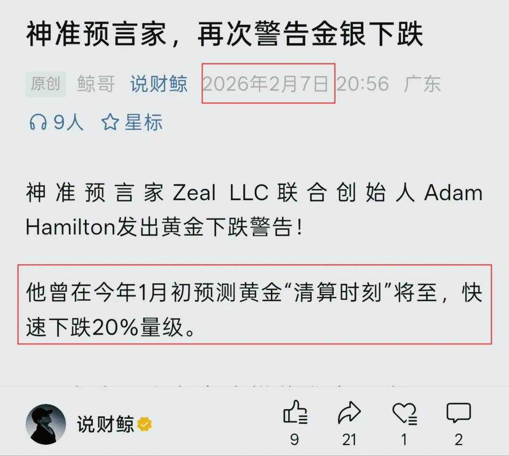
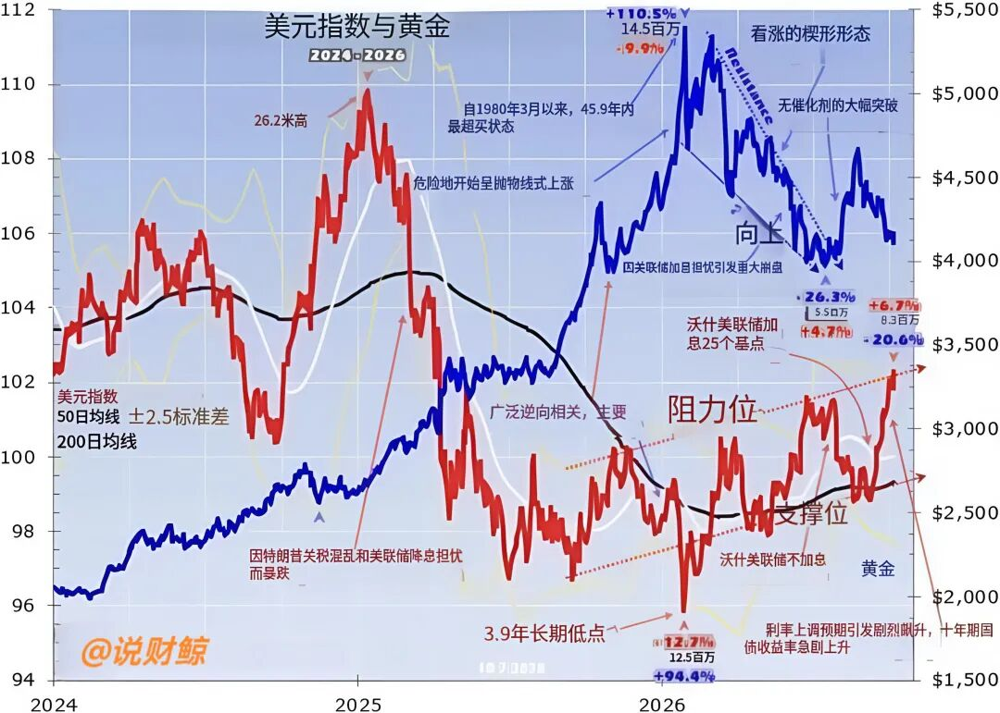

那个精准预言金价暴跌的人，再次发声！

公众号名称：说财鲸

作者名称：鲸哥

发布时间：2026\-10\-1113:16

黄金连跌六周，压住它的不是黄金本身，而是美元在抽血。

但是，__美元这只手，快没劲了，金价随时可能反转！__

这判断是Zeal LLC的联合创始人Adam Hamilton说的！

Adam Hamilton（亚当·汉密尔顿），2000年参与创办Zeal LLC，长期专注贵金属和矿业股逆向研究。

他曾在今年年初就精准预判了黄金将快速下跌至少20％的量级！

就在刚刚，亚当发布了题为《Dollar Hindering Gold》的分析报告，他给出的判断是：__美元对黄金的压制，已经持续太久，明显后劲不足，可能接近反转。__

先看时间线。

7月中，黄金跌到3973美元，结束了5个多月、高达26%的回撤。随后形成大型下降楔形，在8月初向上突破。

美国财政部意外扩大长期国债回购，金价加速。到8月底，从7月中旬的低点算起，不到六周暴涨超过17%，冲到4666美元。

但是在高点后三天，美元反击。美联储沃什在Jackson Hole发表鹰派抗通胀讲话。9月FOMC加息25个基点的概率从35%跳到57%。

随后就业、PPI、CPI数据强化鹰派，9月FOMC前概率到91%。美联储真的加息25个基点，为3\.1年来首次。

美元指数走强，本周三突破102，创18个月新高；10年期美债收益率5\.28%。黄金从高点回落12%，周三跌1\.4%至4107美元，进入技术性回调。

__那么真正的逻辑在哪里？__

黄金期货杠杆太高。

每张100盎司合约控制着大约41万美元的黄金，保证金只有2\.07万美元，最大杠杆20倍。意味着只要跌5%，期货就可能被清零。

所以投机者战战兢兢的盯着美元，美元一强，他们就砸黄金。六周里，美元指数涨3\.4%，黄金跌了12%。

__但是，美元对黄金的压制正在接近极限：__

第一，美元指数冲到过去一年上行趋势的上沿，这一区域已三次受阻，随后回落。

第二，加息预期和长债收益率上行的押注，已经一边倒，仓位太过集中了，这反而容易反转。

第三，黄金期货投机者多头合约降至29\.85万张，是8月初以来最低，只处在2023年10月到2026年1月那轮大牛市期间波动区间的24%位置，也就是说，从低点往上只走到四分之一，仓位很轻，多头的火力还可以很猛。

第四，美国投资者没跑。GLD、IAU、GLDM三大黄金ETF持仓连续13周增加，最近12周平均每周流入6吨，是2022年初以来并列最长的流入潮。

所以亚当的结论是：美元对黄金的阻碍，已经乏力了。__一旦美元滑落，黄金期货买盘和ETF买盘可能共振，黄金有望复制8月的飙升。__

当然，以上只是分析师的报告分享，不是投资建议，趋势仍需数据验证，市场风险大，请你务必自行谨慎判断。

那么，你觉得美元见顶了吗？黄金下一站是4100美元，还是4666？评论区说说你的看法，看谁的预判更准。

关注我，我是鲸哥，每天跟踪贵金属大趋势。

我们下期见。
